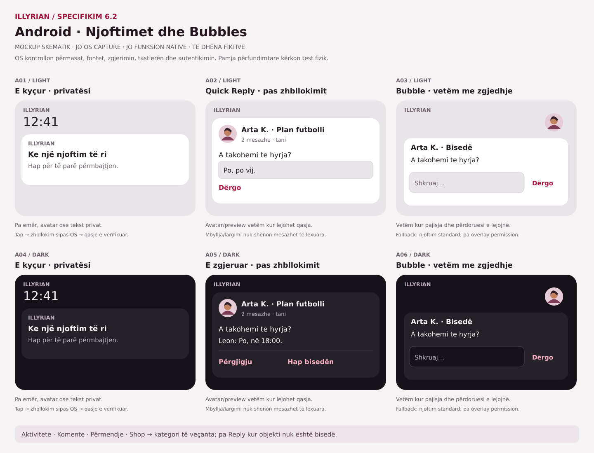
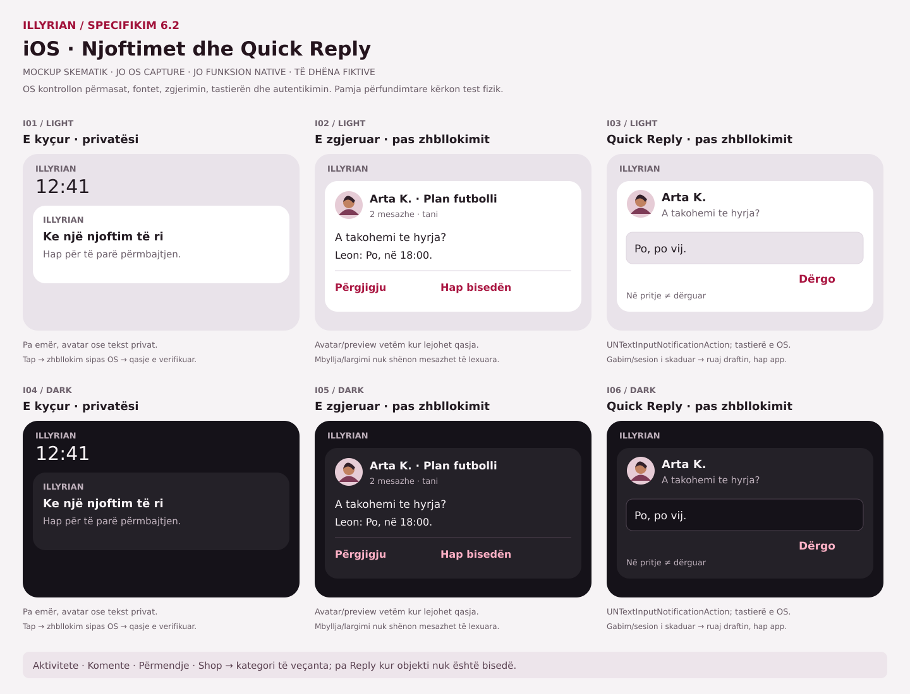

# ILLYRIAN — Product Architecture Blueprint v0.1 (decision draft)

**Profil i mbushur me fotografi — 31 tetor 2026 (kërkesë e pronarit):** kopertinë fotografike në perëndim dhe galeri me 6 shembuj/6 Highlights ilustrative kur mungon përmbajtja personale. Katër fotografi sintetike ImageGen, WebP lokale (~500KB gjithsej); pa rrjet të jashtëm. Shembujt janë projeksion vetëm për pamjen, nuk shkruhen në storage, nuk hyjnë te Saved/Liked/Feed dhe hapen me drawer-in ekzistues. Postimet/cover/Highlights personale kanë përparësi; koleksionet e fshira nuk rindizen nëse fusha ekziston bosh. Numri i postimeve numëron 6 shembujt kur galeria është bosh; ndjekësit mbeten 0, pa reach/verifikim të sajuar. Navbar ruhet. Testi i ri kontrollon fotot/hapjen/sq-en-it dhe storage të pandryshuar; CI/Preview verifikohen pas commit-it. Kjo zëvendëson placeholder-in SVG, jo kërkesat OPEN të crop/preview/Ruaj-Anulo ose fazave 2–5.

**Profili personal — kontrata aktive, 31 tetor 2026:** një render `.p17-profile`, CSS në `demo/ILLYRIAN_PROFILE_V17.css`; pa ndërhyrje te header/nav. Përdor `state.profile` brenda key ekzistues `illyrian_demo_v09_state`, plus bibliotekën ekzistuese `v15Stories/v15Reels`, `state.posts/bookmarks/likes/reelSaved/reelLikes` dhe viewer-at e postimeve/Reels. Emri/bio/handle/qyteti/interesat janë UGC, nuk përkthehen; ndërrimi i gjuhës ruan input-et e paruajtura/fokusin. Ndjekësit 0 pa backend; postimet/ndjekjet numërohen lokalisht. Galeria ruan deklarimin Sponsored kur përmbajtja e ka; pa badge real. Skedat lidhen me panelin ARIA, Arrow/Home/End dhe fokus të dukshëm; kontrollet kryesore synojnë 44px. Cover: JPG/PNG/WebP ≤6MB → JPEG1050×390 ≤260000chars, crop qendror automatik, ruajtje menjëherë me rollback; **nuk ka ende** preview/prerje/ripozicionim/Ruaj-Anulo. Avatar: pipeline ekzistues160×160, i ndarë nga identitetet e tjera. Highlights aktual: `p17Highlights`, deri6×4 snapshots240×360/45000chars, drawer i veçantë; renditje/kopertinë e zgjedhshme/reference-media/integim me viewer-in Stories janë OPEN. Mos fshi snapshots ose migro keys pa zgjidhje ruajtjeje të verifikuar. Saved/Liked vetëm në profilin personal; profili i miqve mbetet rruga ekzistuese më vete. Harta e pesë fazave/statuset te roadmap, provat te CURRENT_STATE. Këto janë kufij aktualë DEMO, jo arkitekturë/storage/security e miratuar për APK.

**Copy aktive e produktit,30 tetor2026:** një deklarim DEMO te Settings → About; pa etiketa DEMO në postime/foto/Stories/Reels/Shop/Plans/Connections/Notifications/onboarding, formularë ose toast-e. Template-t sq/en/it pastrohen përpara interpolimit; source katalogët historikë/keys ruhen për përkthimin e frazave të vjetra dhe nuk përdoret scrubber global i DOM-it. Copy statike e moduleve përditësohet; user content, emrat/store keys/IDs/stored statuses dhe draftet ruhen, edhe kur përmbajnë DEMO. Statuse historike të njohura marrin vetëm etiketë të pastër në UI, jo migrim. Badge social ⓘ është informacion me shpjegimin e mosverifikimit; nuk shndërrohet në verifikim real. Njoftimet e gabimeve/nuk u dërgua/ruajtjes vetëm në pajisje, pa pagesa/rimbursim real, mbeten të sakta. Vendimi ndryshon copy-n e DEMO-s, jo APK/backend/native ose gates e investitorëve.

**Specifikim aktiv Home header,30 tetor2026 (zëvendëson avatar-in e referencës29 tetor):** + dhe Kalendari majtas; ILLYRIAN në qendër reale; Mundësi dhe Njoftime djathtas; pa profil sipër, profili poshtë ruhet. + → compose ekzistues → input v5-file me capture=environment → pipeline ekzistues JPG/PNG/WebP,8MB,1240px/JPEG.75,limit720000chars → draft lokal → publikim vetëm me veprimin ekzistues të përdoruesit. Anulim/input bosh ruan draftin; heq capture nga input-i pas change/cancel që zgjedhja e zakonshme e fotove të ruhet. Pa getUserMedia/stream/mikrofon/GPS ose server-upload. Capture është hint jo garanci: [MDN](https://developer.mozilla.org/en-US/docs/Web/HTML/Reference/Attributes/capture), verifikuar30 tetor2026; kamera/zgjedhësi kontrollohen nga OS/browser, desktop zakonisht file picker. APK: kërkesa për kamerë direkte ruhet si PLANNED/native në fazën e autorizuar, me leje vetëm kur kërkohet, denial/cancel dhe lifecycle; jo implementim APK. Testet CI provojnë wiring me skedar sintetik, jo kamerën fizike. Ruaj layout320/mobile/desktop/landscape, sq/en/it,44px dhe funksionet e tjera.

Home reference — VERIFIED në kufijtë DEMO: `cfb0420`, Browser40971394865 real381 Chromium/16 WebKit/12 classifier PASS; Security40971394860 PASS. Screenshot-et exactSHA Light/Dark/mobile/desktop/landscape u inspektuan, artifact12940748245 (retention deri12 nëntor; arkiv afatgjatë OPEN). Preview exactSHA READY/target:null, jo test vizual direkt pas bllokimit automatik Vercel auth. Harta e miratuar vetëm Home:4 header actions,Stories/composer,3 filtra kryesorë+Latest dytësor,feed/foto fullwidth,5nav me etiketa; Shop entry dedikuar pa listime Home, panelet dytësore pas feed-it pa fshirje. Source/runtime/siguria DEMO nuk provojnë backend/native/APK; pranim vizual pronari dhe QA fizik/a11y/performance reale OPEN. Dokumentimi final nuk ndryshon runtime-in; reuse CI nuk është riekzekutim.

Home QA2/0466567:380 PASS/1 FAIL në40970014876; filtër/locale/Light-Dark tests PASS, Security SUCCESS. Testi i kontrastit Dark korrigjon sinkronizimin: pret background-color përfundimtar rgb(3,6,8) pas transition .15s, pastaj mat AA4.5; runtime/paleta të pandryshuara. Riekzekutimi mbetet për verifikim.

Home reference QA follow-up: ekzekutimi40968539317/0e913685376 PASS/5 FAIL; korrigjuar lidhja e etiketave me namespace kanonik `home:`, dy tekste italiane të vjetruara, dy locatorë qyteti të paqartë dhe pritshmëria e accent-it Dark. Pragu AA4.5 mbahet; etiketat sq/en/it testohen me tekste konkrete. Screenshot-et Light/Dark të CI janë prova browser, jo fizike/native; riekzekutimi mbetet për verifikim.

## Vendimi aktual — Plane & Aktivitete, 29 tetor2026

**Home reference implementation scope (owner29Oct2026):** uploaded reference supersedes PDF A.1 for Home only. One scoped `home-reference` visual layer; existing handlers/stores/domain codes retained. Header avatar routes to existing profile; grid icon retains Mundësi; composer photo, photo-based Reel and manual-city actions reuse existing flows. Three primary feed labels retain original domain values; chronological feed remains a secondary icon. Auxiliary Home tools move after posts rather than being deleted. Shop remains a compact dedicated entry, not Home product listings. No real verification, new media carousel/video/native backend from the picture. Other module design and investor/release authorization unchanged.

Pronari autorizoi një ndryshim të kufizuar: në Mundësi hiqet shortcut-i `Aktivitetet` (Aktivitetet e tua), ndërsa `Plane` riemërtohet **Plane & Aktivitete** (en:Plans & Activities;it:Piani & Attività). Shtatë hyrje; route/key `Plane` dhe Events ruhen. Të gjitha/Kërkesat e mia/Të pranuara mbeten të arritshme brenda modulit, me fokus te tab-i aktiv. Pa ndryshim të stores/IDs, kërkesave, pjesëmarrjes, historikut ose thirrjeve të tjera `v10-my-plans`. Ky vendim mbizotëron ndaj përshkrimeve historike me tetë hyrje; nuk miraton ridizajnimin global A.1, backend, main/Production/merge ose DEMO-n e avancuar për investitorët. Parent ac0224d; QA e prekur, CI dhe Preview verifikohen në dorëzim, jo PASS i supozuar ose fizik.

**Date:** 22 October 2026 | **Stage:** Phase 8 design, NOT product implementation | **Status:** Proposed for validation
**Source of truth for demo:** `demo/ILLYRIAN_DEMO_v1.7.html` and existing module sources; roadmap owns requirements. The original0.1 checkpoint was on `demo/v1.7-illyrian-shop`; current authorized branch/HEAD and LIVE evidence are in CURRENT_STATE. §§24–28 consolidate Programme6; the title/date above preserve the historical draft, not current native approval.
**Isolation:** This blueprint belongs exclusively to ILLYRIAN; do not use code, credentials, infrastructure, repositories or accounts from any other project.
**Proof boundary:** v1.7 is an interactive local-storage demonstration. It has no production identity, shared database, verified business, marketplace settlement, real moderation, or certified native app. Tests on the demo do not prove production security.

## 1. Product thesis and release principle

Albanian-speaking people and local sellers in Albania, Kosovo and diaspora use ILLYRIAN to connect through community posts and plans, discover relevant local goods, housing, vehicles and services, and transact only when trust and fulfillment have been validated. Retention depends on useful community content, reliable plans, and accurate listings, rather than feature count.

**Initial proof of value:** a member can sign up, discover useful local content and plans, communicate or request participation, and find trustworthy listings. Each action must be backed by real shared state and real server authorization, not browser localStorage.

**Commercial rule:** demo's illustrative 5% Shop commission is NOT an approved rate. No live collection, payments, subscriptions, escrow or payout until a separate regulatory/commercial decision. Vehicles, accommodation and services begin with inquiries only.

## 2. Actors and permission boundaries

- **Visitor:** read only intentionally public content and publicly available listings; cannot post, message, order or see private membership.
- **Member:** manage own account/profile/privacy, own content, follows, conversations and plan participation; create reports and block users.
- **Plan organizer:** edit only plans they own, manage requests/capacity, send permitted group messages; role cannot be obtained by client-side UI toggle.
- **Seller / business manager:** manage verified-owned shop and its listings; no access to another seller's inventory or inquiries.
- **Moderator:** review restricted queues with least privilege, record reasons, impose appealable actions; not a database superuser.
- **Admin / operations:** separately authenticated privileged operations with stronger protection and full audit trails.
- **System workers:** explicit service identities scoped only to media, notifications and event processing.

Account suspension, block relations, content privacy, plan membership, seller ownership and moderation are enforced on the SERVER for every request, including websocket/realtime subscriptions.

## 3. Domain and data contracts (logical, not deployed)

Canonical ownership/version and cross-module reference rules are consolidated in [§21](#21-product-simplification-and-authoritative-data--task-52). The short names below are domain summaries: plan=Activity, report=SafetyReport, moderation_case=ModerationCase; they do not define additional stores or competing APIs.

**Identity:** account(id, created_at, status), profile(account_id, name, locale, city_visibility), privacy_preference(account_id, rules), account_block(blocker_id, blocked_id), follow_request(from_id, to_id, status).
**Community:** post(id, author_id, visibility, status), media_asset(id, owner_id, storage_key, content_type, scan_status), comment(id, post_id, author_id, status), reaction(account_id, target_id, type), story(id, expires_at), reel(id, processing_status).
**Plans:** plan(id, owner_id, city, venue_visibility, starts_at, capacity, status), plan_request(plan_id, member_id, status), plan_attendance(plan_id, member_id, state), plan_group_message(plan_id, author_id, body).
**Messaging:** conversation(id, type), conversation_member(conversation_id, account_id, state), message(id, conversation_id, sender_id, body, delivery_state).
**Marketplace:** seller(id, verification_state), shop(id, seller_id, status), listing(id, shop_id, type, status, city), listing_media(listing_id, media_id), product_variant(id, listing_id, sku), inventory(variant_id, quantity_version), inquiry(id, listing_id, sender_id, status).
**Commerce — gated, not MVP settlement:** cart(id, owner_id), order(id, buyer_id, seller_id, payment_state, fulfillment_state), order_item(order_id, variant_id, unit_amount, currency), refund(id, order_id, status). These entities are DESIGN ONLY until payments/compliance are approved.
**Safety / governance:** report(id, reporter_id, target_type, target_id, reason, state), moderation_case(id, assigned_to, decision, appeal_state), moderation_audit(id, actor_id, action, target, timestamp), data_request(id, account_id, kind, state), extended by the canonical DataRequest/export/deletion lifecycle in§28.

Invariants: IDs are opaque; timestamp is server-generated; ownership never comes from a trusted client claim; all changes use transactional server checks. Plan joins never exceed capacity under concurrent requests. Inventory reservations cannot go below zero. A blocked/suspended identity cannot bypass access by deep link or direct API query. Every moderation action has a reason and immutable operational audit. Deletes use a documented lifecycle for user rights and legal retention where applicable.

## 4. Architecture alternatives and provisional direction

**Option A — web/PWA-first + server API:** fastest way to preserve interactions from the existing HTML demo, lowest initial client rewrite. Downsides: mobile video/notifications/platform integrations and high-end gestures may require compromises.
**Option B — Android-first React Native/Expo client + admin web:** better mobile installation, camera/video and native navigation, with iOS path later. Downsides: the 660 KB static HTML demo is a visual/behavioral reference, NOT native reusable UI; substantial screen reconstruction required.

**Recommendation pending explicit product sign-off:** pursue a small cross-platform native client for a validated Android-first pilot, retain web-based QA/admin and a public informational website. Do not confuse converting HTML to APK with creating a secure real product. The actual framework decision is **provisional**, subject to platform needs, maintenance budget and current SDK/app-store verification.

**Backend candidates:** managed relational platform with PostgreSQL/RLS and object storage versus a modular API service on PostgreSQL with dedicated authorization. Start with one coherent domain boundary, not microservices. Provider choice and deployment remain **OPEN**, and infrastructure must be exclusive to ILLYRIAN. Add asynchronous workers for media and notifications only once needed. Do not place privileged database keys or payment secrets in mobile clients.

## 5. API, privacy and trust controls

Privacy access/lifecycle consolidation, proposed rights/incident procedures and the non-effective public draft now have one index in [§31](#task-73); existing contracts/statuses below remain authoritative.

### Minimum threat model — current DEMO vs future real product (2026-10-25)

This table classifies requirements only; it does **not** claim deployed protection for server-side threats.

| Threat / trust boundary | CURRENT DEMO — verifiable scope | FUTURE REAL APP — prerequisite, NOT IMPLEMENTED |
| --- | --- | --- |
| Fake identity, cross-account access, seller/organizer role spoofing | Browser guest/session and role UI are simulated; localStorage gives **no** server authorization | Authenticated server session; per-resource membership and ownership checks; negative tests using two distinct accounts |
| User-authored content and stored data | Browser QA covers selected encoding and malformed localStorage failures; complete media/HTML injection audit not certified | Validated inputs/outputs and uploads, ownership, size/type limits, abuse reporting, moderation and audit trail |
| Sensitive location, private groups, messages | Illustrative controls with fictional data, not a privacy guarantee | Least-privilege access, location minimization, per-conversation membership, retention/export/deletion rights and applicable legal review |
| Stale updates, double booking and inventory | Browser localStorage sequential conflict tests only, **not atomic distributed transactions** | Server transactions, idempotency, capacity/inventory constraints and concurrency regression tests |
| Supply chain, signed packages, incident recovery | Static repo with PR browser workflow; no native release build or app signing | Pinned/reviewed dependencies, least-privilege CI, release signing, secrets isolation, backup/restore and incident runbooks |
| Commercial abuse / refunds / payments | Only fictional Shop UI. No legitimate checkout/settlement | Separate business/legal/owner decision, vetted payment provider, disputes/refunds, fraud controls; NOT NOW |

**Decision boundary:** the future technical stack, payments, legal obligations and release scope remain subject to owner approval. An external protocol cannot authorize them.

- API authentication/session issuance by a real identity service; short-lived credential rotation and revocation; server-side authorization by ownership and membership.
- Explicit privacy for public/private profiles, follow requests, group membership, plan venue visibility; no publishing precise member GPS coordinates.
- Signed, access-checked media upload; content-type and byte limits; malware/abuse screening where appropriate; deletion and media retention workflow.
- Rate limits, spam detection, reporting/appeals, block enforcement, seller verification and conflict-of-interest separation for moderators.
- Private messaging restricted to authorized conversation members; message delivery, reporting, blocking, deletion and abuse handling designed before activation.
- GDPR and local regulatory requirements for target markets require professional review; this file makes no claim of legal compliance.
- Logs redact secrets and sensitive content; privacy export/deletion has explicit service-level tests and response obligations to be defined.
- Operational observability: server request IDs, redacted structured logs, alerting, error budgets and incident/rollback procedures.

## 6. MVP sequencing, proof gates and out-of-scope

### Foundation gate crosswalk (design vs evidence — 2026-10-25)

These are **labels for the existing M0–M5 gates**, not permission to begin a native build. A browser DEMO can pass browser QA while all native/backend release gates remain open.

| Foundation gate | Existing ILLYRIAN gate | Current evidence and boundary |
| --- | --- | --- |
| G0 — product ready to build | M0 → approved M1 scope | **PARTIAL / DECISION REQUIRED**: product thesis and draft blueprint exist; target geography, MVP scope, platform/provider and user validation need owner decisions |
| G1 — real engineering baseline | M1–M2 | **NOT IMPLEMENTED for real app**: no native AAB/APK, real API/auth, backend tests, signing plan or real mobile security checks; static DEMO Chromium/WebKit CI does not count |
| G2 — safe integration/change | DEMO Phase 7 / F06 | **PARTIAL**: GitHub Actions PR checks pass; `demo/v1.7-illyrian-shop` has no required-check enforcement; F06 needs explicit owner authorization |
| G3 — physical-device release | M5 | **NOT TESTED / RELEASE HOLD**: M01–M18 on Android/iPhone, actual screenreaders, real-app performance/privacy/security/store checks and owner sign-off outstanding |

**Gate M0 — validate demand:** interviews/pilots with real buyers, local businesses and community hosts; collect evidence of repeat use, inventory supply and moderation workload. Confirm primary launch geography and data requirements. No live payment obligations.
**Gate M1 — product foundation:** approved PRD, threat model, accounts/profiles, access matrix, public content, reports/blocks, admin audit, privacy/deletion; integration tests prove that one user cannot read or mutate another user's private resources.
**Gate M2 — community loop:** plans/events, capacity transactions, membership messaging, notifications, real media processing and usable Android client. Verify two concurrent requests for last plan seat and blocked-user behavior.
**Gate M3 — marketplace discovery:** verified seller organization, products and catalog, real inquiry path for cars/housing/services, listing quality and reporting, search and moderation. No checkout or payouts yet. Measure active sellers, inquiry-to-response and successful user outcomes.
**Gate M4 — transactional commerce decision:** only after commercial validation and separate verification of payment provider availability, KYC/KYB, fulfillment, fees, taxation, cancellations, disputes, refund policy and liabilities. Use licensed providers; commission rate is an open business decision.
**Gate M5 — release readiness:** security testing, accessibility (real screen reader + keyboard), performance on target phones, backups/restore, incident playbook, privacy review, app-store release checks, observability, staged rollout and written sign-off.

Explicit **NOT NOW**: microservices, complicated recommendation AI, real estate/vehicle payments, self-built wallet/escrow, mass international launch, fine-grained individual location and public real-time identity tracking.

## 7. Migration from demo to real product

Treat current screen flows and 25 Playwright cases as acceptance references, not production code. Version visual tokens (crimson #E50C37, coral #F9644F, burgundy #2A0B18, midnight #0B050A), navigation semantics, empty/error states and user journeys. Replace localStorage fixtures with API-backed state per bounded module, preserving the same user-visible behavior and adding security/error states. Never mix demo identities with real accounts or migrate fictitious listings as genuine offers.

Recommended build order: authentication/privacy first -> content/media -> plans/requests -> messaging -> Shop discovery and seller identity -> moderation/support -> optional financial flows.

## 8. Measurable acceptance and open decisions

### Performance evidence and candidate budgets — no claimed pass (2026-10-25)

- **CURRENT DEMO:** QA Lab displays browser Navigation Timing as **INFO**, not a measured device performance budget; §23 adds a bounded reproducible browser comparison, not device certification. Automated tests cover screen reachability and some 200% CSS scaling; they do not certify battery, memory pressure, startup time on actual phones, or real network latency. Avoid changing code just to satisfy speculative benchmarks.
- **FUTURE REAL APP:** before implementing a native/client/backend performance gate, select and record **two benchmark devices, OS/browser/app build versions, network profile, content fixture, measurement tool, baseline and repetitions**. Measure cold/warm start, first useful screen, p95 tap feedback, scroll-jank rate, memory peak, MB per media session, battery/background cost, package size, crash-free sessions/ANR and API p95 after backend exists.
- **Candidate pilot targets — PROPOSED, NOT APPROVED, NOT TESTED:** useful first screen p75 ≤3 s on the selected midrange device/profile; tap-feedback p95 ≤100 ms; crash-free sessions ≥99.5% once meaningful sessions are available. These are initial hypotheses for measurement **only**; confirm feasibility, device conditions and targets with the owner before enforcing CI/release gates. Do not pretend p95 API, AAB size or network-use budgets exist before their baselines.
- **Change review:** whenever DEMO code adds large assets or expensive UI work, compare identical-browser/same-fixture baselines before/after and report relative change. A documentation change alone does not constitute a benchmark. Native release needs recorded physical measurements and an agreed fail threshold before M5 sign-off.

Success criteria for initial pilot: >90% completion of one meaningful first-session action among test participants; no unauthorized API read/write in security test suite; 100% seller ownership isolation in regression tests; no unhandled critical accessibility blocker in tested journeys; backups successfully restored in a non-production exercise. These are **proposed gates, not achieved metrics**.

**Decisions still requiring owner validation:** target launch geography and minimum viable feature mix; Android-first vs web-first; authentication methods; businesses' willingness to supply real inventory; messaging moderation policy; whether commercial payments are included in the first monetized release; operating and support budget. We can research options without committing vendors, spending money, merging to main or deploying a real backend.

## 9. Evidence and status

Demo Phase 7 automated functional evidence: GitHub Actions run #39833964922, 25/25 Playwright tests PASS, including 126/126 baseline and 147/147 advanced QA Lab assertions. This is NOT a production security or visual accessibility certificate.
Pending Phase 7: human visual sign-off (including screenshot comparison), real phone testing at the end of the demo build, real touch and screen reader tests, performance and release approval.
Phase 8 blueprint status: DESIGN DRAFT; no backend, production DB, real transaction, release or separate app repository was created as part of this design.

## 10. Consolidated architecture decisions — 23 October 2026 (approved direction; not implementation)
**Authority:** Owner accepted the compatible principles of `MASTER ARCHITECTURE UPGRADE`, `MASTER ARCHITECTURE ADDENDUM 02`, and reviewed the independent `ILLYRIAN_MASTER_ARCHITECTURE_REVIEW_AND_EXECUTION_PLAN` (Work report, snapshot 4a951e4). This section records AGREED PRINCIPLES, PROPOSALS, and OPEN DECISIONS separately. It does **not** automatically approve all features or revise prior production gates.

### ACCEPTED — design principles / future requirements
- One integrated ILLYRIAN ecosystem connecting profiles, posts, stories/reels, communities, plans, messaging, and IllyrianShop. Preserve v1.7 DEMO and the distinct project's history; never restart the product from scratch.
- Architecture internationalized from the beginning: canonical semantic UI keys, sq/en/it with technical English fallback, saved preference over device detection, locale-specific number/currency/date/plural formatting, and RTL-ready design without claiming RTL production support. User-generated posts, messages, listings and names are **not** auto-translated by the UI adapter. Support for 100+ future languages is an extension capability, not a deliverable today.
- A single user identity with **scoped** organizer, creator, seller, organization, moderator and admin capabilities. Server-side enforcement on each protected object/action, not client role toggles.
- Shared logical foundations across modules: stable opaque IDs and domain codes independent of language; privacy/permissions, settings, notifications, reporting/moderation, data lifecycle, safe deep links, telemetry/analytics event definitions, media/storage, cost/observability. Build only the minimal implementation each release actually needs.
- Analytics defines versioned event contracts and KPI denominators first; report aggregate profile visits/reach rather than exposing visitor identities. Personal, Creator, Business, and Organizer dashboards share metrics and data protections, but only relevant role views are enabled when the backing functionality exists. DEMO mock analytics must be clearly labeled.
- IllyrianShop stays **inside** ILLYRIAN, never an APK store. Unified `Seller/Organization → Shop → Listing` domain and catalog for Shop and Shop Plus as the real-product target; do not build two production inventories. Distinct workflows: physical product/cart/order; cars/property/classifieds/inquiry; service/rental/request/availability. A social post/reel can reference an authorized listing by ID without copying canonical product data; deleted/unavailable listing must not break the post.
- Separate payments and payouts from catalog/inquiry. The DEMO's illustrative 5% fee is **not** approved pricing. Live checkout, revenue claims, payouts, KYC/KYB, buyer protection, dispute/refund, regional provider support, compliance (GDPR/DSA/GPSR where applicable) each require explicit release gates. No self-operated handling of sensitive card data.
- Privacy/security-by-design, proportionate abuse/fraud controls and owner-scoped admin/moderation. Prefer understandable architecture, modular backend boundaries, relational data integrity, reversible migration, managed primitives as appropriate. Avoid speculative microservices, AI recommendation infrastructure, expensive cloud provisioning and parallel backend systems.
- Real product and DEMO have separate evidence gates: browser demo fixtures/localStorage are not real multi-user authorization. Preserve UX and verified journeys when migrating to real clients; HTML DOM cannot be assumed to transfer directly into React Native.
- Track every change with branch/PR, tests tied to exact SHA, architectural decision record and handoff. No merge to `main`, Production, irreversible migration, vendor subscription, public-release change or spending without express owner authorization.

### ACCEPTED — execution order
`P0-D`: repair proven Shop/i18n regressions, protect stable select values and user content, handle storage errors honestly, improve CI correctness (including PR trigger and canonical locales), define deploy candidate; do not remove existing functions.
`P1-D`: finish sq/en/it forms and critical dynamic states; Shop/Shop Plus demo consistency, Settings scope, only useful illustrative dashboards; regression, visual, accessibility, Android phone review and screenshots by owner, then demo release gate.
`P0-R/P1-R`: once validation and platform/geography choices are recorded, evaluate a mobile-first React Native/Expo+TypeScript client versus Web/PWA, Postgres-backed modular backend with scoped authorization, media, notifications, recovery and operations; deliver a limited real vertical slice, then pilot.
`P2/P3`: validated social-commerce expansion, transactional payments only after business/legal/provider gates, richer realtime/video/analytics, additional markets/languages and measured scaling.

### CONDITIONAL — do not implement as automatically approved
- Product differentiation: test an integrated community → content → seller discovery/inquiry loop as a potential early MVP slice, **not** a mandate to ship full Shop checkout. Whether Shop discovery belongs to P1-R or P2 depends on pilot evidence and operating cost.
- React Native/Expo and Postgres/Supabase are strong *candidates*, **not** signed-off stack, project provisioning or vendor spending. Benchmark Web/PWA vs mobile against actual audience, device capabilities, skill and cost.
- Four full dashboards, sophisticated AI ranking, unrestricted DM, video transcode, seller subscriptions and international commerce are not P0 requirements.
- First pilot geography (Albania/Kosovo vs accessible Italian-city Albanian community), audience, minimum feature triad, public visibility/resource classes, licenses, auth provider, financial model, operator budget and legal/regulatory sign-off remain DECISION REQUIRED.
- Original roadmap's Phase 7 DEMO and Phase 8 M0–M5 gates remain authoritative; P0/P1-D/P1-R/P2/P3 labels **map onto** them instead of replacing their history.

### CURRENT EVIDENCE (as of 23 October 2026; refresh at each PR)
- Branch `demo/v1.7-illyrian-shop` remained at `015ce439...` during audit; Draft PR #1 `feat/i18n-shop-feedback-20261022` HEAD `4a951e4...` (not merged).
- Historical Chromium run #39852708170: 53/53 PASS. New run #39857060705: **54 PASS, 2 FAIL** (Shop category select `<option>` translated text became form value in en/it, while domain expects stable original codes). Do not claim full i18n release or 56/56 until a new SHA passes.
- 296 i18n keys / locale across 15 namespaces on PR branch; full UI coverage unverified. Vercel historical READY is older than the PR; preview/candidate URL and root routing require verified release check. GitHub repository is currently PUBLIC.
- Next action: repair the two failing tests without masking them; enforce invariant that UI labels can change but persisted domain values cannot. Then continue safe i18n migration and phone QA.

### 10.1 First post-review verification — P0-D form contract
A targeted patch preserved the pre-existing Albanian domain values in Shop `<option value>` while allowing sq/en/it translated option labels; listing user-authored detail fields have explicit translation exclusions. GitHub Actions #39865986736 on exact code SHA `db574224d4849775224fb6ee4df0247aa2f18c46` reports **57 passed (2.0m)**. The two previous en/it failures are resolved *within the tested Chromium flows*, not a full localized-release or real-device certification. PR #1 remains draft. Pending gates: failed storage persist semantics, other forms' code/label separation, UGC inventory, canonical i18n keys, preview currency/access, visual/a11y/device verification.

## 12. DEMO → Android/iOS implementation map (2026-10-25; readiness design)
This extends the existing M0–M5 plan, not stack selection or authorization to build an APK. Conditional toolchain/setup/environment/signing/build/release instructions are consolidated in [§30](#task-72); native bindings/commands/execution remain OPEN until the selected project exists. Preserve ILLYRIAN identity, icon, all existing screen references and sq/en/it semantics. Android package/AAB and iOS signed app are separate release artifacts; HTML cannot be assumed reusable as native UI.

| Existing journeys | Preserve as acceptance reference | Real implementation required |
|---|---|---|
| Onboarding/Profile/Settings | Fields, consent choices, locale/theme, recovery/error states | Auth/recovery/revocation, account ownership, privacy/deletion; OS secure token storage |
| Feed/Communities/Search | Navigation, posts, filters, memberships and blocks | API pagination/search, server visibility/membership checks, canonical content IDs and moderation |
| Messages/Story replies | Draft, send/retry, quota/error and return paths | Conversation authorization, durable local outbox, client operation ID + server idempotency, delivery status and cross-device sync |
| Stories/Reels | Existing viewers/creator/links/gestures | Authorized uploads, media processing/CDN access, expiry/delete, playback lifecycle; photo demo is not real video |
| Plans/Events/Connections | Capacity/waitlist, drafts, interest→Plan and host context | One canonical Plan object, time-zone contract, transactional capacity, membership-scoped messaging |
| Shop/Shop Plus | Categories, listing forms/inquiry and seller views | Single Seller→Shop→Listing source, ownership, inventory/versioning; keep inquiries separate from gated financial flows |
| Privacy/Map | Coarse manual city, visibility preview, block/request states | Server enforcement, consent, venue audience and no public precise user tracking |
| Governance/Notifications | Reports/appeals/workflows, honest statuses | Restricted queues, audit/appeal lifecycle, operator response, consent-based push and redacted telemetry |

### Data and mobile acceptance prerequisites
Before client implementation, approve MVP and minimum OS/device matrix; preserve DEMO fixture keys as historical references, never import fictional users/listings as real data. Define API request/response/error schemas, ownership matrix, cursor pagination, operation IDs, version conflicts, UTC timestamps/display zones, media limits and deletion lifecycle. Test malformed JSON/types, historical snapshots, storage quota, interrupted write, offline retry, process restart and two-device concurrent operations. A successful local browser write is not server delivery. Unsent text must remain visible after failure; retry must not duplicate a confirmed operation.

Android: select min/target SDK against current Play requirements at submission; runtime permission denial must retain manual city/photo alternatives. Define lifecycle/back navigation, notification permission, app links, offline drafts, signing-key custody and upload signing, AAB/internal testing and staged rollback. iOS: select supported OS/devices and current Xcode/SDK at submission; define safe areas, keyboard, universal links, permission explanations, background limits, secure credentials, distribution signing and TestFlight. No SDK version, paid account or signing identity is approved by this document.

### Store-readiness evidence (official policies consulted 2026-10-25; recheck before submission)
- Google Play: accurate Data safety disclosures and public privacy policy for actual data/SDK behavior; apps offering account creation need in-app deletion and an external deletion-request web resource. Source: [User Data](https://support.google.com/googleplay/android-developer/answer/10144311?hl=en), [account deletion](https://support.google.com/googleplay/android-developer/answer/13327111?hl=en).
- Apple: account creation requires account-deletion initiation in-app; privacy policy in-app/store metadata; UGC needs filtering, reporting, blocking and published contact. Sources: [App Review Guidelines 1.2/5.1](https://developer.apple.com/app-store/review/guidelines/), [account deletion](https://developer.apple.com/help/app-review/guideline-reference/5-1-1-account-deletion/).
- For both: implement operator-backed moderation and privacy lifecycle, correct age/content ratings, rights to assets, working support/privacy URLs, review access and release-device tests. Classify digital purchases versus physical goods/services before selecting billing; real payment flows remain separately gated. Check current testing, SDK, billing and regional requirements at release rather than freezing changing rules in this blueprint.

Acceptance artifacts: approved MVP/exclusions; screen→API mapping above expanded for the chosen slice; executable API/schema contracts; threat/permission matrix linked from `docs/security/`; device acceptance evidence using existing M01–M18 plus lifecycle/network/security cases. Measure performance on selected devices before adopting numeric budgets. Auth/API/DB and restore gates must pass before real private data; M5 requires current security baseline, physical accessibility, privacy/operational review and explicit owner signoff. These are requirements, not achieved results.

## 13. Social, community and activity API contracts — Phase 3 design

**BACKEND / design only, 25 October 2026.** Extends §3/§5/§10/§12; no database, API, migration, provider or native build is created. Implement only after the existing real-app gates and owner decisions. DEMO IDs remain stable.

### Canonical records and compatibility

| Record | Minimum future contract / invariant |
|---|---|
| Account/Profile | Opaque server-generated account ID; locale; account status; profile visibility; manual home/origin city references separate from presence/GPS. Roles are scoped grants, never a client toggle. |
| Community | ID, name, category code, public/private visibility, membership policy, moderation state. Education category covers school/university/students/alumni context, with no public minor directory; real age/consent/contact safeguards require a separate policy before real users. |
| Membership | Unique `(community_id, account_id)`; pending/accepted/declined/withdrawn/blocked; server checks private access on every read/write/subscription. Leaving removes future private access; retention/history needs an approved policy. |
| Post/Comment | Post author, optional community ID and authorized activity/listing references; comment parent post ID (optional parent comment ID with cycle/depth limits); content status active/hidden/removed; visibility cannot exceed its parent community. Report/hide reuse canonical content IDs. |
| Activity | Opaque ID, organizer account, optional community ID, city ID, venue visibility, local start date/time, IANA zone, resolved UTC start/end, version, capacity and draft/published/cancelled/completed state. Public venue is distinct from personal GPS. |
| Participation | Unique activity/account pair, pending/accepted/declined/waitlist/withdrawn; attendance stored per activity/account, not a globally reused participant ID. Acceptance reserves capacity transactionally; waitlist promotion is not automatic acceptance. |
| Invitation | ID, activity, inviter, invitee, pending/accepted/declined/revoked/expired, expires_at UTC; inviter capability, recipient preference, blocks and expiry checked on server. Invitation acceptance does not bypass capacity or organizer approval. |
| Interest | Account, topic code, manual city ID, availability interval/zone, expires_at UTC, withdrawn_at; expired interests do not count toward matching or create activities/invitations. DEMO counters remain fictional. |
| Notification/Outbox | Event ID/version, recipient account, type, referenced object, created_at, read_at, delivery attempts; transactional outbox and unique `(event_id, recipient_id, channel)` prevent duplicate effects. No private body/precise location in lock-screen pushes. |

Legacy mapping must be explicit and non-destructive: `(source_store, object_type, legacy_id) → canonical_id`. Never assume core Events `e1/e2/e3` and Plans `demo-football/p…`, community `c…`, Privacy group IDs or Shop IDs share an identity. Keep original status/domain values alongside mapped codes and migration version; unknown values remain preserved, not silently converted to pending/accepted. Synthetic fixtures are not migrated as real users/content. The DEMO's optional post `communityId` is an additive reference; existing posts without it remain valid.

### Proposed versioned API surface and negative tests

All routes below are **proposed contracts**, not reachable services. Reads use bounded cursor pagination; lists/search filter authorization before results/counts. Mutations validate input limits, server session, ownership, membership, blocks/suspension and object version. Return a stable error code, request ID and field errors without secret/private payloads. Domain errors include UNAUTHENTICATED, FORBIDDEN/NOT_FOUND according to privacy policy, VALIDATION_ERROR, CONFLICT, CAPACITY_FULL, EXPIRED, CANCELLED and RATE_LIMITED; never return success before durable commit.

- `GET /v1/communities`, `/communities/{id}/posts`, `/posts/{id}/comments`; `POST /communities/{id}/posts`, `/posts/{id}/comments`, `/reports`; membership decisions restricted to authorized community staff. Outsiders and blocked accounts must fail direct-object reads/writes, including search/deep links/realtime.
- `POST /v1/activities`, `PATCH /activities/{id}` with expected version; participation request/withdrawal, invitation response and organizer decision endpoints derive actor from session. Test two concurrent last-seat accepts; exactly one capacity allocation succeeds. Retried idempotent requests reuse their original result without replaying notifications.
- `GET /v1/activities?city_id=…` works with manual city and no geolocation permission. Optional nearby request supplies a coarse location only after explicit user action; precision/radius bounds, purpose and lifetime are enforced. No automatic public coordinates or movement history; revoke stops collection and clears transient coordinates. Feed, Shop, Messages and Plans remain usable without GPS.
- `GET /v1/notifications`, mark-read and authorized conversation/group-message endpoints check recipient/membership per object and subscription. Cancellation/acceptance/decline messages are generated from committed events through outbox, not client toast state. Push permission denial leaves in-app state usable.

Idempotency keys are scoped by authenticated actor + operation + payload digest, with approved retention; a reused key for a different payload conflicts. Rate/size limits and spam/report controls apply proportionately. Moderation decisions require capability, reason, immutable operational audit and appeal path. Client role switches, local messages and local reports prove none of these server controls.

### Time, recurrence and location acceptance

- Keep local date/time + IANA zone + UTC instant; changing display language or viewer timezone never changes the event instant. Do not interpret city activities with `Date.parse(localDateTime)` in the viewer's timezone. IANA rules/zone database and the submitted offset/version must be recorded by the real service.
- DST gaps and duplicated wall times need explicit resolution. The bounded DEMO rejects both rather than guessing; the real API must reject invalid times or require an explicit approved disambiguation/offset. Invalid historical records remain untouched and must not appear as actionable upcoming events.
- Recurrence is a separate future contract: series ID, zone, local start, recurrence rule, until/count, per-occurrence ID and exceptions. Generate bounded occurrences in the series zone across DST; one cancellation must not cancel all instances unless explicitly requested. Organizer edits, attendee lists and notifications use occurrence IDs/versioned semantics. **DEMO “Organizo sërish” only copies a draft with date/place/capacity requiring confirmation; no scheduler, auto-invite or recurring subscription exists.**
- Test viewer zones Europe/Rome, America/New_York and Asia/Tokyo; spring gap, autumn duplicate, midnight/date boundary, invalid leap/calendar date, expiry at exact instant, cancellation/waitlist, retry and concurrent changes. Device clock is untrusted for real enforcement; server time decides deadlines.
- Manual cities in Feed, Shop, Plans and Connections are presently separate scoped filters; do not silently overwrite one from another or publish them to profiles. A future shared preference is a product decision with versioned compatibility, not a destructive DEMO merge.

Implementation reference for explicit timezone formatting: [Intl.DateTimeFormat](https://developer.mozilla.org/en-US/docs/Web/JavaScript/Reference/Global_Objects/Intl/DateTimeFormat/DateTimeFormat). This specification does not certify GDPR/store compliance, mobile hardware performance or real authorization. Those remain separate release gates.

## 14. Knowledge preservation and DEMO/APK boundary — 26 October 2026

**Owner policy; documentation only.** ILLYRIAN DEMO is a prototype for the owner's private testing of design, navigation and functions. The GitHub repository is currently PUBLIC; “private prototype” does not mean confidential source or secure storage. Keep fictional data and no secrets. [AGENTS policy](../AGENTS.md#demo-vs-apk--permanent-owner-policy) governs subsequent agents until an explicit phase change.

### Information map established before simplification

| Information | Canonical destination / original evidence |
|---|---|
| Active state, blockers, next action | [CURRENT_STATE](../CURRENT_STATE.md); superseded text preserved at the immutable source in the [archive index](../docs/archive/continuity/README.md#consolidation-2026-10-26) |
| Owner decisions, permissions, stable keys and continuity | [MASTER_HANDOFF](../MASTER_HANDOFF.md); original text at the same archive source |
| Functional journeys and migration | This blueprint §7/§12 and the source-to-journey map below; runtime code remains the behavioral reference |
| Data/API/roles/privacy and acceptance | This blueprint §2–6/§8/§10/§12–13; [security architecture](../docs/security/SECURITY_ARCHITECTURE.md), [test matrix](../docs/security/SECURITY_TEST_MATRIX.md) and [device matrix](../docs/DEMO_V1_7_DEVICE_QA_ACCEPTANCE.md) remain authoritative in their scopes |
| Priority / sequence | [Existing roadmap](../demo/ILLYRIAN_v1.7_SHOP_AND_ROADMAP.md), Phase 7/8 and M0–M5; no new roadmap |
| Verified tests / findings / historical authorizations | Existing Phase 1/3 reports, SECURITY_REGISTER, Git commits/Actions and archive; no history deleted |

### Existing screen/action references for future specification

All runtime rows are **DEMO**, with bounded **VERIFIED** browser scenarios, not implemented server capabilities. Paths below are relative to this file. Preserve existing buttons/fields through these sources; expand a screen→action→API/error/permission acceptance matrix for the approved real slice before implementing it. This is traceability, not a claim that every button already has a complete signed-off APK specification.

| Screens / actions to preserve | Existing source / verification | Future status and existing contract |
|---|---|---|
| Home/Feed: Stories → existing composer → Shop → Feed; text/media creation and social actions | [Core HTML](../demo/ILLYRIAN_DEMO_v1.7.html), [flow QA](../qa/illyrian-v17-flows.spec.cjs) | BACKEND: content/visibility/media, §3/§5/§12 |
| Header: Calendar→Events; Opportunities: Businesses/Jobs→Explore, Marketplace/Services→Shop, Interest→intent, Activities→v10-my-plans, Plans→Events, Communities→Explore | Core HTML handler `data-ily-op-category`, [header QA](../qa/illyrian-v17.spec.cjs); eight entries | DEMO decisions preserved; BACKEND per referenced object, no parallel module |
| Onboarding/Profile/Settings: guest demo, profile fields, locale/theme, scoped reset | Core HTML, [i18n QA](../qa/illyrian-v17-i18n.spec.cjs) | BACKEND: identity/recovery/privacy/deletion, §2/§5/§12 |
| Stories/Reels/Messages: viewers, replies, send/draft/retry and return paths | Core HTML, [focus QA](../qa/illyrian-v17-focus.spec.cjs), i18n QA | BACKEND: authorized conversations/outbox/media lifecycle, §12 |
| Communities/Search: posts/comments/member links, School & University c4 and Plan drafts | Core HTML, [Phase 3 evidence](../docs/PHASE3_INTEGRATION_QA.md) | BACKEND: membership/visibility/post/communityId, §13; no separate Forum |
| Events/Plans/Connections: request/accept/withdraw/waitlist/chat, manual cities, expiring interest, repeat-as-draft | [Plans](../demo/ILLYRIAN_PLANS_v1.7.js), [Connections](../demo/ILLYRIAN_CONNECTIONS_v1.7.js), [time helper](../demo/ILLYRIAN_ACTIVITY_TIME_v1.7.js), i18n QA | BACKEND: canonical Activity/Participation/Invitation/Outbox and recurrence, §13; GPS optional |
| Shop/Shop Plus: category-specific listing forms, filters, cart/inquiry, needs and seller workflows | [Shop](../demo/ILLYRIAN_SHOP_v1.7.js), [Shop Plus](../demo/ILLYRIAN_SHOP_PLUS_v1.7.js), i18n/flow QA | BACKEND: canonical Seller→Shop→Listing, §3/§10/§12; payments PLANNED and separately gated |
| Privacy/Map/Governance/Notifications: visibility/block/report/appeal and local status | [Privacy](../demo/ILLYRIAN_PRIVACY_MAP_v1.7.js), [Governance](../demo/ILLYRIAN_GOVERNANCE_v1.7.js), core HTML | BACKEND: authorization/moderation/privacy lifecycle, §2/§5/§13 |

MVP/exclusions, platform/provider, complete field/API schemas, operational ownership and device acceptance remain open decisions/design work. Do not invent them, migrate fixtures into real accounts, or describe PLANNED/BACKEND as real implementation. Existing UGC, IDs, domain codes and storage shapes stay unchanged. Advanced native security, server transactions, load/restore/store requirements are documented now and implemented only in their approved phase.

## 15. Marketplace programme — phase 1 Shop (26 October 2026)

**Phase 1 scope at delivery (current phase 2 authorization is in §16):** that owner request superseded the previous CI-only scope. Five phases are preserved as canonical requirements with original-source Git references in the [existing roadmap](../demo/ILLYRIAN_v1.7_SHOP_AND_ROADMAP.md#marketplace-programme--owner-request-26-october-2026). Implement phase 1 only and stop before phase 2. This programme's numbering is independent of historical QA phases. Apply §14/AGENTS automatically. All changes are static DEMO unless explicitly BACKEND/PLANNED below.

### Phase 1 design and bounded execution plan

Keep the existing HTML/vanilla JS modules and independent storage keys. A destructive storage merge is ruled out by the owner's request; a third marketplace would duplicate existing features. Extend the two existing views with consistent category labels/search and reuse one presentation helper for business information. No new dependency, provider, GPS collection or backend.

- [x] Add focused browser regressions for discovery/profile/manual city, category filters, property/job save, unknown salary, literal historical data and separate storage. Verify the failure before implementation.
- [x] Extend `demo/ILLYRIAN_SHOP_v1.7.js`: business directory/profile, accent-insensitive multilingual category/name/product/city/description search, additive property/jobs fixtures and categories, optional job salary; preserve cart/inquiry/edit/delete/rollback.
- [x] Extend `demo/ILLYRIAN_SHOP_PLUS_v1.7.js`: reuse business profile presentation with its own catalog, add property/jobs categories, conditional filters, property fields and optional job salary. Preserve comparison/stock/Kërkoj/reporting/orders and category draft/locale behaviour.
- [x] Localize additions in mirrored sq/en/it catalogs, add only scoped CSS. Run relevant old/new regressions, syntax/secret/vendor checks, then full remote Chromium/WebKit and Security. Inspect Preview metadata and canonical continuity.

**List/Map assessment:** ship useful lists and manual city filtering now. No map mock, mandatory GPS, public precise address or geolocation calls. A real optional Map remains DECISION REQUIRED (provider/cost, location publication/consent, service-area-only sellers, clustered results and accessibility). List remains fully usable if permission is denied or coordinates are absent.

**Prior art, consulted 26 October 2026:** [Shopify filtering](https://shopify.dev/docs/storefronts/themes/navigation-search/filtering/storefront-filtering) supports product/vendor/availability facets; [Google business representation](https://support.google.com/business/answer/3038177?hl=en) distinguishes a visitable business address from a service area. These inform the proposed UI/optional-location separation, not proof of ILLYRIAN market demand. Existing strategic review O3/O5/O7 informs need discovery, availability honesty and multilingual search; no pilot/monetization assumptions become approved facts.

### Single real catalog — BACKEND specification, not deployed

Extend §3/§10 rather than building another domain. `Seller/Organization → Shop → Listing` is the only authoritative real catalog. Shop/Shop Plus become discovery/advanced/management views over the same records, search index and order IDs, never two production inventories. Product identity/variant is distinct from a seller's offer: compare only canonical `product_id`/variant/condition/unit, never a loose title match. No global comparison of the two DEMO catalogs is introduced.

| Record | Minimum logical fields / invariant |
|---|---|
| Seller/Organization | id, owner_account_id, display_name, business_state, status; existing identity/verification boundaries §2/§5; phase 4 designs verification, no verified claim now |
| Shop | id, seller_id, name, category_codes, city_id, description, contact_policy, service_area, nullable public_location, hours + IANA zone/exceptions, status, version |
| Listing | id, shop_id, category_code, title, description, amount_minor nullable, currency, price_basis, availability_state, declared_at, expires_at, version, status; salary absent is not free work |
| Category attributes | product: variant/SKU, unit, inventory quantity/version; vehicle: year/mileage/fuel; property: sale, area/rooms; rental: area/rooms/period; service: scope/area/request; job: employer/title/city, terms, nullable salary, closing date, inquiry only |
| BuyerNeed / Inquiry | id, author_id, category/city, title/details, optional budget, expires_at, state/version; inquiry references authoritative listing_id/shop_id and permitted conversation; contact is not order/payment/work completed |
| Legacy mapping | (source_store, object_type, legacy_id) → canonical_id + migration_version; retain originals. Same name or same `h1` in separate stores never establishes identity. Fictional fixtures never become real offers/accounts |

Stable category codes proposed for the real API: `product`, `vehicle`, `property_sale`, `rental`, `service`, `job`; display labels sq/en/it never become IDs. DEMO codes stay `Produkte`, `Makina`, `Prona`, `Banesa me qira`, `Shërbime`, `Punë`; existing rental records keep their old code. Additive fields/validation only; no raw rewrite on load or migration of local orders. Real offer/inventory/order records are linked by ID; views do not copy them.

### Screens, actions, states, permissions and acceptance — BACKEND / Android+iOS

| Screen / action | Contract and state | Access / acceptance |
|---|---|---|
| Discovery → search/category/city/sort → results or empty/error/retry | `GET /v1/listings?q=&category=&city_id=&shop_id=&availability=&cursor=` and `GET /v1/shops?q=&city_id=`; bounded facets/pagination, locale-independent IDs, stable results, no paid boost presented as organic | Public results include published/visible records only; manual city without GPS, literal UGC, locale/empty/offline/keyboard/screenreader on Android/iOS; unknown facets rejected |
| Business directory → profile → offers / contact | `GET /v1/shops/{id}`; public hours, optional location/service area, offers and seller-declared availability. Unknown/stale hours or stock explicitly unknown; hours are not guaranteed availability | Read only intentionally public fields; no owner's private account/contact data; contact policy/blocks checked. Time-zone/exception hours tests; missing location never blocks catalog |
| Listing detail → product cart or classified/service/job inquiry | `GET /v1/listings/{id}`, `POST /v1/inquiries` with idempotency key and authoritative IDs; draft→sent→answered→closed/withdrawn/expired; missing/deleted/unavailable produces clear state, preserves social link in future phase 2 | Server validates actor, target state, ownership, blocks/contact permissions and expiry. Never reservation/paid checkout for jobs/property; no CV upload/recruitment subsystem in this scope |
| Publish/edit/withdraw listing | `POST /v1/shops/{id}/listings`, `PATCH /v1/listings/{id}` with expected version; draft→published→paused/expired/withdrawn/removed; unavailable distinct from deleted; server timestamp/version | Owner/authorized seller scoped to that shop; reject cross-shop IDs, client role claims and wrong-category fields. Preserve draft on network/validation/version error; duplicate retry creates once |
| Kërkoj → need → permitted seller reply | `POST /v1/buyer-needs`, `POST /v1/buyer-needs/{id}/replies`; open→answered/closed/expired/withdrawn; server verifies expiry and access | Need owner edits/withdraws own need; authorized seller reply only; spam/contact restrictions enforced later with real service. Android/iOS expiry, retry and own-data access tests |
| Existing demo cart/order/return/promotion | DEMO only; real order/payment/refund and promotion surfaces retain §3/§5/§10/M4 gates | 5% illustrative, not approved. Inquiry ≠ order; simulated return ≠ refund; promoted ≠ verified. No real subscription, payment, advertising or pricing decision |

Real test matrix must cover two-account/shop isolation, denied/absent GPS, optional precise-location visibility, correct category fields, nullable salaries, stale stock/version conflicts, repeated inquiry/create idempotency, deleted/expired targets, private seller fields, malicious UGC, offline retry and Android/iOS screenreader/text scaling. Implement these only for an authorized real slice; current DEMO browser checks do not certify backend/native operation. Provider, actual taxonomy depth, real map, hiring-market policy, MVP breadth and commerce pricing remain DECISION REQUIRED.

### Phases 2–5 — planned at the phase 1 checkpoint

The complete requirements (including all prohibitions and common verification/documentation rules) remain in the roadmap matrix above; original wording is recoverable at its cited Git commit. Phase 2: tagged businesses/products/services in posts/photos, Reel/Story references and transparent promotions; authoritative IDs/ownership/privacy/consent/moderation and unavailable targets; no real ad spend. Phase 3: personal-account staff roles/invites/revocation, shared business inbox, assignments/dedup/notifications, optional public staff identity with internal actor audit; reuse existing admin. Phase 4: declared/verified identity independent of paid Pro; documented real verification, expiry/revocation/appeal and anti-impersonation; Pro pricing/legal/monetization proposals only. Phase 5: unified reports/review/decision/notice/appeal across all named targets/modules, block/mute/privacy/contact/spam/vulnerable-user/age policies; no wealth/spending score; audit/evidence/response deadlines, integration with task 6B support (resolve actual existing surface before any implementation). All are deferred; no phase 2–5 functionality is added during phase 1.

**Phase 1 delivery status:** DEMO implementation and bounded browser verification completed at `01e12709bae867d254f34be3d364c11fcaed74b3` (310 Chromium +16 Linux WebKit +12 classifier; Security PASS). Real catalog/API/permissions/Android+iOS rows above remain BACKEND specifications, not implemented services. List/Map and other listed decisions remain open; phases 2–5 were PLANNED/not started at that phase 1 checkpoint, with later authorizations and deliveries recorded below. Exact current evidence and Preview belong in CURRENT_STATE.

## 16. Marketplace programme — phase 2 social commerce (26 October 2026)

Phase 2 scope at delivery (subsequent phase 3 authorization is in §17): phase 1 was delivered; phase 2 stopped before phase 3 at that checkpoint. Full requirements and original-source Git references remain in the roadmap; apply AGENTS DEMO→APK without expanding into real advertising, payments, subscriptions, verification, staff/inbox or moderation implementation.

**Design/plan:** add a bounded `ILLYRIAN_COMMERCE_v1.7.js` presentation/reference helper; it owns no inventory/order store. Small adapters in existing Shop/Shop Plus resolve/open their own targets. Core post/photo and local Story/Reel editors retain at most one business and one listing reference plus an explicit sponsored-DEMO flag in existing content records. Reuse existing activity linking. Missing/deleted/expired/out-of-stock targets render a clear disabled state, are rechecked on navigation/publication, and never open a similarly named listing from another source. Preserve caption/media/select drafts, quota rollback/Retry, locale, keyboard focus, scroll and return to source content. No URL-based tag navigation, GPS or new dependency.

- [x] Tests first: post/photo tags and source-specific business/listing navigation in sq/en/it; organic vs sponsored Feed/Profile; Story/Reel product and existing activity link, return/reply draft; missing/expired/no-stock/malformed references; quota/retry and deletion during edit; labelled Search placement.
- [x] Implement scoped adapters/helper/core hooks and mirrored locale additions; preserve all old data/IDs/functions without catalog migration.
- [x] Run changed and existing Shop/creator/focus regressions (51 local PASS, including 12 new), syntax/security/vendor/mirror checks, independent diff review; full remote 322 Chromium +16 Linux WebKit +12 classifier and Security PASS on `60bf624b2e8d9b4bdc21f8afe6712cba0897232f`, source-matched Preview READY. Exact links are in CURRENT_STATE. Phase 2 delivered within DEMO scope; stopped before phase 3. Real contracts/permissions below remain BACKEND specifications, physical acceptance OPEN.

### Placement and transparency decisions

| Surface | Safe DEMO mechanism | Real-app design, not enabled |
|---|---|---|
| Feed | Owner-created tagged post/photo; explicit “Sponsored · DEMO” plus paid≠verified disclosure | Sponsored insertion with advertiser identity/label, eligibility, targeting consent, placement limits/frequency, organic ranking separation and reporting |
| Search | One clearly labelled contextual example referencing existing Shop Plus promoted offer, only in Businesses search and matching query | Relevant paid slot separate from organic results; no misleading empty-search replacement; paid rank disclosure |
| Shop | Reuse existing promoted-DEMO listing chips/stock and catalog; no extra paid catalog | Same canonical listing and ad eligibility, no copied products/orders |
| Profiles | Existing own-post list renders the same tag/disclosure; no second promotional profile inventory | Business-owned eligible content/campaigns with same visibility/consent checks |
| Social photos/Story/Reel | Explicit caption-adjacent link, not inferred face/object recognition; product/service references; existing activity references retained | Optional positioned photo tags with accessible equivalent, canonical reference; invalid/deleted target never breaks media/story |

No cash ad auctions, payment activation, ad accounts, pricing, tracking pixels, subscriptions or arbitrary trust scores. A sponsorship flag is a simulated content label, not approval, identity verification or product-quality guarantee. Existing trust badges are a separate phase 4 review; sponsorship never sets them.

### Canonical real references / APIs / permissions — BACKEND, not deployed

`ContentReference(id, content_type, content_id, target_type, target_id, target_version, creator_id, approval_state, visibility, status, created_at)` links authoritative Shop/Listing/Activity IDs. No snapshot becomes a second product. `Promotion(id, advertiser_shop_id, content_id/listing_id, placement, disclosure, eligibility_state, schedule, status, audit_actor)` is separate from business verification/subscription. Monetary/billing/provider fields remain conditional on separate approval. Proposed states: reference draft→pending-consent→approved/rejected→revoked; promotion draft→pending-review→approved→active/paused→ended/removed; target published/unavailable/expired/withdrawn/deleted remains authoritative and independently checked.

| Screen / action | Proposed contract | Required permission / test |
|---|---|---|
| Compose/photo → select business/product/service → preview/publish | Existing content API with bounded target references; resolve through `GET /v1/reference-targets` and authoritative `POST /v1/content/{id}/references`, version/idempotency key | Content author only; check target visibility/existence, shop ownership or permitted mention, business consent where required, block/suspension and moderation both on publish and read. No client-owned role claims |
| Tap tag → profile/listing/activity → back | `GET /v1/references/{id}/target` checks access and current availability; opaque safe IDs, allowlisted in-app routes | Denied/deleted/private/expired target yields bounded state with no private title/price leak or fallback to unrelated ID; preserve source media position/reply draft/focus on Android/iOS |
| Story/Reel product/activity link | Same canonical reference contract and content visibility/lifecycle; references cannot extend Story expiry | Private activity/membership/consent checked before disclosure and navigation. Keep existing Activity IDs separate from legacy demo event IDs |
| Sponsored placement/notice/report | Policy-governed campaign eligibility/review, always rendered server-authoritative disclosure; shared report/support path in phase 5/6B | Paying cannot grant verification, bypass safety review, privacy or organic limits; report/appeal/revocation audit, no public verification documents |

**Android/iOS/backend acceptance before real delivery:** two-account/shop ownership isolation, forged/cross-source IDs, private/blocked/revoked consent, concurrent delete/stock/expiry between preview and publish/click, idempotent retry, unsafe deep links, literal UGC, offline retry, accessibility labels/focus/text scaling, returning to Story/Reel playback and preserving unsent replies, disclosure across every placement and organic-content exclusion. DEMO references use `{source:shop|shopPlus,type:listing|business,id}`; business IDs are the existing exact local store names, **DEMO-only**, not authoritative legal identity. Real migration requires §15's explicit source mapping; no name-based inference or fixture migration to real businesses.

## 17. Marketplace programme — phase 3 business team and shared inbox (26 October 2026)

Phase 3 scope at delivery (subsequent phase 4 authorization is in §18): the owner continued after phase 2 and phase 3 stopped before phase 4 at that checkpoint. Canonical requirements and original-source Git references remain in the existing roadmap. Apply AGENTS automatically: practical UI in DEMO; real identity/authorization/concurrency in BACKEND specifications. No phase 4 verification/Pro or phase 5 moderation implementation.

**Design choice:** extend Governance → Work panels → Business, the existing administration surface, with a source-qualified shop selector and fictional personal-account selector. Shop/Plus business profiles link to that same panel and restore their underlying view on close. A separate admin app would duplicate Governance; modifying the personal Messages store would risk unrelated private content, so neither is used. Optional `businessTeams` lives in the existing governance store; no new catalog/order/private-DM store or password sharing. Local team fixtures are explicitly fictional and never imply real ownership. Role restrictions apply to this demonstration panel only, not authorization of the rest of the DEMO.

**Bounded execution plan (vanilla JS/CSS, current locked Playwright, no dependencies):**
- [x] Add 13 browser cases in `qa/illyrian-v17-i18n.spec.cjs` first: existing Shop/Plus → shared panel → back in sq/en/it; pending invite/self acceptance/role/revocation; assignment and shop sender with internal actor audit; public profile opt-in separation; quota/Retry exactly once; observed stale-tab rejection; malformed stored data/literal UGC; locale/draft/focus. Confirm expected RED before code.
- [x] Extend `demo/ILLYRIAN_GOVERNANCE_v1.7.js` state/persistence, existing business work panel and handlers; integrate source-qualified links/public staff presentation into existing Shop/Plus business profiles; small nested-dialog guards and existing Governance CSS. Add mirrored sq/en/it `businessTeam` semantic strings. No real messages, invitations or notifications leave the device.
- [x] New/affected tests PASS (61 impacted, then 24 final Business/Governance including 13 new); syntax/vendor/mirrors/basic security and independent review complete. Runtime `455f923c9c49ec00e2c22b84c02657ac8cd7e7ac`: 335 Chromium +16 Linux WebKit +12 classifier, Security PASS; same-SHA isolated Preview READY/assets matched. Exact links in CURRENT_STATE. Phase 3 delivered within DEMO scope; stopped before phase 4. Real/native contracts and physical acceptance below remain BACKEND/OPEN.

### Screen/action/permission map

| Screen / action | DEMO | Real APK / backend contract, not implemented |
|---|---|---|
| Business team: invite existing personal identity, accept, change role, revoke | Fixed fictional IDs, owner-only staff management; invited person accepts as self; no email/password/account creation; owner cannot remove self | `ShopMembership(id,shop_id,user_id,role,status,public_opt_in,version,created_by,revoked_at)`; unique shop+user; `ShopInvitation(id,shop_id,invitee_id,role,status,expires_at,inviter_id)` with pending→accepted/declined/expired/revoked. `POST /shops/{id}/invitations`, `POST /invitations/{id}/accept`, `PATCH/DELETE /shops/{id}/members/{id}`. Authenticated subject + shop capability checked on every operation, invitations single-use, no self promotion/last-owner loss. Ownership transfer and recovery require a later explicit product decision |
| Role/capability preview | owner/admin: products, prices, orders, messages; catalog: products/prices; support: order read/messages; viewer: catalog read. Staff/sensitive management owner only; internal audit owner/admin. Existing catalog/order actions stay in their established modules | Server policy for `catalog.read/write`, `prices.write`, `orders.read/manage`, `messages.read/reply/assign`, `members.manage`, `audit.read`, sensitive data separate. Role names are a proposed starting matrix, granular delegated staffing/sensitive permissions require approval; UI hiding never authorizes API access |
| Shared inbox, assignment, reply | Fictional customer threads per source+business; claim/assign to active messaging member; reply only when assigned to self; answered state blocks repeat send. Pending count is local UI feedback, not delivered notification | `BusinessConversation(id,shop_id,customer_id,status,assignee_membership_id,version,last_message_at)` and `BusinessMessage(id,conversation_id,sender_type,sender_shop_id,internal_actor_id,body,client_message_id,created_at)`; open→assigned→awaiting_customer→closed/reopened. Existing canonical conversation infrastructure, with business principal, not parallel DM architecture. `GET /shops/{id}/conversations`, `PATCH /conversations/{id}/assignment`, `POST /conversations/{id}/messages` check member+customer scope; expected version/transaction and unique client_message_id prevent duplicate replies; lost claim returns 409 without losing draft |
| Customer-facing sender vs internal history | Customer preview shows shop name; actor recorded separately in local admin history and visible only to owner/admin in this panel | Customer projection omits internal actor identity, membership/admin metadata; shop name authoritative. Append-only authorized audit `AuditEvent(id,shop_id,actor_id,action,target_id,before_version,after_version,at,request_id)` for replies, assignments, staff/role/privacy changes. Retention/legal access and incident ownership must be decided before real data |
| Personal public-staff preference | Active member changes own opt-in only; business profile exposes only opted-in active fictional display names/role; never inbox/audit/invitation details | `PATCH /shops/{id}/members/me/public-profile`; public projection only consented profile fields with independent profile privacy/blocking. Opt-out/revocation clears caches/indexes, never erases owner/legal audit identity |
| Notifications and immediate revoke | Local pending count; revoked session loses panel access on next action/storage event, stale snapshot rejects writes; no atomic/security guarantee | Notification/outbox event with recipient membership/version, unread/read/dismissed, dedup and preferences. Revoke transaction invalidates membership/session subscriptions, push/websocket access and assignment eligibility immediately; all API/media reads and writes reauthorize current membership, no cached role authority or post-revocation queued reply |

**State/storage boundaries:** legacy governance cases/appeals/audits/drafts and both catalogs retain old IDs/keys. New content is bounded/escaped and normalized in memory without rewriting raw data on load. Failed storage writes roll back and preserve form/focus for Retry; observed sequential stale writes fail closed, not true CAS. LocalStorage and role switching are editable simulations, not security or private communication. No staff catalogue edits, real orders, push services, invitation delivery, tracking, authentication service or paid resource is built.

**Android/iOS/backend acceptance:** two real personal accounts and two shops; owner/admin/catalog/support/viewer denial matrix; forged IDs/role escalation/cross-shop inbox/audit/private-DM isolation; invite replay/expiry/decline/revoke/last-owner checks; assignment races, idempotent double-send, revoke between draft/claim/send/offline-retry; notification recipient/duplicate/read consistency; public opt-out/profile privacy/cache invalidation without hiding audit actor; unsafe UGC, accessibility, text scaling, nested focus/back and draft retention; server transaction/audit failure must not send or show success. Physical devices, real privacy/security, provider, retention, transfer/recovery and operational/legal policies remain OPEN/DECISION REQUIRED. Phases 4–5 remain PLANNED.

## 18. Marketplace programme — phase 4 identity, verification and Business Pro (27 October 2026)

Phase 4 scope at delivery: owner continued after phase 3 and stopped before phase 5 at that checkpoint; subsequent phase 5 authorization is in §19. Phase 4 requirements and original-source Git references are preserved in the existing roadmap. Apply AGENTS automatically. This slice improves truthful DEMO presentation and specifies the real service; no real identity check, document upload, approval engine, subscription activation, payments, prices or changed commercial decisions.

**Design / decisions:** keep existing decorative `verified` fixture flags and raw data, but label every rendered core post/profile marker visibly DEMO, with a keyboard/touch disclosure explaining it is not identity verification. Business profiles remain declared/unverified DEMO, with a link to the existing Governance trust guide. Extend that guide with ordinary profile / declared business / verified business reference examples, the last always explicitly labelled an illustrative DEMO example, never assigned to a shop. Do not simulate KYB approval, upload identity documents or create verification/subscription localStorage. Business Pro remains documentation only. Reuse current modules and Governance rather than another trust/admin panel.

**Bounded execution plan (inline; existing authorized feature workspace):**
- [x] Seven browser cases in `qa/illyrian-v17-i18n.spec.cjs`: visible badge meaning/disclosure and ordinary/profile vs declared/verified-example guide in sq/en/it; Shop/Plus guide return, keyboard and live locale/focus; persisted flags/UGC remain literal and unchanged; no review form, Pro purchase or storage mutation. Observe expected RED.
- [x] Add one escaped badge template helper/two replacements in core HTML, a declared-status/help entry in shared Shop business-profile presentation, read-only guide/disclosure handlers in existing Governance, scoped CSS and mirrored sq/en/it identity keys. Keep media/commerce/staff/moderation logic and stores unchanged; recover only this new guide opener after parent locale repaint.
- [x] Focused regressions 68/68 PASS (7 new); syntax/vendor/mirrors/basic security and independent review complete. Runtime `dbac966784f429f43369196412e8f8194b0b3cf6`: full 342 Chromium +16 Linux WebKit +12 classifier, Security PASS; same-source isolated Preview READY/assets matched. Minimal runner-only official Ubuntu mirror repair resolved the pre-test WebKit install timeout; protections/inventory/check names unchanged. Exact evidence in CURRENT_STATE. Phase 4 delivered within DEMO scope; STOPPED before phase 5. Real/native/Pro contracts and physical acceptance below remain BACKEND/OPEN. No duplicated continuity/design documents.

### Real identity and verification — BACKEND specification, not deployed

| Screen / action | Canonical data / proposed API | Permission / states / acceptance |
|---|---|---|
| Personal profile → declare/register business | Reuse Account→Seller/Organization→Shop from §15; `BusinessRegistration(id,shop_id,legal_name,trading_name,country,registry_id,contact,owner_account_id,status,version)`. `POST /shops`, `PATCH /shops/{id}/registration` with explicit public-field projection and idempotency key | Authenticated owner, not a shared account; declared is self-reported, not verified; registration alone grants no trust badge or Pro entitlement. Preserve one canonical business/listing source, original language and safe identifiers |
| Request identity/ownership review | `VerificationRequest(id,shop_id,applicant_id,scope,policy_version,status,evidence_refs,submitted_at,reviewer_id,decision_reason,version)`, restricted `VerificationEvidence(id,request_id,kind,provider_ref,retention_until,access_log_ref)`; `POST /shops/{id}/verification-requests`, `GET /.../{id}` | Owner or explicitly delegated verification capability; draft→submitted→in_review→needs_information→approved/rejected/cancelled. Verify current ownership and business existence against appropriate authoritative registry/contact proof, proportionate to risk and jurisdiction; prohibit applicant self-approval and paid-priority bypass. No real ID/document collection in this DEMO |
| Review / ask for correction / decide | Existing Governance/support integration; capability-scoped evidence access and `POST /verification-requests/{id}/decisions` with expected version and idempotency key; atomic decision/audit/notification event | Authorized reviewer, conflict-of-interest control and reason required. Anti-forgery: registry/source checks, provider validation where justified, duplicate/impersonation risk review, safe file handling/quarantine before viewing, non-public evidence URLs, no sole reliance on OCR or a payment receipt. Legal basis/retention/provider/operational owner remain decisions before real collection |
| Public badge → meaning/current validity | `BusinessVerification(id,shop_id,scope,status,verified_at,next_review_at,expires_at,policy_version,decision_id,revoked_at)` and `GET /shops/{id}/identity-status` return server-derived identity projection, not applicant booleans, documents or reviewer notes | Separate profile ordinary / business declared / identity+ownership checked. Badge means only checked identity/ownership scope on the stated date; never product quality, transaction honesty, stock, solvency, platform endorsement or absolute safety. Accessible text alongside symbol, date/scope, paid status separate |
| Recheck / expire / suspend / revoke / appeal | approved/active→review_due→expired/suspended/revoked; renewed only after new authorized evidence/decision. `POST /.../rechecks`, `POST /.../revocations`, `POST /.../appeals` (pending→in_review→upheld/overturned) reuse case/audit/notification contracts | Periodic recheck is due at policy-derived `next_review_at`; the server expires a badge at `expires_at` even if a recheck job is delayed. Cadence remains a risk/policy decision. Server time and current owner/version determine badge on every surface/read; ownership/legal-name changes trigger reassessment, expired/revoked badge removed from caches/search/social references; no stale offline green badge. Notify reason/correction path and appeal, protect evidence from public disclosure; reviewer separation where feasible |

Basic verification eligibility/outcome is independent of Pro and promotions. Payment never causes approval or safety exemptions. A manual-review fee is **not approved**: recommendation is to defer it until actual costs/accessibility are measured; if later proposed, disclose its purpose, amount/tax/cancellation/refund terms and that it buys review effort rather than a positive outcome, with an alternative/access policy reviewed separately. No final fee, expiry interval, service promise or pricing is chosen here.

### Business Pro — PLANNED proposal only

Optional business productivity subscription, distinct from identity checks and separately reviewed promotion campaigns. Proposed value: aggregate shop analytics (defined reach/view windows and denominators, not visitor identity), staff workflow/assignment tools, advanced catalog/management tools and clearly disclosed promotional tooling. Existing Shop/Plus/phase 3 features stay available in the DEMO; this proposal does not approve retroactive paywalls or removal of any function. Pro badge/plan label, if approved later, must be visually/textually distinct from identity verification. A Pro subscriber may be unverified; a verified business may use a free plan; neither grants moderation/privacy exceptions or organic rank by default.

`BusinessSubscription(id,shop_id,provider,external_subscription_id,plan_version,status,current_period_end,cancel_at_period_end,version)` and separate `BusinessEntitlement(shop_id,capability,source,valid_until)`; proposed subscription states none/pending/active/grace/paused/cancelled/expired/refunded. Server validates provider receipts/signed events, replay/idempotency/order, renewal/cancellation/refund/reconciliation and tenant membership. `GET /shops/{id}/subscription`, future authorized checkout/restore/cancel endpoints, with server-calculated entitlements. These operations cannot update BusinessVerification or policy decisions; downgrade/expiry preserves user-owned catalog/messages and disables only approved future paid tools. Cross-platform restore/account ownership and entitlement revocation must be defined before implementation. No payment/subscription UI, SDK, service, trial or entitlement flag is implemented now.

**Commercial/UX decisions still required:** first market and B2B/B2C contract classification, MVP benefits/free boundaries, measurable merchant demand, billing distribution/provider, tax/invoice/currency/refund/cancellation policy and operating support cost. Measure activation, repeat tool use/time saved, retention/churn and cost per active business before setting prices. Proposed unit margin = net recurring revenue less applicable store/payment charges, taxes and variable analytics/storage/support costs; break-even depends on observed costs/retention, not invented conversion/revenue figures. Keep promotion/ad budgets separate. Upgrade UX must show actual features, total cost/period, renewal, consent, terms, cancellation/withdrawal and restore, with no preselected paid extras or misleading verification promise. Pricing/activation require owner approval later.

**Conditional legal/platform considerations (official sources checked 27 October 2026, not legal clearance):** GDPR data minimisation/purpose/access/retention apply to real identity processing; establish basis, notices, evidence retention/deletion, processors and safeguards before collection ([Commission GDPR principles](https://commission.europa.eu/law/law-topic/data-protection/information-business-and-organisations/principles-gdpr_en)). Marketplace trader-traceability and public contact duties depend on service/jurisdiction/size and applicable exceptions; assess separately from any optional marketing badge ([Commission DSA overview](https://digital-strategy.ec.europa.eu/en/policies/digital-services-act)). Business buyers and consumers have different contract treatment; consumer-facing recurring services need applicable precontract/withdrawal/cancellation disclosures and national implementation review, including current amendments ([Commission Consumer Rights Directive](https://commission.europa.eu/law/law-topic/consumer-protection-law/consumer-contract-law/consumer-rights-directive_en)). Digital Pro features/in-app boosts and physical marketplace goods are different billing categories: recheck storefront/program exceptions and ongoing-value/terms/restore requirements before selecting payment paths ([Google Play Payments](https://support.google.com/googleplay/android-developer/answer/9858738?hl=en), [Apple App Review §3.1](https://developer.apple.com/app-store/review/guidelines/)). No legal or store-policy compliance PASS is claimed; no rates or provider are adopted.

**Real Android/iOS/backend acceptance:** two shops/accounts forged/cross-tenant requests, applicant/reviewer separation and revoked membership; tampered/duplicate evidence and non-public files; authoritative identity/contact consistency; concurrent changes, decision/audit failure and idempotent retries; server-time expiry/recheck/revoke across Feed/Search/Shop/profile/offline caches; scope/disclaimer and accessible badge meaning; rejected request→correction/appeal without buying approval; all combinations of verified/unverified × free/Pro/past_due/cancelled; forged/replayed/out-of-order provider events, restore/downgrade/refund and data preservation; totals/renewal/cancel/withdrawal/no hidden paid extras; privacy/retention/deletion and no analytics visitor identity. Actual provider, legal review, reviewer operations, pricing and physical/device evidence remain OPEN/DECISION REQUIRED. Phase 5 moderation unification is not implemented in this phase.

## 19. Marketplace programme — phase 5 trust, safety and unified moderation (27 October 2026)

Owner explicitly continues after delivered phase 4. Canonical requirements and original-source Git references remain in the existing roadmap. Apply AGENTS automatically; this is a bounded DEMO slice, not a new service, trust score, second administration panel or permission to release. Existing phases 1–4, stores, IDs, fixtures and APK decisions remain intact.

**Design / approaches:** keep Governance as the single demonstration review/decision/appeal surface. Read existing Social report IDs and Shop Plus flags without copying or rewriting their source stores; persist only local decisions/appeals in the existing Governance key. New context report buttons reuse that panel for profiles, comment threads, communities, activities and Shop listings. Shop Plus's established form remains and its status is projected from the same Governance decision. Rejected alternatives: merging stores (destructive, competing writers) or another support module (duplicate administration). A distinct Task 6B deliverable was not found in current tracked source beyond the owner's reference; map integration to the actual Governance support surface now, retain 6B linkage as an unresolved historical reference, never invent its completion.

**Bounded execution plan (inline, vanilla JS/CSS, locked Playwright; no dependencies):**
- [x] Add 15 browser regressions first in existing i18n QA: source-qualified report contexts and unchanged underlying drafts/focus; stable imported Social/Shop Plus identity, old raw preservation, one decision/status projection and local notification; appeal/accepted sample updates and duplicate/pending guards; failed decision/report writes retain exact forms, language and retry once; local mute separate from block and honest quota rollback; adversarial text/unknown historical codes remain literal. Observe expected RED before implementation.
- [x] Extend Governance read projections/context forms/derived notifications and existing lifecycle; bounded new Shop Plus flag IDs preserve old flags, shared decision status replaces hardcoded pending; small context links in existing core/Shop/Plans, relevant nested keyboard guards, localized local mute and safety explanation. Existing moderation never deletes or hides source content as a consequence of a simulated decision. No upload, auth, notification delivery, age gate, automated moderation or backend.
- [x] Affected local regressions 100/100 and final Safety/Governance 27/27 PASS (15 new cases); static/basic security checks and independent review complete. Runtime `88de889ae952e4a32b024453dd6edb3f75f26a30`: full 357 Chromium +16 Linux WebKit +12 classifier, Security PASS; same-source isolated Preview READY/assets matched. Exact source/logs/links in CURRENT_STATE. Phase 5 delivered within DEMO bounds; STOPPED after this five-phase programme. Real/native/operational/age/6B decisions and physical acceptance below remain BACKEND/OPEN; no merge/Production or automatic next programme.

**Review focus:** old flag reordering/ambiguous legacy decisions; accepted appeal without an existing Governance overlay; save failure after a provisional tab change; nested locale repaint/source focus and chat draft; cross-module target-ID collisions. These are practical DEMO correctness checks, not server security certification. Existing canonical source/report IDs are not migrated into real users.

### Implemented boundary and canonical source identity

DEMO target references are `{source,kind,id}` with allowlisted Social/profile/post/commentThread/conversation/Reel, Communities/community, Plans/activity, Shop/listing and ShopPlus/listing domains. Existing Social post IDs remain in their original report array and are projected read-only. Historical reports without a recorded reason say so explicitly; no abuse category is inferred. Historical comments/messages are string arrays without individual IDs: a DEMO report identifies the thread/conversation, never invents an authoritative comment/message ID or copies a private message. Real media/comments/messages need individual server IDs and permission-scoped evidence below. Context labels are user content, escaped and never used as authority. Generic manually typed reports remain explicitly unlinked descriptions.

New Shop Plus flags gain an opaque report ID and listing ID in the same store. Old flags stay untouched; deterministic content-based IDs (not list position) identify read projections, with only unambiguous matching old decision overlays reused. Exact duplicate legacy evidence is one review projection, not proof of independent reports; uncertain legacy associations are not reassigned by name. A local decision is one Governance overlay; Shop Plus reads that status rather than persisting a second status. Derived local decision/appeal notices have no outbox, push or delivery claim. Unknown historical statuses remain literal, not silently pending. Pending appeals block a contradictory new local decision; an accepted appeal creates/updates its case overlay even for a sample/imported case. Caps, duplicate-pending guards and observed stale-write rejection are local usability limits, not anti-spam/security enforcement or atomic CAS.

Local core mute hides that fixture author's Feed posts without preventing contact; block keeps its established local behavior. Failed writes restore the displayed prior state and unsent forms. Existing profile/contact/invite privacy settings remain honest visual preferences, not a real server policy. Privacy/Map's separate fictional identities remain separate; no destructive merging of block/follow/member stores. No wealth/spending score, reputation purchase or status-based safety exemption.

### Real report, review, decision, notification and appeal — BACKEND design

| Screen / action | Data / API proposal | Permission, lifecycle and tests |
|---|---|---|
| Report from Social, Communities, Plans, Shop, profile, comment, video, DM or promotion | `SafetyReport(id,reporter_id,target_type,target_id,context_id,reason_code,detail,evidence_refs,status,created_at,version,client_request_id)`; canonical target registry uses existing domain IDs. Reasons include impersonation, fraud, abusive content, unwanted contact/spam, harassment, threats, misleading ads, privacy, harmful activity and other. `POST /safety/reports`, `GET /safety/reports/mine` | Authenticated reporter must have access to target at report time; retain minimum necessary snapshot if later removed. Signed opaque receipt; idempotency and per-account/action limits, not spend ranking. Never expose reporter identity to accused users or export entire private conversations. Validate target/kind/tenant, archived/deleted target, blocked reporter and replay/cross-tenant IDs |
| Support queue / triage / review | `ModerationCase(id,target_type,target_id,status,priority,assignee_id,policy_version,version,opened_at,due_at)` links multiple reports; `CaseReport`, `Evidence(id,case_id,kind,storage_ref,hash,retention_until,access_policy)`; `GET /support/cases`, `POST /support/cases/{id}/claim`, scoped evidence reads | Existing Governance is the design anchor for Task 6B, not another admin service. Separate reporter/customer support (own sanitized receipt), support triager (metadata/assign/request information), domain moderator (scoped evidence/decide), appeal reviewer (independent where feasible) and safety lead (escalate/policy/oversight). Business owner/admin capabilities never grant platform moderation or another customer's DM. Least privilege, staff authentication/session revoke and evidence access audit on every read/write |
| Decision with written reason | `ModerationDecision(id,case_id,action,reason_code,reason_text,policy_version,actor_id,target_version,created_at,supersedes_id)`; `POST /support/cases/{id}/decisions` requires expected case/target versions and idempotency | received→triaged→in_review→needs_information→decided→closed; target enforcement separate from report/appeal state. Actions no_action/restrict/remove/warn/suspend/reinstate must be proportionate, scoped and policy-authorized. One server transaction commits decision, target enforcement revision, append-only audit and notification outbox; no partial contradictory module flags. Stale decisions return 409 preserving draft; payment/Pro/verification cannot bypass policy |
| Notice and status in every module | `SafetyNotification(id,recipient_id,case_id,decision_id,template_version,status,created_at,delivered_at)`; outbox pending→sent/failed/retrying, in-app unread/read. `GET /safety/notifications`, `PATCH /.../{id}/read`; safe deep links | Separate reporter and affected-user projections, reasons/action/policy/date/appeal route without private evidence or reporter details. Shared authoritative decision revision across Feed, Communities, Plans, Shop/ads/search/cache; hide/recheck offline stale unsafe content according to policy. Failed delivery never claims sent; retries deduplicate and audit |
| Appeal / correction | `SafetyAppeal(id,case_id,decision_id,appellant_id,text,evidence_refs,status,assigned_reviewer_id,response_reason,created_at,due_at,version)`; `POST /safety/decisions/{id}/appeals`, `POST /support/appeals/{id}/decision` | Eligible affected party, one open appeal per decision; submitted→in_review→needs_information→upheld/overturned/withdrawn. Version-bound, no self-review where feasible, written outcome; overturned produces a new superseding decision and same transaction/enforcement/outbox path. Historical decisions are retained under approved retention, not rewritten. Test removed target, revoked staff, stale second decision, repeated submissions, accepted appeal without previous projection |

**Evidence/privacy/audit:** store evidence separately under restricted signed access, safe attachment handling, malware/quarantine where relevant, encryption/access logs, legal basis and minimal retention; do not solicit sensitive documents in public reports or commit real evidence here. `SafetyAuditEvent(id,actor_id,capability,case_id,action,old_version,new_version,request_id,at)` is append-only with operational access/retention/legal hold, not browser history. Ordinary deletion removes public content/personal data as policy permits; lawful holds and reporter/accused rights require documented review. Security incidents use the existing private security disclosure/incident process, not a publicly visible exploit ticket. No server/provider is chosen or deployed.

### Protection, age policy, operations and acceptance — PLANNED / decisions

- `UserSafetyPreference(user_id,contact_policy,profile_visibility,invite_policy,version)`, `UserBlock(blocker_id,blocked_id,created_at)`, `UserMute(user_id,subject_id,scope)` via authenticated `/me/safety-preferences`, `/me/blocks`, `/me/mutes`. Block applies consistently to messaging requests, follows/invites/mentions and content discovery according to approved semantics; existing conversations/required audit do not silently disappear. Mute is a personal feed/notification preference, never a safety ban. Reauthorize direct API, push, websocket, search, media and offline queued writes; contact-policy changes/revocation take effect server-side. Minimize location and evidence leakage; defaults and whether mutual visibility is removed require a documented product decision.
- Spam/abuse controls: per-account/recipient/action quotas with accessible explanations, progressive friction and review, new-account/link/bulk-invite risk checks, idempotency, report brigading/false-report controls and independent appeals. No automatic punitive decision solely from report volume, wealth, ad budget, verification or Pro. Do not train an unapproved classifier on private DMs; automated triage only with human escalation, measured false positives, privacy review and audit.
- Age/function policy proposal: preserve adult-only Alumni direction; propose an adults-only first real marketplace/business-admin/hiring/in-person pilot until owner/legal approval of eligible ages and jurisdictions. This is a proposal, not an activated 18+ global rule or an age verification claim. If minors can access any social/community surface, define proportionate age assurance, private defaults, restrictive stranger contact/location/discovery, age-appropriate ads/content/media, grooming/bullying/CSAE reporting and trained escalation before access. Do not collect identity/DOB in DEMO; app rating/consent age/contract eligibility are distinct. No public directory of children. Age policy cannot replace child-safety operations.
- Operations: before real launch assign an accountable support/safety lead, staffed hours, reachable contact, language coverage and documented escalation/appeal ownership. Proposed priority classes: imminent threats/child exploitation→urgent specialist triage/escalation under applicable procedure; fraud/harassment/privacy→risk-prioritized queue; ordinary content disputes→normal review. Response/appeal times and escalation thresholds must be measured against actual staffing and legal duties before committing an SLA; no invented 24/7 promise, safety guarantee or legal response deadline. Show a report receipt and actual queue state, never emergency-service delivery.
- Official inputs checked 27 October 2026, conditional and not compliance certification: [Google UGC](https://support.google.com/googleplay/android-developer/answer/9876937), [Google child-safety standards](https://support.google.com/googleplay/android-developer/answer/14747720?hl=en), [Apple §1.2](https://developer.apple.com/app-store/review/guidelines/) require operational safeguards appropriate to the released app; [Commission minors guidelines](https://digital-strategy.ec.europa.eu/en/library/commission-publishes-guidelines-protection-minors) inform proportionate protection subject to scope/exemptions. Recheck current stores/laws and obtain jurisdiction-specific review before release; adult marketing alone is not evidence that children cannot access the service.

**Real Android/iOS/backend acceptance:** exercise every report reason/target across two accounts/shops/communities including private comments, removed/expired media/listings and restricted activities; forged/cross-tenant IDs, reporter/evidence disclosure, unauthorized staff/business-role escalation; claim/decision/appeal races, repeated/offline submissions, transaction/audit/outbox failure and notification dedup; one enforcement revision across all module/cached views and accepted appeals; immediate block/contact changes at read/send/invite/media/push boundaries, mute distinct from block, unblocking never restores unwanted consent automatically; brigading/spam false positives, age/consent/content-rating matrices and urgent specialist escalation; data minimization/retention/deletion/hold/restore, accessible report/receipt/reason/appeal UI and Android/iOS back/focus/text scaling/permissions. Physical tests, real auth/enforcement/staffing/SLAs/evidence infrastructure/age/legal decisions and the separate 6B historical reference remain OPEN. No release or complete security claim follows from DEMO tests.

**Bounded local evidence:** 100 affected browser regressions PASS, followed by 27 final Safety/Governance cases after the legacy-reason honesty correction; 15 new cases total. Independent review's Reel-arrow, malformed targetRef and long Unicode audit-reference findings reproduced RED→GREEN. Exact legacy reference is retained up to the bounded generated-ID size (audit cap 4096), rather than silently truncated; no hash migration. Syntax/vendor/mirrors/embedded assets/classifier/scanner/npm audit passed. Screenshots at 320/390 inspected, not physical certification. Remote full CI and exact-source Preview are verified for the source recorded in CURRENT_STATE; documentation-only closure follows the existing safe evidence-reuse path.

## 20. Smart social programme — task 5.1 and PERFORMANCE FIRST (27 October 2026)

This programme is separate from delivered Shop §§15–19. Complete owner requirements and original-source Git references remain in the [roadmap matrix](../demo/ILLYRIAN_v1.7_SHOP_AND_ROADMAP.md#smart-social-programme--owner-source-27-october-2026). All four bounded DEMO/specification increments were delivered sequentially (§§20–23); current work is programme 6.1 (§24), not reopening Smart Social. Recommendations are not approvals.

### Source/approval reconciliation and actual delta

| Reference / requirement | Existing evidence and status | Delta / execution decision |
|---|---|---|
| K1–K8, N1–N3 | Source recovered during 6.1: ILLYRIAN_PRAN_MASTER_PRODUCT_INNOVATION_REVIEW, 24 October 2026, §§7–8/11/16; see §24 source register | Definitions now identified; recommendations remain PROPOZUAR, not owner approvals. Earlier unresolved-source checkpoint remains in Git at fb9ef1a; no inferred mapping to O/IN9 codes |
| O1–O8 | [Strategic review](../docs/research/ILLYRIAN_PRODUCT_INNOVATION_STRATEGIC_REVIEW_2026-10-23.md) explicitly labels opportunities/conditional recommendations, not an approved backlog | O1 links: existing in-app navigation; public acquisition/login context BACKEND. O2 interest/host drafts and O3 needs/replies exist in DEMO; real matching/three-provider pilot needs validation and chosen vertical. O4 scope-specific trust/report/appeal covered §§18–19, real evidence BACKEND. O5 availability checks exist; real seller reconfirmation/cadence unapproved. O6 two-city preference exists, temporary visit hypothesis remains deferred. O7 accent/category multilingual search exists; new synonym taxonomy requires evidence. O8 local notices exist, real delivery/digest needs consent/operations. No automatic activation of any pilot, digest, AI or paid flow |
| “Detyra 2” design | No uniquely identified design approval supplied by this reference | UNRESOLVED; retain active Home/design/brand decisions, not the similarly numbered Shop phase 2 as a presumed design authorization |
| Feed/photo/Story/Reel → business/product/activity | Source-qualified existing Commerce adapters reuse Shop/Plus and existing activity links; §§13/16, existing Commerce QA | Already implemented DEMO. Missing/deleted/expired/inactive/zero-stock refs and publication/click rechecks exist; no duplicate linking module needed |
| Feed/Communities → Plans / Messages | Community activity draft/open, current plan statuses and accepted-participant group-chat UI; core personal messages, separate business inbox §17 | Existing DEMO journeys retained; no synthetic realtime/transaction service or cross-inbox data import |
| Statuses / privacy / block / drafts / language | Existing Plans capacity/expiry/participation, Commerce availability, Governance status projections; sq/en/it, quota/Retry and affected source-focus tests | Bounded runtime evidence remains source88de889:357 Chromium+16 Linux WebKit+12 classifier, Security. See CURRENT_STATE exact links. This increment changes documents only: no newly executed runtime tests claimed, no global privacy or physical certification |
| Search / filters | Shop phase1 accent-insensitive multilingual category/need discovery, city/category-specific filters and empty states | Existing practical DEMO scope covered; semantic ranking/aliases and market usefulness remain hypotheses, not missing approved functionality to rebuild |
| Shared inbox for actions/requests/confirmations | Personal Messages, business Work inbox and Governance review/appeal have different audience/permission scopes | Genuine unresolved product/API delta. Specify an action projection below; do not merge stores or build a fake common inbox without an approved access contract and user validation |

**5.1 outcome:** reconciliation and missing real-app contracts, with existing practical DEMO flows reused. No new runtime implementation is justified by the verified delta in this increment. This does not declare all recommendation/pilot hypotheses delivered. Evidence of an additional concrete navigation defect or an approved action-inbox UX can open a later bounded increment; do not silently turn that into authorization for 5.2.

### Proposed action-inbox and contextual-link contracts — BACKEND, not approved implementation

Reuse canonical Activity/Participation/Inquiry/Conversation/Moderation records in §§3/13/15–19. A proposed `ActionItem(id,recipient_id,scope,target_type,target_id,target_version,action_type,status,due_at,created_at,version)` is an authorized projection, not a second message/order/request database. Scope distinguishes personal participation/inquiry, business membership/capability, and moderation assignment; no private message body or evidence in mixed/public previews. `GET /me/actions?scope=&cursor=` returns only current authorized items; `POST /actions/{id}/ack` handles notification acknowledgement only. Actual accept/decline/cancel/reply calls existing domain APIs with expected version/idempotency and current authorization. Acknowledging an item never accepts a request or confirms a transaction.

Proposed action states pending/action_required/resolved/expired/unavailable reflect the authoritative target revision; they are not new local aliases for request/business/moderation statuses. A single shared visual entry, separate tabs, and which scopes may coexist require explicit product/UX and access-contract approval. Default proposal: personal action overview, business and moderation routed to their existing scoped panels. No authority or message access is granted by a deep link, client-supplied recipient, role label, payment or cached membership.

Context links carry canonical target IDs and a return destination/draft token, not copied objects or sensitive URL text. Reauthorize visibility, ownership/membership, block/contact policy, expiry and target version at read and action. Removed/private/ineligible targets show unavailable without revealing title, participants, address or message; never substitute a same-name object from another module. User-authored text remains original; localized labels never change domain codes. Preserve unsent drafts on rejected action/retry and revalidate before replay after offline/login/context restoration. Existing DEMO references remain demonstrations, not authenticated external app links.

**Android/iOS/backend acceptance:** two users and two businesses, revoked membership/moderator assignment, forged/cross-scope IDs, private/blocked content and changed visibility between list/open/action; expired/full/cancelled activity and missing/unavailable listing; duplicate/out-of-order notifications and cursor pagination; idempotent ack distinct from domain mutation, stale revision409 retaining draft; return focus/back and draft after login/offline/error in sq/en/it; no private content in URL/search/cache/notification previews, or in another inbox. Performance measurement: instrument list/open/action request counts, payload, p50/p95 response and UI readiness on agreed devices/network/data sizes before choosing budgets. Server policy, provider, product validation and physical/native measurements remain OPEN.

### PERFORMANCE FIRST and later-task boundaries

Permanent rule is in AGENTS and recovered via CURRENT_STATE/MASTER_HANDOFF. This documentation-only increment adds no runtime listeners, renders, media, storage, dependencies or network requests: runtime performance impact is zero by unchanged executable bytes, not a measured speed gain. No new FPS, battery, latency or native PASS. Existing performance candidates in §8 remain proposals; establish comparable device/network/data baseline and record module-specific objectives/results/limits before changing runtime performance.

5.2 authoritative model/simplification is specified in §21, with a bounded DEMO status correction; no migration or function removal. 5.3 professional media is addressed in §22; unknown “Detyra 2” still prevents interpreting it as a design approval. No streaming/storage infrastructure is deployed. 5.4 optimization/60 FPS remains a target and measurement programme, not an achieved result. Their complete requirements are preserved in the roadmap matrix, with original-source Git references; they are not reimplemented or duplicated here. F06 remains deferred to real-app phase; main/Production/merge untouched.

## 21. Product simplification and authoritative data — task 5.2

Owner continuation on 27 October 2026 opened SS2-A/B/C, superseding stop-before-5.2 at `adab4d0d6332f29ab26f3fa2ab64a9e5e8f4eedb`. This consolidated domain design, not stack/backend/migration. 5.3 and 5.4 were subsequently delivered (§§22–23). Source requirements and acceptance remain in the roadmap; UI/design, Shop/Plus, all existing functions and stored IDs stay compatible.

### DEMO conflicts and simplification decisions (SS2-A)

Inspection at that source covered core Feed/Events/Messages, Commerce target adapters, Shop/Plus, Plans, Connections, Privacy/Map and Governance. This is a bounded state/reference review, not a global audit.

| Surface / actual source | Conflict or duplication | Decision / practical boundary |
|---|---|---|
| Feed + Shop/Shop Plus: `commerceRefs`, `IllyrianShopTargets` | Equal names/IDs across two local catalogs can identify different listings | RETAIN both views/stores and `{source,type,id}` references; one real Listing below. No name matching or catalog/order merge. Existing filters/forms already vary by category; no proven redundant control requires removal |
| Core Events + Plans | Core `e…` fixtures and Plans IDs/participation are independent | RETAIN visible flows; map only with explicit legacy identity. Do not merge attendance or requests by title/person name |
| Connections → Plans | Interest/host examples are not accepted participation | RETAIN existing draft/open flows; Plans owns created local event/request state. No automatic plan creation or duplicate activity service |
| Privacy/Map → Plans | Map/upcoming and status projections used viewer-local Date.parse, unlike Plans/Connections city-zone resolver | CORRECT read projections: reuse ActivityTime.resolve; exact start is closed/expired, invalid/DST-ambiguous time unknown. Private/cancelled precedence retained; no persisted rewrite. Schematic map pins/sample statuses are illustrative, not new activities |
| Personal Messages + Plans group chat + business inbox | Different audience and local records; legacy core strings lack individual server IDs | RETAIN separate scopes/entry points. Real messages share canonical infrastructure with distinct conversation membership, not merged inbox access |
| Social/Shop Plus reports → Governance | Reports and decision projections have separate meanings | RETAIN existing source reports and single Governance decision/appeal overlay; do not copy reports into a second writable queue. Unknown legacy associations remain unresolved |
| Privacy/Map profiles/groups + core accounts/Communities | Fictional local identities and local privacy switches are not global ACL | RETAIN demonstrations. Real account/privacy/membership is authoritative; never merge fixtures by display name or treat a role toggle as authorization |

No extra navigation layer, dependency or store is added. Larger screen/button consolidation, global block/ACL synchronization and destructive data unification are DEFERRED until product/access/migration approval. This retains the practical design tests without pretending local stores are the APK architecture.

### Authoritative object registry (SS2-B; BACKEND, not deployed)

All six objects have opaque server-generated ID, authoritative owner/principal, status, object-scoped access and monotonic version. The named domain owns writes; Feed, Reel, Message, Search, map, Shop/Plus and notification entries are references/projections. Existing detailed fields/APIs remain in the cited sections.

| Canonical object / authority | Ownership and status | Access and concurrent changes |
|---|---|---|
| Account/Profile (§3/§13), identity domain | Account owns profile; active/suspended/deleted, with proposed deletion_pending barrier and DataRequest lifecycle in§28; profile visibility is a separate policy | Self-edit approved fields; privileged suspension requires capability/audit. Expected version for profile/privacy changes; server-derived actor, never submitted owner ID |
| Listing (§15), marketplace domain | Shop owns listing; owner account acts through scoped business membership. Draft/published/paused/withdrawn/expired/removed lifecycle; stock/availability and moderation are separate dimensions | Public only if policy permits; writes require current shop capability. Version conflict409 preserves draft; atomic inventory/reservation and no negative stock. Business verification/payment does not grant listing access |
| Activity (plan, §13), activity domain | Organizer owns activity; draft/published/cancelled/completed. Capacity/full, time expiry and viewer visibility are derived, not substitute lifecycle states | Authorized organizer edits; participants see permitted fields. Unique activity/account participation, transactional last-seat allocation and version check; invitations/interest never imply acceptance |
| Conversation/Message (§3/§17), messaging domain | Conversation has personal/group/business scope; sender owns authored message within policy, not ownership of the whole thread. Message sent/edited/deleted lifecycle; delivery/read tracked separately per recipient | Current conversation membership, business capability, block/contact and moderation checks on read/send/subscription. Unique conversation+sender+client_message_id for retries; edits use version. Assignment and reply commit atomically; no private preview leakage across scopes |
| SafetyReport (§19), safety domain | Reporter owns submission/receipt, not review outcome; submitted/triaged/linked/closed workflow | Reporter sees permitted receipt; assigned reviewers see minimized evidence; accused never gains reporter/evidence access through target ID. Idempotent submission; versioned review/link; report remains separate from case/decision |
| ModerationDecision (§19), safety domain | Authorized reviewer/system principal issues decision for ModerationCase; imposed/revoked/superseded lifecycle, appeal status separate | Capability, assignment and applicant/reviewer separation; reason/policy/version audit. One current decision revision per case, transactional decision+case+audit+outbox; appeal produces a new revision retaining lawful history, never edits source reports to mimic a decision |

A common reference is `{target_type,target_id}`; business scope and parent conversation/community/activity are resolved server-side. Reel/Feed/Message product references point to the SAME Listing ID used by Shop; all activity links point to the SAME Activity ID. Never copy availability/capacity/permission into another writer or resolve by label. Recheck current revision, visibility, block, expiry and moderation at open/action; unavailable targets keep source/draft/back navigation without revealing private content. §16/§20 retain detailed link contracts.

Compatibility: explicit `(source_store,object_type,legacy_id) → canonical_id` mapping with migration version, collision handling and rollback; preserve original IDs/statuses/UGC/language and unknown codes. No real records created from fictional fixtures. Core string messages need verified parent/sender and assigned IDs during a separately approved migration, not invented IDs now. No DEMO migration or wholesale raw rewrite. These names refine §3 summaries; they do not create parallel report/message/activity models.

Concurrency: expected version/CAS and transactions on the server; stale writes return409 with current permitted revision, retaining unsent draft. Idempotency is actor+operation+payload scoped; reused keys with different payload conflict. Event/version outbox updates projections after commit; deduplicate delivery and prevent older events regressing a newer revision. Revalidate offline replay after membership/block/deletion changes. localStorage snapshot checks are only bounded stale-write detection, never atomic server guarantees.

### Acceptance and evidence (SS2-C)

- DEMO regression: same Milan activity before and exactly at start, viewers New York/Tokyo; Plans, Privacy statuses and map presence agree. Invalid DST time stays unknown in sq/en/it, private title remains hidden, cancellation wins; viewing never rewrites stored plans. Existing Commerce source-collision/unavailable, Plans/Connections draft/stale-write and Governance overlay tests remain required.
- Real Android/iOS/API, NOT RUN: same listing/activity ID from Reel/Feed/Message/Shop; two shops with colliding legacy IDs; edits/deletion/expiry reflected after revision refresh; unauthorized/cross-scope links, private/block/revoked membership and search/cache/subscription isolation; concurrent last seat, stock and inbox assignment; duplicate message/report, out-of-order projections, decision/appeal consistency; unknown legacy status, rollback, offline/retry/draft and sq/en/it. Require DB/API implementation and actual devices before PASS.
- Performance: projection reuses the existing bounded time resolver/cache; no new network, listeners or storage. No measured speed/FPS/battery claim. Code/test/CI evidence is recorded in CURRENT_STATE; provider, platform, migration policy and larger UI decisions remain OPEN.

## 22. Professional media system — task 5.3

Owner continuation opens SS3-A–F after verified 5.2 source `5cb9d43205b0c19828a8d63c1c45d825462ba7d6`; it supersedes stop-before-5.3, not previous product decisions. This increment covers safe DEMO image lifecycle fixes and real-media contracts. Unknown “Detyra 2” remains unresolved (§20): preserve active design, logo, screens, navigation and commerce tags. 5.4 was unopened at that checkpoint; its subsequent scope is §23. No backend/provider, paid infrastructure, subscriptions or actual video upload/streaming is activated.

### Existing surfaces and DEMO implementation (SS3-A/B/F)

| Surface | Existing capability / limits retained | Increment / boundary |
|---|---|---|
| Feed/post/photo | JPEG/PNG/WebP input ≤8 MiB; fit longest edge1240px, JPEG quality .75, encoded string ≤720000 characters | Existing editor reuses one local image lifecycle; on success/failure revoke Blob URL. Latest selection wins; closing/reopening or choosing sample/remove invalidates obsolete work. Preserve text and commerce references; no new post or upload store |
| Avatar | JPEG/PNG/WebP ≤6000000 bytes; centered square160×160, JPEG .82 | Blob decoding replaces raw source FileReader data URL; failed persist restores previous profile and reports failure. Successful image save retains unsent name/bio without saving them. Same-file retry remains possible |
| Stories/Reels | Existing photo creator, not video upload; JPEG/PNG/WebP ≤8 MiB; fit720×1120 at .68, existing .7 resize/.54 fallback; encoded media validator remains authoritative | Same lifecycle cleanup and stale-result guard; decoder/canvas exceptions preserve caption/plan/tag drafts and allow retry. Viewers, replies, publish/delete, activity/product links and animation design remain unchanged |
| Messages, listing/business images | Existing text/sample/fixture representations; Shop/Plus do not expose a local file-upload pipeline in the inspected modules | Retain actual capabilities; private attachments, arbitrary product media uploads, cross-device delivery and professional video require real service below. No fake attachment/streaming interface |

`v53Photo` is a bounded helper inside the existing HTML, not a new media service. Only the active editor/draft receives decoded output. Every allocated URL is revoked in finally when the operation settles; stale results/errors are ignored. Selection/cancel guards prevent late UI mutation; they are not immediate browser-decoder cancellation or protection against hostile decoder inputs. MIME/byte checks plus browser decode are basic DEMO validation, not a server security boundary. Raster re-encoding does not deliberately copy source EXIF, but exhaustive metadata sanitization is NOT certified. Resource/decoded-memory limits before full decode remain a real-pipeline requirement. Existing localStorage/base64 persistence limits and fictional privacy controls remain; no secure storage claim.

### Real media authority and API contracts (SS3-C/D; BACKEND, not deployed)

Reuse `media_asset` (§3) and authoritative parent records (§21). `MediaAsset(id,owner_account_id,business_id?,parent_type,parent_id,visibility,status,input_bytes,detected_type,width,height,duration,checksum,policy_version,version,created_at,retention_until)` owns source/rendition references; `MediaRendition(id,asset_id,variant,content_type,width,height,bytes,duration,storage_key,version)` owns processed output metadata. Feed/Story/Reel/profile/Message/Listing reference the same authorized asset/rendition ID; no independent copied image authority. Never migrate demo fixtures as real personal/business media.

Proposed lifecycle: initiated→uploading→quarantined→processing→ready, with failed/cancelled/deleting/deleted branches; publication only after ready and parent permission checks. Draft/sending/delivered/read are separate content/message states. Processing, moderation and deletion results are versioned; an old worker cannot resurrect deleted media or replace a newer avatar. Quotas cover per-file bytes, dimensions/pixel count, duration, count, total account/business storage and rate/concurrency; actual numbers depend on measured need, operations and approval, not automatic adoption of DEMO caps.

| Proposed operation | Contract / failure acceptance |
|---|---|
| POST `/media/uploads` | Authenticated actor, intended parent/visibility, declared type/size/hash and idempotency key; check current account/business capability, quota and allowed purpose. Return scoped short-lived upload session, not a public storage URL. Reject forged ownership, cross-business parent, replay with changed payload or exhausted quota |
| Upload chunks + POST `/media/uploads/{id}/complete` | Resumable offset/chunk checksum and ownership; retry is idempotent. Verify actual bytes/type/signature, dimensions/pixel count, duration/codecs and completion checksum independently of client MIME/extension; bounded isolated decode/transcode, quarantine/malware screening where relevant. Partial, aborted or failed uploads remain unpublishable and expire under policy |
| GET `/media/{id}` / authorized rendition access | Recheck parent visibility, membership, block/contact, moderation and asset revision. Short-lived signed access or authenticated proxy; URL possession alone must not create broader rights. Private assets excluded from public search, notification previews and shared caches. Account-aware offline caches require approved lifetime, OS protection and logout/revoke cleanup; no absolute prevention of copying/screenshots |
| DELETE `/media/{id}` | Owner/delegated capability and expected version; detach or tombstone references consistently, enqueue source/rendition/CDN cleanup, retain only legally required restricted evidence. Purge retries/outbox are idempotent; deletion races with upload/processing/notification cannot restore visibility. Document retention/hold policy and honest offline-cache/revocation limits |

Server processing normalizes orientation, strips sensitive GPS/device metadata by policy, validates safe raster/video output and retains only necessary fields. Moderation/reporting uses §19 asset/parent IDs and access-scoped evidence; no public reporter/evidence leak. Signed access, notification/outbox and audit reuse §§13/19/21. Provider, storage/CDN, malware/transcoder, codec licenses, retention/age/consent and operational ownership remain DECISION REQUIRED. No security/compliance PASS is inferred from local image tests.

### Renditions, delivery and client lifecycle (SS3-B/D)

- Android/iOS/web: verify supported MIME/codec before selection; stream or use OS file handles, preserve draft across interruption and recover resumable uploads after reauthorization. Bound decoded size and simultaneous decodes; release image/video resources and stop playback in background/offscreen. Unsupported/corrupt files keep the draft and clear error/retry path. Deletion and quota failures must not display false success.
- Photos: derive avatar, card thumbnail and detail renditions by display density/maximum dimensions, maintaining orientation/aspect and text readability. JPEG/WebP/AVIF are candidates, not selected production formats; choose from measured quality/size and actual device support with fallback. No client/server raw EXIF/location exposure by default.
- Video: source quarantine→poster/thumbnail→compatible renditions, duration/size limits, bounded worker resources and failure states. Progressive delivery first where sufficient; HLS/DASH/adaptive quality only when video length/network/cost measurements justify it. No video backend is simulated through the DEMO's photo Reel.
- Feed/Shop/profile/messages: bounded cursor pages, lazy thumbnail loading, reserved layout dimensions, cancel obsolete requests and selective preload. Cache immutable rendition IDs+version, not a second mutable media catalog. Private/user-specific entries never use a public cache key; consent/metered-data preferences and offline placeholders/retry keep existing navigation usable. Real push notifications reference authorized ready content without private media previews.

### Measurement and acceptance (SS3-E/F)

| Evidence / metric | Current result or required acceptance |
|---|---|
| Deterministic lifecycle before/after | Delayed first selection overwrote the newer image in all three post/Story/Reel tests before fix; now latest image remains. Corrupt post image left one observed URL unreleased; now zero remain after settlement and retry. Failed avatar save previously changed presentation/reported success; now rollback/error/retry with draft retention. These are bounded correctness/resource counts, not heap/battery benchmarks |
| Input/output dimensions and bytes | Browser fixture3000×2000 PNG must produce1240×827 JPEG within existing post string cap; oversized input preserves previous photo/text. Avatar remains160×160. Record actual test result in CURRENT_STATE; no general compression ratio or speed gain claimed |
| Opening / Feed / Stories / Reels | Agree device/build, data set, cold/warm cache and slow/offline network profile; measure p50/p95 first useful screen/thumbnail/frame, upload→ready, decode/render time, transferred bytes, frame drops and error/retry completion. Compare before/after under the same conditions before adopting budgets |
| Memory, battery, small screens | Test repeated select/switch/remove/delete and long feeds, peak/steady decoded memory, foreground/background energy, keyboard/a11y and layout on agreed lower-end Android and iPhone. Physical/native evidence NOT RUN; Linux Chromium/WebKit and viewport captures are separate evidence |
| Real security / failure acceptance | Wrong MIME/signature, oversize/decompression-heavy input, unsupported codec, sensitive metadata, private/cross-tenant IDs, revoked/expired links, offline/retry/resume, interrupted transcode, storage/quota failure and deletion races; no duplicate publish or private cache leak. Requires real backend/storage and actual devices before PASS |

DEMO regression covers corrupt decode, stale selection, closed composer, avatar quota/Retry in sq/en/it, canvas failure/Retry, dimensions and byte limits, plus existing social/commerce/media regressions. Full real attachment/video/media platform acceptance remains NOT RUN. Requirements SS3-A–F are retained; only the practical DEMO slice above is implemented. No native performance result or stack choice is implied; subsequent 5.4 authorization is bounded by §23.

## 23. Measured performance — task 5.4

Owner continuation opens SS4-A–E after source `400cf47231246d9d23ff7ff1def37f00bfd3f236`; previous stop-before-5.4 is superseded. Apply AGENTS PERFORMANCE FIRST and DEMO→APK. Preserve existing design, modules, stored IDs/data, privacy, security and accessibility; no backend/native, provider, paid infrastructure, merge or Production.

**IMPLEMENTED DEMO:** personal chat initially renders the newest 50 saved messages (plus the unchanged fictional incoming example); a keyboard-accessible sq/en/it button prepends 50 older messages at a time. Keep the same composer DOM, draft/selection, ordered escaped content and visible scroll anchor; remove the completed control and move focus to the first loaded message. Current-thread/range guards prevent an unrelated load. Loaded depth is ephemeral to the modal, resets on reopening/send and is not persisted. Complete stored history/keys/IDs and existing quota/Retry/stale-write controls remain unchanged. Group/business/moderation conversations, Shop/Plus and design are preserved. Repeated history loads can eventually render all messages; whole-state parse/serialization remains. No backend sync or virtual list is claimed.

### Reproducible browser comparison — bounded evidence

Source baseline `400cf47231246d9d23ff7ff1def37f00bfd3f236`; candidate is this 5.4 change. `qa/measure-v17.cjs` starts the existing local static server and prints metadata/raw samples/median/maximum as JSON. For comparison, place the baseline HTML and three original `demo/i18n/locales/*.js` files at their served relative paths in a temporary baseline directory; use `NODE_PATH="$PWD/security/node_modules" PERF_COMPARE_DIR=<baseline-directory> PERF_SAMPLES=7 node qa/measure-v17.cjs`. Unchanged assets are shared. No new timing CI gate/dependency or production instrumentation.

Environment: Linux x64, AMD EPYC 9V74 host (9 visible CPUs), Chromium140.0.7339.186/Playwright1.55.1;390×844, CPU throttle4×, reduced motion, localhost/unthrottled. Seven fresh contexts **per variant**, sequential alternating AB/BA, same routing/cache policy, no other browser test running. Original changed assets were verified against GitHub blobs before editing. These are scripted click/input→forced layout→two-rAF elapsed diagnostics, not physical tap latency/INP or guaranteed visual readiness. Startup uses navigation loadEventEnd, not real cold native launch. Values below are milliseconds **median (maximum)**; seven samples do not justify p95/statistical guarantees. Only long-chat rendering is optimized; small stock-module differences reflect bounded observations/host variability, not claimed gains or native budget PASS.

| Probe | Before | After |
|---|---:|---:|
| Opening: load event | 774.1 (1143.4) | 713.0 (901.6) |
| Profile | 123.6 (185.0) | 139.6 (188.7) |
| Feed | 92.9 (146.6) | 87.2 (149.8) |
| Story | 120.6 (142.3) | 132.2 (179.8) |
| Reel | 146.9 (159.1) | 147.2 (191.1) |
| Search: open / navigate | 169.8 (183.8) | 161.6 (345.8) |
| Search: query | 30.5 (37.5) | 32.9 (38.4) |
| Community detail | 99.1 (127.3) | 95.3 (124.6) |
| Plans | 44.1 (52.4) | 36.7 (57.4) |
| Shop | 156.1 (201.4) | 142.6 (177.8) |
| Shop Plus | 100.7 (120.9) | 89.3 (148.1) |
| Inbox | 134.7 (153.7) | 131.2 (147.4) |
| Stock chat: open | 109.9 (145.8) | 100.0 (147.7) |
| Stock chat: input | 25.6 (29.4) | 22.1 (25.2) |
| Stock chat: send | 105.5 (143.4) | 105.1 (136.0) |
| 5,000 messages: open | 1653.9 (2069.3) | 183.8 (216.6) |
| 5,000 messages: send | 1578.9 (2013.4) | 180.1 (183.9) |

Long-chat median open elapsed fell **88.9%**, send feedback **88.6%** in this fixture; initial bubbles5,001→51. Synchronous handler/layout medians: open1,155.5→100.7ms, send1,095.9→94.7ms. Scroll probe changes scrollTop across40 rAF intervals/run: median per-run maximum gap100.0→16.8ms (worst150.1→16.8ms), median gaps>50ms2→0 (worst3→0); stock Feed median/worst maximum gap16.8ms both variants. It is not real touch/scroll/FPS certification. Local document transferSize687,689→688,835bytes (+1,146); no transferred-media, heap/RSS, battery or billed-minutes saving was measured. No speculative Feed/cache/preload/asset refactor is justified by this bounded comparison.

Regression evidence: seven new browser cases cover ordered full123-message history and literal UGC in sq/en/it, draft/input DOM/selection/focus/scroll preservation, language switch, isolated thread/reopen,5,000-message send/reload with complete storage and empty/exact50 boundaries. Five paging cases failed against the original all-at-once renderer then passed; the two unchanged short-history cases characterize preserved behavior. Existing media/commerce/safety/profile/quota/stale regressions remain required. Exact local/remote outcomes and next action belong in CURRENT_STATE, not inferred from this design.

### Real APK/client/backend measurement and data contracts — SPECIFIED, NOT IMPLEMENTED

- Reuse the authoritative Message/Conversation IDs, ownership, visibility/version rules in §§13/17/21 and media lifecycle in §22. Personal, business and moderation inboxes retain separate permissions. No new duplicate message store or DEMO sync simulation.
- Proposed personal history read: `GET /conversations/{id}/messages?before=<opaque_cursor>&limit=<bounded_limit>` returns messages in stable `(server_sequence,id)` order, a next cursor and revision; server authorizes current membership/block/visibility before every page and before counts. Cursor binds conversation/filter/snapshot, cannot expose another thread or skip messages after concurrent inserts. Initial read requests the newest page; prepend preserves the visible anchor, selection and unsent draft. A server-enforced maximum page/payload and cache/retention limits require a measured data baseline; DEMO's 50 is a presentation batch, not an approved API budget.
- Delta sync uses a server-issued continuation/sequence token scoped to the current account/conversation; deduplicate by authoritative message ID, apply edits/deletion tombstones in order, recover expired cursors with an authorized resync. Acknowledge only committed server sequences. Durable outbox with client operation ID/idempotency, expected revision and explicit queued/sent/failed states; reconnect/retry must not duplicate, lose, silently reorder or falsely confirm a message. An incoming page never overwrites the composer. Auth/membership revocation invalidates cached private views, previews and queued sends according to the approved retention policy.
- Instrument one user action across UI→request→query→render with non-content correlation IDs; never log private messages, tokens or GPS. Bound payloads, cancel superseded search, debounce only after measuring, deduplicate in-flight reads and avoid repeated full sync. Query plans/indexes for conversation sequence, authorized feed pagination and search must be validated against realistic cardinality/permissions before selecting indexes or infrastructure. No unmeasured cache, DB migration, request reduction or API latency claim.
- Bounded client cache/decoded media, eviction on memory pressure/account change, offscreen/background resource release and measured selective preload; avoid unnecessary render/compute. Virtualize only when measured content size warrants it, preserving keyboard/screenreader order, search/find, scroll restoration, variable media heights and draft state. Incremental DEMO history can still grow after repeated loads; it is not virtualization or a reduction of persisted data/whole-state serialization.

| Surface | Measurable objective / real acceptance | Evidence boundary / relevant checks |
|---|---|---|
| App opening | Cold/warm start to first usable screen, bytes/requests and p50/p95; no blocked first action | Local fresh-context load timing below; real Android/iOS startup, package size and crash/ANR NOT RUN |
| Navigation/profile/other overlays | Tap→feedback and destination-ready p50/p95, Back/focus restoration; avoid duplicate render/listeners | Local action→two-rAF probe and existing focus/flows regressions; reduced-motion probe cannot certify animation smoothness |
| Feed | First useful content, page-render time/DOM count, long tasks and scroll gaps on large lists; preserve order/privacy | Local stock Feed scroll diagnostic; real large-feed pagination/virtualization remains conditional, not implemented |
| Stories/Reels/photos | First visible frame, decode/bytes/memory peak and background stop; interruption/retry | Local viewer-open timing plus media regressions; real video/adaptive formats and device acceptance remain §22 |
| Messages | Latest page/open, input, send feedback and eventual server commit measured separately; older pages ordered, draft/anchor retained, no loss/duplicate on recovery | Local stock/5,000-item history and send timing, paging/data/quota/stale regressions; server delivery/delta sync NOT RUN |
| Communities/Plans | Directory/detail first content and pagination/filter latency, correct time/permissions and unchanged actions | Local detail/open timing and existing Community/Plans regressions; remote data/API latency NOT RUN |
| Search | Input feedback and authorized result-ready p50/p95 across realistic query/data sizes; no stale result application or private leaks | Local stock Explore query; search index/backend/cancellation and large real dataset NOT RUN |
| Shop/Shop Plus | Catalog/profile/query/pagination-ready and product-media bytes; keep source-qualified listing IDs, drafts and ordering | Local overlay-open timing and existing commerce tests; real inventory/search/network measurements NOT RUN |

**Physical/real-service acceptance plan:** choose a representative midrange Android and iPhone (exact models/OS/build/tools remain DECISION REQUIRED), plus desktop browser/version. Record cold/warm cache, fixture/cardinality (empty, typical, 5,000+ history and large feeds), repetitions and the same device/thermal/battery state before/after. Measure p50/p95 first-use/open/navigation/search/send, long tasks/frame gaps/scroll-jank, peak process and decoded-media memory, transferred bytes/request count, background and foreground battery drain with device profiling; 60 FPS is an aspiration on capable selected devices, not a browser-derived certificate. Compare normal, high-latency/low-bandwidth, offline, packet-loss/interrupted/resumed and background/foreground scenarios; preserve drafts, ordered sync, access checks, accessibility and recovery. Current real devices, weak mobile network, native memory/battery, API/database and recovery pipeline: **NOT RUN/OPEN**. Candidate budgets in §8 remain PROPOSED/unapproved; baseline first, agree device-specific thresholds before CI/release enforcement. Device worksheet M01–M18 and security/release gates remain mandatory for actual acceptance; no release authorization.

## 24. Master MVP and DEMO → APK contracts — task 6.1

**Documentation increment, 27 October 2026; baseline `fb9ef1a8f08dbc0713ff7e647db8c855eaa9ff6f`.** The [programme requirements and MVP decision table](../demo/ILLYRIAN_v1.7_SHOP_AND_ROADMAP.md#programme-6) own scope/priorities. This section fills mapping gaps in §§12/14; it does not duplicate their architecture or approve a release. No runtime, design, dependency, test, infrastructure or provider change. Apply AGENTS DEMO→APK automatically: the useful result here is specification for the real app, not additional DEMO simulations. At that6.1 checkpoint tasks6.2–6.5 were planned; the owner subsequently opened6.2 (§25), then6.3 (§26),6.4 (§27) and6.5 (§28), each by separate instruction.

### Evidence, sources and approval standard

- Exact branch/PR/CI evidence is in CURRENT_STATE. All four edited documents and relevant core/modules/QA/contracts matched remote blobs before editing; two local QA HTML harness snapshots differed and were not used as LIVE runtime proof. Remote historical/archival files remain in the base Git tree, untouched. Scope is source inspection and existing CI, not a new exhaustive browser/device audit.
- Product/roles/contracts: §§2–6/10/12–23; i18n architecture; AGENTS; existing Shop/Smart Social matrices; security register and device/release matrices. Historical counts/checkpoints are not current capability claims.
- Recovered research source: [ILLYRIAN_PRAN_MASTER_PRODUCT_INNOVATION_REVIEW.md](https://chatgpt.com/library?file_id=libfile_2f396a5158208191bfd2c6c86321aa64&account_id=personal), evidence date24 October 2026, all582 lines read in6.1. It studied older ILLYRIAN snapshot `d6ae612de70f7aa6b2788170ce31b45f0312e041`; current code/decisions win. It is **research/proposal**, not owner authorization. No PRAN files/code/accounts/infrastructure are changed or imported; report copy and private source documents are not added here.
- Recovered definitions: K1 expiring interest→confirmed Plan; K2 individual-consent friend invitation; K3 action inbox; K4 authoritative Plan/Listing across views; K5 expiring needs/fresh offers; K6 scoped trust/audience; K7 voluntarily recurring small groups; K8 task-based search. N1 aggregate demand window (K1/K5), N2 version/state-change card (K4), N3 private temporary visit context. Definitions replace only the previous missing-source status (§20); their experiments, exclusions, numbers, proposed pilot and stack are not adopted. O1–O8 retain their separate source. “Detyra2” and old6A/6B provenance remain unresolved.

| Status | Evidence required / limit |
|---|---|
| IMPLEMENTUAR NË DEMO | Executable source/handler and local fixture behavior exist; never implies remote persistence/identity/security. |
| VERIFIKUAR | Named scenario/check, exact source SHA and result. Record browser/API/native/physical scope separately; existence of a button or green CI is not verification of every action. |
| MIRATUAR PËR APK | Explicit owner decision with scope, including accepted principles§10 and the current roadmap B01 initial-package decision; does not imply built/tested or whole-DEMO/provider/stack/build approval. |
| PROPOZUAR | Design/research/candidate requires decision; cannot silently become launch scope or removal permission. |
| OPEN | Missing decision, contract detail, implementation or evidence; state which kind and next owner/task. |

These are independent dimensions, not an automatic progression. A DEMO feature can be implemented and browser-verified while APK inclusion remains OPEN. The programme matrix retains future requirements;6.2 design is now specified in§25, then6.3 in§26 and6.4 in§27;6.5 consolidation/readiness is in§28, with real-release gates OPEN. Neither label implies native delivery.

### Contract standard C0 — applied to every mapped family

For each feature selected IN for the real release, complete one canonical record: `feature_id; purpose; owner-decision/source; screen/entry/back path; exact controls and input fields/validation; action and side effects; authoritative object/IDs/ownership/version/lifecycle; API request/response/error/idempotency; server capability/visibility; success/error/empty/loading/offline/conflict/unavailable states; privacy/retention; tests and measurable acceptance; DEMO/verification/approval/OPEN status`. Reference existing contracts rather than creating a second schema. Tables below inherit C0 and the cited domain contract; **an absent field-level schema or permission detail is OPEN, never filled by guessing**.

- **Success:** mutation confirmed only after durable server commit; localized confirmation reflects the authoritative version. Navigation/presentation actions have a destination/selected state, not a fake server success.
- **Error:** field validation with input retained; auth expired→reauth without automatic unsafe replay; denied/private/missing→non-revealing unavailable; conflict→permitted current revision plus draft; network/quota→honest pending/failed and explicit retry. Retry must not duplicate confirmed operations. Codes already defined in §13; exact schemas/status mappings not yet defined remain OPEN.
- **Empty/loading:** authorized empty results with clear/reset/retry as appropriate; loading feedback without blocking navigation, no stale private content, no new role/access from cached UI. Distinguish no history from failed loading. OS-only controls need unsupported/permission-denied/revoked states. Current static DEMO usually has no real network/loading; these are **proposed real-app states**, not existing implementation.
- **Acceptance:** success plus relevant negative cases: two-account/object/role denial, malformed IDs/input, deleted/expired/blocked/revoked target, concurrent change, duplicate retry, offline/reconnect and process restart, draft/back/focus/scroll, sq/en/it, Light/Dark, keyboard/screenreader/device performance. Test evidence must name actual cases, not infer every combination from a whole-suite total. Native/UI details require the selected platform and device matrix.

### Screen → action → real-app map

Migration codes: **R** preserve behavior/meaning as an acceptance reference; **D** adapt to native navigation/OS UI only after platform/design approval; **Z** replace fixture/localStorage/mock privilege with real implementation; **B** connect to authoritative backend. R is not a promise to reuse HTML or include the feature in MVP; D never authorizes changing active DEMO design. Each family below is IMPLEMENTUAR NË DEMO unless marked absent/future; real inclusion follows the roadmap MVP decision table. Contracts/API names below are existing logical designs, not deployed/final executable endpoints.

Sources: **Core**=[HTML](../demo/ILLYRIAN_DEMO_v1.7.html); **Plans**=[module](../demo/ILLYRIAN_PLANS_v1.7.js); **Connections**=[module](../demo/ILLYRIAN_CONNECTIONS_v1.7.js); **Privacy**=[module](../demo/ILLYRIAN_PRIVACY_MAP_v1.7.js); **Shop**=[module](../demo/ILLYRIAN_SHOP_v1.7.js); **Plus**=[module](../demo/ILLYRIAN_SHOP_PLUS_v1.7.js); **Governance**=[module](../demo/ILLYRIAN_GOVERNANCE_v1.7.js); **Commerce**=[references helper](../demo/ILLYRIAN_COMMERCE_v1.7.js). Repeated close/back/tab controls inherit A03, rather than being separate product features.

| ID / screen → actions (source controls) / purpose | Migration | Data/API contract and authorization | Evidence reference / remaining specification 7.5 trace route / completeness (real NOT RUN) |
|---|---|---|---|---|
| A01 Welcome/signup/login/onboarding/tour → enter, guest, interests, privacy, next/back/finish (Core `v7Render`, `data-v7`) | R+D+Z+B | Account/Profile §§2/3/12/21; auth/session/consent enforced server-side, not V7SESSION. Guest public reads only after approved policy. | i18n/focus QA; auth provider, login fields, consent, guest transitions OPEN. | PARTIAL: CC01/02 → AQ01/02; auth/onboarding C0 fields/guest/consent OPEN. |
| A02 Login → recover → return (Core v7 `recover`) | R+D+Z+B | DEMO remains conceptual; real recovery/contact/session/Help contracts and ownership rules in§26. | **No working recovery**.6.3 design delivered; provider/schemas/service/native/security execution remain OPEN/NOT RUN. | PARTIAL: CC13 → AQ13 + RAPI01–12/RQ01–24; chosen methods/proof policy OPEN. |
| A03 Five-icon shell, tabs/drawers/viewers → open/close/back/shade/Escape, safe areas/focus/scroll | R+D | Navigation state, no authority; every destination rechecks domain access. Native Back/deep-link handling §12. | flow/focus/mobile-touch QA; complete native route table, universal/app links, OS back OPEN. | PARTIAL: C0/§12/§30 → M01/02/16/17; navigation has no mutation API; route/Back/device bindings OPEN. |
| A04 Home header Calendar/Opportunities/Notifications → eight menu routes | R+D+B | Existing exact destinations §14; reuses Activity, Shop discovery, Community and notifications, no duplicate modules. | header QA; Biznese/Punë Explore fixtures must be mapped to canonical shops/job listings, not copied. | PARTIAL: CC05/08/09/11 → AQ05/08/09/11; each destination reauthorizes; header route bindings OPEN. |
| A05 Profile/other profile → posts/media/saved/about/follow/message; tabs/person/community links | R+D+Z+B | Account/Profile, Post, Follow; self-only edit vs permitted public read, blocks/visibility §§2/13/21. | i18n/focus/flows; complete profile field/privacy schema OPEN. | PARTIAL: CC02/03/06/10 → AQ02/03/06/10; follow/profile action schemas and audience fields OPEN. |
| A06 Settings → Auto/Light/Dark, sq/en/it, about, onboarding reentry | R+D | Theme/locale local preference with defined account sync policy; semantic keys/UGC per i18n architecture. About must show real release info. | i18n/mobile QA; global text/OS text scaling and native persistence policy OPEN. | PARTIAL: C0/i18n/§30 → PT12/M16/17; client preference, remote sync only if approved; persistence choice OPEN. |
| A07 Settings → privacy/contact/invites, notification preferences; reset social demo | R+Z+B | Preferences §§5/19/21; server enforces privacy. Demo reset is QA-only, **not** real logout/account deletion. | quota/reset QA; contact/session design§26, implementation NOT RUN; export/delete remains6.5. Retain QA in DEMO. | PARTIAL: CC02/11/13/15/16 → AQ02/11/13/15/16; reset fixture is not logout/delete; executable Settings bindings OPEN. |
| A08 Edit profile → name/bio/save; avatar select/replace with automatic persistence | R+D+Z+B | Self-owned Profile version + MediaAsset §§21/22, never rewrite authorship of other records from display-name changes. | media/avatar quota/Retry QA5.3; production fields/limits/schema OPEN. | PARTIAL: CC02/10 → AQ02/10; profile validation/version and avatar transaction schemas OPEN. |
| A09 Feed → For you/Following/Latest/Near, ranking explanation (`v10-why`), manual city, post open/profile | R+D+Z+B | Authorized Post cursor feed and manual city §§13/21/23; no mandatory GPS or private-result counts. | flows/i18n; ranking/freshness and final API response OPEN, no AI assumed. | PARTIAL: §13/23 + CC02/03 → AQ02/03; feed cursor/ranking/read contract detail OPEN. |
| A10 Post → like/save/follow/hide/share/menu (Core social actions) | R+D+Z+B | Reaction/Bookmark/Follow/personal hide; parent visibility/block checked. Share safe canonical reference, not mock toast. | affected social QA; exact endpoints and external-share preview/copy policy OPEN. | PARTIAL: §13/21 + CC02/03/09; reaction/bookmark/follow/hide/share endpoint/negative-test bindings OPEN; do not infer publish API covers reactions. |
| A11 Comments → open/read/draft/send/back (`send-comment`, `v5-opencomments`) | R+D+Z+B | Post/Comment §§3/13; author and parent permissions, idempotent write/version, literal UGC. | draft/quota/stale/locale QA; reply-depth/retention/final schemas OPEN. | PARTIAL: CC03 → AQ03; exact comment/reply schema and parent limits OPEN. |
| A12 Composer → text/city/photo/sample/clear/publish (`v5-*`, `publish`) | R+D+Z+B | Post+MediaAsset/authorized community/listing refs §§13/16/22; server actor, visibility, limits; samples are QA fixtures. | media/Commerce/UGC/quota QA; final fields/audience/API/publish transaction OPEN. | PARTIAL: CC03/10 → AQ03/10; complete composer fields/atomic publish validation OPEN. |
| A13 Community → compose/discussions/search/posts/comments | R+D+Z+B | Community/Membership/Post/Comment §13, audience never broader than parent; no separate Forum. | Phase3 QA/i18n; full membership/role matrix and schemas OPEN. | PARTIAL: CC03/04 → AQ03/04; community staff/member/parent action schemas OPEN. |
| A14 Post/photo → tag business/product/service, sponsor disclosure and open target (Commerce) | R+Z+B | Canonical Listing/Shop ref §§15/16/21; current access/state at publish/open, sponsorship≠verification. | Commerce tests; authorized ads service/consent/pricing separately gated, not MVP assumption. | PARTIAL: CC03/08/09 → AQ03/08/09 + LT01; typed references, sponsor/ads scope OPEN. |
| A15 Built-in Stories → open/previous/next/tap/swipe/pause/close, like | R+D+Z+B | Story/MediaAsset + viewer authorization/expiry §§3/22; fixtures/timers replaced by real lifecycle. | focus/WebKit smoke; real duration/audience/expiry and native media OPEN. | PARTIAL: CC03/10 → AQ03/10; Story read/expiry/like and native gesture bindings OPEN. |
| A16 Story → reply/send → personal chat (`v6-story-send`) | R+D+Z+B | Authorized Conversation/Message+Story reference §§21/23; no local success presented as delivery. | draft/quota/stale/focus QA; real reply rules/deleted-story retention OPEN. | PARTIAL: CC06/09 → AQ06/09; Story reply permission/lifecycle fields OPEN. |
| A17 Built-in Reels → next/previous/swipe, like/save/share/profile/message | R+D+Z+B | Reel/MediaAsset/Bookmark/conversation refs §§21/22; photo reel UI is not video. | WebKit/focus/i18n QA; video selection, moderation, bandwidth/ranking scope OPEN. | PARTIAL: CC03/06/09/10 → AQ03/06/09/10; Reel actions/video/ranking scope OPEN. |
| A18 Reels → comments/back/saved collection (`v16-builtin-comment`, `saved-reels`) | R+D+Z+B | Comment and Bookmark owned by actor, parent-access checked; canonical pagination replaces bounded demo comment strings. | media/focus/i18n; real comment/history limits and schemas OPEN. | PARTIAL: CC03/10 → AQ03/10; bookmark/comment read/write schema detail OPEN. |
| A19 Story/Reel creator → kind/photo/sample/caption/Plan/commerce/preview/publish | R+D+Z+B | MediaAsset/Story/Reel, Activity/Listing refs §§13/16/22; publish only ready authorized assets; no fixture migration. |5.3/Commerce tests; real video/audio, quotas, duration and release inclusion OPEN. | PARTIAL: CC03/05/08/09/10 → AQ03/05/08/09/10; chosen media/linked target/creator action fields OPEN. |
| A20 Own media viewer/profile cards → open/like/save/comment/share/delete/close | R+D+Z+B | Self-owned MediaAsset/content lifecycle plus authorized viewer actions §§21/22; deletion detaches references safely. | focus/media quota/Retry; retention/cache/delete and complete negative cases OPEN. | PARTIAL: CC03/10 → AQ03/10; parent/delete/cache and viewer-action schemas OPEN. |
| A21 Story/Reel/post → Plan and return to source | R+D+Z+B | Same Activity ID/version §§13/20/21, private/full/cancelled/expired/unavailable handling; keep draft/return, no rights from link. | Commerce/activity/focus regressions; external links/native restoration OPEN. | PARTIAL: CC05/09 → AQ05/09; same Activity/ACL and return-state routing OPEN. |
| A22 Messages → inbox/filter/search/read/open/back | R+D+Z+B | Conversation membership + per-recipient read state §§21/23; personal/business/moderation remain scoped separately. | i18n/focus QA; API/search/read semantics, unread counts and K3 projection OPEN. | PARTIAL: CC06/07 → AQ06/07; inbox/search/read receipt fields and counts OPEN. |
| A23 Personal chat → draft/send/retry/offline/failure simulation | R+D+Z+B | Message/Conversation + durable outbox/client operation ID §§21/23; current membership/block/contact, committed≠read. | quota/stale/Retry QA; real send/ack/delta/cross-device security tests OPEN. | PARTIAL: CC06 → AQ06 + §25 NQ; commit/outbox/delta/retry executable client/server contract OPEN. |
| A24 Personal chat → 50 newest/older history, scroll/selection retention | R+D+Z+B | Server sequence/cursor/version §23;50 is DEMO rendering batch, not approved API/page budget. |5.4 seven browser tests and benchmark; real pagination/performance/process-death OPEN. | PARTIAL: CC06/§23 → AQ06; native paging/budgets/scroll/process-death proof OPEN. |
| A25 Notifications → badge/list/open/read-all and alert prefs | R+D+Z+B | Recipient-scoped Notification/Outbox §§13/25; domain state≠push/read/accept. | Core `v6Notifications/v6Action` browser QA;6.2 native design specified in§25; real push/tokens/quick reply/bubbles NOT IMPLEMENTED/NOT RUN. | PARTIAL: CC11 → AQ11 + NAPI01–08/NQ01–24; real permission/token/device execution OPEN. |
| A26 Explore → query/recent/clear/category/city/search result | R+D+Z+B | Authorized cross-domain search §§13/15/21/23; domain codes independent of labels, no silent radius expansion. | i18n/search QA; final result types/aliases/ranking and history privacy OPEN. | PARTIAL: §13/15/23 + CC09 → authorized target reads; cross-domain search/ranking/history endpoint and negative-test contract OPEN. |
| A27 Community detail → membership request/join/leave, tabs/posts/people | R+D+Z+B | Community/Membership §13; private request≠accepted membership, revoke future access. | Phase3/Privacy QA; mapping core toggle vs private membership and staff rights OPEN. | PARTIAL: CC04 → AQ04; membership decisions/visibility/staff field matrix OPEN. |
| A28 Community → activity list/open or compose Plan draft (`community-plan-*`, `v11-*`) | R+D+Z+B | Community ID + authoritative Activity §§13/21; explicit publish by organizer, not auto-join. | Phase3 integration QA; community organizer grant and fields/API OPEN. | PARTIAL: CC04/05/09 → AQ04/05/09; organizer grant and community-to-draft schema OPEN. |
| A29 Legacy Events → filters/detail/request/withdraw/accepted/My Plans | R+D+Z+B | Activity/Participation §§13/21; core e… and Plans IDs need explicit identity mapping; no name merge. | activity/Phase3 QA; unified routes/legacy mapping and RSVP semantics OPEN. | PARTIAL: CC05/09 → AQ05/09; legacy→Activity mapping and RSVP route transitions OPEN. |
| A30 Plans → list/detail/create/edit/cancel (`data-ilp`, `ilp-form`) | R+D+Z+B | Activity title/kind/city/place/date/time/zone/capacity/contribution/privacy/conditions, optional community; owner capability/version §§13/21. | Plans/time/locale/quota tests; final bounds/edit reconfirmation contract OPEN. | PARTIAL: CC05 → AQ05; complete create/edit/cancel fields/version/reconfirmation OPEN. |
| A31 Plans → request/waitlist/withdraw | R+D+Z+B | Unique Activity/account Participation §13; only eligible actor; expiry/server-time/capacity, request≠seat. | Plans regressions; concurrent API/withdraw-after-start policy OPEN. | PARTIAL: CC05 → AQ05; participation constraints/races and withdrawal policy OPEN. |
| A32 Plans organizer → accept/decline/promote/attendance | R+D+Z+B | Organizer scoped to Activity; last-seat transaction, promotion≠accept; attendance per activity/account §§13/21. | Plans regressions; atomics, lawful attendance retention and appeals OPEN. | PARTIAL: CC05 → AQ05; acceptance/promotion/attendance transaction and retention OPEN. |
| A33 Plan/group chat → read/send after acceptance, read-only after close | R+D+Z+B | Conversation membership from authoritative Participation §§13/21/23; unauthorized direct reads/subscriptions denied. | group/Plans browser QA; native message history/lifecycle and closure permissions OPEN. | PARTIAL: CC05/06 → AQ05/06; participation-derived membership/history closure contract OPEN. |
| A34 Connections → two manual cities/save (`ilc-cities`) | R+D+Z+B | Scoped city preference, home/origin distinct from profile/GPS §13; never public travel history. | Connections quota/stale/locales; cross-device preference choice OPEN. | PARTIAL: CC02/05 → AQ02/05; city preference scope/sync policy OPEN, not profile/GPS inference. |
| A35 Connections/intent → topic/city/time slot/days/save/clear/expiry | R+D+Z+B | Interest §13, existing IL-029 vs Connections requires explicit mapping; aggregate counts remain synthetic. | Connections/time tests; K1/N1 thresholds/consent/visibility decisions OPEN. | PARTIAL: CC05/§13 → AQ05; Interest mapping/expiry/visibility fields and matching choices OPEN. |
| A36 Connections → first-time/welcome/repeat/together → Plan draft | R+D+Z+B | Explicit Activity draft with new date/place/confirmation §13; no automatic invitations/registration/recurrence. | Phase3/draft QA; K2 individual invite/capacity and K7 series OPEN. | PARTIAL: CC05/09 → AQ05/09; draft-confirmation/invitation constraints OPEN; no recurrence assumed. |
| A37 Action inbox proposal → pending/waiting/confirmed/context change | Future R/D/B only if approved | ActionItem is a permitted projection, not new business/personal/moderation write store §20; K3/N2 recommendation. | **Not implemented as unified inbox**; design/ACL/MVP OPEN. | OPEN: OPEN proposal §20; no unified ActionItem endpoint/acceptance implementation or MVP approval. Domain references do not create a writer. |
| A38 Privacy → profile/follow request/approve/deny/withdraw/block/unblock/group membership | R+D+Z+B | Account/Follow/Membership/Block §§13/19/21; remove UI role switches in real app, enforce every access path. | Privacy/UGC/quota tests; global synchronization/complete block semantics OPEN. | PARTIAL: CC02/04/12 → AQ02/04/12; global block/follow/membership action paths OPEN. |
| A39 Map → manual city/kind/query/pin/detail; plan status previews | R+D+Z+B | Authorized public Shop/Activity projections §13/21; schematic map replaced only if provider chosen, list/manual city always available. |5.2 time/map tests; real provider/GPS consent/precision/retention OPEN. | PARTIAL: CC02/05/08/09 → AQ02/05/08/09; provider/optional location/map projection schema OPEN. |
| A40 Shop → browse/businesses/category/search/sort/city/store/clear | R+D+Z+B | Single Seller→Shop→Listing §§15/21; Plus is another view, no second production catalog. | Shop1/locale/flows QA; category breadth/real search schema OPEN. | PARTIAL: CC08 → AQ08; single catalog/search category/page schema OPEN. |
| A41 Shop/Plus → business profile/catalog/offers/contact/staff | R+D+Z+B | Shop/seller public fields/hours/service-area/Listing/inquiry §§15/17/18; private contacts masked/authorized. | discovery/team/identity QA; real hours/verification/provider policy OPEN. | PARTIAL: CC07/08 → AQ07/08 + LT01; public/private seller/staff field disclosures OPEN. |
| A42 Shop → listing detail/inquiry, product cart/add/remove/checkout/confirmation | R+D+Z+B | Listing/Inquiry §15; inquiries distinct from financial Order. Cart/order/5% stay DEMO until M4, no real job/property checkout. | Shop rollback/flows QA; release cart/payment inclusion OPEN, transactions gated. | PARTIAL: CC08 → AQ08/LT01/02 for inquiry; real cart/order/payment excluded pending separate M4 decision, contract OPEN. |
| A43 Shop → own listing/create/edit/delete (`ils-sell-form`) | R+D+Z+B | Own-shop Listing version §§15/21; category-specific attributes, price semantics and ownership server-enforced. | Shop category/quota/UGC QA; exact field schema/assets/withdraw vs delete OPEN. | PARTIAL: CC08/10 → AQ08/10; category form/ownership/media validation fields OPEN. |
| A44 Plus → advanced filters/catalog/stores/detail/SKU compare | R+D+Z+B | Same canonical Listing/product identity §15; reliable variant/condition/unit, no title/SKU fixture inference. | Plus i18n/filters tests; canonical product matching and inventory source OPEN. | PARTIAL: CC08/§15 → AQ08; product/variant comparison authority and query schema OPEN. |
| A45 Plus → create/edit (`isp-create`); type-specific product/vehicle/property/rental/service/job | R+D+Z+B | Listing/category attributes §§15/21; nullable salary≠free, irrelevant fields excluded without losing draft. | category/draft/quota tests; full real taxonomy/bounds and schemas OPEN. | PARTIAL: CC08/10 → AQ08/10; per-category Listing schema/bounds/asset contract OPEN. |
| A46 Plus Kërkoj → need/respond/withdraw (`isp-need`, `isp-answer`); report/sample order/return | R+D+Z+B | BuyerNeed/Inquiry §15, safety §19; real Order/Refund M4 only, local flags not staff response. | needs/quota/safety tests; offer freshness/eligibility and K5 pilot OPEN. | PARTIAL: CC08/12 → AQ08/12; BuyerNeed/reply/receipt schemas OPEN; order/refund remains M4. |
| A47 Governance Business → shop/actor/work view/staff/invite/self-accept/role/revoke/public opt-in | R+D+Z+B | One BusinessMembership/capability source §17; self-consent, internal actor audit; real entry from Shop, never public role selector. |13 team regressions + existing QA; §27/§28 specify boundaries; real identities/invitation/revoke/MFA execution and policy values OPEN. | PARTIAL: CC07 → AQ07; invitations/team/opt-in/actor capabilities §17; real issuance/revocation contracts OPEN. |
| A48 Business inbox → thread/assign/reply-as-shop/customer preview | R+D+Z+B | Business Conversation/Message assignment/idempotency §17, no import/access to personal DM; revoke before every read/send. | team assignment/reply tests; real cross-device/delivery/concurrency OPEN. | PARTIAL: CC07 → AQ07; business assignment/send/membership race/ack schemas OPEN. |
| A49 Trust guide → declared/verified example/disclosure; Pro proposal | R+D+Z+B | Identity evidence/verification §§18/19, separate from Pro/payment; no invented guarantee or paid badge. | identity/disclosure QA; verification procedure/entitlements/prices and launch scope OPEN. | PARTIAL: §18/27 + LT01; optional verification/Pro design only, exact evidence/decision/entitlement API/test binding OPEN; no new badge approval. |
| A50 Report center → target/reason/detail/submit/receipt/review/decision/appeal | R+D+Z+B | SafetyReport/Case/Decision/Appeal/Audit §§19/21; reporter own receipt, reviewers least privilege, reason/version/outbox. |15 safety + Governance regressions; private staffing/ACL/operations design in§27; real enforcement/evidence/retention/SLA and6.5 acceptance OPEN. | PARTIAL: CC12/14 → AQ12/14 + PAPI01–12/PQ01–24/LT03–08; enforcement/notice/evidence/policy bindings OPEN. |
| A51 Governance work roles → business/employer drafts/applicant/organizer/seller summaries | R+Z+B | Replace demo role toggles: listings and jobs→Shop; activities→Plans; authorized projections only. No parallel employer recruitment system approved. | Governance/i18n/quota QA; role/surface/access design in§27; real implementation/validation OPEN; preserve DEMO QA. | PARTIAL: CC05/07/08/14 → AQ05/07/08/14; business/jobs→Shop, activities→Plans; fixture-workflow replacement OPEN. |
| A52 Help/FAQ/contact change/sessions/ticket status/support communication | Absent → proposed D+B | Proposed identity/Support/API/ownership design and sq/en/it content in§26; same safety/operator boundaries, not manual DB edits. |6.3 documentation delivered; real UI/auth/service and RQ execution OPEN/NOT RUN, privileged panel design in§27, not implemented. | PARTIAL: CC13/15/16 → AQ13/15/16 + RAPI/RQ/PT05–08; real Help/rights/ticket/service UI bindings OPEN. |
| A53 Private Owner/Support/Moderator account search/tickets/recovery/urgent queue/statistics | Existing Governance reference → D+Z+B |§27 private surface, exact proposed roles/scopes/MFA/audit/masked lookup; no impersonation/private-DM viewing/uncontrolled identity change. |6.4 documentation delivered; real panel/API absent, policy/ops/provider and PQ01–24 execution OPEN/NOT RUN. | PARTIAL: CC14 → AQ14 + PC01–14/PUI01–12/PAPI01–12/PQ01–24; real staff identity/MFA/operations OPEN. |
| A54 QA Lab/offline/fail-next/scenario reset/role selection/Alumni/job/business fixtures | R for DEMO QA; Z for real flows | QA controls excluded from ordinary real accounts; keep test tools until replacement. Alumni consent/adult direction; jobs→Shop/Punë, legacy business/market→Shop mapping §§13/15/19. | lab/i18n/flows tests; legacy detail/action/field inventory, true offline tests and precise gate mapping OPEN. | OPEN: C0/§27/§30 + M01–18; QA retained in DEMO, no public production privilege/API implied; approved replacement/legacy details OPEN. |

**7.5 audit note:** the added trace column links every existing family to the relevant logical contract/acceptance source; it is not a new API, proof of executed native tests or a claim that every control is specified. CCxx/AQxx refer to§28; RAPI/RQ to§26; PAPI/PQ to§27; NAPI/NQ to§25. C0 remains mandatory. No final owner-approved IN/OUT/LATER release set was found: approved principles and DEMO decisions are preserved, while real inclusion remains the roadmap decision. Unlisted reaction/search/verification field-level APIs are explicitly OPEN rather than silently treated as covered by a nearby family. Navigation/locale/QA actions do not need invented backend mutations.

### Fields, tests and completeness limits

Form anchors were inspected in source: Core onboarding/profile/post/comment/personal/group reply and `data-v6-pref`; Plans `ilp-form`/`ilp-chat-form`; Connections `ilc-cities`/`ilc-interest`; Privacy `il4-mapform`; Shop `ils-sell-form`; Plus `isp-filters/isp-create/isp-need/isp-answer/isp-report`; Governance `ig6-report/ig6-decision/ig6-appeal/ig6-appeal-review/ig6-draft/ig6-team-invite/ig6-team-role-*/ig6-team-public/ig6-team-assignment/ig6-team-reply`. Conditional fields/options/validation remain authoritative in these source forms as **DEMO references**, not production schema. They map to the families above; do not copy demo field caps, string-message arrays, status aliases, client-derived owners or local role switches into real DB/API contracts.

Verification sources: [flows](../qa/illyrian-v17-flows.spec.cjs), [functional/header](../qa/illyrian-v17.spec.cjs), [i18n/domain/failure cases](../qa/illyrian-v17-i18n.spec.cjs), [focus](../qa/illyrian-v17-focus.spec.cjs), [mobile touch](../qa/illyrian-v17-mobile-touch.spec.cjs), [lab](../qa/illyrian-v17-lab.spec.cjs), [visual capture](../qa/illyrian-v17-visual.spec.cjs) and [localization inventory](../qa/illyrian-v17-i18n-inventory.spec.cjs). Existing full CI on baseline has actual browser steps, not evidence reuse; current documentation changes reuse those executable bytes under the existing fail-closed classifier. Test-file references indicate where bounded evidence lives, **not** that all listed actions/states are individually verified. No new runtime test/device/Preview-interaction result is claimed from this mapping.

| Gap | Exact missing item / consequence | Next destination |
|---|---|---|
| GAP-MVP | Approved IN/OUT/LATER, audience/city/age/visibility/contact policy, operator/support budget and chosen first cycle | Roadmap MVP owner decisions; no real release scope assumed. |
| GAP-PLATFORM | Android-first/iOS later accepted in current roadmap B01; framework/backend/auth/providers/minimum OS/device/build/signing remain OPEN | Existing §§4/8/10/12/30 and B01/B03; explicit technical selection and real-build authorization before native/provider build. |
| GAP-INVENTORY | Per-instance enumeration of dynamic/generated buttons, legacy detail screens, every setting/subview and exact field→API→error→test IDs is not complete;54 family rows are not an exhaustive screen certificate | Expand these same rows for selected MVP; any unmapped instance stays OPEN. No deletion/hiding justified by omission. |
| GAP-CONTRACT | Executable request/response/schema, complete status transitions/default privacy, error/validation limits and API endpoint per selected action; revisions/reconfirmation/retention boundaries unresolved | Reuse §§13/15–28; documentary families are consolidated, executable per-control/provider schemas remain OPEN (B02/B03 in§28), never fixture migration or parallel contracts. |
| GAP-NOTIFY |6.2 design/source review and mockups supplied in§25; provider/framework/minimum devices, execution and privacy-gated enrichment still need decisions/evidence | Design increment delivered; real native/backend/push/device acceptance OPEN/NOT RUN. |
| GAP-RECOVERY | Design supplied in§26:8 journeys, sq/en/it Help, ownership/abuse/session/contact/ticket/retention/API/test plan; selected methods/provider/proof thresholds/durations and executable service still missing |6.3 design delivered; no real reset/email/SMS/PII collection, native/security tests NOT RUN. |
| GAP-ADMIN | Support-specific account search/tickets/recovery, private UI routes, exact Owner/Support/Moderator permissions and audit/PII/urgent handling | Design in§27; Governance/reports reused and QA retained. Implementation, policy/operator/provider values and PQ01–24 remain OPEN/NOT RUN. |
| GAP-ACCEPT | Real auth/API/DB/native package/integrity/security/restore/offline, physical M01–M18/TalkBack/VoiceOver/performance, Preview interaction/release sign-off where not directly evidenced | §28 GQ01–12/B01–12 now consolidate the plan; real/device/security/restore/release execution remains OPEN/NOT RUN, HOLD. Browser PASS is not APK readiness. |

**6.1 result:** verified source-based candidate MVP and expanded migration-family map with explicit missing decisions/contracts/evidence; no claim of complete per-screen implementation specification, approved MVP, backend/database/security/native build or store readiness. The6.1 stop was fulfilled; subsequent6.2 scope is§25. Existing real-app knowledge remains in its original sections; future work updates this map/contract records in place.

## 25. Premium notifications and Quick Reply — task 6.2

**28 October 2026; design/specification only.** Owner “Vazhdo6.2” follows verified documentation source `f3d8af4dbc0f63dda0b4a957c90daa11e704e86f`. This opens only the eight6.2 requirements in the [programme matrix](../demo/ILLYRIAN_v1.7_SHOP_AND_ROADMAP.md#programme-6); stop before6.3. Apply AGENTS DEMO→APK and C0 (§24). Existing design, code, tests, stored IDs, permissions and runtime configuration are unchanged. The two static SVG assets below are specification illustrations, not a browser simulation or a redesign of the DEMO. No provider/account provisioning, APNs/FCM registration, entitlement, paid service, real message or push is activated.

**Authority/status:** source review and document/mockup consistency can be VERIFIKUAR; native capabilities below are documented platform facts, not ILLYRIAN implementation. Proposed contracts/defaults are PROPOZUAR for the real app, subject to MVP/platform/provider/privacy decisions. Existing approved identity/ACL/privacy principles (§10) remain binding. Real notifications/backend/client/device performance are OPEN/NOT RUN. “Detyra2” is still unidentified and grants no active-design change.

### Existing functions reused and bounded design choice

Core `v6Notifications`, `v6AlertsContent`, `v6RenderBadge`, `v6Action` provide fictional list/badge/open/read-all. Settings `v6SubSettings('alerts')` stores local message/activity choices; no OS permission or push token exists. Plans, business Governance and Safety derive local notices/counts (§§13/17/19); personal, business and moderation access must remain separate. Do not duplicate any inbox, message store, report queue or action-inbox proposal (§20). Native adapters extend the existing authoritative Notification/Outbox and Message contracts (§§13/21/23), not localStorage data shapes.

Chosen specification approach: use supported OS notification templates/actions plus an authoritative in-app list and delta sync. Full custom lock-screen UI/overlay would conflict with platform/security limits; browser imitation would add no proof of native behavior. No new simulation is justified. Android/iOS are both researched, **not both approved launch platforms**. React Native/Expo, direct native, APNs transport and an Android provider are still implementation choices; platform APIs listed here do not select the app stack.

### Platform capability matrix — official inputs checked 28 October 2026

| Capability | Android | iOS | Required ILLYRIAN fallback / limit |
|---|---|---|---|
| Permission and OS settings | Android13/API33+ runtime POST_NOTIFICATIONS; channels on26+; user controls permission, channel importance/sound and lock-screen visibility. [N01/N04] | Request alert/sound/badge authorization; query current settings. Provisional authorization is quiet Notification Center delivery, not an ordinary lock-screen/banner grant. [N07] | In-app notifications/manual refresh work after denial/revocation; explain once in context, offer OS Settings when appropriate, no repeated prompt loop. Minimum/target OS remains OPEN. |
| Avatar/name/preview/grouped conversation | MessagingStyle/Person and stable conversation shortcut support conversation presentation; compact/expanded geometry is system-controlled. [N01/N02] | Communication Notifications capability with INPerson/INSendMessageIntent enables people/group presentation, with appropriate intent metadata. [N08] | Generic title/icon if avatar unavailable or privacy/access not confirmed. Not every activity/comment/Shop event is a person-to-person communication. No claim of identical OS layouts. |
| Quick Reply | RemoteInput from API24; explicit conversation-specific PendingIntent, mutable only where RemoteInput requires it. API31+ action authentication requirement is available. [N01/N05] | UNTextInputNotificationAction in registered categories; handle UNTextInputNotificationResponse. authenticationRequired requests OS unlock before action execution. [N06] | Text-only reply to eligible conversation; unsupported/locked/expired-session case opens authenticated app. Do not promise a particular biometric method or ability to send while locked. |
| Bubble/expanded interaction | Conversation bubble requires eligible notification/shortcut/BubbleMetadata and an appropriate embedded/resizable activity; user controls availability. Locked/AOD state uses notifications. Current docs also describe Android17 app-window bubbles; that does not waive notification-bubble requirements on other versions. [N02/N03] | No Android-style notification-bubble counterpart is specified here; use the OS expanded/actionable notification or open app. | Optional enhancement only for a supported, user-enabled Android conversation. Never require Accessibility Services or SYSTEM_ALERT_WINDOW/overlay permission; no forced auto-expansion. |
| Silent/background | Background transport/execution can be delayed or restricted by OS, power, app state and provider. Provider acceptance is not device receipt. [N10/N11] | Background content-available wake-ups are best effort/throttled; not a durable message channel. [N09] | Push is a hint; foreground/reconnect always reconcile authorized deltas. No persistent background polling or silent-push delivery guarantee. |
| Group/open/expand/dismiss | Stable OS notification identity per account scope/conversation; ordinary native open/expand/swipe/cancel behavior. [N01] | threadIdentifier groups presentation; categories define actions; customDismissAction allows a dismiss callback. [N06/N12] | Grouping≠provider collapse≠DB dedup. Dismiss/collapse/OS display never accepts a Plan, deletes a message, marks a DM read or changes another device's local presentation. |
| Focus/DND/urgency | Respect OS/channel/user interruption controls. | Focus/Summary may defer presentation; communication semantics have special system behavior, not a general bypass entitlement. [N08] | No critical-alert entitlement, full-screen intent, alarm/VoIP misuse, notify-anyway flow or DND bypass is authorized. Ordinary social/Shop pushes remain ordinary. |

### Mockups and UI-state acceptance

**These are proposed schematic layouts with fictional people/text and illustrative avatar artwork**, not screenshots, pixel-accurate OS designs, active DEMO UI, a new logo or proof of native operation. Native implementation must use the approved ILLYRIAN icon/brand assets; cards/fonts/actions/keyboard/biometric prompt follow OS and accessibility settings, not hard-coded mockup pixels. Crimson accent is an ILLYRIAN reference only; OS may recolor/limit it. The two assets are the single visual source for this specification.

| Mockup states | Meaning / action and required acceptance |
|---|---|
| M01=A01 light; M04=A04 dark | Android locked: generic ILLYRIAN notice, **no private sender/avatar/body**. Tap enters OS unlock/app-auth path; failure/cancel stays generic without private metadata. |
| M02=A02 light | Android unlocked inline text reply: approved avatar/name/context plus draft; Send follows the commit/idempotency contract below. Loading/queued/failed are not “sent”. |
| M05=A05 dark | Android expanded group: group context and sender lines remain distinct; Reply opens OS input. Expand/collapse is presentation only. |
| M03=A03 light; M06=A06 dark | Android bubble is opt-in/eligible only; collapse/close preserves draft, unauthorized/unsupported state falls back to ordinary notification/app. Bubble content rechecks membership and stops sensitive rendering when locked/revoked. |
| M07=I01 light; M10=I04 dark | iOS locked: same generic privacy promise; no identifying title/subtitle/attachment or hidden-preview override. Actual unlock is performed by iOS. |
| M08=I02 light; M11=I05 dark | iOS expanded communication after allowed disclosure: sender/avatar/group and preview; native Reply/open action. No custom floating window or forced theme. |
| M09=I03 light; M12=I06 dark | iOS text-input action after required unlock: OS text/dictation controls. Unauthenticated/offline/revoked reply retains recoverable draft in secure app outbox when possible, asks to open app, never falsely confirms delivery. OS may discard input before the app receives it; do not promise recovery of an unreceived keystroke. |

Supporting in-app states: loading authorized list/context; true empty “no notifications”; permission denied/revoked (app list remains usable); generic unavailable/deleted/expired target; offline with last authorized safe content; action queued/pending, committed, failed/retry and session-expired/open-app. Retry revalidates account, membership and current object version. Collapsing/dismissing a native notification is not a promise to stop/revoke a committed action. New incoming content must never overwrite a typed reply.

Proposed localization copy (native resources plus existing i18n semantics; no runtime locale changes now):

| Key / purpose | sq | en | it |
|---|---|---|---|
| generic private notice | Ke një njoftim të ri | You have a new notification | Hai una nuova notifica |
| open / reply / send | Hap / Përgjigju / Dërgo | Open / Reply / Send | Apri / Rispondi / Invia |
| queued, not sent | Në pritje për dërgim | Waiting to send | In attesa di invio |
| failed / retry | Nuk u dërgua / Provo sërish | Not sent / Retry | Non inviato / Riprova |
| auth required | Hap aplikacionin për të vazhduar | Open the app to continue | Apri l’app per continuare |
| unavailable | Nuk është më i disponueshëm | No longer available | Non più disponibile |

Do not translate UGC, names or stable category/action codes. Preview text is sanitized, length-bounded by the selected client/OS contract and never rendered as HTML; final native string/accessibility review remains OPEN.

### Event taxonomy, recipients and actions

| Category / domain event examples (versioned) | Eligible recipient and authoritative object | Allowed notification action |
|---|---|---|
| messages: message.created/edited/deleted | Current Conversation member; personal/group/business scope resolved through §§17/21. Business staff require current messaging capability/assignment. | Open; text Reply only when server confirms send capability. Initially propose personal/accepted-group Reply; business reply disabled until assignment/revocation races are verified. No reply to another sender merely because of a stale OS identifier. |
| activities: participation.requested/decided, activity.changed/cancelled | Scoped organizer or affected participant, same Activity/Participation/occurrence/version §13. Private venue stays private. | Open current Plan/request; no one-tap RSVP/accept/withdraw in this increment. Material changes require explicit reconfirmation under approved future policy. |
| comments / mentions | Permitted post/comment audience and eligible mentioned account, checking block/contact/privacy and parent visibility; a mention never grants access. | Open parent/context, not a new unrestricted DM or automatic subscription. |
| Shop: inquiry.message, listing.changed, team assignment | Authorized customer or shop member; Listing/Inquiry/Conversation IDs §§15/17. No live order/payment events without M4. | Open existing Shop/business conversation; Reply only under the eligible conversation contract above, not purchase/refund/stock mutation. |
| safety/support status | Own report/appeal receipt or specifically assigned privileged user, §§19/21; never reporter identity/evidence or personal DMs in push. | Generic Open into appropriate authenticated scope; no private moderation action from notification. Support/recovery/private-staff contracts are in§§26/27; implementation/recipient policy still OPEN. |

Events are generated only from committed domain state, not a client toast or arbitrary caller-supplied recipient. Every send/preview/open/action rechecks current account status, membership/capability, block/contact/visibility, target version/expiry and recipient binding. Revoke/deletion can suppress pending deliveries; push already displayed cannot reliably be recalled everywhere. Use generic remote content so stale OS notifications do not expose old private details.

### Logical data and API contracts — PROPOZUAR / BACKEND, not deployed

Extend the existing canonical Notification/Outbox (§13), Message/Conversation (§21/23), business membership (§17), safety audit (§19) and media access (§22). These records are not another source for messages/listings or a unified privileged inbox.

| Record / constraint | Required fields and invariants |
|---|---|
| Notification / recipient projection | id, event_id/schema_version, recipient_account_id, scope, category_code, target_type/id/version, conversation_id if applicable, created_at/expires_at UTC, sequence, read_at, version. One recipient projection per(event_id,recipient); existing Notification/Outbox unique(event_id,recipient,channel) is the channel-dispatch constraint (§13), not two writable notice/message copies. PushDelivery attempts reference the same notice ID. List/search/counts authorize before output. |
| PushInstallation / registration binding | installation_id, account_id derived from session, provider/app_id/environment/platform, registration_kind + protected provider value, binding_epoch/version, permission/capability snapshot, locale, updated_at/last_seen_at, revoked_at. Installation ID is an app-instance identifier, **not** hardware fingerprint or credential. Token/registration is address material, never login/auth; same registration cannot remain actively bound to two account principals. |
| NotificationPreference | account, enabled_categories, conversation_mutes/until, preview_mode, quiet_hours(enabled,start/end local,IANA zone), sound/badge choices, version. Effective behavior is limited by OS permission/settings. No duplicate business/personal permission grant in preferences. |
| PushDelivery job / attempt history | Job fields: notification_id, installation_id, binding_epoch, delivery_revision, provider/environment, state, expires_at. Unique job(notification_id,installation_id,binding_epoch,delivery_revision). Each try has attempt_id/attempt_no, provider_request_id, outcome/timestamps/retry_after/error_code, unique(job_id,attempt_no). Retries keep job identity, append attempts, and never create a new domain event. Retry/retention limits need measured policy, not an infinite worker. |

Push envelope is versioned, bounded and **content-minimal**: schema_version, notification_id, opaque target/reference, event/revision, account-binding epoch, category, expires_at and optional safe generic localization key. A push token, auth credential, private message/body, sender/avatar URL, reporter/evidence, address or GPS is not in the payload/logs/deep-link URL. Provider envelope may include a generic localized alert and OS category/thread identifier; identifiers are opaque and scoped, not names. Size must be checked against the chosen transport's current limit; sample transport values are not approved ILLYRIAN budgets.

| API ID / existing or proposed route | Request → response / errors | Authorization and acceptance |
|---|---|---|
| NAPI01 PUT /v1/me/push-installations/{installation_id} | Registration kind/value, app/platform/environment, locale and permission snapshot, expected binding version → id/epoch/version/status. Validate enums/size/provider type. Fresh binding or update is idempotent; stale binding409, invalid input422, rate429. | Current authenticated account/session+installation proof appropriate to chosen stack; server derives owner. Rebind requires current authority and atomically retires previous account deliveries. A stolen/address-only token does not prove account/device ownership. Exact proof flow OPEN before activation. |
| NAPI02 DELETE /v1/me/push-installations/{installation_id} | Current binding/version → revoked result, repeat revoke idempotent. Logout/account-switch/session-revoke invokes equivalent server-side invalidation. | Only own bound installation or authorized session-security operation; purge queued sends and client private cache/actions. Late response from old session cannot rebind after logout. |
| NAPI03 GET /v1/notifications?cursor=&category= | Authorized bounded items, next_cursor, permitted unread count and server time. Cursor binds account/scope/filter; expired cursor→authorized resync. | Recipient-only; role/business/moderation scope checks before rows/counts. No private target metadata on denied/missing objects. |
| NAPI04 POST /v1/notifications/{id}/read | operation_id + expected version → authoritative read_at/version; batch read, if later needed, uses the same per-item checks and a bounded list/cutoff. | Own notice only. Notification-read≠Message-read; read-all cannot accept activities or mark unseen arriving messages as read. |
| NAPI05 POST /v1/notifications/{id}/dismiss | installation_id/binding_epoch + operation_id → per-installation presentation acknowledgement, if callback is available. | Own notification and current binding; no domain delete/read side effect. Missing OS callback leaves status unknown, not fabricated. |
| NAPI06 GET/PATCH /v1/me/notification-preferences | Get version or update allowed categories/mute/preview/quiet zone with expected_version → new preference/version; malformed zone/interval422, conflict409 preserves form. | Self-only; server enforcement plus OS settings. Unsupported option is disclosed; never silently re-enable denied permission or increase OS channel importance. |
| NAPI07 GET /v1/notifications/{id}/context | Current binding, authorized target ID/version → minimal allowed context, action capabilities and conversation/message sequence, or generic unavailable/auth-required. | Server reauthorizes each read; private media via §22 only. Reply/open does not trust cached notification recipient/conversation/role or provider payload. No arbitrary URL redirect. |
| NAPI08 POST /v1/conversations/{id}/messages | Reuse §17/23 send with client_message_id/operation_id, text, optional in_reply_to and notification context/version → canonical Message ID/server_sequence/commit state. Different payload with same id409; revoked/blocked→denied, closed/expired→unavailable, rate429. | Current member/contact/capability and assignment for business; actor from session, never push. Same send/outbox as in-app composer, no parallel /quick-reply message database. Limits/authenticated schema still need selected MVP/backend. |

All APIs reuse §13 error envelope `{code,request_id,field_errors?}` with privacy-safe messages;403/404 distinction follows non-disclosure policy, not object enumeration. Unauthorized requests never get a useful existence oracle.401 requires reauthentication; no automatic cross-account replay. Mutations use transactions/idempotency/expected revision from §§13/21. Endpoint descriptions here are reviewable logical contracts, **not implemented API schemas or chosen auth/provider integration**.

### Dispatch, delivery truth and multi-device synchronization

1. Domain transaction commits entity revision + event/outbox once. Worker computes current eligible recipients and preferences; writes/reuses authorized projection and installation attempts. Recheck binding_epoch, membership, block, expiry and preference immediately before provider submission. Failures between commit/send retry without duplicating entity/notice.
2. State dimensions remain separate: domain message queued/committed; dispatch pending/suppressed/deferred/submitted/provider_accepted/retryable_failed/permanent_failed/expired; optional client_received/OS_presented evidence; notification opened/dismissed/read; actual message read watermark per conversation. Provider accepted means request accepted, **not displayed/delivered/read**. Unsupported receipts are UNKNOWN; no global exact-once delivery promise.
3. Client validates schema, expiry, account binding and allowed route; uses notification_id/event_id/revision for dedup. Stable local notification identity is scoped to account binding+conversation; updates replace the appropriate presentation, never another account/thread. Older push must not regress a newer target or read watermark. Android intent identity must differ by conversation/binding in the actual Intent identity/request code, not just extras [N01].
4. Fetch current authorized context/delta; same canonical conversation/message IDs and server_sequence on all devices (§23). Lost/reordered/collapsed push is repaired by foreground/reconnect cursor sync, including deletion tombstones and read-state revisions. Never use provider push count as message history or unread truth.
5. Notification tap opens the authorized destination through safe typed routing after app/session authorization; private/missing/expired target shows generic unavailable. Message read occurs only by the approved visible-conversation/read rule, not OS tap/read-all/expand. Read watermark `through_sequence` is monotonic and bounded to messages actually displayed; remove/update presentations only through that watermark, preserving newer arrivals. Other devices reconcile best effort; no instant removal guarantee while offline.
6. Reply action is validated for the current account/binding/conversation and unlock policy, then placed in the same protected durable outbox with stable client_message_id. Pending/loading is honest; only server commit can mark sent. Network retry, duplicate OS callback, app/process restart and uncertain timeout reuse the same operation ID. Block/revoke/logout/assignment conflict must not send; retain a safe recoverable draft scoped to the originating account, never submit it as the next logged-in account. Notification cancellation does not cancel a committed send.

### Registration/token management and native handlers

- APNs token is unique to app/device context; request/update through current OS registration callback and bind to correct bundle/environment [N10]. Do not assume a token survives restore/reinstall or cache a fixed byte length. Provider SDK registration types can change: current FCM documentation describes FID-based registration alongside legacy tokens [N11]; `registration_kind` must distinguish tested SDK/provider address types. Do not substitute an installation FID for a legacy token field without the selected API's supported contract. No Firebase/Expo provider choice is made here.
- Protect registration values at rest/in transit, redact them and access credentials from logs/analytics, restrict send workers, rotate provider server credentials under the eventual ops policy. Upsert freshness on actual registration/change/foreground synchronization; failed update retries boundedly. Invalid/unregistered responses retire that exact registration/binding; do not delete valid addresses for a generic malformed payload error. Provider/version/pruning window and quotas remain OPEN; no battery-wasting token polling loop.
- Logout/switch/revoke: atomically invalidate binding epoch and pending server attempts, remove owned OS notifications/shortcuts/bubbles and private local caches/outbox access. Client late callbacks must carry expected epoch/session and cannot resurrect an old binding. Already submitted generic alerts may arrive late; client rejects stale binding where execution is available. No promise of erasing a notification the OS already rendered while offline.
- Android: use native MessagingStyle/Person and conversation shortcuts for eligible chats; channels/categories are stable, not one channel per message. Explicit app-component PendingIntents; normal open immutable, RemoteInput mutability narrowly scoped; conversation/account identity collision tests. API31+ require-unlock action; on older unsupported API either securely gate in foreground or expose Open only. Replies needing app auth/biometrics/keys unavailable in background fall back to app; no trampoline/overlay or unrequested foreground service. Bubble activity follows native lifecycle and is access-checked after recreation.
- iOS: register versioned categories/actions and delegate at launch; choose UNTextInputNotificationAction + authenticationRequired for sensitive reply. Default/open/dismiss paths distinguish UNNotificationDefaultActionIdentifier/UNNotificationDismissActionIdentifier; category customDismissAction only for best-effort dismissal observation. Completion handler is called within OS limits after bounded work; persist recoverable pending operation before completion when feasible. No infinite background send; process expiry goes to normal outbox/foreground sync. Communication intent/avatar/NSE is conditional and fail-closed, not mandatory for a generic notification [N06/N08].

### Privacy, preferences and spam controls

**Existing §13 privacy invariant is preserved:** private message body and precise location never go in lock-screen pushes. Proposed default is generic notice while locked and `preview_mode=after_unlock` for in-app/authorized native context; `hidden` stays generic even unlocked. Public-only previews may be considered only for intentionally public content and approved user choice. Names, avatars, group titles, attachments, summary arguments and action labels are also privacy data, not a loophole around body redaction.

Authorized unlocked context may show avatar/name/text only when device/app privacy permits and current access is confirmed; otherwise generic icon/text and Open. Rich extension/cache/network failure or protected keys unavailable keeps the generic base payload. Do not assume NSE runs after unlock or can retroactively enrich every already-delivered notice: proof of a secure OS preview/enrichment path is OPEN; if unsupported, native preview stays generic and full context is shown in authenticated app. Do not set hiddenPreviewsShowTitle/Subtitle for private identifying values [N12]. OS/unlock/Face ID/Touch ID/device PIN is system-controlled; optional app-lock requires its own supported, approved flow. No app claims to force a biometric method or override the phone's privacy controls.

Preferences apply in order: current authorization/binding/expiry → block/contact/privacy → account/category/conversation mute → quiet-hours policy → OS permission/channel/Focus → presentation. Mute is not block and cannot grant message access; in-app state persists even when pushes are off. Proposed categories are Messages, Activities, Comments, Mentions, Shop and narrowly scoped account/safety notices; exact defaults/opt-in for nonessential or promotional content need owner/privacy approval. No marketing enrollment from account creation or contact import.

Quiet hours use explicit IANA zone and local start/end, support crossing midnight and DST via server-time evaluation; do not infer zone from GPS or silently follow travel. Proposed policy defers/coalesces optional alerts until end, then rechecks access/expiry/current state; expired invites or superseded updates are dropped or summarized honestly. Timezone choice, exceptions, category defaults and schedules remain OPEN; no invented emergency override. User-selected silent alerts mean no requested sound, while silent background updates mean no visible alert; neither guarantees immediate execution. iOS provisional delivery is not evidence of lock-screen permission. Denied push is never compensated with SMS/email, alarm/full-screen/VoIP or other invasive mechanism.

Server quotas bound per sender/recipient/conversation/device/category and total fan-out, with burst coalescing, duplicate event suppression and expiry; policy based on abuse/latency measurements, not an arbitrary paid reply limit. Mention/Shop spam and mass invites cannot create unlimited wake-ups. No public private-conversation topics/subscriptions; direct recipient targeting after ACL. Grouping key stays opaque/account-scoped. OS presentation grouping, provider collapse hint and persistent event dedup have separate keys; collapse can lose intermediate hints, so delta sync remains authoritative. When an FCM adapter is selected, respect its limited collapse-key capacity instead of allocating one transport collapse key to every chat [N11]. Repeated reads/updates should not repeatedly alert the user; no unmeasured battery/network/latency gain is claimed.

### Native implementation sequence — future authorized real-app work

1. Approve chosen MVP conversations/categories/platform/device/OS matrix, preview/enrichment policy, registration/auth provider and dev budget; verify pinned SDK capabilities (including extension/bubble/RemoteInput support). A wrapper unable to expose a capability must use a supported native module or honest fallback; no claim that Expo Go/browser proves it.
2. Implement current-account auth/ACL, canonical Conversation/Message/Activity IDs and atomic outbox; add registration binding/epoch/preferences and NAPI negative tests. No native push before these boundaries exist.
3. Add platform permissions/channels/categories, generic notification delivery, token/registration callbacks and safe routes in an explicitly authorized isolated development environment. Never put APNs/FCM privileged keys in client/repository; signing/provider setup requires its separate authorization.
4. Implement deterministic in-app list/read/dedup, message/delta sync, stale target handling and logout/revoke behavior; then supported text Quick Reply with protected outbox and explicit fallback.
5. Add optional privacy-gated avatar/communication presentation and Android bubble only after fallback/revocation/accessibility tests; omit unsupported surfaces without removing message access.
6. Run the matrix below on selected physical devices and a real authorized test backend; inspect privacy, failures, delivered vs accepted evidence and performance/cost. Fix failing cases; retain NOT RUN where hardware/capability is absent.
7. Verify current provider/OS/store documentation again for pinned release, signing/privacy disclosures and staged rollout gates (§12/M5); obtain owner sign-off. This specification grants no merge, release, Production or paid-service authorization.

### Android/iOS acceptance matrix — all native/API cases NOT RUN

Use two accounts, two conversations (one private group), two business scopes when enabled, and at least two installations; synthetic content only in isolated testing. Record exact model/OS/build/SDK/provider/environment, policy, event/message/operation IDs and measured result. A simulator/desktop/browser result is a separate column, not physical PASS. Minimum physical matrix: selected midrange Android, iPhone, applicable older/current supported OS and at least one relevant OEM variant; models/versions still OPEN.

| Case | Required exercise and acceptance |
|---|---|
| NQ01 | Fresh permission allow/deny/dismiss; upgrade/reinstall; revoked in OS Settings; channel disabled. In-app list works, no prompt loop or unauthorized alert. |
| NQ02 | iOS notDetermined/denied/authorized/provisional and per-alert/sound/badge settings; provisional never claimed as lock-screen grant. |
| NQ03 | Lock screen/AOD, OS hide previews and app hidden/after-unlock modes: no private sender/avatar/title/body/attachment, including grouped summaries, cached/system-generated responses and extension failure. |
| NQ04 | OS unlock cancelled/failed, device passcode/biometric variations and app-lock/session expiry: no send/private reveal until required checks pass; older Android falls back safely. |
| NQ05 | Both platforms collapsed/expanded/open/back/close/swipe/clear-all, Light/Dark and long names/emoji/multi-message groups; no message-read/RSVP/delete side effect. |
| NQ06 | Two chat/account identities with same local numeric notification/request codes, reordered intents and process restart: Reply always targets original authorized conversation/account, never current unrelated UI. |
| NQ07 | Text Quick Reply success/empty/oversize/malformed input; duplicate callback/double-tap/timeout: same client operation creates exactly one Message, server commit before sent confirmation. |
| NQ08 | Reply offline/reconnect, killed app/background deadline/restart: recover safe received draft/pending outbox, explicit failure if unrecoverable; no loss hidden behind false success. |
| NQ09 | Logout/relogin as another account, reinstall/token/registration rotation and delayed callback/provider retry: old binding rejected, no cross-account draft send or private notification. |
| NQ10 | Block/suspend/group leave/business role revoke or assignment race between issue/expand/reply: current server access denies, pending operation does not bypass revocation. |
| NQ11 | Deleted/private/expired/full/cancelled Activity/Listing/comment between issue/open/action: generic unavailable or current permitted state, no old private venue/content or false acceptance. |
| NQ12 | Two-device message/history/read sync, delete/edit/out-of-order notifications and stale counts; higher read watermark preserved, newer unread arrivals not cleared by an older action. |
| NQ13 | Lost/collapsed/coalesced provider hints, expired cursor, missed sequence and total push denial: foreground/reconnect reconciles canonical deltas with no missing/duplicate message. |
| NQ14 | Android bubble enabled/disabled/not supported, shortcut eligibility, locked/AOD, collapse/dismiss/recreate/rotation/keyboard; ordinary notification remains usable and draft/ACL retained. |
| NQ15 | iOS communication intent/NSE/avatar missing/download timeout/no protected-key access; generic fallback without leak, correct group identity only when permitted. No fake bubble. |
| NQ16 | Category mute/unmute, per-conversation mute/expiry, silent vs background, quiet hours crossing midnight/DST/manual zone change, Focus/DND/Summary and OS delivery delay: obey effective settings, drop stale deferred alerts. |
| NQ17 | Spam bursts/mention storms/many chats, user mute, fan-out and provider throttling; bounded coalescing/retry/backoff, no repeating sound/wake loop or bypass via paid privilege. |
| NQ18 | Registration upsert/rebind/revoke authorization, guessed installation IDs, invalid provider kind/environment, stale binding epoch and all list/context/read/preferences endpoints across accounts: no data/access escalation. |
| NQ19 | Domain commit/outbox/worker/provider failure, crash between steps, duplicate event and partial multi-device send: idempotent domain/projection/effects, honest attempt state; retry transient errors only while eligible/unexpired. |
| NQ20 | Provider accepted vs client receipt/display unknown vs opened/read; unavailable callbacks remain UNKNOWN. Native dismissal observation cannot claim delivery or send cancellation. |
| NQ21 | Tampered/unknown schema/deep-link/target/category, stale notification action, hostile text/media references; allowlisted routing/validation, no external URL execution, secret/PII/token in logs or payload. |
| NQ22 | sq/en/it native strings, preserved UGC, TalkBack/VoiceOver, OS text scaling, touch/focus/keyboard/safe areas and reduced motion; semantic labels and privacy preserved, no clipping blocking critical actions. |
| NQ23 | Repeated foreground/background, battery saver/Doze/force-stop/low memory/slow network and many notifications: record wake-ups/requests/bytes/peak memory/energy/action latency. No numeric performance PASS until baseline/thresholds approved (§8/23). |
| NQ24 | Registration/preference/notice/attempt retention, account deletion/export, device lost/revoked and cached previews: no resurrection after restore/replay; verify feasible OS cleanup and record limits. Recovery/admin procedures remain6.3/6.4, not silently implemented. |

Design acceptance now: all6.2-01…08 mapped to this section/assets, platform facts tied to official sources, proposed decisions explicit, existing contract/privacy rules preserved, SVG rendered/inspected and documentation-only/runtime diff verified. Real acceptance later: authorized backend/native implementation plus all applicable NQ cases and recorded evidence; unsupported capabilities have tested fallbacks. **Nothing in browser CI certifies push, native reply, identity security, delivery, battery or APK readiness.**

### Official source register — checked 28 October 2026, recheck at implementation/release

| ID | Primary source | Fact used / scope |
|---|---|---|
| N01 | [Android create notification](https://developer.android.com/develop/ui/compose/notifications/create-notification) | Standard templates, RemoteInput, intent identity, lock-screen visibility and native update/dismiss behavior. |
| N02 | [Android people/conversations](https://developer.android.com/develop/ui/views/notifications/conversations) | Conversation/Person/shortcut requirements and grouping context. |
| N03 | [Android notification bubbles](https://developer.android.com/develop/ui/compose/notifications/bubbles) | User control, eligibility/fallback, embedded activity, lifecycle and locked behavior; current Android17 note not minimum SDK choice. |
| N04 | [Android notification permission](https://developer.android.com/develop/ui/views/notifications/notification-permission) | Android13 runtime permission and denial/dismissal states. |
| N05 | [Android Action.Builder authentication](https://developer.android.com/reference/android/app/Notification.Action.Builder#setAuthenticationRequired(boolean)) | API31 unlock requirement; not biometric-method guarantee. |
| N06 | [Apple actionable categories](https://developer.apple.com/documentation/usernotifications/declaring-your-actionable-notification-types), [text-input action](https://developer.apple.com/documentation/usernotifications/untextinputnotificationaction), [authenticationRequired](https://developer.apple.com/documentation/usernotifications/unnotificationactionoptions/authenticationrequired) | Category registration/delegate, text input and OS unlock action. Apple article/option Markdown was fetched/read when web rendering required JavaScript. |
| N07 | [Apple notification authorization](https://developer.apple.com/documentation/usernotifications/asking-permission-to-use-notifications) | Current settings, authorization and provisional quiet behavior; full official Markdown read. |
| N08 | [Apple communication notifications](https://developer.apple.com/documentation/usernotifications/implementing-communication-notifications) | Capability/intents/people-avatar presentation and system Focus behavior; full official Markdown read. |
| N09 | [Apple background updates](https://developer.apple.com/documentation/usernotifications/pushing-background-updates-to-your-app) | Best-effort wake-ups and bounded execution; not durable delivery. |
| N10 | [Apple APNs registration](https://developer.apple.com/documentation/usernotifications/registering-your-app-with-apns), [APNs requests](https://developer.apple.com/documentation/usernotifications/sending-notification-requests-to-apns) | App/device token, environment and best-effort/reordered transport. |
| N11 | [FCM registration lifecycle](https://firebase.google.com/docs/cloud-messaging/manage-tokens), [lifespan](https://firebase.google.com/docs/cloud-messaging/customize-messages/setting-message-lifespan), [collapse](https://firebase.google.com/docs/cloud-messaging/customize-messages/collapsible-message-types) | Conditional provider-adapter input, not provider selection: typed registration/freshness, accepted≠delivered, ordering/collapse limits. |
| N12 | [Apple category options](https://developer.apple.com/documentation/usernotifications/unnotificationcategoryoptions), [thread identifier](https://developer.apple.com/documentation/usernotifications/unmutablenotificationcontent/threadidentifier) | Hidden-preview/dismiss handling and presentation grouping, not private-content bypass. |

**Remaining OPEN:** MVP/platform/minimum OS/devices; chosen auth/registration transport and tested SDK; exact secure preview/enrichment path/extension support; privacy defaults/quiet schedule/category priorities/retention/retry budgets and operational ownership; actual executable schemas, credentials/signing/test service and NQ01–24 evidence. The6.2 stop was fulfilled; recovery/Help design follows in§26. Real services/admin, full account lifecycle and final readiness still require implementation/6.4–6.5 gates. This6.2 increment delivers specifications, mockups and native plan, not native implementation or approval of every proposed policy.

## 26. Secure account recovery and Help Center — task 6.3

**27 October 2026 (UTC); specification only, baseline `8258d2e6ac0a24f0189794ebbbda53db951f23f0`.** Owner “Vazhdo6.3” opens the six6.3 requirements in the existing roadmap after verified6.2. Stop before6.4. Apply AGENTS/C0/§24 status dimensions: source/document checks are VERIFIKUAR only within their evidence; flows/models/copy below are PROPOZUAR for the real app, not implemented recovery or approved MVP/auth methods. Existing principles—one Account, server-scoped authority, privacy and audit—remain binding. No auth provider, reset operation, live account access, email/SMS, native/backend service, real ticket or admin privilege is created. No DEMO code/design/test/config change or synthetic browser simulation is needed.

### Existing sources and integration boundary

Core `v7Render` has a read-only demo login and an informational `recover` page; `V7SESSION` is a local entry flag, not authentication. Social reset is fixture reset, **not account recovery/logout/delete**. Governance already owns local reports/cases/appeals/business work (§§17/19); there is no verified user SupportTicket/recovery service. Do not build another report queue, use a user's personal DM as support history, expose private messages to staff, or manually edit account DB records. Reuse Account/Profile/identity authority (§21), Safety case/audit boundaries (§19), MediaAsset restrictions (§22), session/push-binding invalidation (§25) and existing sq/en/it conventions.6.4 private staff design is now in§27 over these same records;6.3 defines only recovery/support contracts and procedures.

Auth choices remain OPEN: if password, phone, Google, Apple, passkeys or recovery codes are not enabled/enrolled in the chosen product, their paths are marked unavailable with honest Help/fallback. Documenting a conditional path does not authorize collecting a phone number, adding password login to a federated-only account, or purchasing SMS delivery.

### Recovery journeys R01–R08

| ID / entry and purpose | Required UI path, proof and exact outcome | Failure / acceptance boundary |
|---|---|---|
| R01 Forgot password → Login/Help → request → established channel → explicit token/code verification → restricted reset → normal login | If password auth is enabled, accept a claimed identifier; respond generically. Deliver only through a previously verified eligible recovery method. Valid proof grants only password-reset purpose; user enters/confirm new password. Commit change, audit, revoke sessions/grants as below and notify safe established channels. Never reveal/send the existing password or auto-login. | Unknown/ineligible/throttled account gets same public request response; wrong/expired/used token gets generic invalid response and request-again/Help. No password change or account lock on request alone. |
| R02 Forgot email/identifier → Help → choose known login method or existing trusted session | Try original selected Google/Apple method, known username through generic intake, or authenticated Settings showing only own permitted masked contacts. A previously enrolled alternative factor can support verified recovery. Public username/profile is a lookup claim, **not ownership proof**. | Never show matching account lists, full/masked recovery destinations, linked-provider presence or “email exists” to an unverified caller. No safe method→R08; support may be unable to identify/recover the account. |
| R03 Lost access to old email → Help/recovery → other established factor → contact-change procedure | Fresh enrolled MFA/recovery credential or approved independent ownership process; verify proposed replacement address separately. A still-active session alone is insufficient. On sufficient proof, issue purpose/account/proposed-contact-bound change grant and complete R07's controlled alternative path. | New inbox control proves only the new inbox, not the old account. No automatic revert to an old address or unconditional transfer. If no sufficient independent proof→R08/cannot verify. |
| R04 Changed/lost phone → Help → available enrolled factor or existing secure account settings | If phone is supported, verify current identity with an independent existing method, then verify the new number before replacing it. Treat lost MFA factor separately from password reset; phone/SIM possession is not universal identity evidence. Revoke compromised factor and notify safe contacts. | No SMS service assumed. No OTP sent to an unverified claimant number as account proof; recycled/SIM-swapped numbers and recently added factors require risk checks. All factors lost→R08; no simple support MFA bypass. |
| R05 Google/Apple login issue → same provider sign-in → provider's own recovery if needed | Explain choosing the original method/account; Apple relay email may differ from the personal mailbox. Server must verify provider subject/issuer/audience and supported protocol protections using the chosen audited library. Link/unlink requires fresh established-account proof plus new provider proof. | No email-equality auto-link, new duplicate account merge, support-generated provider password or new local password for SSO-only accounts. Provider outage/invalid token→clear retry/Help, not identity override. Provider/MVP choice and SDK details remain OPEN. |
| R06 Lost device → another enrolled trusted method/device → Sessions → revoke lost session | Reauthenticate appropriately, list only own minimized sessions, revoke the lost device or all other sessions. Advance session/installation binding state and revoke pending operations (§25); review MFA/recovery factors. Normal logout remains available without inventing a recovery privilege. | Device nickname/location or knowing a device model is not proof. If no usable method→R08. OS biometric unlock by itself is not remote account proof; an enrolled cryptographic credential still needs server validation. Offline cache/OS alerts cannot be promised erased remotely. |
| R07 Change email → authenticated Settings/Security → fresh proof → pending contact → required confirmations → commit | With enrolled MFA, reauthenticate with it, verify new inbox and notify safe established old channel. Without MFA, propose current password plus confirmation on both existing and proposed inbox. If old inbox unavailable, route through R03's stronger alternative; do not silently skip proof. Bind pending request to contact value, account/credential version, purpose and expiry. | No switch before all required proofs; duplicates/conflict/expiry preserve old valid contact. Concurrent edit/version conflict revalidates. Newly verified inbox cannot approve its own account-ownership change. Cancel/report is controlled; a public warning click cannot automatically transfer/freeze identity. |
| R08 Blocked/compromised/all methods unavailable → public Help/ticket → verify safe claimant contact → authorized assessment → prove or refuse | Separate suspension/appeal from account ownership. Reuse Safety case linkage for restrictions, not a parallel appeal system. Verify independent previously established evidence under an approved risk policy; compromised-account review checks changed email/phone/MFA and revokes attacker sessions/authenticators after verified recovery. If proof succeeds, a scoped grant lets the user complete the exact permitted change; staff do not log in as them. | Ticket receipt, accessible new mailbox, public profile facts, chat screenshots, payment/spend status or a staff assertion alone never authorizes recovery. Insufficient/conflicting proof→cannot_verify/secure escalation, no transfer. Successful ownership proof does not lift a moderation restriction; a suspension appeal does not reset credentials. |

### Proof, tokens and atomic completion — proposed security contract

Two independent proofs: **account ownership** uses sufficiently strong, previously established evidence; **claimant-contact verification** only authorizes limited ticket communication. Never turn the second into the first. Do not collect identity documents by default, ask for a password/OTP/recovery code in a ticket, use security questions as sole proof, or have staff inspect private DMs. Suspected compromise cannot be resolved solely with recently added/changed recovery contacts. Any necessary exceptional evidence requires approved proportional criteria, private scoped intake, trained reviewers and deletion rules before collection; no such upload channel is active now.

- R-SEC1: use audited identity-provider flows where possible. Passwords are one-way salted slow hashes under the chosen provider/OWASP-reviewed policy, never reversible plaintext storage or support-visible hashes/secrets. Staff/Owner can neither retrieve an existing password nor request it from a user. Do not put real proof, personal contacts or credential material in this public repository.
- R-SEC2: challenge/code is cryptographically random, purpose/account/contact-version-bound, short-lived and single-use; store only a protected verifier, not raw secret, with expiry/attempt count and constant-time comparison appropriate to the implementation. Proposed URL-token baseline is at least128 random bits; numeric OTP, if selected, needs separate length/attempt/rate analysis. Exact provider-compatible TTL/attempt/entropy/cooldown policies must be recorded before activation; OPEN is not a deployable default.
- R-SEC3: trusted HTTPS origin/app links only, allowlisted return route, no Host-header-derived reset origin or arbitrary redirect. Initial GET/display/email scanner must not consume proof or change credentials. Explicit POST verification exchanges proof for a short-lived restricted recovery grant; clear secrets from visible URL/history as feasible, prohibit analytics/third-party resources on the recovery surface, use no-referrer/no-store and redact URL/query/body/telemetry. Do not claim the email provider/browser never sees a link token.
- R-SEC4: grant contains server-controlled purpose, account, challenge/proof revision, credential/contact epoch, permitted change and expiry; no general session, DM/media access, provider linking, MFA disable, role grant or contact change from a password-only grant. Password reset never satisfies/bypasses an enrolled MFA challenge or removes that factor. Grants and verification material are held in protected native storage/memory or restricted secure web session, not DEMO localStorage.
- R-SEC5: atomically verify current grant/account/proof versions and expiry, consume grant, update the exact credential/contact, advance authentication epoch, invalidate old sessions/refresh families/recovery grants and unsafe pending provider sends, append minimal audit and enqueue security notices. Exactly one concurrent completion succeeds; old proof cannot apply a second change. Retry with same operation ID returns the safe committed result; changed payload/key reuse conflicts. New unauthenticated requests/resends never invalidate a legitimate session or induce account lockout merely by existing.
- R-SEC6: known compromise additionally reviews/revokes suspicious factors/contacts, invalidates outstanding links/codes and requires normal fresh login and approved factor re-enrollment. No automatic restoration of superseded old email/phone. Account suspension/deletion policy remains authoritative and is not cleared by recovery. After completion notify all applicable **safe, established verified** destinations and the verified new contact when relevant; never include password, token, old/new full PII or private content in push.§25 remains generic; email/SMS templates use only necessary security context, not secrets. Failed notice delivery retries honestly and never rolls back into an unsafe credential state.

Provider change and app DB update may not share one transaction. If a managed auth provider is chosen, use versioned operation/saga state `pending_provider → provider_committed → local_finalized` with authenticated reconciliation/outbox. Prevent unsafe login/old-grant reuse across incomplete steps; do not issue success until provider revocation/epoch semantics are proven. Never “undo” a password change by storing/replaying the old plaintext. Idempotent reconciliation and provider failure tests are an activation gate, not a claimed implemented transaction.

### UI screens and states — design, not a new DEMO flow

Login “Forgot access?”/Help → select issue R01–R08 → minimal identifier/method claim → generic request received → explicit link/code verification → purpose-specific reset/contact/security step → committed confirmation → normal login. Authenticated Settings → Security → masked contacts/Sessions/Help/My tickets; public Help also works without a login. Restricted recovery sessions can see only their allowed operation, not Settings/normal account data. Support ticket receipt/detail/reply is a separate restricted route.

Required forms: recovery intake(identifier, user-selected method, locale, request nonce); proof(code/token, challenge reference, attempt operation ID); new password+confirm (only applicable account/method); contact-change(proposed contact, recent-proof reference, expected version); session revoke(session ID/current-account version); ticket intake(category, claimed username/ID optional, safe contact, short description, locale); ticket reply(text, ticket version). Do not submit current password/OTP into generic ticket payloads. Use separate provider-controlled reauthentication, clear secrets on close/logout, and preserve nonsecret draft text on errors. No screenshots, ID documents, private messages or general attachments accepted in the proposed first support intake; future necessary evidence reuses§22 quarantine/access/retention, never arbitrary public uploads.

| State / purpose | sq | en | it |
|---|---|---|---|
| loading (not delivery confirmation) | Po përpunohet kërkesa… | Processing your request… | Richiesta in elaborazione… |
| generic received (existing/unknown/ineligible alike) | Nëse të dhënat përputhen me një metodë të vlefshme, do të marrësh udhëzime. | If the details match an eligible method, you will receive instructions. | Se i dati corrispondono a un metodo valido, riceverai le istruzioni. |
| invalid/expired/used proof (same public result) | Lidhja ose kodi nuk është i vlefshëm. Kërko udhëzime të reja. | The link or code is not valid. Request new instructions. | Il link o il codice non è valido. Richiedi nuove istruzioni. |
| offline/timeout, no false success | Nuk u konfirmua ndryshimi. Kontrollo lidhjen dhe provo sërish. | The change was not confirmed. Check your connection and retry. | La modifica non è stata confermata. Controlla la connessione e riprova. |
| rate limit | Shumë përpjekje. Provo më vonë. | Too many attempts. Try again later. | Troppi tentativi. Riprova più tardi. |
| committed reset | Fjalëkalimi u ndryshua. Hyr sërish në mënyrën e zakonshme. | Password changed. Sign in again using your usual method. | Password modificata. Accedi di nuovo con il metodo abituale. |
| pending contact | Kontakti i ri pret verifikim. Ende nuk është aktiv. | The new contact needs verification. It is not active yet. | Il nuovo contatto è in attesa di verifica. Non è ancora attivo. |
| insufficient ownership proof | Nuk mund ta autorizojmë rikuperimin pa prova të mjaftueshme pronësie. | We cannot authorize recovery without sufficient proof of ownership. | Non possiamo autorizzare il recupero senza prove sufficienti di titolarità. |
| ticket contact verified, not account recovered | Kontakti i ticket-it u verifikua. Kjo nuk rikuperon llogarinë. | Ticket contact verified. This does not recover the account. | Contatto del ticket verificato. Questo non recupera l’account. |
| empty tickets / no fake status | Nuk ka ticket-e të disponueshme për këtë qasje. | No tickets are available for this access. | Nessun ticket disponibile con questo accesso. |
| report problem / submit / retry | Raporto problem / Dërgo kërkesën / Provo sërish | Report a problem / Submit request / Retry | Segnala un problema / Invia richiesta / Riprova |
| sessions / revoke / sign out | Sesionet / Hiq aksesin / Dil | Sessions / Revoke access / Sign out | Sessioni / Revoca accesso / Esci |

Show role/purpose-appropriate confirmation only from the authoritative result; neither “sent email” nor “recovered” from accepted intake or ticket creation. Invalid fields retain nonsecret input with accessible field errors, screenreader announcements and focus; password fields are never echoed in error/telemetry, do not disable password managers/paste. On uncertain mutation timeout, reconcile same operation before retrying; fresh proof may be required. Locale changes never change domain/status codes or automatically submit forms. Real Android/iOS/Web authentication/browser lifecycle, deep links, accessibility and copy review remain NOT RUN.

### Help Center / FAQ — canonical sq/en/it draft content

Article IDs and sections are stable across languages. All copy is proposed for the future app; **it is not live Help Center functionality or a promise of currently supported auth channels**. Interface must hide unsupported method actions and explain the actual alternatives. Public reading does not require login; personalized data or tickets do. App-specific support domain/contact/provider and operating hours are not invented. Source-only internal risk/denial thresholds must never be exposed as instructions for bypassing verification.

| ID / topic | sq | en | it |
|---|---|---|---|
| H01 Forgotten password | Te Hyrja zgjidh “Harrova aksesin”. Nëse llogaria përdor fjalëkalim, kërko udhëzime përmes metodës së verifikuar. Për Google/Apple përdor metodën origjinale. | On Sign in, choose “Forgot access”. If the account uses a password, request instructions through an eligible verified method. For Google/Apple, use the original sign-in method. | In Accedi scegli “Accesso dimenticato”. Se l’account usa una password, richiedi istruzioni tramite un metodo verificato valido. Per Google/Apple usa il metodo originale. |
| H02 Forgotten email | Provo metodën e hyrjes që përdore fillimisht ose kontrollo kontaktet nga një sesion ku ke ende akses. Username-i ndihmon kërkimin, por nuk provon pronësinë. Nuk zbulojmë email-e të llogarive. | Try your original sign-in method or check your contacts from a session you can still access. A username helps identify a claim but does not prove ownership. We do not disclose account email addresses. | Prova il metodo di accesso originale o controlla i contatti da una sessione ancora accessibile. Lo username aiuta a identificare la richiesta ma non prova la titolarità. Non divulghiamo le email degli account. |
| H03 No access to email | Përdor një metodë tjetër të regjistruar më parë, nëse ekziston. Nëse asnjë nuk funksionon, hap kërkesë suporti. Një email i ri, i vetëm, nuk mjafton për ta marrë llogarinë. | Use another previously enrolled method if available. If none works, open a support request. A new email address alone is not enough to take control of the account. | Usa un altro metodo già registrato, se disponibile. Se nessuno funziona, apri una richiesta di assistenza. Una nuova email, da sola, non basta per ottenere l’account. |
| H04 Lost/changed phone | Nëse telefoni është metodë e mbështetur, verifiko identitetin me një metodë tjetër ekzistuese para zëvendësimit. Më pas verifiko numrin e ri. Mos i dërgo kodet në ticket. | If phone access is supported, verify ownership using another existing method before replacement, then verify the new number. Do not send verification codes in a ticket. | Se il telefono è un metodo supportato, verifica la titolarità con un altro metodo esistente prima della sostituzione, poi verifica il nuovo numero. Non inviare codici nel ticket. |
| H05 Google/Apple | Zgjidh të njëjtin ofrues dhe llogari si herën e parë. Apple mund të përdorë email relay. Problemet me ofruesin zgjidhen përmes rikuperimit të tij; nuk bashkojmë llogari vetëm sepse email-et ngjajnë. | Choose the same provider and account used originally. Apple may use a relay email. Recover provider access through that provider; accounts are not merged just because email addresses match. | Scegli lo stesso provider e account usati all’inizio. Apple può usare un’email relay. Recupera l’accesso tramite il provider; gli account non vengono uniti solo perché le email coincidono. |
| H06 Lost device | Nga një metodë tjetër e sigurt hyr te Siguria → Sesionet dhe hiq aksesin e pajisjes së humbur. Kontrollo faktorët dhe kontaktet. Nuk garantohet fshirja në distancë e përmbajtjes së ruajtur më parë. | From another secure sign-in method, open Security → Sessions and revoke the lost device. Review factors and contacts. Previously cached content cannot be guaranteed remotely erased. | Da un altro metodo di accesso sicuro apri Sicurezza → Sessioni e revoca il dispositivo perso. Controlla fattori e contatti. Non è garantita la cancellazione remota dei contenuti già salvati. |
| H07 Suspected compromise | Përdor një pajisje/metodë të sigurt dhe zgjidh problemin “Llogari e komprometuar”. Pas verifikimit duhen shqyrtuar sesionet, email-i, telefoni dhe MFA; vetëm ndryshimi i fjalëkalimit mund të mos mjaftojë. | Use a safe device/method and choose “Compromised account”. After verification, review sessions, email, phone and MFA; changing the password alone may not be enough. | Usa un dispositivo/metodo sicuro e scegli “Account compromesso”. Dopo la verifica controlla sessioni, email, telefono e MFA; cambiare solo la password può non bastare. |
| H08 Suspended account | Rikuperimi i aksesit dhe apelimi i kufizimit janë procese të ndryshme. Ndiq rrugën e apelimit të vendimit; reset-i nuk e heq kufizimin. Suporti nuk e premton rikthimin e llogarisë. | Access recovery and appealing a restriction are separate processes. Use the decision's appeal path; a reset does not remove the restriction. Support does not promise reinstatement. | Recuperare l’accesso e contestare una restrizione sono procedure diverse. Usa il ricorso previsto dalla decisione; il reset non rimuove la restrizione. L’assistenza non promette il ripristino. |
| H09 Change email | Te Siguria nis ndryshimin, kryej verifikimet e kërkuara dhe konfirmo kontaktin e ri. Deri në përfundim ai nuk është aktiv. Nëse nuk ke email-in e vjetër, zgjidh rrjedhën për humbje aksesi. | Start the change in Security, complete required checks and confirm the new contact. It is not active until completion. If the old email is unavailable, use the lost-access flow. | Avvia la modifica in Sicurezza, completa le verifiche richieste e conferma il nuovo contatto. Non è attivo fino al completamento. Se la vecchia email non è disponibile, usa il percorso di accesso perso. |
| H10 Invalid/missing instructions | Kontrollo metodën e zgjedhur, spam-in dhe lidhjen; përdor vetëm lidhje nga origjina zyrtare e verifikuar. Një kod i pavlefshëm ose lidhje e skaduar kërkon udhëzime të reja. Përgjigjja e kërkesës nuk konfirmon ekzistencën e llogarisë. | Check the selected method, spam folder and connection; use links only from the verified official origin. Invalid/expired codes or links need fresh instructions. A request response does not confirm an account exists. | Controlla metodo scelto, spam e connessione; usa link solo dall’origine ufficiale verificata. Codici/link non validi o scaduti richiedono nuove istruzioni. La risposta non conferma che un account esista. |
| H11 Sessions | Sesionet tregojnë vetëm pajisjet/qasjet e tua të autorizuara. Hiq ato që nuk njeh pasi të verifikohesh; “Dil” mbyll sesionin aktual. Emri ose vendndodhja e përafërt e pajisjes nuk janë provë identiteti. | Sessions show only your authorized access. After verification, revoke entries you do not recognize; “Sign out” closes the current session. Device names or approximate locations are not identity proof. | Le sessioni mostrano solo i tuoi accessi autorizzati. Dopo la verifica revoca quelli che non riconosci; “Esci” chiude la sessione attuale. Nomi o posizioni approssimative dei dispositivi non provano l’identità. |
| H12 Open a ticket | Zgjidh kategorinë, shkruaj problemin dhe jep një kontakt të sigurt. Mos dërgo fjalëkalime, kode, biseda private ose dokumente identiteti. Verifikimi i kontaktit lejon komunikimin për ticket-in, jo hyrjen në llogari. | Select a category, describe the problem and provide a safe contact. Do not send passwords, codes, private chats or identity documents. Verifying the contact permits ticket communication, not account access. | Scegli una categoria, descrivi il problema e indica un contatto sicuro. Non inviare password, codici, chat private o documenti d’identità. Verificare il contatto permette di comunicare sul ticket, non di accedere all’account. |
| H13 Ticket status/reply | Te Ndihma → Kërkesat e mia shiko vetëm ticket-et e autorizuara ose përdor qasjen e kufizuar të ticket-it të verifikuar. Statusi “u mor” nuk është miratim; kërkesat për sqarim dhe përgjigjet ruhen aty. Nuk premtohet afat pa orare suporti të konfirmuara. | In Help → My requests, view only authorized tickets or use verified restricted ticket access. “Received” is not approval; clarification requests and replies appear there. No response time is promised without confirmed support coverage. | In Aiuto → Le mie richieste visualizza solo i ticket autorizzati o usa l’accesso limitato verificato. “Ricevuto” non significa approvato; chiarimenti e risposte compaiono lì. Nessun tempo di risposta è promesso senza copertura confermata. |
| H14 Cannot verify ownership | Pa prova të mjaftueshme nuk ndryshojmë pronësinë ose kredencialet. Mund të dërgosh sqarim përmes procedurës së lejuar; njohja e profilit, email-i i ri ose pagesa nuk e anashkalojnë verifikimin. | Without sufficient proof, ownership or credentials are not changed. You may provide clarification through the allowed process; knowing the profile, a new email or payment cannot bypass verification. | Senza prove sufficienti non modifichiamo titolarità o credenziali. Puoi fornire chiarimenti tramite la procedura consentita; conoscere il profilo, una nuova email o un pagamento non aggirano la verifica. |
| H15 Report a technical problem | Jep versionin e aplikacionit, pajisjen dhe hapat e problemit pa sekrete/personale të panevojshme. Mos supozo se raporti i bug-ut ka rikuperuar llogarinë ose i ka dhënë suportit qasje te mesazhet. | Provide app version, device and reproduction steps without secrets or unnecessary personal data. A bug report does not recover the account or give support access to messages. | Indica versione dell’app, dispositivo e passaggi del problema senza segreti o dati personali non necessari. Una segnalazione tecnica non recupera l’account né dà accesso ai messaggi all’assistenza. |
| H16 Security notices and phishing | Suporti nuk kërkon fjalëkalimin ose kodin në chat/ticket. Nëse nuk e nise ndryshimin, përdor rrugën zyrtare të Sigurisë/Ndihmës. Mos kliko lidhje të dyshimta dhe mos jep akses në distancë për “rikuperim”. | Support does not ask for passwords or codes in chat/tickets. If you did not request a change, use the official Security/Help route. Avoid suspicious links and do not grant remote access for “recovery”. | L’assistenza non chiede password o codici in chat/ticket. Se non hai richiesto una modifica usa il percorso ufficiale Sicurezza/Aiuto. Evita link sospetti e non concedere accesso remoto per il “recupero”. |

### Canonical models and logical APIs — PROPOZUAR, no migration/service

Extend the identity domain, not Profile fields or local demo session flags. The chosen auth service remains the only credential authority; proposed logical names below may map to audited provider APIs. SupportTicket and RecoveryCase are distinct from SafetyReport/ModerationDecision; link an authorized existing Safety case for suspension/abuse, never copy its private evidence or treat report status as an ownership decision.

| Record | Fields / ownership / state constraints |
|---|---|
| AuthIdentity / verified contact / Session | Canonical Account ID, provider subject+issuer or credential reference, contact verification/version/history under restricted retention, authenticator status, auth_epoch; Session ID/refresh-family reference, account, device label, last_seen, auth strength/time, revoked/expiry/version. No plaintext password or staff-readable credential in app/support model. Public Profile never owns recovery authority. |
| RecoveryChallenge / RecoveryGrant | IDs, purpose, account_id nullable for unverified intake, protected claimed-identifier digest, eligible-method reference, secret verifier, created/expires/consumed/revoked, attempts/version, proof_revision/auth_epoch; grant adds exact allowed operation and proposed-contact digest. A generic public receipt never reveals whether account_id is null. issued→verified/expired/revoked; grant issued→consumed/expired/revoked, exactly once under atomic compare. |
| ContactChangeRequest | id, account, initiated_by/session proof, current contact version, protected proposed contact/reference, required proof set/completions, expiry, status/version. pending_proof→ready→committed or cancelled/expired/rejected. “ready” is derived from current valid proofs, never a client checkbox. Unique active change semantics and contact uniqueness enforced transactionally. |
| RecoveryCase / SecurityChangeOperation | RecoveryCase id, support_ticket_id, claimed account reference (restricted), verification policy version, evidence references/digest, assigned verifier/independent approver when required, outcome/reason/version; assessing/awaiting_claimant/verified/cannot_verify/closed. Operation idempotency actor+purpose+payload digest, account/version, provider/local commit states and audit linkage. A reviewer outcome cannot mutate credentials directly; approved verifier produces only scoped grant after server policy checks. |
| SupportTicket / TicketMessage / TicketAccess | Ticket id, submitted_by_account optional, verified claimant-contact reference, category/locale, minimal description, status/version/created/updated/retention_class, linked RecoveryCase/SafetyCase references; separate account_binding_assurance. received→triaged→awaiting_user/in_review→resolved/cannot_verify/closed, reopen as versioned reviewed transition. TicketMessage id/ticket/author role/body/visibility/sequence; public-to-claimant messages separate from private reviewer notes. TicketAccess has scoped verifier/session expiry/revoke, never username/receipt as bearer access. Account-associated TicketAccess binds the current account/auth/contact epoch and is revoked or requires fresh approved revalidation after compromise, recovery or contact change. Unbound claimant ticket access remains separately contact/purpose-scoped, never auto-attached to an account from a claimed username or exposed to a newly bound account without explicit verified authority. |
| SecurityAuditEvent / notification outbox | Reuse audit/outbox foundations §§19/25: actor/capability, target/operation, old/new revision, reason/policy version, proof class not secret, request ID/time/result. Minimal security notice event follows committed change and eligible verified recipient; provider accepted≠delivered. No raw password/code/link/token, proof document/body or private conversation in audit/telemetry. |

| API / route (logical, not deployed) | Input → result and error behavior | Required authority / invariant |
|---|---|---|
| RAPI01 POST /v1/recovery/requests | Claimed identifier, chosen method, locale, request nonce → constant-shape202 generic receipt. No account/method/contact disclosure, delivery status or changed credentials. | Public bounded intake; same account-dependent response/timing path, protected identifiers/rate controls. Format-only validation may be field-specific; target suppression stays generic. |
| RAPI02 POST /v1/recovery/challenges/verify | Challenge reference + code/token + operation ID → restricted recovery grant if proof valid; otherwise generic RECOVERY_INVALID regardless unknown/expired/used. | Possession of valid purpose/version-bound proof; enforce attempts/expiry/atomic consumption. Never a full login/session or ticket-only ownership proof. |
| RAPI03 POST /v1/recovery/password/complete | Valid password-reset grant + new/confirm password + operation ID → committed/auth_epoch + normal-login instruction, or safe invalid/conflict/provider-pending result. | Exact grant account/purpose/version, applicable password identity; single use. No MFA disable/contact/provider/role side effect. Same password policy as normal auth. |
| RAPI04 POST /v1/me/contact-changes | Proposed email/phone + recent proof + expected_version → masked pending request/required confirmations. Verify/commit/cancel sub-actions require operation ID and current request proof/version. | Authenticated current Account with fresh required proof, or a verified R03-specific grant limited to that exact contact change. No current-session-only or new-contact-only approval. |
| RAPI05 GET /v1/me/sessions | Cursor if needed → own minimal session labels/last activity/current flag, no secrets or precise location history. | Normal authenticated account, not recovery/ticket grant; access checks every request. |
| RAPI06 POST /v1/me/sessions/revoke | Own session ID or explicit all-others scope, recent proof as required, operation ID → authoritative revocation/version. | Self-logout permitted; other/all security-sensitive revocation requires approved step-up. Revoke server/refresh/push bindings and subscriptions, not only UI/local token. |
| RAPI07 GET /v1/help/articles?locale=&category= | sq/en/it article IDs/revision/content and search/empty states → public nonpersonal Help. | No login needed; sanitize rendered copy, deterministic fallback, no third-party tracking of recovery secrets or account-specific answers. |
| RAPI08 POST /v1/support/tickets | Category, locale, minimal text, claimed identifier optional, safe contact/request nonce → generic receipt/access-verification instructions. Known account from session only; no claimed-account binding. | Public anti-abuse intake or current-account submission; account existence stays undisclosed. Ticket contact must be verified before restricted history/communication; no proof uploads now. |
| RAPI09 POST /v1/support/ticket-access/verify | One-time contact proof bound to ticket/intake/session → restricted expiring ticket session; public receipt ID alone fails. | Verifies claimant-contact access only, no Account ownership. Failed/used/expired proof is generic; no ticket enumeration. |
| RAPI10 GET /v1/support/tickets/{id}; POST /{id}/messages | Ticket revision/cursor or text+operation_id+expected version → allowed messages/status or idempotent reply; preserves safe draft on failure. | Authenticated verified bound account owner OR restricted TicketAccess to that ticket; assigned staff capability/MFA for permitted fields. Claimant never sees reviewer notes, another ticket or Safety private evidence. |
| RAPI11 POST /v1/internal/recovery-cases/{id}/assessment | Policy-versioned evidence references/outcome/reason+expected version → audit/assessment or scoped grant request subject to required independent approval. | Dedicated assigned recovery-verifier capability + recent MFA; no self-review/conflicting subject. Support/Moderator role alone cannot reset/transfer identity.6.4 panel remains unbuilt. |
| RAPI12 POST /v1/security/changes/{id}/report | Security-notice reference + optional authenticated context/nonce → generic report receipt/escalation. | Reporting possible suspicious change is not a cancellation/transfer command. Any protective change/rollback needs independent verified authority and current account state; reuse safe incident/Safety route. |

All routes inherit §13 validation/error envelope, TLS, actor-derived ownership, deny-by-default authorization, operation IDs and privacy-safe403/404 behavior. Public start/contact/ticket status/body/URLs/timing/cooldown must not expose account existence. Recovery verification failure is one safe result; no detailed secret or proof-policy reason. Authenticated legitimate callers may receive permitted version/field errors; API401/409/429 are scoped safely, never a substitute for per-object authorization. If cookies are used, require secure restricted HttpOnly/SameSite cookies, CSRF defenses and origin checks for mutations; native clients use OS-protected tokens and verified app links. No credential in query/analytics, no arbitrary CORS/deep-link return origin, no browser localStorage session as production auth.

### Staff procedure, MFA and authorization handoff to6.4

Roles are proposed capabilities, not credentials or a new panel: claimant self-service; assigned Support may triage/reply to sanitized tickets; dedicated recovery verifier may inspect only approved evidence for assigned cases; independent approver for high-risk identity/factor replacement; identity service executes scoped policy-validated grant; Moderator handles linked moderation issues only; Owner/operations configures policy under separate privileged controls. No impersonation, shared password, private-DM browsing, setting a known temporary user password, or manual SQL identity override.

Before any sensitive staff read/decision require real server ACL, current assignment/account scope, recent MFA/reauthentication, reason, version and durable audit. Revoke staff access immediately at service boundaries when role/session changes. Favor phishing-resistant privileged MFA where supported; exact provider/enrollment/recovery policy remains OPEN. Lost admin MFA is not reset through ordinary customer Support; require a separately reviewed high-assurance operational process with independent approval. No actual administrator account/privilege is provisioned by6.3.

Procedure: (1) triage without promising account existence/recovery; (2) verify safe claimant communication and distinguish its assurance; (3) verify eligible independent established ownership evidence using the approved policy; (4) escalate ambiguity/high-risk or refuse with minimal explanation, never collect unnecessary data; (5) on sufficient proof issue approved narrow grant through service, user completes secure form; (6) reconcile revocations/security changes, audit and safe notices; (7) communicate allowed outcome, resolve/reopen ticket and enforce retention. Rushed deadlines, payment, familiar profile, pressure or claimed personal connection do not bypass proof. Policy/operator/training/coverage and any promised SLA must be approved before live support, not invented from this procedure.

### Enumeration, abuse and sensitive-data lifecycle

- Normalize/validate bounded identifiers without silent destructive contact canonicalization; use protected keyed lookup digests where justified, not plaintext identifiers in logs. Public existing/unknown/ineligible requests receive same response structure/status/path and measurably similar latency distributions under load; asynchronous dispatch and safe equivalent work avoid fast account-dependent exits. No fixed sleeping loop or claim of mathematically identical timing.
- Rate controls per intake/session/network/claimed target/verification purpose and delivery destination, bounded resend/OTP budgets, progressive accessible anti-bot friction, queue limits and dedup. Target-specific suppression remains generic; do not lock an account from unauthenticated requests. Cooldowns, TTL/attempt budgets and anomaly thresholds are OPEN until provider/risk/abuse testing; no paid bypass, contact import, emergency override or SMS fallback without authorization.
- Session revocation is checked server-side including refresh, API/websocket/subscriptions/media, outstanding grants and§25 push account epoch; offline clients cannot instantly prove erased caches. Preserve only account-scoped pending nonsecret drafts, never replay under a different account. Real immediate revocation semantics require provider integration/negative tests, not a UI switch.

| Data class | Proposed retention/deletion rule and owner | Gate / limit |
|---|---|---|
| Challenge/OTP/grant/verifier | Expire/revoke/consume under identity policy; promptly purge secret verifiers after operational need; retain only minimal event digest/result for approved audit period. Raw secret never logged. | Exact TTL, attempt limits, verifier/audit deletion windows and provider behavior OPEN; required before activation. |
| Unverified intake/contact challenge | Delete abandoned claims/contact after bounded verification window; no indefinite unknown-account dossier. Network abuse signals minimized/pseudonymized and separately time-bounded. | Privacy/security owner approves durations and accessible anti-abuse process before collecting real data. |
| SupportTicket/public reply | Minimum text/contact/status for resolution, then close-time-triggered deletion/redaction under approved retention class; delete nonessential account references and sensitive accidental submissions promptly. | Days/months, support/legal needs and user export/deletion handling OPEN. Not permanent history by default. |
| Recovery evidence/private notes | No uploads in proposed initial intake. If exceptional evidence later approved: restricted quarantine, need-to-know access logs, purpose-bound short retention and deletion after outcome/appeal window unless lawful documented hold. | No ID collection or evidence vendor selected; holds require purpose/reviewer/expiry, not blanket “audit forever”. |
| SecurityAuditEvent/operations | Minimal actor/action/reason/version/result, separate restricted log access and integrity protection. Retain only for approved security/operational purpose; no full contacts, message bodies or credentials. | Audit retention/immutability mechanism/operator OPEN; never call DEMO history tamper-proof. |
| Backups/provider/exports | Propagate deletions and epoch revocations through providers/caches; restore tombstones/revocation ledger before access so deleted credentials/tickets do not become active again. | §28 supplies the backup/deletion/restore design; approved periods/provider semantics and actual tests remain OPEN. No instant erase/legal compliance guarantee. |

No live intake or recovery before policy records have explicit retention durations, operators, proof thresholds, channel/provider and risk/security approval. These are genuine open decisions, not missing values to silently default to infinite retention. Account deletion/export lifecycle is consolidated in§28; implementation, exact policies and applicable professional privacy review remain OPEN.

### Security and functional acceptance — RQ01–RQ24, all real/API/native NOT RUN

Tests must use isolated synthetic accounts, chosen real identity provider/backend and exact client/OS/build; record PASS/FAIL/NOT RUN with source/policy version. Existing Chromium379/WebKit16 validate DEMO regressions only, not this recovery service. Extend existing security/device matrices by reference, do not create another audit dossier.

| ID | Scenario and required result |
|---|---|
| RQ01 | R01–R08 success/alternative/cannot-verify/unsupported-method paths; no account transfer from insufficient proof, no fake support/reset completion. |
| RQ02 | Existing/unknown/deleted/suspended/federated-only identifiers: equal public status/body/URL/receipt shape, similar timing distributions, no masked contact/provider/delivery/existence leak. |
| RQ03 | Requests/resends/verification floods and distributed targets: rate/delivery/queue limits, accessible anti-bot fallback; unauthenticated attacker cannot lock account or invalidate valid session. |
| RQ04 | Token/code random generation, protected storage, expiry/attempt bounds, purpose/account/contact binding and constant-time verifier behavior; raw secrets absent from logs/backups/analytics. |
| RQ05 | Concurrent verify/complete, replay/used/expired proof, wrong-purpose grant and same operation with changed payload: exactly one permitted completion, no full session/MFA/contact/role escalation. |
| RQ06 | Link scanners/GET/prefetch, Host-header poisoning, malicious return origin/deep link, referrer/browser cache/trace/analytics: no mutation/consumption on GET and no secret leakage or external redirect. |
| RQ07 | Password/confirm validation, manager/paste/Unicode/length policy consistency, correct provider hash handling; staff/API responses cannot retrieve old/new plaintext/hash or create a support-known temporary password. |
| RQ08 | Managed auth/DB/outbox failure between steps, timeout/retry/reconciliation: honest pending, safe auth epoch, no restored old secret or duplicate security-change operation. |
| RQ09 | Reset with enrolled MFA: no MFA bypass/disable/replacement from password-reset proof; fresh login still requires correct factors. |
| RQ10 | Email change with MFA/no MFA, old inbox lost, incorrect/expired confirmation, contact collision and concurrent version change: pending contact never activated from new inbox alone; policy proofs required. |
| RQ11 | Recycled/SIM-swapped phone, lost device, new/untrusted/recently added factor during suspected compromise: independent established proof or refuse; no auto-restore of superseded contacts. |
| RQ12 | Google/Apple wrong issuer/audience/subject/nonce, unlinked matching email/relay, provider outage and SSO-only password request: no auto-link/merge/local password bypass. |
| RQ13 | Compromised password plus active attacker sessions/contact/MFA changes: verify approved evidence, revoke unsafe factors/grants/sessions, notify safe established contacts; password-only reset not claimed as complete recovery. |
| RQ14 | Session list/revoke/logout/all-others with two accounts, current/expired/stolen sessions and restricted grant: no foreign sessions/secrets exposed, no step-up bypass, server/refresh/subscription revocation enforced. |
| RQ15 | Logout/relogin/account switch while proof/commit/provider callbacks pending, delayed§25 reply/token refresh: stale epoch rejected, no cross-account draft/credential/push binding resurrection. |
| RQ16 | Public ticket receipt/ID/verified new mailbox versus actual account ownership: only restricted ticket access, no normal account/session, no password/contact change authority. |
| RQ17 | Cross-ticket/account enumeration, reply/cursor/attachment/private-note/evidence/Safety links: claimant/assigned staff see only permitted fields; generic denial, no personal DM disclosure. |
| RQ18 | Staff self-review/conflict/revocation, Owner/Support/Moderator role forgery, missing MFA/reason/version/audit, lost admin factor: no unauthorized assessment/reset or ordinary Support bypass. |
| RQ19 | Moderation suspension/deletion versus recovery/appeal: ownership proof does not lift restriction, appeal does not reset credentials, deleted account does not silently reactivate. |
| RQ20 | Security notice duplicate/transient/permanent delivery failure, compromised old contact, user report link and replay: minimal appropriate notices, honest status, no automatic transfer/rollback from public click.  Include account-bound TicketAccess invalidation after epoch/contact changes; unbound claimant tickets never auto-link by username. |
| RQ21 | Malicious ticket/reply/help text, oversize/secret/PII submissions, log injection and attachment attempt: bounded safe output, reject unsupported files, restricted accidental-data handling, no secret echo. |
| RQ22 | Retention expiry/close/reopen/hold/account deletion/export and backup restore: approved deletions/redactions, access/revocation tombstones retained as needed, no resurrected active grant/session/ticket. |
| RQ23 | sq/en/it all H01–H16 and UI states, unavailable methods, locale switching/draft, empty/loading/error/offline/retry, focus/keyboard/OS text scaling/TalkBack/VoiceOver/deep-link lifecycle: no lost safe draft or deceptive success. |
| RQ24 | Provider/channel cost/delivery lag, abuse load and UI/API latency under selected devices/network; record measured baselines and thresholds before performance PASS. No OTP brute-force test against real users or paid/live services without approval. |

### Implementation plan and remaining gates

Future authorized order: select auth/MVP/enrolled methods, proof/MFA/admin-risk policies and retention/operating owner → implement audited auth/session/epoch and public uniform intake → proof/restricted-grant/atomic completion and provider reconciliation → verified contact/session self-service → ticket-contact access/messages using shared support/safety boundaries → sq/en/it Help/UI → negative/integrity/abuse/provider/device/restore acceptance.6.4 adds the private panel over these contracts, not another recovery authority. Actual API/schema/provider/UI/security tests, email/SMS configuration, privacy review and staffing must precede real data; no implementation is authorized by this document.

| Source ID | Official OWASP reference checked 27 October 2026 (UTC) | Input used (not certification) |
|---|---|---|
| R-S01 | [Forgot Password](https://cheatsheetseries.owasp.org/cheatsheets/Forgot_Password_Cheat_Sheet.html) | Uniform intake, random expiring single-use proof, safe reset/session/compromise recovery controls. |
| R-S02 | [Authentication](https://cheatsheetseries.owasp.org/cheatsheets/Authentication_Cheat_Sheet.html) | Reauthentication, enumeration/error consistency, contact-change and federated-link safeguards; exact ILLYRIAN policies remain proposed. |
| R-S03 | [Multifactor Authentication](https://cheatsheetseries.owasp.org/cheatsheets/Multifactor_Authentication_Cheat_Sheet.html) | Lost/change factor risk, independent established factor, secure staff recovery/step-up and notification. |
| R-S04 | [Session Management](https://cheatsheetseries.owasp.org/cheatsheets/Session_Management_Cheat_Sheet.html) | Server-side revocation/renewal, protected session material, safe caching/logging; mobile/provider semantics still require evidence. |
| R-S05 | [Authorization](https://cheatsheetseries.owasp.org/cheatsheets/Authorization_Cheat_Sheet.html) | Least privilege, deny by default and checks on every object/request. |
| R-S06 | [Logging](https://cheatsheetseries.owasp.org/cheatsheets/Logging_Cheat_Sheet.html) | Proportionate sensitive-action audit, minimized protected event data, no secret logging. |
| R-S07 | [Password Storage](https://cheatsheetseries.owasp.org/cheatsheets/Password_Storage_Cheat_Sheet.html) | Nonplaintext one-way provider-reviewed password storage, not a custom hash implementation or staff credential viewer. |

**Delivery boundary:**6.3 provides8 conditional recovery journeys,16 Help articles and12 UI-state rows in sq/en/it,12 logical API families, proposed roles/procedures/retention rules and24 acceptance cases. No real implementation, proof-of-ownership certification, translation/device certification or full account/backend security claim. OPEN: chosen methods/provider and executable schemas, sufficient evidence/step-up thresholds, exact TTL/attempt/rate/retention values, operator/admin recovery/coverage, provider transaction semantics, real channels/native/UI and all RQ cases. The historical6.3 stop was fulfilled;6.4 design is in§27 and6.5 documentary assessment is in§28; real-release readiness remains HOLD. History/requirements and existing contracts remain in their canonical locations.

## 27. Private administration, customer support and scoped roles — task 6.4

**28 October 2026 (Europe/Rome); design only.** Baseline `9a8b065ef16ff1b7c27a01d6ad13da657a03ae3a`, verified Draft PR#1 on the authorized feature branch. Owner “Vazhdo6.4” opens only requirements6.4-01…06; stop before6.5. Apply AGENTS DEMO→APK and C0 (§24). The panel/contracts below are **PROPOZUAR**, not MIRATUAR PËR APK as a release, implemented server authorization or a provisioned administrator. VERIFIKUAR applies only to inspected source/document/CI evidence. No DEMO code, design, storage, QA switch, real staff access, backend, provider, paid infrastructure or Production changes.

### Existing source and one-panel boundary

`demo/ILLYRIAN_GOVERNANCE_v1.7.js` already renders report/review/appeal, local audit and work-role demonstrations; `state.role` and `bizActor` select fictional actors. The current business `capabilities` map is shop-scoped simulation; `localStorage` cases/appeals/audits are not a private administrative service. Preserve those QA tools now. Reuse §§17/19/21 domain contracts and §26 SupportTicket/RecoveryCase/identity procedures; neither another report queue nor a new credential authority is justified.

**Design choice:** one future private staff workspace with authorized views over existing domains. It is separated from the public app's routes, sessions and navigation; separate staff authentication audience/session is proposed, hosting/client/stack remain OPEN. It shares canonical domain services with the public app, not duplicated users/cases/messages. Reusing the public DEMO role toggle would confer no security; separate independently writable moderation/support panels would split decisions. Neither approach is adopted. This is a specification, not an authorization to build/provision either client or backend.

| Surface in real app | Allowed entry and authority | DEMO compatibility |
|---|---|---|
| Normal member/visitor | Own Help/tickets/report receipts/appeals/Settings; public navigation never exposes moderator/business/seller/employer/organizer test-role selectors. Hidden buttons are not API authorization. | Keep current Governance/QA tools until a tested alternative exists; no removal or routing patch in6.4. |
| Business/seller/staff | Listings, catalog and permitted business operations enter **ILLYRIAN Shop**; §17 scoped business team/inbox remains the same domain. Shop `owner/admin/support` are distinct from platform Owner/Support/Moderator. | Existing Shop/Plus and fictional work panels remain; no catalog/inbox merge. |
| Organizer | Own activity management enters **Plans**, current organizer capability and activity ID; not a second organizer dashboard. | Existing activity/work demonstrations retained. |
| Employer/jobs | Job listing management enters **Shop → Punë**, with current shop/listing permissions; no separate recruitment/admin system. | Existing category/forms/IDs retained. |
| Platform staff | One private workspace; real identity + current explicit StaffAccessGrant + MFA + resource scope/assignment. Public login, shop membership, local role flag, username or Owner label alone never grants staff access. | Governance is a design/QA reference, not the private staff application. |

### Capability matrix — proposed defaults, every unlisted action denied

Roles are bundles, not universal authority. `scoped` below always means current explicit capability, permitted case/domain, assignment or queue-triage grant, active staff session and audit. Owner has policy/operations oversight, not automatic access to all user records. Additional recovery-verifier, independent-approver, appeal-review and access-approver permissions are separately granted capabilities within these roles; none is a fourth public user persona or an implied permission.

| ID / operation | Owner | Support | Moderator | Mandatory restriction |
|---|---|---|---|---|
| PC01 Staff entry/menu | Active own grant | Active own grant | Active own grant | Staff MFA; server-returned capabilities, no client-selected role. |
| PC02 Queue metadata/claim | Scoped oversight or assigned work | Scoped ticket/recovery triage | Scoped moderation/appeal triage | Only minimal authorized queue projection; claim never expands domain/evidence permissions. |
| PC03 Account lookup | Explicit case-purpose lookup capability | Explicit case-purpose lookup capability | Only authorized case subject lookup | Case reference + reason, minimized/masked result; no arbitrary global browse. |
| PC04 Ticket timeline/reply | Only with separately assigned support capability | Assigned ticket, sanitized fields | No general ticket reading; only permitted linked-case metadata | Claimant-visible reply distinct from internal note; no cross-ticket/history disclosure. |
| PC05 Moderation evidence | Only explicit assigned moderator capability | Triage metadata only | Assigned policy-approved non-DM evidence | No browsing or disclosure of personal/business private-message bodies, including reported DM previews. |
| PC06 Moderation decision | Only explicit assigned decision capability | Denied | Assigned decision capability | Current policy/reason/target version; no self/conflicting-case review or paid exemption. |
| PC07 Appeal outcome | Only explicit independent appeal capability | Denied | Explicit independent appeal capability | Original decision actor cannot decide their appeal; lack of another qualified reviewer leaves it pending/escalated. |
| PC08 Recovery assessment | Only explicit assigned verifier capability | Verifier capability if separately approved | Denied by role | §26 independent established ownership proof; minimal evidence, no password/code/DM request. |
| PC09 High-risk recovery approval | Explicit independent approver | Explicit independent approver if approved | Denied by role | Cannot be claimant, verifier or conflicted actor; exact risk/proof policy OPEN. |
| PC10 Credential/contact change, impersonation | Denied | Denied | Denied | Identity service alone executes §26 scoped user flow; no “log in as”, password viewer/setter or manual identity override. |
| PC11 Assign/priority/due/urgent acknowledgement | Scoped queue manager | Scoped queue manager or own permitted claim | Scoped moderation manager or own permitted claim | Active eligible assignee; reason/version; cannot bypass proof, independent review or decision state. |
| PC12 Metrics/audit | Approved aggregate metrics/oversight audit scope | Own authorized queue/case activity only | Own authorized domain/case activity only | No raw global user exports, private messages or universal evidence access from metrics/audit. |
| PC13 Staff access request/approve/revoke | Explicit access-management capability | Own access request; no grants by Support role | Own access request; no grants by Moderator role | Grant/approval requires independently authorized actor, recent MFA, bounded scope and audit; no self-approval/escalation. |
| PC14 Bulk user/contact export, unrestricted search, edit audit | Denied | Denied | Denied | No such action/API in this increment. Future necessary export requires separate6.5 privacy/security contract and authorization. |

Server authorization combines authenticated actor, current grant/capability, case/domain/tenant relationship, assignment, current MFA/auth epoch, policy version and conflicts. A broad role or valid object ID never suffices. Recheck on every list/detail/count/search/mutation/subscription/media access and service job execution. Deny unknown actions/fields/statuses. Business-owner and platform-Owner grants are separate namespaces; holding both does not join privileges or waive self-review/conflict checks.

### Workspace screens and actions — C0 mapping, proposed UI only

Layout: private header shows staff identity, active scope and MFA/session state; navigation contains only authorized queues/search/audit/metrics/access. Queue list opens one detail pane with tabs **Overview / claimant conversation / permitted internal notes / audit**. Recovery and moderation panels appear only on their own case type/capability. Permission tags explain limits; they are not impersonation or role-switch controls. A narrow viewport stacks the same authorized list/detail, with Back/focus/draft retained; client/platform design remains for implementation review.

| Screen / purpose and exact action | Model / logical API family | Authority / relevant errors | Acceptance references (all real NOT RUN) |
|---|---|---|---|
| PUI01 Staff sign-in → MFA → allowed workspace; step-up and sign-out | Identity/StaffAccessGrant; PAPI01 | PC01; denied grant, stale MFA/session, provider unavailable. No fallback to public/demo role. | PQ01–03/PQ16 |
| PUI02 Assigned/eligible queue → filter kind/priority/status/assignee/due → open/claim | Existing canonical cases + assignment; PAPI03/05 | PC02/11; no unauthorized rows/counts, stale claim409, empty vs unavailable distinct. | PQ04/PQ09/PQ11 |
| PUI03 Case-bound account lookup → exact username/Account ID → masked result → authorized case reference | Account projection + lookup audit; PAPI02 | PC03; case/subject mismatch denied, safe not-found/unavailable, rate limit. No account transfer/link from search result. | PQ05–06/PQ13 |
| PUI04 Ticket → sanitized history/status → reply or separate internal note → permitted transition | SupportTicket/TicketMessage; PAPI04/07 (reuse RAPI10) | PC04; expected version, contact/account assurance and visibility; scope loss clears protected view. | PQ07/PQ10/PQ16/PQ18 |
| PUI05 RecoveryCase → assess independent proof → independent approval if required → user-completed scoped recovery or cannot_verify | RecoveryCase/SecurityChangeOperation; PAPI09 (RAPI11/§26) | PC08/09; missing/insufficient proof, self-review, policy/version conflict. Staff never receives the user grant secret. | PQ08/PQ12/PQ15 |
| PUI06 ModerationCase → allowed evidence → written reason/action → committed decision | SafetyReport/ModerationCase/Decision; PAPI08 | PC05/06; forbidden DM body, missing evidence/authority, target/case409. Existing §19 decision service. | PQ10/PQ12–14 |
| PUI07 Appeal → original decision reference → independent review → upheld/overturned outcome | SafetyAppeal + superseding Decision; PAPI08 | PC07; same actor denied, no qualified reviewer→pending escalation, one open appeal. | PQ12/PQ14 |
| PUI08 Technical/bug ticket → minimal app/device/version/repro → link sanitized incident → reply | SupportTicket(category=technical/bug); PAPI04/07 | PC04; no separate bug account database, secrets/private attachments rejected/redacted, no user DM access. | PQ07/PQ18 |
| PUI09 Work management → claim/reassign → set justified priority/deadline → handover | Work fields on original case + policy; PAPI05/06 | PC11; inactive/ineligible assignee, conflicting versions, missing reason; policy clocks not manual silent resets. | PQ09/PQ11/PQ17 |
| PUI10 Urgent view → open authorized case → acknowledge/assign/escalate → outcome | Canonical case/event + AlertAcknowledgement/outbox; PAPI10 | PC11; no unverified “emergency” privilege, duplicate ack idempotent, delivery failure honest. | PQ17/PQ19 |
| PUI11 Support statistics / restricted audit → permitted window/filter → aggregate or minimized events | Derived metrics / SecurityAuditEvent; PAPI11 | PC12; suppressed small groups, no full contact/secret/query/body in logs; unavailable≠zero. | PQ06/PQ20–21 |
| PUI12 Access management → request scope → independent approve → subject accepts with MFA → active; revoke | StaffAccessRequest/Grant; PAPI12 | PC13; self-approve/escalate/conflict/replay denied, missing bootstrap/recovery policy blocks activation. | PQ02–03/PQ16/PQ22 |

For every screen: loading returns no stale privileged content; true empty indicates no authorized data; success comes from authoritative committed result; error preserves only safe actor/case-scoped unsent text. Mutation timeout is “unconfirmed”, reconcile same operation ID before retry;409 requires reread current permitted revision, never overwrite. On logout/role loss/account switch/MFA expiry clear protected detail and plaintext drafts; do not replay under a new actor. Proposed private workspace is online-only for sensitive reads/actions; no offline queue of staff decisions or persistent PII cache/service-worker storage. General Help remains available independently.

All labels/errors/actions use sq/en/it semantic keys; user ticket text is not translated/rewritten automatically. Accessibility acceptance includes keyboard order, explicit labels, live error/status, modal focus return, non-color priority indicators, text scaling and screenreader-readable masked values. Sample copy: sq “Qasje e pamjaftueshme” / en “Insufficient access” / it “Accesso insufficiente”; sq “Ndryshimi nuk u konfirmua” / en “Change not confirmed” / it “Modifica non confermata”. These are proposed copy, not shipped translations or a phone/a11y PASS.

### Logical database contracts — extend existing authorities

| Record / authority | Proposed fields, state and integrity |
|---|---|
| StaffAccessRequest / StaffAccessGrant (identity/access domain) | Request id, staff_account_id, requested role/capabilities/scope, reason, requester/independent approver, policy_version, expiry, status/version. requested→approved/rejected/cancelled/expired; approved request needs target acceptance + verified MFA before an active grant. Grant id, staff subject, exact capability/domain/scope, valid_from/until, approved_by, accepted_at, revoked_at, grant_version/auth_epoch. pending_acceptance→active→revoked/expired. Unique effective grants, no self approval, privilege escalation or unbounded Owner wildcard. No staff credential in application DB. |
| Canonical work fields, **on** SupportTicket/RecoveryCase/ModerationCase/SafetyAppeal | Extend/reuse existing priority/assignee/due fields, not a CaseWorkItem database. Fields: assignee_staff_grant_id, assignment_revision, triage_scope, priority/reason, policy_version, due_at_utc, clock/paused interval references, version. Domain status remains §19/§26's source of truth. Queue rows are `{kind,id,revision}` projections, not another editable lifecycle. Claim and membership validation atomic; one active responsible assignee per case, separate reviewers recorded with their distinct capability. |
| CaseLink / Incident reference | Typed authorized links among existing ticket/recovery/safety/appeal objects and a sanitized incident reference; link creator/reason/time/revision. Never duplicate body/evidence, merge user identities or attach an unbound claimant ticket merely by username. Link read checks both ends; unpermitted end is omitted without revealing existence. Bug reports stay SupportTicket categories. Security-incident route is private/operational; owner/channel/response coverage OPEN, no public exploit ticket or invented contact. |
| WorkPolicy / schedule | Versioned permitted priorities/reasons, transition rules, response/resolve clock definitions, IANA work timezone/calendar, pause/escalation rules, staffing/coverage and approved numeric targets; approved_by/effective_at. No live policy until those values/operators are approved; human cannot silently change a historical SLA clock. |
| AlertAcknowledgement / escalation | Minimal canonical case/event revision, authorized staff/grant, acknowledged_at, assignment/escalation reference and version; unique actor+event+revision. Notification/outbox/delivery remains §25, not another inbox/DM or a second case status. Acknowledging a notice never resolves its case or proves another human is handling it. |
| Existing audit/outbox / derived metrics | Extend SecurityAuditEvent/SafetyAuditEvent with actor/grant/capability, typed case/target, reason code, before/after revisions, request/operation ID, policy, server UTC time and result; secret-free search-purpose reference and protected target reference, not raw search text/contact. Metrics are authorized aggregates, with source watermark/window/policy revision; no competing case statistics writer or raw user export. |

§26 remains the single RecoveryCase/SupportTicket/contact/session authority; this paragraph adds work fields/access lifecycle only. No migrations, tables, executable schemas or new service are implemented. Compatibility migration of any DEMO sources requires separate approval/mapping; fictional role fixtures never become real staff/accounts.

### Logical API families — PAPI01–12, not deployed

Routes refine existing §19/§26 services. `/v1` is a proposed common version prefix for those logical routes, not a second case service; reuse their action/idempotency/ownership implementation. No independent staff writer for the same decision or ticket. All request inputs bounded/allowlisted; capability, assignment, scope, approval and actor come from current server authority, never client flags.

| ID / endpoint family | Input → authoritative result | Permission, errors and invariant |
|---|---|---|
| PAPI01 GET /v1/staff/me; POST /v1/staff/session/step-up or /logout | Identity-provider proof/session → current minimized grants/MFA status, authorized navigation or signed-out state. Provider verifies fresh step-up, not an app boolean. | PC01;401/403/step-up-required without role/contact disclosure. Separate staff audience/session; logout revokes own staff binding and subscriptions. |
| PAPI02 POST /v1/support/account-search | Existing permitted case_id/kind, query_type=username/account_id, exact bounded value, purpose/reason → only authorized masked subject results. Other identifiers, e.g. verified contact, remain disabled until an explicit lookup policy is approved. | PC03; assignment/triage relationship and subject match, rate/anti-scraping limits, audited purpose. No wildcard/global listing/contact reveal; no search input in URL/telemetry. No account link from a claimed identifier. |
| PAPI03 GET /v1/support/work-queue | Allowlisted kind/status/priority/assignee/due filters, opaque cursor → authorized minimal case references and counts/watermark. | PC02; row/count/cursor authorization before aggregation, no cross-domain or cross-tenant leaks; no user-selected arbitrary query/SQL. |
| PAPI04 GET /v1/support/tickets/{id}; POST /v1/support/tickets/{id}/messages | Existing RAPI10: permitted projection, or claimant-visible text + expected version/operation ID → sanitized history/status or committed reply. | Assigned PC04; identity/contact assurance from §26; only claimant-visible reply fields, never internal notes/recovery evidence. Staff reply is signed by staff actor, never a user. |
| PAPI05 Assignment family: POST /v1/support/cases/{id}/claim; PATCH /v1/support/{tickets,recovery-cases,appeals}/{id}/assignment | Expected domain/assignment revision, eligible assignee/self, reason, operation ID → same canonical case's new assignment. §19 claim is the same service action; manager reassign uses it with an explicit assignee/action. | PC02/11; same-kind scoped queue-manager/claim capability, assignment cannot grant verifier/decision permission.409 conflict preserves draft; denied/inactive assignee rejected. |
| PAPI06 PATCH /v1/support/{tickets,recovery-cases,cases,appeals}/{id}/work-policy | Priority/reason, approved policy revision, permitted deadline request + expected version/operation ID → recalculated work fields/clock history. | PC11; server computes due/escalation from WorkPolicy. Cannot edit decision/ownership or reset breach history; unapproved SLA values rejected. |
| PAPI07 GET/POST /v1/support/tickets/{id}/notes; POST /v1/support/tickets/{id}/transitions | Authorized note cursor/read, internal-note text+visibility=staff, or permitted ticket transition/reason, with expected version/operation ID → committed separate note/status/audit. | PC04; note never appears in claimant projection. Closing/cannot_verify does not decide a linked recovery/safety case. User text cannot supply visibility/author/capability via mass assignment. |
| PAPI08 GET /v1/support/cases/{id} or /appeals/{id}; GET /v1/support/cases/{id}/evidence/{evidence_id}; existing POST /v1/support/cases/{id}/decisions or /appeals/{id}/decision | Authorized case/appeal or non-DM evidence projection; §19 reason/action/policy/expected case+target revisions/operation ID → same transactional decision/enforcement/audit/outbox or safe failure. | PC05–07; independent appeal actor, current scope and no DM-content disclosure. No parallel decision endpoint or silent override;409/403 preserve lawful history. |
| PAPI09 Existing POST /v1/internal/recovery-cases/{id}/assessment; POST /{id}/approval | §26 RAPI11 assessment or independent approval/denial with proof-policy references, reason, versions/operation ID → assessed/awaiting approval/cannot_verify or service-authorized next step. | PC08/09; server checks ownership proof, conflict and approver independence. Result to staff contains **no user recovery token**. Service sends only an eligible purpose-bound user flow; staff cannot complete it as user or set credentials. |
| PAPI10 GET /v1/support/urgent-events; POST /v1/support/urgent-events/{id}/acknowledgement or /escalation | Authorized case-derived event revision, assignee/escalation target/reason/operation ID → ack/escalation reference and honest notice state. | PC11, current scoped target eligibility; no “urgent” privilege bypass, no SMS/paid service or action-from-lock-screen. Dedup/revalidate each retry; acknowledgement≠resolution. |
| PAPI11 GET /v1/support/metrics; GET /v1/support/audit-events | Approved time window/kind/cursor → permitted aggregates or minimized scoped audit events, watermark/timezone. | PC12; window/aggregation/rate limits and small-group suppression policy required, no raw event dump/full-user export; all sensitive audit reads themselves audited. |
| PAPI12 POST /v1/staff/access-requests; POST /{id}/approve, /accept or /revoke | Role/capability/scope/reason, target, policy/expected versions and operation ID → controlled request/grant state; each sub-action has independent server policy. | PC13; requester cannot approve own request; target acceptance cannot activate beyond independent approval/MFA. Revocation rechecks authorized manager; no self-escalation or implicit global auth provisioning. Routine changes prevent accidental last-operator loss; security containment revokes compromised grants even if they are the last operator, then fails closed pending independently controlled restoration. |

Common error envelope follows §13: safe401/403/404 for unavailable authority/object,409 revision/idempotency-payload conflict,422 permitted field/transition error,429 bounded abuse and503 unavailable dependency/audit. External/public callers cannot use staff APIs to enumerate accounts/tickets; staff responses disclose only their allowed scope. Operation keys bind actor+purpose+target+payload; repeating returns a permitted committed result, never restores revoked access. Fresh authorization still required on idempotent result reads. Provider/cache/audit failure cannot be presented as success.

### Authentication, sensitive actions and audit

- **Staff boundary:** real identity, approved grant and MFA required; phishing-resistant authentication preferred. Step-up is recent, purpose-bound and server-verified for sensitive reads/decisions/access changes. Public/account password reset does not restore staff grant or satisfy staff MFA. Enrollment, expiry values, initial Owner bootstrap, absence of a second approver and lost staff MFA are OPEN high-assurance operational gates; no single-operator emergency bypass is promised. Routine removal must guard against accidental last-operator lockout, but that guard never preserves compromised authority: security revocation invalidates even the last affected operator, leaves the workspace unavailable if necessary and requires the separately controlled bootstrap/recovery process. Do not create real staff access now.
- **No credential/private-DM authority:** no impersonation, password viewing, known temporary-password setter, arbitrary contact/identity edit, private-message browsing, private conversation export or manual SQL account repair. A DM report gives staff only authorized metadata/status; it cannot unlock its body or the thread. Existing §19 evidence references do not override this boundary. Necessary non-DM evidence must be minimized/scoped under §§19/22/26; unknown exceptional evidence policy remains OPEN, no new upload in this design. Accidental secrets/private content in ticket text require restricted redaction handling; do not propagate it into notes, logs, previews or exports.
- **Revoke everywhere:** staff grant/session/contact/security epoch changes invalidate UI detail, API/refresh/websocket/subscriptions, signed evidence access and queued privileged jobs at service boundaries. Revalidate object/grant versions on execution; an old signed URL/JWT or cached role cannot preserve authority. No promise of remotely erasing already seen content. Server-side evidence proxy/short scoped access and cache strategy require measured integration tests; offline staff mutation is disabled.
- **Commit and audit:** sensitive reads/searches first record durable authorized-access intent, then release only allowed fields. Mutations atomically validate actor/assignment/proof/policy/revisions, commit original domain change + append-only audit + outbox; failure rolls back/no success. If provider boundaries prevent a transaction, use §26's versioned reconciliation principle, deny unsafe partial access and test failure recovery. Operational queue status never overrides a pending identity/security operation.
- **Audit minimization/protection:** record access, changes, denials, assignments, policy/priority/due adjustments, approvals/revocations, searches and urgent acknowledgement with reason/request ID/result. No passwords/OTP/tokens, raw contact/query, private message, proof document or full ticket body in audit. Bound/redact user-supplied reason text to prevent log injection. Authorized oversight can read minimized events, not edit/delete them in panel; storage integrity, restricted operator access, detection/alert routing and retention must be verified before calling it tamper-resistant. Audit unavailability fails closed for sensitive disclosure/mutation, with safe error and operator escalation; do not leak protected data into fallback logs.
- **Client/API protections:** TLS, validated staff audience/origin, secure HttpOnly/SameSite cookies and CSRF/origin protection if web, native OS-protected tokens if selected, no client secrets or localStorage authority; restrictive CORS/deep-link routes and no third-party analytics on protected recovery/evidence surfaces. Escape ticket/reason/UGC, prohibit embedded active HTML/arbitrary attachment links, prevent frame embedding and PII caching. Exact client/provider configuration is not implemented here.

### Triage, deadlines, statistics and urgent work

| Priority (proposed operational classification) | Trigger / permitted next action | Clock and acceptance limit |
|---|---|---|
| P0 urgent | Credible immediate safety/ongoing compromise or critical service/security incident; qualified scope-aware staff triage and private escalation. User-selected “urgent” is a claim, never verified proof. | Response/ack/resolve targets and on-call coverage OPEN; no24/7 promise or automatic identity/security bypass. |
| P1 high | High-impact access/safety failure, serious abuse or widespread degradation; assigned qualified handler. | Versioned business/calendar clock and escalation rule, exact targets OPEN. |
| P2 normal | Ordinary access/support/moderation issue; own queue and permitted clarification. | Response and resolution are separate measures; “awaiting_user” pauses only under approved policy, not silently. |
| P3 low | Low-impact bug/question without evidence of harm; Help/self-service and tracked ticket. | Reasoned priority changes retained; never deprioritize because free/unverified user, little wealth/spend or no subscription. |

Procedure: receive in existing domain → sanitized triage/classification → assign qualified actor with due policy → investigate within authorized evidence → request claimant clarification or independent approval → canonical domain action → permitted notice/reply → resolve/close or documented handover. Conflicts/refusals retain history and escalate to an independent qualified person; urgency never converts missing ownership proof into approval. Recovery failure stays cannot_verify; moderation appeal stays separate from identity recovery.

Store instants in server UTC, display with user's/staff's selected IANA timezone; business-hours policy includes its calendar/timezone and DST handling. Compute `due_at_utc` from immutable origin and versioned policy; pauses/reopens/reclassification create attributable clock intervals, not overwritten start dates. Overdue≠resolved; work-policy changes do not rewrite prior breaches. Qualification loss/revocation releases/reassigns work transactionally or marks it unassigned for the authorized queue; no hidden orphan case. Escalation recipient/coverage and timers must be operationally owned/tested before live use.

Metrics: authorized open/unassigned/overdue counts by kind/priority, first qualified response and resolution durations, reopen rate, age and workload; include received/resolved denominators, interval/timezone, policy and source watermark. Distinguish acknowledgement, auto-response, actual staff response, resolved vs closed/cannot_verify, delivery acceptance vs read; no invented SLA attainment. Prevent small-group/individual inference with approved suppression/minimum cohort and bounded filters (values OPEN). No wealth/trust scoring, private-message analytics, global user activity tracking or unaudited bulk export. Performance budgets/row limits/rate caps need actual workload/device baselines before PASS.

Urgent notices reuse §25 recipient-scoped outbox/preferences/delivery; internal operator category is separate from public marketing, personal DM and business inbox. Use generic preview/Open with staff authentication+MFA+current scope; no sensitive content, moderation approval or recovery action from lock screen/Quick Reply. Record accepted/delivered/acknowledged/escalated separately, dedup by source event revision; retry does not notify revoked/ineligible staff or mark a case solved. If nobody qualified/available, show unassigned/escalation failure honestly; no invented hotline, push delivery or automated emergency response.

Retention/deletion: inherit §26's ticket/claim/evidence/audit classes and §22 media lifecycle. Add staff grants/request/assignment/alert-ack history to approved purpose-bound retention, minimize references after expiry; metric aggregates must not preserve re-identifiable case histories after deletion. Legal holds require explicit scope/owner/review/expiry, never a panel “keep forever” switch. §28 supplies deletion/export/backup/restore contracts; exact periods, operator/provider policy and execution remain OPEN, with no live PII or staff intake until defined. This does not certify legal compliance.

### Real construction checklist and acceptance — PQ01–PQ24, all NOT RUN

Before building: approve client/backend/identity/provider and staff boundary; set grant/MFA/step-up/bootstrap/independent-review/recovery policy; approve proof/PII/retention/operating coverage, work-clock/rate/metrics budgets; implement canonical domain/version services and audit/outbox; build one scoped private UI and public Shop/Plans/Help entries; then run two-account/two-shop/staff-role, revoked/offline/concurrency and real-device/a11y tests. Do not remove DEMO QA until an equivalent documented test route has been proven. No production/admin provisioning or executable migration is authorized by this checklist.

| ID | Required negative/functional acceptance evidence before real release |
|---|---|
| PQ01 | Visitor/normal member/public session/shop owner/admin/support/forged role/localStorage cannot access any private route/API/list/count/deep link; server denial with no privileged payload. |
| PQ02 | Owner/Support/Moderator × PC01–14 denial/allow matrix across two accounts/shops/domains; broad role/known ID never expands scope or public role grant. |
| PQ03 | Staff MFA/step-up/session audience verification, expired/failed factor, password reset/lost-MFA path; no public login/recovery bypass, phishing-resistant method verified on chosen stack. |
| PQ04 | Queue/filter/count/cursor/event scopes prevent IDOR and cross-tenant/role leaks; only eligible minimal rows, pagination deterministic, true empty vs unavailable. |
| PQ05 | Search requires allowed case/purpose/subject relation; exact matching, normalization bounds, masked contacts, rate/anti-scraping/no wildcard; unknown/unauthorized results never enumerate to public caller. |
| PQ06 | Search/contact/query/log/metric minimization and small-cohort suppression withstand repeated filters; audit reads audited, no raw global export or private-message analysis. |
| PQ07 | Assigned ticket detail/reply/internal note/technical report each obey visibility; claimant never sees internal notes/other case history, Moderator cannot browse SupportTicket body. |
| PQ08 | Claimant contact/ticket receipt/username/search/link is not account ownership; no unbound ticket auto-attachment, verifier requires approved independent proof; insufficient proof refuses transfer. |
| PQ09 | Two simultaneous claims/reassignments/closures: expected revisions, one assignee, eligible grant, atomic audit;409 preserves safe draft and no role expansion from assignment. |
| PQ10 | Decision/reply/note retry/idempotency with changed payload, lost response and audit/outbox failure: exactly one permitted commit, no false success, no duplicate service writer. |
| PQ11 | Domain status/priority/assignee/reviewer remain separate; linked ticket closure cannot finish recovery or reverse moderation; inactive assignee triggers safe reassignment/unassigned queue. |
| PQ12 | Own/conflicting-account case, original decision actor on appeal, verifier approving own recovery, staff granting own privileges: denied/escalated, no single-person urgent override. |
| PQ13 | Private DM/business thread body, password/hash/token/contact reveal and login-as-user remain unavailable even to Owner, reported DM, forged evidence URL or broad audit permission. |
| PQ14 | Existing §19 report→review→decision→notice→appeal uses one current decision revision across modules; missing/removed target and overturned decision retain history/privacy. |
| PQ15 | RAPI11/approval verifies proof/policy/version and issues no secret to staff; only service-authorized user flow changes contact/credentials, reset never removes MFA/suspension. |
| PQ16 | Revoke/expire staff grant mid-detail/search/decision/draft/subscription/evidence URL/job; no post-revocation access/replay, protected drafts cleared, account-bound TicketAccess epoch follows §26. |
| PQ17 | Priority change, wait/pause/reopen, due time, overdue/escalation, DST and calendar revisions preserve attributable clock history; no silent SLA reset or unsupported service-hours promise. |
| PQ18 | Malicious ticket/reason/bug text, secret/private-content submission, log injection, active HTML and unauthorized attachments: inert rendering, minimized/redacted handling, no propagation in push/audit. |
| PQ19 | Urgent dedup/retry/recipient revoke/no available staff/failed delivery/ack race; generic preview and authorized Open, ack≠assignment≠resolution, no lock-screen approval. |
| PQ20 | Required read/mutation audit unavailable/tampered/full storage: sensitive action fails safely, protected intent/result recorded with verified integrity/monitoring/retention and no fallback secret leak. |
| PQ21 | Metrics match controlled source fixtures/time window/watermark, received/resolved denominator and true staff response; stale/unavailable displayed honestly, no fabricated performance/SLA PASS. |
| PQ22 | Access request→independent approval→target MFA acceptance→bounded active grant→expiry/revoke; replay/escalation denied; routine last-operator lockout prevented, but compromise revokes even the last operator and leaves access closed until independently controlled bootstrap/recovery. Lost-admin-MFA procedure also requires real evidence. |
| PQ23 | Retention expiry/redaction/hold/revocation and deletion/export/backup restore do not resurrect tickets/evidence/grants; link projections/aggregates do not leak deleted identities. Actual6.5 lifecycle remains pending. |
| PQ24 | sq/en/it, keyboard/focus/draft/error states, text scaling/screenreader, selected devices, weak network/reconnect and measured queue/search/load limits. Browser simulation never certifies native/physical readiness. |

Checklist completion means executable policies/services and actual tests with actor/source/device/CI evidence, not presence of this table. All PQ01–24 remain NOT RUN; M01–M18/release gates stay OPEN. API schemas, retention/TTL/step-up/rate/row/suppression values, operators/coverage/bootstrap and independent-review availability, provider/client choices and real enforcement remain activation blockers.

### Sources, requirement mapping and stop boundary

Official inputs rechecked28 October2026: [OWASP Authorization](https://cheatsheetseries.owasp.org/cheatsheets/Authorization_Cheat_Sheet.html) (deny by default, every-request/object least privilege); [OWASP Multifactor Authentication](https://cheatsheetseries.owasp.org/cheatsheets/Multifactor_Authentication_Cheat_Sheet.html) (privileged MFA, sensitive-action step-up and safe recovery); [OWASP Logging](https://cheatsheetseries.owasp.org/cheatsheets/Logging_Cheat_Sheet.html) (proportionate protected logs, sensitive-data exclusion and failure verification). These inform proposed ILLYRIAN controls, not certification or a provider decision. §26 remains the source for recovery guidance and copies.

Coverage:6.4-01→PUI02–08/PAPI02–09;6.4-02→PC/PUI09–12/work policy/metrics/urgent;6.4-03→capability/security contracts/PQ;6.4-04→surface routing table;6.4-05→single-panel/source/QA boundary;6.4-06→models/API/UI/checklist/proof in CURRENT_STATE. Delivery:12 screen families,14 capability rows,12 logical API families and24 planned acceptance cases. No implemented private panel, real administrator access or APK readiness claim. The historical stop before6.5 was fulfilled at `a5d6bba`;§28 now independently assesses6.1–6.4 and consolidates critical/release contracts without claiming real implementation.

## 28. Critical contracts, APK readiness and final programme handoff — task 6.5

**28 October 2026 (Europe/Rome); documentary assessment, baseline `a5d6bbaa2e648ef83358e0b8a0250fab0bde7646`.** Owner “Vazhdo6.5” authorizes the seven6.5 requirements, not a native/backend build, merge, Production, paid service or real account operation. Apply AGENTS/C0 and the five status dimensions in§24. This section is the canonical readiness report and cross-domain contract index; do not create a parallel report/schema or reconstruct decisions from chat. Prior detailed domain contracts remain authoritative in their cited sections. Programme6 ends with this handoff; no6.6 or implementation phase is implicitly opened.

**Readiness verdict: HOLD / OPEN for a real APK and real-user release.** There is no verified native build/signing artifact, auth/API/database service or server-side enforcement in this repository. MVP IN/OUT, target platforms/phases, stack/provider and operational policies are not fully approved. Physical Android/iPhone, actual TalkBack/VoiceOver, real integrity/security/restore/performance and release sign-off lack evidence. The documentation is a consolidated input for the next approved decisions/build plan, **not an assertion of an exhaustive build-ready specification for every screen/button** or an approved product architecture. DEMO browser PASS does not close these gates.

### Verified programme results and evidence limits

GitHub LIVE comparison `fb9ef1a…a5d6bba` contains five commits: four existing canonical Markdown paths changed and two static6.2 SVG assets added; no application/test/config/dependency changes. All four local canonical documents matched remote blob SHAs before6.5. Source tree is a static HTML/JavaScript DEMO with browser QA/security workflows; no Gradle/AndroidManifest/Kotlin/Swift/Xcode native project was found. No claim is made about an unprovided external build or service.

| Phase / retained source | What was actually delivered and rechecked | What remains OPEN |
|---|---|---|
| 6.1 — `f3d8af4dbc0f63dda0b4a957c90daa11e704e86f`, §24 + roadmap | Candidate MVP roles/flows/IN-OUT decisions; C0;54 action families;34 programme requirement groups. Research source and K/N definitions recovered with provenance, not adopted as owner decisions. | Final MVP/platform/architecture approval and per-instance control/field/API/error/test completeness; absent fields remain OPEN. |
| 6.2 — `8258d2e6ac0a24f0189794ebbbda53db951f23f0`, §25 | Android/iOS capability constraints,12 illustrated states in two static SVGs,8 NAPI families and NQ01–24; token/recipient/privacy/delivery/sync design. | Native push/Quick Reply/bubble/provider/SDK/entitlement implementation and all NQ real tests; defaults/limits require decisions. |
| 6.3 — `f8056fd5314fda5084469fb762c84a7a87d180cc` + `9a8b065ef16ff1b7c27a01d6ad13da657a03ae3a`, §26 | 8 conditional recovery journeys;16 Help articles and12 UI-state rows in sq/en/it;12 RAPI families, RQ01–24 and proof/contact/session/ticket/retention procedure. | Real identity/channels/Help UI, executable schemas, proof/TTL/rate/retention/operator policy and all RQ execution. No ticket-contact proof becomes account ownership. |
| 6.4 — `a5d6bbaa2e648ef83358e0b8a0250fab0bde7646`, §27 | One private workspace design,12 PUI families,14 permission rows,12 PAPI families and PQ01–24; business/platform roles, audit/assignment/urgency/independent review. | Actual staff boundary/grants/MFA/bootstrap, panel/backend, policy values and all PQ execution. Even last compromised operator must be revoked; restoration is independently controlled. |

Latest baseline proof: [browser40680970242](https://github.com/titanfit102-bit/Illyrian/actions/runs/40680970242) SUCCESS;12 classifier tests actually executed, Chromium/WebKit test execution SKIPPED and evidence-reuse steps SUCCESS against full run [40601069212](https://github.com/titanfit102-bit/Illyrian/actions/runs/40601069212) at `8258d2e` (379 Chromium +16 Linux WebKit). [Security40680970122](https://github.com/titanfit102-bit/Illyrian/actions/runs/40680970122) actually executed:7 detector fixtures,90-file bounded scan/no findings, syntax/vendor and npm audit0. This is bounded DEMO/repository evidence, not real security certification. Draft PR#1 is OPEN/unmerged→`demo/v1.7-illyrian-shop`; base `015ce439e7c6d736149c6c300391586517664f62`, main `9f91b5c083b4482a70a2149483cc799360e6102c`. LIVE rulesets=[] and branch metadata protected:false; F06 remains deferred/approval-only, no settings changed. Preview READY/exact-source alias metadata is verified in CURRENT_STATE; fresh HTTP/render/interaction/device/release acceptance is not inferred from metadata.

### Authoritative data, integrity and common error contract

Identity owns Account/verified contacts/credentials/session epochs; marketplace owns Shop/Listing; activities own Activity/Participation; messaging owns Conversation/Message. §§13/15/17/19/21/22/25/26/27 define the remaining objects/capabilities; views and search/notification/cache projections never become competing writers. An individual with several roles acts only in the current authorized account/business/domain; no shared password or client-chosen Owner identity. New DataRequest below extends the existing `data_request` summary in§3; it does not create another Account or support-case authority.

All real mutations: authenticated subject/purpose and current object/membership/visibility/block/status → bounded field validation → expected version/CAS and integrity constraints → atomic domain change + minimal audit + outbox → permitted authoritative result. Use unique actor+operation+payload idempotency, opaque scoped cursors, server UTC timestamps and consistent request IDs. A duplicate returns only a currently authorized result; different payload/key reuse conflicts. Stale projections/events/jobs cannot roll back a newer revision, restore deleted objects or replay revoked authority. Never claim distributed/provider exactly-once delivery; prove one logical committed effect using uniqueness/idempotency/reconciliation. If provider and DB cannot share a transaction, use versioned durable operation/reconciliation (§26), suppress unsafe partial access, and expose pending/failure honestly.

Common success/error/empty/loading/offline/conflict rules are C0/§13: no success before durable commit; safe401/403/404,422 validation,409 version/idempotency conflict,429 abuse,503 unavailable dependency. Add purpose-safe `REQUEST_EXPIRED`, `OPERATION_PENDING`, `DELETION_IN_PROGRESS` and `RESTORE_NOT_READY` where appropriate; no exception payload with secrets, private text or account-existence leaks. Preserve nonsecret actor-scoped drafts on transient failure; reconcile unknown mutation outcome before retry. Logout, account switch, membership/consent/security revocation invalidates private views/queued operations; workers and subscriptions reauthorize too. Native credentials use chosen OS/provider secure mechanisms, not copied DEMO localStorage. Encryption, key custody, cache/backup exclusions and any messaging confidentiality model must be explicitly selected/tested; none is certified here.

### Critical screen → action → data/API → authorization/error → test index

These18 families consolidate existing contracts and close cross-domain lifecycle gaps. They inherit C0 and common states above; referenced APIs are logical proposals, **not deployed endpoints**. Existing routes are reused, not reimplemented as a second API. For every selected MVP action/field the builder must still finish executable request/response/permission/error schemas and tests in the existing record; the54-family map is not a complete control inventory.

| ID / screen and action | Model / lifecycle / authority | API, authorization and relevant failure | Integrity acceptance (real NOT RUN) |
|---|---|---|---|
| CC01 Login/Settings → authenticate, rotate/revoke session | Account/Session/contact/auth_epoch, §§21/26 | Chosen auth-provider session/reauth APIs; RAPI05/06. Authenticated subject, verified factor and server epoch; expired/revoked/provider failure. Provider-specific sign-in schema OPEN. | AQ01: two identities/factors; no cross-account session or stale-epoch access. |
| CC02 Profile/Privacy/manual city → change visibility/consent/block preference | Profile/PrivacyPreference/AccountBlock, §§5/13/21 | Own bounded `PATCH /v1/me/profile` and `/privacy`; block service§19. Expected version/current account; no forged owner/GPS default or broad contact disclosure. | AQ02: revoke consent/GPS permission mid-flow; no precise public coordinates or unauthorized cached view. |
| CC03 Feed/Story/Reel/comment composer → publish/edit/remove | Post/Comment/Story/Reel + MediaAsset refs, §§13/20/22 | Existing post/comment/media contracts; own author/parent/community/current visibility; invalid parent/media, block, deleted target,409. Exact creator schemas not yet complete. | AQ03: author/parent ACL, expiry, literal UGC, atomic media attachment, delete vs publish race. |
| CC04 Community → join/respond/read private content | Community/Membership, §13 | Membership/post APIs§13; subject/current member/staff capability and block/age policy; pending/left/forbidden states distinct. | AQ04: leave/revoke vs read/subscription/page counts; no private-membership/content leak. |
| CC05 Plans/Connections → create/edit/request/accept/withdraw/invite | Activity/Participation/Invitation/Interest, §13 | Activity/invitation APIs; organizer or actual participant, server expiry, version/capacity constraints; full/cancelled/DST-invalid/conflict. Repeat creates draft unless future recurrence approved. | AQ05: last-seat race, duplicate invitation response, UTC/IANA/DST/viewer-zone invariance. |
| CC06 Personal/group Messages → send/edit/read/delta/retry | Conversation/Message/outbox/receipt, §§21/23/25 | Existing message page/send/delta/receipt contracts; current membership+contact/block+auth epoch; failed/queued/committed/delivered/read distinct, stale cursor resync. | AQ06: process death/offline/two devices; zero duplicate committed message effect, ordered tombstones, honest per-recipient receipts. |
| CC07 Shop business team/inbox → accept invite/assign/reply/revoke | ShopMembership/Invitation/BusinessConversation/Message, §17 | Same conversation authority, business principal/current scope/assignment; no personal-DM access;409 on claim/send race, revoked member denied. | AQ07: two shops, assignment/revocation race, customer-safe actor projection, no privilege from business role. |
| CC08 Shop/Punë/listing → create/edit/pause/inquire | Shop/Listing/Inquiry, §15/§21 | Existing listing/inquiry API; owning shop membership/version/current status; stock/expiry/category errors. No live payment or recruitment platform. | AQ08: one listing revision across Shop/Plus, forged shop denied, no negative stock or stale inquiry success. |
| CC09 Feed/Story/Message/Plans link → open target/act | Typed Listing/Activity/content reference, §§16/20/21 | Existing target endpoint, resolved canonical parent/domain and current ACL/version; unavailable/deleted/private fallback preserves back/draft. | AQ09: all entry points reach same object/revision; no label-based fallback or duplicated authority. |
| CC10 Media editor/viewer → upload/process/read/delete | MediaAsset/Rendition, §22 | Same upload/complete/read/delete APIs; owner+parent scoped capability/current revision; quarantine/type/quota/expiry errors; deletion wins stale worker. | AQ10: reject forged upload/private URL, no publication before ready, deletion reaches renditions/CDN/cache. |
| CC11 Notifications/Quick Reply → register/open/reply/read | Registration/Notification/outbox/job/attempt, §25 | NAPI01–08 with current account/session/membership; permissions/privacy/preferences/quiet-hours; provider accepted≠device delivered≠read. | AQ11 + NQ01–24: duplicate/out-of-order/revoked token and native locked/unlocked behavior per platform. |
| CC12 Report/block/appeal → submit/review/decide/supersede | SafetyReport/ModerationCase/Decision/Appeal/Audit, §19/§27 | Existing safety/support APIs; reporter receipt vs assigned reviewer/independent appeal; no reporter/private-DM disclosure or paid bypass. | AQ12: one decision/enforcement revision, block vs queued send, audit/outbox failure, appeal actor separation. |
| CC13 Login/Help/recovery/tickets → prove ownership/contact change/status/reply | RecoveryCase/Grant/SupportTicket/DataRequest linkage, §26 | RAPI01–12; exact proof purpose, independent ownership and ticket-only assurance; generic public intake/errors. Help text is draft, not a working recovery service. | AQ13 + RQ01–24: replay/parallel complete, MFA not bypassed, no identity transfer without proof. |
| CC14 Private staff workspace → lookup/assign/decide/urgent/metrics | Current staff grant+canonical case fields, §27 | PAPI01–12/PC01–14; current scope/MFA/assignment, denied sensitive fields,409/503 fail closed; no impersonation. | AQ14 + PQ01–24: immediate revocation, independent approval, masked search and audit integrity. |
| CC15 Settings → request/check/download own export | Existing DataRequest(kind=export) + private artifact manifest, lifecycle below | `POST/GET /v1/me/data-requests`, `POST /{id}/download` under same parent; fresh proof/current subject/purpose and request epoch. Expired/pending/deletion cancels download. | AQ15: snapshot/privacy boundaries, no other person's messages/notes/secrets, cross-account/revoked download denied. |
| CC16 Settings/external deletion page → verify/confirm/delete/status | DataRequest(kind=delete), Account deletion state, tombstone ledger | Same DataRequest API, `POST /v1/me/data-requests/{id}/confirm`; `GET /v1/data-requests/{id}/status` with request-only capability after revocation; verified own intent, no ticket/staff password override. Public intake stays generic; no deletion on unverified GET/request. | AQ16: safe external path, restricted status access after own deletion barrier without normal login/reactivation, independent security revocation/expiry, honest completion, provider/media/cache purge and late-job/recovery prevention. |
| CC17 Restricted operations → snapshot/restore/reconcile/validate | BackupManifest/RestoreRun + current revocation/deletion ledger | Proposed internal backup/restore job contract, not public or ordinary Support API; separate scoped ops authority/approval, no secrets in panel. Partial/inconsistent restore is unavailable, never live. | AQ17: isolated restore with corrupt/missing blob/key/provider and expired/deleted/revoked records; measured RPO/RTO. |
| CC18 Restricted operations → version migration/update/rollback | MigrationRun/schema/client compatibility + canonical ID mapping | Versioned migration jobs, explicit ops approval/expected source+target schema and manifest; no fixture import or blind down-migration. | AQ18: pre/post constraints/checksums, interrupted upgrade, older client/worker, rollback preserves new writes/tombstones. |

### Message, time and privacy reconciliation

- **Message truth:** client queued/failed is local transport state; server commit assigns canonical ID/sequence. Retry retains `client_message_id`; sender sees committed only after server proof. Delivery/read are per-recipient acknowledgements with explicit semantics, never inferred from push acceptance. Acknowledgement and delta tokens are account/conversation-scoped; expired cursor triggers authorized resync preserving unsent draft and anchor. Deleted/edited messages use versioned tombstones; membership/block/auth changes invalidate queued sends and subscriptions before replay. Existing §25 outbox/registration authority and §23 history contract remain unchanged. Receipt eligibility/read-consent/retention/provider details still require decisions; no forced read tracking or invented guaranteed delivery.
- **Dates/time:** §13's local time+IANA zone+resolved UTC and server expiry remain canonical. Record offset/disambiguation/timezone-rule version; reject impossible times or require an approved explicit resolution for duplicates. Viewer language/timezone never shifts the event instant. Organizer edit affects invitations/capacity/notifications under current version; expired Interest and unconfirmed repeat draft create no activity or auto-invite. Clock/history and DST tests apply to §27 work deadlines as well.
- **Privacy:** authorize each object/page/count/search/media/subscription and invalidate projections on consent/block/deletion changes. Manual city works without GPS; nearby uses explicit optional purpose/precision/lifetime and no automatic public personal coordinates. Audience defaults, minor/education/contact policy, message receipts, exact cache/retention and consent notices remain OPEN before data collection. No wealth/spend score, personal-visit tracking or platform-staff private-DM browsing. Data export or operational backup must not become an alternative unauthorized message reader.

### Account export and deletion — proposed extension of the existing DataRequest

**UI:** Settings → Privacy → Export my data / Delete my account → explain exact scope, consequences, timing and retained exceptions → fresh established authentication/MFA where applicable → explicit confirmation → private request status. Public external deletion resource offers a clear request path without requiring reinstall; account recovery/help is available when access is lost. Routine deletion is self-service, not mandatory manual support. Verify ownership with§26, never a newly verified ticket contact alone; a generic public request/link GET cannot freeze or delete an account. Confirmation shows pending/failed/complete honestly in sq/en/it, accessible focus/errors and safe notices. No real page/channel/request is activated now.

**Record:** reuse `DataRequest(id,account_id,kind,scope,policy_version,proof_revision,auth_epoch,operation_id,created_at,verified_at,status,version,expires_at,completed_at,result_manifest_ref,retention_until)`. Proposed request workflow `requested→verified→queued→processing→completed`; an unverifiable/expired request never advances. Retryable failed steps belong to a durable job ledger with task/checksum/version/attempt/result, not a fictitious completion; `needs_review` records approved scoped retention/identity ambiguity without silently abandoning the request. Optional cancellation is permitted only before irreversible processing under an approved policy; no invented grace period or reversal of purged data. Chosen method/provider, request/proof/download TTL, response/processing windows and operator ownership remain OPEN.

**Export:** build a policy-approved consistent snapshot/manifest of the subject's account/profile/preferences, owned/authored content and permitted business/activity data, with schema/cut/revision and checksum. Include only authorized own data; redact other parties' identifiers, private content and internal safety/support notes. No password/hash/token/provider secret, reporter identity, staff evidence or entire conversation dump. Exact portability/third-party scope needs privacy review before implementation; this design does not certify a legal export. Artifact is encrypted/private, purpose/account/epoch-bound with short approved retention; download requires current subject authorization and a fresh permitted request, not a public link or email attachment. A worker's technical access is purpose-scoped, never a new human DM-view capability. Log only operation/manifest metadata, not contents. Expire/purge artifacts and safe download material; account deletion/recovery/compromise revalidates or revokes outstanding exports before release/download.

**Deletion commit:** after verified explicit intent, atomically persist request + account deletion barrier/epoch advance + revocation + audit/outbox. Extend Account's existing active/suspended/deleted lifecycle with proposed `deletion_pending`, during which ordinary writes/sign-in/recovery cannot reactivate it. Status access uses a separately scoped verified deletion-request capability issued only from verified deletion intent as part of the deletion-barrier commit (Authorization header, not URL bearer material), bound to request/subject/purpose/revision/expiry and held in protected storage; `GET /v1/data-requests/{id}/status` returns only safe request progress after revalidation. It is not a normal account session or new recovery authority; it survives only its own deletion-barrier revocation of ordinary sessions. Independent compromise/request revocation, request-version invalidation or expiry revokes it under approved security policy; it cannot authenticate, cancel irreversible deletion or reactivate the account. No contact/identity detail in its response. Enqueue idempotent purge tasks for identity/provider sessions and linked credentials, contacts/profile/consents, authored UGC, media/source/renditions, indexes/caches/CDN, device/push bindings, exports and eligible ticket/analytics data. No API success declares all purges complete until required tasks/reconciliation prove the stated outcome. Conditional Google/Apple identity integrations must revoke/unlink provider material according to the selected provider's current contract; if Sign in with Apple is selected, its token-revocation path must be proven.

**Shared resources and retention:** delete associated authored data; shared conversation/activity/business containers owned by others must retain referential integrity without retaining the deleted person's personal content by default. Use minimal nonpersonal tombstone placeholders where needed; narrowly justified retained data needs a reviewed purpose, access restriction, expiry and disclosure. Do not use “shared history”, suspension, a ticket or commercial status as a blanket exemption. Sole shop/organizer ownership, commitments and any lawful hold require a defined succession/closure policy before the feature launches; no automatic transfer to staff or indefinite deletion obstruction. Exact periods, legally necessary exceptions and privacy-rights review remain OPEN; no compliance PASS or paid/subscription flow is authorized. User copies/screenshots/offline material cannot be promised remotely erased; controlled servers/providers must implement the approved deletion obligations.

**Propagation/completion:** versioned tombstone/purge ledger records each domain/provider task, effective deletion cut, acknowledgements/failures/retries and bounded retained exception. Revoked auth/push tokens and stale uploads/messages/provider callbacks cannot restore the account or media. Do not expose account existence through a public request-status endpoint. After account credentials are removed, use only the scoped request-status capability/safe verified communication; expire it under approved policy. Completion notices distinguish removal from live systems, any approved backup expiry and retained exceptions; no “fully erased” label while required purge is pending. Ledger/backup retention must be sufficient to prevent restoration resurrection, proportionate and explicitly approved, not permanent unidentified-person tracking.

### Backup, restore and migration — operational contract, no infrastructure provisioned

| Contract | Required implementation/acceptance, not an executed procedure |
|---|---|
| BackupManifest / BackupRun | Isolated ILLYRIAN-only encrypted backup of consistent DB cut plus necessary media/object references, schema/migration/client compatibility, hashes/counts, time and provider coverage. Record backup ID, cut sequence, encrypted location/key reference, state/result and retention. Keys/credentials kept in separately controlled secret custody, not Git/client/manifest plaintext. Immutable/restricted storage and automated verification need actual provider evidence; copying localStorage/Git is not a backend backup. |
| Revocation/deletion journal | Preserve the current authoritative revocation/tombstone/hold state independently of an older restored snapshot, with reviewed minimum retention covering all retained backups. Restore replays latest required entries before any account/notification/job access. If current journal/provider security state cannot be validated, keep restored service isolated/unavailable. No restored password/refresh token/staff grant implicitly becomes valid. |
| RestoreRun | Explicit scoped ops approval and maintenance/isolated target; no live user notifications or provider sends during exercise. Validate backup/key/DB/media cut and integrity, apply compatible migrations, overlay deletion/revocation and current policies, reconcile provider states, rebuild projections, run ACL/integrity tests, compare counts/checksums and document gaps. Only independently authorized cutover after evidence; no automatic Production action. Missing media, bad key or partial provider restore stays failed/pending, not PASS. |
| Measured RPO/RTO | RPO_actual = failure reference time minus newest consistent restorable committed cut; RTO_actual = declared outage/start to a safely restored authorized usable service. Record scope, lost writes, data size, environment, tooling and repetitions. Approved maximum RPO/RTO, schedule, retention/key recovery and operator/on-call coverage remain OPEN; “backup succeeded” does not prove restore. |
| MigrationRun / rollback | Versioned source→target schema, canonical ID mapping, compatibility window, expected counts/checksums, actor/approval, checkpoints and result. Expand→validate/backfill→switch→contract only after proven compatibility. Unknown historical codes/data quarantined/preserved for review, not converted silently or seeded as real accounts. Test interrupted/repeated migration, constraints and old client/worker writes. Application rollback preserves new data/revocations; irreversible changes need a forward recovery plan, no blind restore/down-migration that loses intervening writes or resurrects deletions. |
| Device backup/cache | OS/device backup is separate from server disaster recovery. Chosen Android/iOS storage/backup/transfer rules must exclude or safely revalidate device/session/push identifiers, recovery grants and private caches; reinstall/transfer cannot replay old authority. Verify actual OS/provider restore behavior per supported versions. No platform configuration is implemented or blanket “secure backup” claimed. |

No real DB/provider, scheduled backup, restore test, secret custody, migration or Production access exists by virtue of these contracts. Required operator runbooks must specify exact commands/approved target, preconditions, recovery/key access, failure stop and evidence before execution; those provider-specific runbooks are OPEN.

### Measurable acceptance plan — scope and numbers remain evidence-bound

Use §8/§23's existing measurement protocol. Every report records source/build/artifact hash, signed-client version, backend/schema/policy versions, device/OS, test identities/scopes, fixture/cardinality, network/cache state, tools/repetitions, expected/actual and evidence. No threshold means no PASS. The following are acceptance requirements/proposals, not achieved results.

| Measure | Required observable criterion / threshold | Current status |
|---|---|---|
| Authorization/privacy | Zero unauthorized read/write/download/subscription in the approved two-account/two-shop/role/negative matrix; every scoped action tested including direct APIs/deep links. | OPEN / NOT RUN real service; a zero-finding bounded static scan is different evidence. |
| Integrity/concurrency | Zero over-capacity/negative-stock effects; one logical committed result per operation; no duplicate message effect, orphan reference or stale event resurrection in specified race/fault cases. | OPEN / NOT RUN; required invariants, not benchmark percentages. |
| Deletion/export | No unauthorized export/download; required purge steps verified, all permitted retention exceptions disclosed/versioned; no deleted/revoked identity resurrection after restore. | OPEN / NOT RUN; exact scope/processing/expiry/retention targets unapproved. |
| App responsiveness | Existing §8 candidates: first useful screen p75≤3s, tap feedback p95≤100ms on selected device/network. Measure cold/warm behavior separately; never treat immediate UI feedback as server commit latency. | PROPOZUAR/unapproved/NOT RUN native; do not silently convert to release limits. |
| Reliability and task completion | Existing candidates crash-free sessions≥99.5% with declared session definition/window/sample; >90% meaningful first-session task completion under approved usability protocol. | PROPOZUAR, not achieved; define sample/denominator/minimum exposure before interpreting. |
| API/media/resources | p50/p95 API/page/search/send/first-frame, error/timeout rate, payload bytes, peak memory, jank, battery/background drain, package size/ANR. Record thresholds by approved device/network/load and sample. | OPEN: no invented API/ms/MB/battery/package budget; measure baseline and approve numeric pass/fail limits. |
| Recovery/support delivery | Credential change/revocation/notice semantics; first human response/resolution, pending/unassigned/overdue counts and outbox retry lag with denominators/policy clock. | OPEN: proof/TTL/rate/SLA/provider limits not approved; no24/7/delivery guarantee. |
| Disaster recovery | Measured RPO_actual≤approved RPO and RTO_actual≤approved RTO, consistent manifests and zero restored revoked access in fault exercise. | OPEN: thresholds/provider/runbook/test absent. |
| Accessibility | No unresolved critical accessibility blocker in selected journeys; physical TalkBack/VoiceOver, keyboard/focus/text scaling and permitted language/theme states. | OPEN / NOT RUN; CSS scaling/Linux WebKit is not physical certification. |

### Release gates — same M0–M5 sequence, not a new release authorization

| Gate / existing scope | Required evidence before PASS | Current readiness |
|---|---|---|
| GQ01 M0/M1 — product and platform | Explicit owner scope/market/age/platform direction, supported OS/device matrix and success protocol; every IN action completed under C0. | PARTIAL: initial [B01 direction approved](../demo/ILLYRIAN_v1.7_SHOP_AND_ROADMAP.md#mvp-owner-decision); per-action/role/flow/OS/device/success details OPEN. Stack not selected; gate not PASS and no build permission. |
| GQ02 M1 — executable engineering contracts | Approved stack/provider, API schemas/permission/error/status/transaction mapping for every chosen control; real isolated identity/DB/media services, migrations and threat tests. | OPEN: logical contracts only; no real backend/native build. |
| GQ03 M1 — security/privacy | Server object ACL, session/MFA/recovery/consent/block, secret/transport/storage protection, scoped ASVS/MASVS checks and dependency review; no unresolved release-critical flaw/unknown. | OPEN / NOT RUN real. Existing SECURITY_REGISTER statuses are not promoted by documentation. |
| GQ04 M2 — critical journeys/integrity | Selected signup/Help/profile→content/community→Plan/participation→conversation→Shop inquiry flows, all common states and AQ01–18; NQ/RQ/PQ where selected. | OPEN / NOT RUN real; browser fixtures verify only reported DEMO scenarios. |
| GQ05 M2/M3 — native integration | Actual signed selected-platform install/update/uninstall, permissions/app links/camera/media/push/lifecycle/background/reconnect; NQ platform-specific proof. | OPEN / NOT RUN; iOS is not implied by Android or Linux WebKit. |
| GQ06 M1/M5 — personal-data lifecycle | Self-service deletion/external request resource/export/retention/holds/provider cleanup and restore no-resurrection evidence. | OPEN: new design supplied, implementation/policy/real tests absent. |
| GQ07 M5 — operations and disaster recovery | Trained assigned operators/coverage, redacted monitoring/incident/private disclosure/rollback, keys and isolated restore drill within approved RPO/RTO. | OPEN: provider/runbook/thresholds/operator evidence absent. No scheduled monitoring inferred. |
| GQ08 M5 — device/accessibility/language | M01–M18 using existing worksheet on claimed physical platforms; TalkBack/VoiceOver, gestures/keyboard/safe areas/200% scaling, sq/en/it and UGC. | OPEN / NOT RUN physical; detailed DEMO worksheet retained, real-client cases additionally required. |
| GQ09 M5 — performance/offline | Approved device/load/network budgets and actual cold/warm/API/memory/battery/ANR measurements, reconnect/outbox/process-death tests. | OPEN / NOT RUN native; bounded §23 browser comparison is not native readiness. |
| GQ10 M5 — reproducible artifact/store | Source-to-build hash, locked dependencies, package IDs/version/signing custody, reproducible build provenance, store privacy/data/SDK/age/UGC/support/deletion disclosures; current requirements rechecked. | OPEN: no native artifact, signing/store submission or approved SDK target. No expenses/account setup authorized. |
| GQ11 M5 — release/pilot control | Synthetic staging→approved limited pilot→staged rollout/rollback plan, allowed P2/P3 exceptions with owner/expiry, no open P0/P1 in critical chosen flows; explicit release sign-off. M4 commerce separately gated. | HOLD: no pilot/release sign-off or financial authorization; no merge/main/Production. |
| GQ12 DEMO evidence boundary/F05/F06 | Exact-source PR checks, allowed Markdown evidence reuse transparently recorded; current Preview served-source/render where claimed, physical/visual review and F06 enforcement separately approved/verified before relying on it. | CI baseline PASS within scope; Preview metadata READY only for this assessment; fresh interaction/physical/sign-off OPEN. F06 absent/deferred, not blocking this docs edit or automatically enforced. |

Android/iOS each need their own approved phase and real evidence. A deferred platform is explicitly LATER/NOT RUN, never a PASS/N/A chosen by the assistant. M01–M18's DEMO conflict/storage checks remain DEMO evidence; real cross-account/server/offline/integrity/device cases additionally apply. Official release rules are rechecked at actual submission, not frozen as a claimed2026 compliance certificate.

### Open gaps and exact next steps — single handoff register

| Gap | What still prevents the relevant real build/release claim | Next accountable role/output (roles proposed, no real staff appointed) |
|---|---|---|
| B01 Scope/platform | PARTIAL: [owner MVP decision](../demo/ILLYRIAN_v1.7_SHOP_AND_ROADMAP.md#mvp-owner-decision) approves current initial slice, Albania18+, Android first/iOS later and sq/en/it. Detailed role/flow/control scope, OS/devices and success protocol remain OPEN. | Product+engineering: complete B02/C0 for the approved slice; ask only unresolved scope choices. Owner must be consulted again before preparing/building the advanced investor DEMO; no automatic scope carry-over or real-build authorization. |
| B02 Per-control completeness | A01–A54 are families; not every instance/button/form/field has executable schema/ACL/error/state/test mapping. | Product+engineering: finish C0 records for each selected IN control in existing sections, enumerate missing controls explicitly; no invented completion percentage. |
| B03 Architecture/provider | Client/backend/DB/auth/storage/push/key/signing decisions and costs not approved; schemas/provider semantics not executable. | Owner+engineering: approve bounded architecture/operational ownership, then detailed implementation plan; no provisioning from this report. |
| B04 Security/privacy policy | Proof/MFA/step-up/TTL/attempt/rate, consent/age/contact/evidence/retention/holds/export/deletion scope and numeric periods absent. | Security/privacy+Owner: versioned explicit values/purposes/approvals and negative tests; no silent default. |
| B05 Real core/integrity | No real identity/API/DB/domain constraints/jobs, transactions or multi-device synchronization evidence. | Engineering after authorization: one isolated vertical slice against canonical objects; execute AQ/domain negative/fault tests. |
| B06 Native subsystems | Native notification/reply/media/link/permission/background/secure-storage behavior and actual account recovery not implemented/tested. | Approved platform engineer: implement chosen slice; run NQ/RQ on supported devices/provider sandbox. |
| B07 Staff/support operations | No real staff boundary/panel/operators/independent approvers/bootstrap/MFA-recovery/coverage/SLA. | Owner+operations/security: approve policies and availability; implement§27 only when authorized, then PQ evidence. |
| B08 Lifecycle/disaster recovery | DataRequest/manifest/purge/provider/backup/restore/migration contracts need actual runbooks, RPO/RTO, retention and executed drills. | Data/operations+privacy: approved policies and isolated synthetic backup/restore/delete/export tests, no live DB manipulation. |
| B09 Device/a11y/performance | M01–M18 actual phones/screenreaders, real network/offline/resource budgets and visual/translation review missing. | QA+Owner: exact-build physical worksheet/evidence and approved numeric performance limits; leave unavailable platform OPEN. |
| B10 Security/release governance | Broader application security, private incident/disclosure, restore/monitoring and F06 administration not verified for real release. | Security/operations+Owner: applicable gate evidence; settings only under separate authorization, no claim CI enforces merge now. |
| B11 Build/store/publication | Signed source-matched artifact, privacy/support/deletion URLs, SDK/ratings/disclosures, store/pilot/rollback and release approvals absent. | Release owner: execute GQ10/11 on approved platform after upstream gates; no auto-publish or main change. |
| B12 Historical/unapproved proposals | “Detyra2”/historical6A/6B provenance unresolved; research/pilot/Pro/monetization/full DEMO launch scope not owner approval. | Owner/product: clarify only if selected work depends on them; otherwise preserve OPEN/LATER. No extra panel, paid feature or redesign from historical references. |

Execution order after this documentary programme: **(1)** Owner resolves B01, with B12 only where relevant; **(2)** engineering completes B02/B03 and the build plan for that signed slice; **(3)** approve B04/B07/B08 policies, operators and testable limits; **(4)** only under explicit real-build authorization implement isolated B05/B06/selected§27 slice, with synthetic integration/fault tests; **(5)** finish B08/B09/GQ tests with real devices and source-matched artifacts; **(6)** current security/privacy/store/operations review, approved exceptions and explicit pilot/release sign-off. Steps2–3 may iterate, but live data or distribution cannot bypass them. No new implementation task is authorized by concluding6.5.

### Current official inputs and delivery boundary

Checked28 October2026: [Google Play account deletion](https://support.google.com/googleplay/android-developer/answer/13327111?hl=en) requires an in-app path and external request resource for apps with account creation, associated-data handling and clear retained exceptions; [Apple account deletion](https://developer.apple.com/help/app-review/guideline-reference/5-1-1-account-deletion/) requires in-app initiation, full account/data handling and a straightforward flow, with token revocation if Sign in with Apple is used; [Android Auto Backup](https://developer.android.com/identity/data/autobackup) distinguishes cloud/device transfer and configurable exclusions. Implementation must verify actual selected OS/provider behavior. These are source inputs, not legal/store approval; exact privacy/retention/provider obligations need professional review. §12's other policy links and §§25–27 official security/native sources remain canonical and require release-time recheck.

**6.5 output:** rechecked6.1–6.4 evidence/limits,18 critical contract families with18 cross-domain acceptance cases, DataRequest/deletion/backup/migration lifecycle design, measurable acceptance plan,12 gates and12 open gaps with ordered next actions. AQ01–18 are the acceptance requirements in the CC table, all NOT RUN real; existing NQ/RQ/PQ detailed tests remain unchanged. Documents/design delivery can be complete while these stated decisions/schemas/implementation/evidence remain OPEN. The54-family map is not every screen's final build specification. Current-SHA CI/readback/Preview proof belongs to CURRENT_STATE/final delivery; no duplicate report, rewritten history, real backend/database/security/APK or release PASS is created. Stop at the end of Programme6 and await the next explicit scoped instruction.

## 29. Documentation audit and project entry — task 7.1

**28 October2026 (Europe/Rome), baseline `44052899c6735da2695ff4cd6cb9664e90fa74be`; documentation-only.** Source is the owner's full Programme7 request retained as unique requirements in the roadmap, not an assumed attachment or previous Task7 implementation. Mode AUTO: repository/source/CI inspection, deterministic link/history checks and bounded editorial changes. Only7.1 is open; stop before7.2. No application/test/config/approved-architecture/main/Production/merge, native build, paid infrastructure or public policy changes.

**Programme6 prerequisite:** LIVE history and the content of §§24–28 verify all five authorized documentary increments through6.5. Comparison from runtime `fb9ef1a…4405289` contains six commits, four canonical Markdown paths plus two static6.2 SVGs, no runtime/test/config changes. Scope/field/provider/policy/implementation/device gaps are explicitly retained in§28; this is not certification of complete per-control specification or a real APK. No undelivered documentary phase6 was found that requires repeating it before this7.1 audit. The prerequisite permits7.1 only; B01–B12/GQ01–12 still block the relevant real build/release claims. Shop and Smart Social source requirements/decisions remain intact. No Programme7 deliverable existed at this baseline;7.2–7.5 remain planned.

### Audit register — status describes documentation/evidence, never implied implementation

VERIFIED = checked content/path/source within named scope; PARTIAL = usable material with missing detail/proof; MISSING = requested deliverable absent from inspected tracked documentation; OPEN = owner/professional decision or future verification. Multiple dimensions can apply. No completion percentage or blanket security/compliance judgment is inferred from file existence.

| ID / inspected item and evidence | Result / risk or missing detail | Action in7.1 / remaining proof |
|---|---|---|
| DA01 README at source4405289: entry table and branch/boundary already present | PARTIAL before edit: no repository structure or explicit reading sequence; security/test/build-planning destinations insufficiently distinguished. | Improved the same README: ordered entry map, structure/architecture, continue/verify procedure, history and explicit planned-guide/policy boundaries. VERIFIED as documentation after link/readback checks, not native build verification. |
| DA02 CURRENT_STATE / MASTER_HANDOFF active and Programme6 sections | Documentary6.5 delivered; current table still ended at the parent6.4 baseline and next step predated the new7.1 request. Older dated checkpoints intentionally remain. | Record6.5 LIVE proof and new7.1 scope/stop; retain previous next-build decisions as OPEN, not erase them or execute a build. Current state wins over historical reports. |
| DA03 AGENTS permanent DEMO→APK/security/performance and canonical-source rules | VERIFIED content applicable; latest user scope only documentation. No missing permission to improve README/canonical docs. | Unchanged. No new approval rule, role, framework or architecture direction invented. |
| DA04 Blueprint §§2/4/10/13/15/17/19/21 and Shop/Smart Social roadmap matrices | VERIFIED logical authority/accepted-principle references: one real catalog/activity/message identity, scoped roles; local stores intentionally independent. Executable architecture/services remain PARTIAL/OPEN. | Reuse unchanged accepted design; no new architecture/schema or source-store merge. Gaps stay B02/B03 and planned7.2/7.5. |
| DA05 MVP1.0 candidate and owner IN/OUT/LATER table | OPEN: accepted principles are not approval of whole DEMO/release/platform. No evidence of final owner scope/market/age/platform/stack sign-off. | Preserve existing decision table and B01; README points there.7.1 does not approve a slice or force an unprovided decision. |
| DA06 DEMO→APK A01–A54 and C0, §24 | PARTIAL:54 families mapped; dynamic controls/fields/subviews and exact per-action schemas/ACL/errors/tests incomplete. This is already disclosed, not a newly discovered implementation regression. | Do not rewrite or claim exhaustive coverage. B02 and selected-MVP C0 completion remain OPEN;7.5 must verify the final feature→screen→flow→data→API→auth→test→acceptance chain. |
| DA07 DB/API/common integrity §§13/15/17/19/21–28 | PARTIAL: logical objects/status/version/outbox/recovery/export/delete/restore/migration contracts exist;18 critical families are not executable service schemas/runbooks. | Preserve verified6 documentation. Provider-specific schemas, exact policy limits and service tests remain OPEN B02–B08; no parallel contract file. |
| DA08 Security register/architecture/threat/test/release docs and SECURITY.md | PARTIAL by declared control scope; SEC-06 real backend N/A to DEMO, unknown for real release; private incident route/restore/physical evidence OPEN. LIVE rulesets=[]/branches protected:false. | No control status promoted or security files changed. README adds canonical links; F06 remains deferred/approval-only. Actual server authorization/MFA/incident operations still need evidence. |
| DA09 Privacy technical design §§5/13/19/22/25–28/31 | At7.1 the public draft was MISSING;7.3 now supplies16-class access index, rights/incident procedure and14-part public draft in§31. PARTIAL/OPEN for actual field/provider/retention/basis/controller/contact/operations/translation/implementation evidence. | Documentary draft delivered, DRAFT / NOT EFFECTIVE. PG01–10 require professional legal review, actual controls and owner adoption before activation; PT01–12 real NOT RUN. No compliance PASS or new security-register control status. |
| DA10 Android/iOS build/release planning §§4/8/12/23/28/30 and device/security gates | At7.1 broad native gates existed;7.2 now supplies conditional setup/structure/env/secrets/signing/version/CI/migration/store/update/rollback guidance in§30. PARTIAL/OPEN: actual stack/project/config/commands/operator bindings and native execution still absent. | README links§30. Do not call the conditional guide an executable complete native runbook or approved build/provider/signing setup; fill the actual bindings in place after decisions/authorization. |
| DA11 Legal/commerce responsibilities §§15/18/19/28/32/M4 | At7.1 requested drafts/Albania–EU analysis were MISSING;7.4 now supplies LM01–04 model distinction, LR01–10 responsibilities, JD01–08 review and five draft parts TU/SE/SR/CP/LD in§32. PARTIAL/OPEN for operator/markets/current national law/model/real operations/legal adoption. | DRAFT / NOT EFFECTIVE, LG01–10 review/adoption gates, LP01–06 reuse Support/Safety and LT01–10 real NOT RUN. No absolute waiver, policy/payment activation or compliance PASS. |
| DA12 Source/tests/config, browser/security CI and manual QA docs | §33 FC01/18–24 records final7.5 bounded source/CI/test evidence; baseline0c19089 CI40696807584 classifier12/reuse379+16 and Security40696807843 actual fixtures7/scan90/syntax/vendor/audit0. Physical/native/API/restore/global locale/visual remain PARTIAL/OPEN. | No local Playwright rerun or real-control PASS. New archival ZIPs are outside classifier Markdown allowlist, so unchanged workflow must run full candidate browser CI; final result/source belongs to CURRENT_STATE/delivery. |
| DA13 Research, archive, evidence storage and chronology | §33 FC25/device-QA durable index:87 original CI JPEGs and sampled inventory recovered from40601069212/8258d2e, archived as byte-identical ZIPs with API digest/source/run/member provenance; Git decisions/archive retained. | Baseline durability supplied without recapture/redesign. Other historical/future physical/build evidence remains OPEN; image capture/archive is not visual/device/legal approval. No complete-history screenshot coverage claim. |
| DA14 Link integrity and duplication review | Baseline11 key documents:138 relative paths and61 anchors resolved against actual Git tree/content, including the remote-only continuity archive. No broken destination found in that scope. Repeated dated proof is historical, not a second product authority. | Do not rewrite valid destinations/history or add parallel manuals/policies/audits. Update existing entry/status/programme/audit sections only; validate all changed links/diff and preserve source requirement text. External historical URLs were not all re-tested. |

### Verified scope, changes and handoff

Audited categories: state/handoff/README; architecture/i18n; roadmap/decisions/MVP/map; DB/API/privacy/security; test/release plans and representative source/config/tests. This is a documentary consistency/completeness audit, not an exhaustive source/security/browser/legal audit. Existing code and test files matched LIVE hashes for unchanged runtime proof; two known local QA HTML harness snapshots differ from remote and are not used as LIVE execution evidence. Full remote tree is preserved when committing documentation.

Changes are limited to README entry improvements, this audit register, the lossless Programme7 request/destination matrix and active continuity evidence/scope. Correct material stays in place.14 findings are documentation/evidence assessments; MISSING/OPEN drafts or native implementation are not falsely “fixed” by references. No change to accepted product design, original icon/name, languages, QA tools, user functions or stores. Programme6 source/requirements and all earlier unique decisions/history remain recoverable.

After local verification, save/read back the five existing Markdown documents on the authorized feature branch, verify exact-SHA PR/CI and isolated Preview metadata; report actual runtime reuse separately. Stop before7.2. The historical7.1 stop was fulfilled at `5385f30`; owner subsequently opened7.2, now documented in§30 using existing sources/DA10. Platform/stack/provider/commands remain OPEN.At7.1,7.3 privacy and7.4 legal drafts were not begun;7.3 is now documented in§31 after its separate authorization.7.4 legal drafts are now supplied in§32 after separate authorization;7.5 final audit is now delivered in§33 with explicit remaining decisions/contracts/real proofs and HOLD. APK remains HOLD under§28;7.1 completion does not satisfy GQ build/release gates.

## 30. Android/iOS build and release guide — task 7.2

**28 October2026 (Europe/Rome); documentation only, baseline `5385f30838406ba9b3aebf6471b8efd2266695a9`.** Owner “Vazhdo7.2” opens only7.2-01…04 after verified7.1. Stop before7.3. This guide fills DA10/§12's environment/build/release gaps without changing accepted architecture or duplicating §§4/8/12/21–28. No app code, native project, dependency/tool install, environment configuration, signing key/certificate/account, backend, pipeline, deployment, store upload, paid service or public policy is created. Architecture/runtime/platform/stack decisions remain OPEN; documented procedures are proposed, not an executable native runbook or release permission. APK readiness stays HOLD (§28).

Baseline LIVE evidence: Draft PR#1 OPEN/unmerged→`demo/v1.7-illyrian-shop`, feature `feat/i18n-shop-feedback-20261022`; [browser40687405094](https://github.com/titanfit102-bit/Illyrian/actions/runs/40687405094) SUCCESS,12 classifier actually executed and379/16 browser evidence reused from40601069212 at8258d2e; [Security40687405148](https://github.com/titanfit102-bit/Illyrian/actions/runs/40687405148) actual90-file bounded scan/7 fixtures/syntax/vendor/audit0 PASS. Repository has no Android manifest/Gradle/Xcode/Swift/native build project. Existing DEMO commands below are source-verified; native commands cannot be verified before project/toolchain selection.

### 1. Decisions and project organization — retain the existing alternatives

| Decision | Current authoritative choice/alternative | What must be recorded before real setup |
|---|---|---|
| Product/platform | Current roadmap B01 accepts the initial slice, Albania18+, Android first/iOS later and sq/en/it. §4 client/framework/backend alternatives remain unselected; Android-first acceptance is not React Native/Expo approval. | Complete remaining role/flow/OS/device/success details and B02/B03. No wrapper/build tool selected, no automatic HTML packaging or real-build permission. |
| Client/toolchain | RN/Expo is an existing candidate, not installed. Local native build versus an approved managed build service remains OPEN; no managed provider/account/cost adoption. | Framework/version, native dependency compatibility, package manager/lock, Android/JDK/Gradle and macOS/Xcode/SDK versions, build host and maintenance owner. Use selected-version official docs, not a floating latest/next tutorial. |
| Backend/data | §4 managed relational/RLS/storage platform versus modular API+PostgreSQL; no provider selected. Canonical identity/listing/activity/message ownership in§21 stays binding. | Provider/runtime/DB/migration tool/hosting, identity/permissions/secret custody and environment/project isolation; executable C0/API schemas and policy values. |
| Distribution/operations | Google Play/App Store, signing ownership, identifiers, team roles, test tracks, staging/prod, costs and release owner are OPEN. Existing Vercel Preview is static DEMO only. | Who owns developer accounts/keys, recovery and approval rights, package/bundle IDs, support/privacy/deletion URLs, operator/incident/restore coverage and approved test/release plan. |

**Logical project structure, proposed after approval — not directories created now:**

| Component | Responsibility / framework-dependent location |
|---|---|
| Client shell/features | Approved navigation/screens and C0 actions; profile/community/plans/conversations/shop share canonical domain IDs, not new independent catalogs or activity copies. Preserve original ILLYRIAN name/icon/design and sq/en/it/UGC rules. Actual app folder/router convention OPEN. |
| Domain/API layer | Typed request/response/errors, actor/version/idempotency/cursor handling and one adapter per canonical domain; executable schemas/versioning are still required. No privileged DB key in client. |
| State/device layer | Account-scoped nonsecret drafts, bounded cache/outbox, secure credential references, consent/deep-link/push/media/lifecycle adapters under §§22–28. No production localStorage authority or fixture migration. |
| Android host | Native manifest/resources/permissions/app links/build variants/signing hooks if required/generated by the approved framework; conventional `android/` is conditional, not an existing path. Record generated-file ownership so regeneration cannot discard reviewed changes. |
| iOS host | Xcode project/workspace/targets, entitlements/universal links/permissions/signing; conditional `ios/`, dependency manager and any notification extension depend on chosen stack and§25 capabilities. Do not create an extension merely because it appears in a mockup. |
| Backend/workers/migrations | Same identity/domain services, audit/outbox/media/purge jobs and versioned DB migrations from§28. Actual folder/service deployment topology remains OPEN; no microservice split introduced. |
| Private staff workspace | Separate authenticated surface/scopes over existing services (§27), not another user/case database or public role selector. Actual client folder/hosting is a later decision. |
| Tests/build metadata | Unit/domain/API/negative/concurrency, chosen platform native/instrumented/device tests, build manifest and controlled CI definitions. Browser `qa/` remains DEMO evidence; it does not become the native suite automatically. |

Keep existing DEMO and historical keys/files available as behavioral reference. A real project must be isolated in an explicitly authorized branch/path with documented ownership; this guide neither creates a repository/monorepo layout nor relocates the DEMO.

### 2. Development environment setup — conditional sequence

| ID | Procedure after scope/stack authorization | Required verification / OPEN boundary |
|---|---|---|
| TG01 | Read AGENTS→CURRENT_STATE→MASTER_HANDOFF→MVP/C0→this guide; verify GitHub branch/HEAD/PR and real-build permission. | Approved slice/architecture/provider and exact target; “Vazhdo7.2” is permission for documentation only. |
| TG02 | Choose host OS/CPU/resources and local versus approved remote build route; pin compatible toolchain/dependencies against official source groups below. | Record exact versions, host, lockfiles/checksums and commands tested. No installation or cloud account is performed now. |
| TG03 | Android local route: install the approved Android Studio/toolchain from official distribution; use Setup/SDK Manager to select required SDK/build-tools, compatible JDK/Gradle, emulator image or authorized test device. | Verify version compatibility/SDK licenses, a chosen test target and selected framework's requirements. minSdk, compileSdk and targetSdk are different; do not assume IDE defaults are the release policy. |
| TG04 | iOS local route: use compatible macOS/Xcode, selected platform tools/simulator and framework-required dependency tooling. A managed route still requires approved provider, compatible Apple toolchain and controlled signing. | Verify Xcode/macOS/SDK/deployment-target compatibility; identify app targets and selected-version dependencies. Windows/Linux alone is not an approved local Xcode build route. No Mac/cloud purchase or enrollment authorized. |
| TG05 | If OptionB is approved, follow the chosen RN/Expo version's environment setup; select development build/native capabilities and lock the actual app dependencies. | The DEMO's `security/package.json` is audit/browser inventory, not the future app dependency manifest. A generic client/simulator cannot certify all push/native capabilities. |
| TG06 | Configure Development only with synthetic data and approved nonproduction API/auth/storage/push routing; create sanitized config template only when variable names are known. | Validate server issuer/audience/environment boundaries, absent secrets in bundle and no Production endpoint fallback. On a physical device localhost refers to that device; define an authorized test network route, never disable production TLS checks to make it connect. |
| TG07 | Add an emulator/simulator and actual selected Android/iPhone test devices as applicable; establish approved developer/device signing/access and consent for testing. | Record model/OS/build/install method, expected app identity and backend environment. Physical permissions/signing/integration must be tested separately from simulator behavior. |
| TG08 | Once the real files exist, complete the command record below and run clean install→test→debug build→release-signed candidate under approved scope. | No native initialization/install/build/upload command is supplied as executable until stack/path/toolchain/project/config and proof exist. Failures stay FAIL/BLOCKED/NOT RUN; no automatic store upload. |

Current external rules checked28 October2026: Google Play's ordinary new phone-app/update target floor is Android16/API36, while minimum supported Android OS is a separate product decision. Apple states App Store Connect uploads require Xcode26+ with iOS26 SDK+; deployment target/minimum supported iOS is separate. These source observations do **not** choose ILLYRIAN target versions or authorize upgrades; recheck actual category, dates/exemptions and current requirements at implementation/submission. Xcode/IDE latest versions and host compatibility can change; select a tested compatible stable toolchain, not a beta/RC by accident.

### 3. Environment and configuration separation

| Environment | Data/access/build purpose | Isolation and promotion rule |
|---|---|---|
| Development | Local/emulator/device, synthetic fixtures and an explicitly approved development backend; debug/test identity and least-privilege developer access. | No real user or production credentials. Local cache/outbox/token state scoped to account+environment. Public app labels/IDs/endpoints must make the environment unambiguous. |
| Preview | **Current:** feature-branch Vercel DEMO with fixed alias, no real backend. **Future native:** optional short-lived review build if authorized. | Preview URL is not APK/TestFlight distribution or Staging proof. Future preview must map to dedicated nonproduction services/test users; no default sharing of production storage/auth/push credentials. |
| Staging | Proposed production-like integration/device candidate using synthetic accounts and sandbox providers; schema/services/policy versions declared. | Separate identity audience/issuer, DB, buckets, secrets, push/application identifiers as required. Test negative cross-environment access and no real customer sends/payments. Existence/configuration remains OPEN. |
| Production | Real users only after GQ/M5, policies, operators, signing/store and explicit release approval. | Separate privileged access/secret custody/backups and protected promotion. Nothing in this task creates/modifies Production, main, global auth/SSO or branch rules. |

Build environment names are labels, not authorization. Backend verifies actual issuer/audience/project/resource scope; a client flag cannot select staff permissions or turn a test account into a real one. APNs sandbox/production, FCM projects, app/universal links, redirect URIs, media origins and notification bindings require explicit environment mapping and negative tests. If a managed framework has its own environment/profile names, record the mapping to all four environments; do not silently equate its “preview” with Staging or its “production” profile with permission to publish.

Configuration contract to complete: variable/config key, public versus secret, owner, source/secret reference, allowed environment, required/optional status, validation, consumer and rotation/revocation/test procedure. Actual names/values and provisioning commands remain OPEN. Missing or mismatched critical configuration fails closed; no fallback from Staging to Production. Do not put secrets in native config, compiled JavaScript, client env files, resources or public repository artifacts; if Expo is chosen, `EXPO_PUBLIC_` values are bundled public configuration, not a secret vault.

| Configuration class | Allowed handling / review evidence |
|---|---|
| Public client config | Nonsecret API origin, public app/environment identifiers and permitted capabilities; validate host/identity and record a redacted config digest per artifact. Public identifiers never replace authorization. |
| Server/provider secrets | DB/service credentials, signing-provider/API private material, email/SMS/push private credentials remain server/approved secret-store only, scoped by service/environment. No value printed in CI/error logs or sent to app. |
| Build/signing credentials | Dedicated least-privilege trusted job/operator, secure temporary injection and cleanup, approved key recovery/revocation; no untrusted PR/fork access or credentials in archived build outputs. |
| User sessions/recovery material | OS/provider-protected runtime storage and server expiry/revocation (§26), not build env or shared staff password. Device backup/transfer rules must not resurrect stale session/push/grant authority (§28). |
| Local developer settings | Ignore secret-bearing files; only sanitized examples after actual names are chosen. Review working tree/artifacts/logs before commit; never commit real `.env`, keystore/private key or personal test data. |

### 4. Commands — current DEMO references versus native OPEN slots

Current source references: `playwright.config.cjs`, `playwright.webkit.config.cjs`, `.github/workflows/illyrian-v17-browser-qa.yml`, `.github/workflows/illyrian-security.yml` and `docs/security/SECURITY_TEST_MATRIX.md`. Working directory for the following is the **repository root**. CI currently uses Node22/Python3 and locked `security/package-lock.json`; browser runs need OS/browser dependencies. These are existing DEMO/source commands, **not Android/iOS build commands** and not all executed anew in7.2.

| ID / purpose | Existing command/reference | Preconditions / meaning |
|---|---|---|
| CMD01 Serve DEMO locally | `python3 -m http.server 4173 --bind 127.0.0.1 --directory demo` | Python3, local-only loopback server; open `/ILLYRIAN_DEMO_v1.7.html`. This is not a device backend or release build. |
| CMD02 Install locked audit/browser inventory | `npm ci --prefix security --ignore-scripts --no-audit --no-fund` | Node/npm compatible with lock; network/dependency install, not performed by this documentation task. No native framework installed. |
| CMD03 Syntax/vendor | `node scripts/security/syntax.cjs` | Locked inventory present; JS parses and served vendor equals audited distribution, not APK compile proof. |
| CMD04 Detector fixture check | `python3 scripts/security/check.py --self-test` | Synthetic rejection fixtures only; no real secret output. |
| CMD05 Bounded tracked-tree scan | `python3 scripts/security/check.py` | Scope depends on actual Git tracked tree; local snapshot count differs from complete remote checkout, no full SAST/history guarantee. |
| CMD06 Classifier regression | `python3 -m unittest discover -s scripts/ci -p 'test_*.py'` | Tests fail-closed browser-evidence classification; no native verification. |
| CMD07 Dependency audit | `npm audit --prefix security --audit-level=high` | Installed locked inventory/network available; actual advisories/result required, not permanently zero from old CI. |
| CMD08 Browser suite | Existing workflow uses `node security/node_modules/@playwright/test/cli.js test`; WebKit adds `--config=playwright.webkit.config.cjs`. | Workflow sets `NODE_PATH` to the checkout's `security/node_modules`; install selected browser/system dependencies using its existing job. Local shell must supply that same module-resolution environment. Do not rerun browser suite solely for this Markdown edit. |

No native command is invented here. For each future command (project initialization, dependency install, schema migration, unit/API/native tests, Android debug/release APK/AAB, iOS archive/export/upload, distribution, hotfix) the existing canonical guide must record **exact command + working directory + selected tool versions + input files/lock/config environment + permissions/network/side effects + expected artifact/hash/exit result + actual verification**. Native command fields are OPEN until the real project and permissions exist; “build succeeded” requires its actual log/artifact. Upload/release/migration are separate authorized actions, never a side effect of an apparently local build command.

### 5. Signing, identifiers and versions

**Android:** decide package/application ID, environment variants and key custody before distribution. Debug/test signing is separate from release identity. For Play App Bundles distinguish upload key/certificate from the app-signing identity used for delivered APKs; configure Play App Signing only under separate approval. An AAB is a distribution input, not directly installable as an APK. Record signing certificate fingerprints/lineage, access/recovery/rotation policy and matching app-link/auth integrations. No keystore/key/Play record generated now. APK/AAB output must be tied to source/toolchain/config manifest and verified on actual supported devices.

**iOS:** decide bundle ID, Apple team/app record, targets/capabilities/entitlements, certificate/provisioning method and developer versus distribution identities. Provisioning must match the actual target/environment; extensions, associated domains and push capabilities require explicit setup/test. Simulator success is not a signed-device or TestFlight result. Cloud/automatic signing does not remove ownership, least-privilege access or key-recovery obligations; Apple account/enrollment/certificates/distribution are not provisioned now. Record expiry/revocation/renewal and which authorized operator can recover access.

Version contract: public release version separately from Android monotonic `versionCode` / user-facing `versionName` and iOS marketing version / build string; choose an explicit scheme and verify store acceptance before upload. Each artifact also records API/schema/migration/policy compatibility and environment. Never reuse an already distributed build identity to silently replace bytes. Package/bundle IDs, signing lineages, counters and actual starting version remain OPEN. Current v1.7 DEMO name and dependency versions are not the native release version.

### 6. Build, CI/CD and migration procedure — proposed checkpoints, no pipeline changes

BP01–12 order the technical work required by existing§28 GQ01–12; they do not replace that readiness register, create another release authority or authorize a pipeline/environment.

| ID | Required gate/action after authorization | Evidence / failure stop |
|---|---|---|
| BP01 Source/decision | Verify exact allowed repo/branch/source, signed MVP/stack/toolchain decision and sanitized environment contract. | Fail if unknown target/scope/config; no untrusted-PR secret access or automatic main/Production promotion. |
| BP02 Clean dependency/config checks | Install actual project's locked inputs on a pinned compatible host; syntax/type/lint/schema checks where applicable, secret/vendor/dependency review. | Record lock/tool/runner versions; fail on relevant unresolved advisories or missing checks. Current DEMO inventory is not native dependency coverage. |
| BP03 Domain/service integrity | Execute chosen C0/API negative/transaction/concurrency/recovery/permissions and media/message tests with synthetic dependencies/staging. | AQ/NQ/RQ/PQ as applicable; no zero-error claim from mocks alone or local browser roles. |
| BP04 Migration rehearsal | Apply versioned§28 migration plan to representative synthetic previous schema; verify constraints/backfill/retry/current revocation and rollback/forward recovery. | Approved migration ID/checksum/from→to schema and compatible client/worker versions; provider-specific commands still OPEN. No automatic DB change from client update. |
| BP05 Unsigned/debug/native tests | Build chosen platform/test target, run actual native/instrumented/simulator tests and source-matched debug device smoke using the approved development/debug signing identity. | Actual logs/artifact; NOT RUN until selected project exists. No release signing or distribution implied. |
| BP06 Release candidate/signing | Trusted isolated job creates the declared release configuration, signs/validates with approved identity and records manifest/hash/symbol mapping. | Debug/staging builds with different app IDs/config/signatures are **not byte-identical production artifacts**. If config/signing differs, create/retest the final artifact under controlled approval; promote same bytes only when identity/config and distribution permit it. |
| BP07 Artifact/device acceptance | Install exact signed candidate through approved test channel, run physical§12/§23/M01–M18 plus native API/security/offline cases. | Model/OS/build/hash/backend/schema/network/language/orientation/tool/actual evidence; no substitute with Vercel READY/Chromium/Linux WebKit. |
| BP08 Evidence/operations | Archive authorized sanitized build manifest, tests/device evidence and private symbols/mappings under approved retention/access; verify restore/incident/support coverage. | Redact secrets/PII; immutable or integrity-protected durable storage required before relying on expired CI artifacts. Exact storage/retention/operator choice remains OPEN; no evidence archive provisioned now. |
| BP09 Staging→release approval | Review GQ01–12, current store/privacy/SDK/legal requirements and exceptions; independently authorize selected distribution scope. | No P0/P1 in critical chosen flows; account creation/deletion/support/privacy prerequisites working. Public privacy draft7.3 now exists in§31 but is not effective/approved; legal terms7.4 now exist as non-effective drafts in§32, publication/legal review remains pending; no compliance PASS. |
| BP10 Store testing/submission | Authorized Google Play internal/closed test or Apple TestFlight as appropriate, correct app record/track/locale metadata, review access and chosen final artifact. | Console processing/review/test eligibility actual results; track release/Apple submission permissions separate from app Owner/Support/Moderator. No upload/account created by7.2. |
| BP11 Release/pilot | Only explicit owner sign-off and current gates permit first public rollout/selected regions or approved pilot; monitor declared indicators and stop thresholds. | No auto-publish after green CI/store review. First launch and update staging differ; percentage/device coverage thresholds need actual approval. |
| BP12 Post-release change | Triage crash/ANR/API/compatibility/privacy/support signals; halt/pause when required, produce higher-version corrected candidate, verify old/new client/schema behavior. | Proven incident/runbook/rollback/forward recovery; later update repeats relevant gates and policy/SDK review. No background monitoring, automatic hotfix or OTA service is implemented. |

Build manifest fields: source SHA/repository, dependency lock hashes, framework/native tool versions, host/CI provenance, public config digest/environment/app identifier, version/build/signing certificate reference, artifact hash, API/schema/migration/policy versions, test/device evidence, intended track/rollout, approver/time and release outcome. Keep symbols/deobfuscation maps and relevant device screenshots tied to that exact build under restricted durable retention; no private key/token/raw secret config inside manifest/artifact/log. Signed outputs may include nondeterministic signing metadata; do not claim byte-for-byte reproducibility unless actually proved under defined inputs. Source-to-artifact provenance and verification remain mandatory.

DB compatibility uses§28 expand→validate/backfill→switch→contract, explicit migration authorization, approved backup/restore RPO/RTO and current tombstone/revocation journal. Test both old and new clients/workers before raising minimum supported API/schema versions; interrupted/stale writes cannot lose data or restore revoked access. Client installation/update must not migrate shared Production DB implicitly. Rolling back app/backend code never authorizes restoring an old DB over new writes. Provider-specific runbooks/commands, maintenance windows and operator approval remain OPEN.

### 7. Physical-device and store release sequence

**Android path, when approved:** select host/toolchain and phone OS matrix → real release-signed artifact/device smoke → approved Play app/signing setup → internal/closed testing under account-specific eligibility → source-matched physical flows/permissions/app links/push/offline/upgrade/security/a11y → truthful listing/Data safety/privacy/deletion/support/content ratings/SDK declarations → review and separate rollout approval. Check current developer-account testing/verification requirements; no fixed tester count/duration is assumed for an unchosen account. First release cannot use staged-update rollout as a substitute for a tested pilot. Preserve source/signing/version proof; an APK installed by another route and a Play-delivered build may differ in delivery/signing and require validation of the claimed route.

**iOS path, when approved:** compatible Xcode/macOS+chosen framework → correct app/team/targets/entitlements/signing → signed device tests → validate/archive/upload selected build → TestFlight processing and permitted internal/external beta review/tests → exact build/metadata/permissions/privacy/deletion/support/ratings/SDK declarations → App Review → explicit release approval. TestFlight upload/processing is not App Store approval; manual release choice is proposed to retain the approval boundary, not configured now. No program enrollment or third-party managed service spend is authorized.

Both paths reuse actual§25 native notification limits,§26 recovery/Help,§27 role isolation and§28 integrity/lifecycle gates. Record GPS denial/manual city, locked/unlocked notifications, background/process death, deep/universal links, camera/media denial, secure storage/backup transfer, account switch/revoke, weak network/reconnect and old-version update. TalkBack/VoiceOver/200% text scaling/safe areas/keyboards, sq/en/it/UGC and performance need exact-device evidence. Candidate budgets remain§8 proposals until approved; no new numeric performance PASS from this guide. Public privacy/terms and legal review belong7.3/7.4;7.5 audits completion, neither is performed here.

### 8. Rollback and updates — distinguish stopping exposure from restoring data

| Layer | Correct proposed containment/recovery | Limit / verification |
|---|---|---|
| Android staged update | Authorized operator can halt rollout; stop additional delivery and prepare a corrected higher-version artifact. | Already updated users remain on their installed version. Play's eligible fully-rolled-out release halt is a separate mechanism that may serve a prior eligible release to other users; it cannot halt the first release on a track and is not a device downgrade. Verify console eligibility/current policy before acting. |
| iOS version update | Pause phased automatic rollout where applicable; provide corrected new version/build and repeat review/release gates. | Manual downloads remain possible during a phased rollout; App Store does not offer reverting to the prior version as an app rollback. No promise of instant recall/downgrade or immediate review. |
| Backend/config | Approved reversible code/config rollback or scoped feature disable only if implemented/tested, preserving API compatibility and authorization. | No hidden feature-flag provider/kill switch is provisioned. Verify older/newer clients against the actual compatible services. |
| DB/media/auth | Isolated restore or forward recovery only under§28 approved operation/manifest and current deletion/revocation overlay. | Do not erase intervening writes or resurrect users/grants/media; maintenance/cutover and RPO/RTO proof required. No destructive down-migration from store incident alone. |
| Optional OTA/managed update | Remains OPEN; if a chosen framework offers it, require compatible runtime/native version, environment/channel integrity, actual policy review and independent publication approval. | Not a replacement for store review, native permissions/signing or source-to-artifact evidence; no update service/channel is enabled now. |

For every later release: record reason/change/risk, source and artifact/version compatibility, actual test results, current store obligations, phased rollout/stop criteria, operator/owner approval and incident/support follow-up. Key/cert compromise requires controlled revocation/rotation/recovery and store/provider procedure, not shipping a different identity or weakening verification. Do not silently remove privacy/security controls to regain build success.

### 9. Official source register — rechecked28 October2026, release-time recheck required

| ID | Primary sources / bounded input |
|---|---|
| BG-S01 | [Android Studio installation](https://developer.android.com/studio/install), [React Native environment](https://reactnative.dev/docs/set-up-your-environment), [Expo environment setup](https://docs.expo.dev/get-started/set-up-your-environment/): conditional host/toolchain setup; framework/version not adopted. |
| BG-S02 | [Android app signing](https://developer.android.com/studio/publish/app-signing): upload versus app-signing identity, signed delivery and custody. |
| BG-S03 | [Android versioning](https://developer.android.com/studio/publish/versioning), [Play app setup](https://support.google.com/googleplay/android-developer/answer/9859152?hl=en): identifiers/build version handling, not a chosen release number. |
| BG-S04 | [Play target API requirements](https://support.google.com/googleplay/android-developer/answer/11926878?hl=en): current category/date-specific upload floor, not minimum supported phone OS. |
| BG-S05 | [Prepare/roll out a Play release](https://support.google.com/googleplay/android-developer/answer/9859348?hl=en): test tracks/account eligibility/review before release; no account or track provisioned. |
| BG-S06 | [Play staged updates](https://support.google.com/googleplay/android-developer/answer/6346149?hl=en), [fully rolled-out release halt](https://support.google.com/googleplay/android-developer/answer/16285429?hl=en-gb): distinct eligibility/containment limits. |
| BG-S07 | [Xcode SDK/system compatibility](https://developer.apple.com/xcode/system-requirements), [Apple upcoming requirements](https://developer.apple.com/news/upcoming-requirements/): compatible host/SDK/upload rules, recheck at actual build. |
| BG-S08 | [Apple distribution](https://developer.apple.com/documentation/xcode/distributing-your-app-for-beta-testing-and-releases), [TestFlight overview](https://developer.apple.com/help/app-store-connect/test-a-beta-version/testflight-overview/): signed build/archive/test versus final review/release. |
| BG-S09 | [Apple phased updates](https://developer.apple.com/help/app-store-connect/update-your-app/release-a-version-update-in-phases), [new version](https://developer.apple.com/help/app-store-connect/update-your-app/create-a-new-version), [release options](https://developer.apple.com/help/app-store-connect/manage-your-apps-availability/select-an-app-store-version-release-option/): pause/manual/new-version behavior, no automatic rollback. |
| BG-S10 | [Expo environment variables](https://docs.expo.dev/guides/environment-variables/): public bundled values are not secrets if this candidate is selected. No Expo/EAS config, provider or update channel adopted. |

### Completion and stop boundary

7.2-01→decision/structure/TG setup;7.2-02→four-environment/config/secret contract;7.2-03→signing/version/CI/migration/rollback;7.2-04→source-backed current commands, native OPEN command record, physical/store/update sequence and sources. Before7.2 only broad native gates existed (§12/DA10); now the same blueprint has the conditional setup/build/distribution procedure, isolation/promotion and recovery limits. Correct prior contracts/accepted alternatives remain unchanged.

Documentary guide supplied:8 setup steps,4 environment classes,8 current command-reference rows,12 proposed build/release gates and10 official source groups. **OPEN**: owner MVP/platform/stack/provider/host/tool versions, actual directories/app IDs/config variables/commands, key/cert/accounts/costs, policy/retention/operator/metrics values, real build/device/integration/signing/store/migration/rollback execution. Every BP/TG native execution is NOT RUN. This guide is therefore not an executable complete native runbook or proof of APK readiness; fill those fields in place after decisions and authorization.The7.2 stop before7.3 was fulfilled at `2d343ee`; the owner subsequently opened only7.3, documented in§31.The later7.3 stop was fulfilled at `44f4248`;7.4 is now documented in§32,7.5 remains planned; no code/build/publish/paid infrastructure or public policy activation.

## 31. Privacy/security consolidation and public privacy-policy draft — task 7.3

**28 October2026; baseline `2d343eeed398ac0832440629542f96e01e7a991e`, documentation only.** The owner's “vazhdo me7.3” opens only7.3 after7.2. This section indexes existing contracts and supplies the previously missing public draft; it does not select a controller/provider/legal basis, change approved architecture, activate a policy, implement controls or certify compliance. Stop before7.4. §§5/13/19/21–28 and the [security register](../docs/security/SECURITY_REGISTER.md) remain authoritative for existing rules/statuses; §28 B01–B12/GQ01–12 still apply. No parallel privacy document, consent screen or application change.

### Evidence and interpretation boundary

- **VERIFIKUAR, bounded source/metadata:** the repository contains a static browser DEMO with fictional fixtures and localStorage, not native authentication/API/DB/push/recovery. GitHub repository is public; Vercel hosts the isolated Preview. A bounded first-party HTML/JS/CSS inspection found no direct `navigator.geolocation`, `getCurrentPosition`, `watchPosition`, `fetch(`, XMLHttpRequest, sendBeacon, document.cookie or serviceWorker calls; this is not runtime network/SDK/log evidence. SVG namespace text is not a remote data recipient.
- Local storage may retain text/media entered by a tester, including real personal data if they enter it. Fixtures being fictional does not prove all subsequent inputs are synthetic. Hosting/IP/request logs, deployment-injected scripts, provider access/retention and actual browser traffic were not audited here; no “no personal data”, “no cookies”, “no tracking” or zero-recipient claim. DEMO evidence reuse never proves native privacy controls.
- **PROPOZUAR / OPEN:** the matrix/procedures below describe the real app to be built under separate authorization; every PT native/server test is NOT RUN. Existing approved product rules, including optional GPS/manual city and no staff private-DM browsing, remain requirements, not proof of enforcement. “MIRATUAR PËR APK” is used only where an actual owner decision exists in the earlier sources; this draft grants none.

### Technical privacy matrix — one object authority, existing API contracts

Every real read/write/search/count/download/subscription checks authenticated identity, object/audience/business scope and current server policy. Client role switches, push tokens, cached state and ticket contact verification are not authority. Purpose-scoped worker/service access is distinct from human staff permissions. Private operational access, if necessary, needs separately approved least-privilege custody and auditing; this documentation creates no staff DM-view function. Apply denial without account enumeration and invalidate cache/jobs/media access on relevant membership/block/consent/deletion/revocation changes.

| ID / data and purpose | Who may see/change in proposed real app | Limits, lifecycle and canonical contract |
| --- | --- | --- |
| PV01 Account, verified contacts, credentials and sessions — identity/security | Subject manages own permitted settings using required fresh proof; identity service controls verified fields/session epochs. Staff see only assigned masked case data; separate authorized recovery roles follow §26. | No password/hash/secret disclosure, impersonation or direct identity edits. Revoke sessions/grants/exports on compromise/change under §26; public identifiers do not reveal contacts. CC01/13; RAPI01–12, PC01–14. Methods/TTLs/retention OPEN. |
| PV02 Profile, relationships and contact visibility — discovery | Subject edits own profile and approved audience choices; viewers see only permitted fields. Profile projection cannot write Account identity. | Contact/age/audience defaults and exact field list OPEN. Block/change/delete invalidates discovery/search/cache, not just the profile UI. §§13/21; CC02/12, AQ02/12. |
| PV03 Posts/comments, Stories/Reels and Communities — shared content | Author has own allowed actions; audience/community membership and moderator object permissions govern access/actions. | Private groups are not publicly searchable by cached title/count/media. Expiry, edits, report and removal propagate to projections; no separate Forum, education remains Communities. §§13/19/21–23; CC03/04. Detailed audience/age defaults OPEN. |
| PV04 Personal/group/business messages — conversation | Authorized current participants access permitted history and send as themselves or assigned business capability; revocation blocks future operations. Platform Owner/Support/Moderator cannot browse private DMs. | Business inbox membership is not platform staff authority. No full conversation copied into ticket/report/export by default. Sync/ack/read eligibility, tombstones, retries and receipts follow §§17/23/25/28 CC06/07; read-consent/history/retention decisions OPEN. |
| PV05 Media, thumbnails and metadata — permitted display | Owner requests upload; media service validates/processes; access follows parent object/audience and current permission. | Quarantine, bounded decode, approved safe renditions and private access; no raw EXIF/location exposure by default. Revoke URLs/cache/jobs and purge derivatives under §22/CC10. DEMO re-encoding is not certified metadata removal. Pipeline/provider/TTL/retention OPEN. |
| PV06 Manual city and optional location — nearby | User selects city without device permission. GPS only for explicit permitted purpose/precision/lifetime when user enables it; no implicit public personal coordinates. | OS denial/revocation leaves manual city/core flows available; stop location reads and cancel dependent queued jobs when withdrawn. No background tracking or location-history feature authorized. §13/CC02; exact transient/server/cache handling OPEN. |
| PV07 Activity, invitation, participation and venue — plans | Organizer changes owned permitted fields; invited/participating users see only authorized details and own responses. | Private home/attendance/location not automatically public; revoked invitations/expiry invalidate access. UTC/IANA/local dates remain §13/CC05/09; field audience, retention and minor safeguards OPEN. |
| PV08 Shop listing, inquiry, business contacts and work applications — marketplace | Authorized seller/team manages one listing authority; public fields versus private inquiry/application limited by object/assignment. | Shop/Plus unified in real app; job seeker contacts not public by default. Role visibility not staff privilege. §§15/17/21; CC08. Final transaction model, seller/controller duties and public legal disclosures OPEN for7.4; no real payments/orders added. |
| PV09 Business memberships, invitations and staff opt-in — team access | Authorized manager acts within business; member accepts/revokes permitted choices, own public staff opt-in only. | Revoked assignment stops inbox access and public staff projection. No shared password, forced public staff identity or promotion to platform Owner. §17, CC01/02/07; history/retention OPEN. |
| PV10 Reports, cases, decisions and appeals — safety | Reporter sees own permitted status; assigned authorized moderator accesses minimum case evidence; subject receives safe outcome/appeal information. | Protect reporter/contact/private evidence from subject and unrelated staff. Case evidence is scoped, not private-DM browsing; record reason, actor, transition and appeal. §19/27, CC12/14, PAPI06–09; lawful holds/retention OPEN. |
| PV11 Support/recovery tickets and evidence — assistance | Requester sees own ticket through scoped proof; assigned Support sees masked/minimum ticket data. Independent recovery verification/approval follows §26/27. | Ticket contact≠account ownership. No password/OTP collection by staff or in support conversations, and no unnecessary identity attachments; proof material separated from routine conversation, access/expiry restricted. RAPI/PC/PAPI contracts unchanged; proof policy/attachment safety/retention OPEN. |
| PV12 Push registrations, preferences and delivery records — notifications | Subject manages own registered device/preferences; authorized service routes only currently eligible events. | Token≠credential; minimized/generic private payload, lock-screen choice, mute/quiet hours/dedup; no guaranteed delivery/read. Revoke account/device registration and stale queued payloads under §25 NAPI01–08; provider/TTL/log retention OPEN. |
| PV13 Consent/permission choices and policy receipts — preferences/proof | Subject grants/withdraws separate purposes; scoped service records version, purpose, choice/time and necessary evidence. | OS permission, reading a notice and contractual acceptance are distinct from legal consent. No blanket “continued use” consent; propagate revocation to applicable jobs/providers. Extend existing PrivacyPreference authority (§§3/13) with proposed purpose/version receipt fields, not a second identity store; exact schema/legal basis/proof retention OPEN. |
| PV14 Audit/security/diagnostic records — accountability/incident handling | Scoped service writes protected audit events; only approved operational/security roles read minimum fields with purpose/reason. | Actor/reference/action/outcome/version only where needed; no passwords/OTPs/tokens/raw messages/precise location in logs. No unrestricted staff search or export. §§19/26–28 and security docs; diagnostics/vendors/access/retention OPEN. |
| PV15 DataRequest and export artifacts — rights/export/delete | Subject or appropriately verified rights requester uses allowed request/status scope; authorized service fulfills only approved subject scope. | Existing §28 DataRequest/manifest/purge authority reused; protected artifact/download, third-party rights review, no entire DM dump or staff-reader capability. Post-delete status capability cannot log in/reactivate; statutory request procedure below complements self-service. CC15/16, AQ15/16; exact scopes/periods OPEN. |
| PV16 Backups, deletion/revocation journal and held data — safe restore | Isolated purpose-scoped backup/restore operations, separately controlled keys and authorized audited operators. | No backup as staff content browser. Restore replays current deletion/revocation before access; fail closed if journal cannot be validated. §28 CC17/18 and lifecycle; approved expiry/hold/review/RPO/RTO/regions/operators OPEN. |

**Retention rule:** for each PV class bind purpose/basis, exact fields, trigger, approved duration or meaningful determination criteria, purge/backup/processor coverage, owner and justified hold/review/end condition before collection. No numeric period is approved here; “until needed” alone is not a completed schedule. Revoked optional purpose stops future applicable processing; retain only independently justified, restricted minimum records. Exceptions cannot silently become indefinite retention. Full schemas/endpoint authorization/error cases remain in the linked contracts rather than duplicated here.

### Consent, privacy rights and incident procedures — proposed implementation requirements

**Consent/permissions:** show the purpose before requesting the relevant OS permission; provide manual/denied/revoked/offline states and accessible settings. Bind evidence to purpose/policy version, not to an all-or-nothing account checkbox. Withdrawal must be as accessible as granting; recheck before future dispatch/upload/location work. Withdrawal does not retrospectively change lawful prior processing; a different continuing purpose requires its own valid assessed basis, not an automatic fallback. No inferred marketing/analytics consent or purchase/wealth/visit scoring. Exact optional purposes, defaults and public text need PG review.

**Rights intake:** reuse Help/SupportTicket (§26) and DataRequest (§28) with a privacy request purpose and minimal cross-references; do not create a parallel privacy inbox/database. Settings self-service is convenient, but lost-account users and non-account subjects (for example, someone named in content) also need a safe accessible external contact route. This route/operator is **OPEN and not live**. Do not make account recovery/full login, identity-document upload or ownership transfer a universal prerequisite to exercising statutory rights. For disclosure/destructive account actions, require proportionate identity/authority assurance for that scope; ask for minimal additional proof where reasonably necessary, record why and give a safe route when ordinary sign-in is unavailable. Contact proof alone never authorizes account takeover or another person's export. Ambiguous cases need restricted privacy review and a reasoned response, not a leaked existence signal.

Proposed request record uses existing ticket/DataRequest references plus request type/scope, received time, jurisdiction/legal deadline, assurance decision/reason, assignee with actual capability, response/extension time and outcome/retention reference. These are contract requirements, **not deployed fields/API routes**. Self-service export is not automatically a complete legal access/portability response: review all in-scope personal data, third-party rights, justified redactions/exceptions and recipient propagation. No categorical exclusion of all internal records or all mixed-author messages from a legal review. Safe fulfillment may use a service-generated redacted response; it never authorizes staff browsing DMs. Record action/refusal reasons and complaint route; no blanket fee or automatic denial from anti-abuse throttling.

**Legal clock:** ordinary support priority/SLA, ticket `awaiting_user`, account suspension or absent staff must not silently reset/pause statutory time. Where GDPR applies, the source guidance states one month, with qualified extensions notified within the first month. Albanian Law124/2024 Art12 specifies30 days and a conditional extension with notice; do not substitute “one month” for30 days or assume identical extension arithmetic. Counsel must map applicable laws, deadlines/extensions and notification route before deployment (PS02/04). Store receipt time and escalate before the earliest applicable deadline; any legally permitted suspension needs an explicit reviewed rule, never a UI status assumption.

**Incident runbook:** responsible operator/coverage and contacts remain OPEN. On an actual event, record discovery and awareness times, affected categories/scope/environments, known/unknown impact and evidence references; contain exposure/revoke affected access while preserving minimal restricted forensic evidence. Assess risks, processor/controller duties and authority/individual notifications with counsel; record decision, grounds, deadlines, sent acknowledgements and reasons for delay. GDPR Art33 has a conditional72-hour supervisory notification rule; Art34 concerns high-risk individual notification. Albanian law Art29 also has a72-hour rule with its stated risk exception and individual-notification conditions (PS03/04). Do not treat every bug as automatically notifiable or wait for complete certainty before escalation. Coordinate correction/processor cleanup and safe restore under§28; post-incident review verifies containment, no resurrection and necessary policy/control changes. No real monitoring, on-call coverage, security certification or notifications are claimed here.

### Public privacy-policy draft — sq, editorial version7.3, DRAFT / NOT EFFECTIVE

**Draft për shqyrtim, jo politikë në fuqi.** Teksti më poshtë përshkruan aplikacionin real të propozuar. Nuk provon që këto funksione ekzistojnë në DEMO. Çdo `[OPEN: …]` duhet plotësuar me praktikën reale të verifikuar dhe miratimin përkatës përpara përdorimit publik. Ruajtja në GitHub publik është dokumentim, jo aktivizim si njoftim ligjor i shërbimit. Përkthimet për publikim sq/en/it, shqyrtimi juridik, URL-ja për përdoruesit/store dhe data e hyrjes në fuqi mbeten OPEN.

#### PPN01 — Kush përgjigjet për të dhënat

ILLYRIAN është emri i produktit. Kontrolluesi përgjegjës do të identifikohet si `[OPEN: emri juridik, adresa dhe kontakti i privatësisë]`. Përfaqësuesi dhe nëpunësi i mbrojtjes së të dhënave do të shënohen nëse kërkohen: `[OPEN: zbatueshmëria dhe kontaktet]`. Emri i repository-t ose i një autori commit-i nuk identifikon automatikisht kontrolluesin. Kontakti funksional për pyetje dhe kërkesa mbi të dhënat është `[OPEN: kanal i monitoruar dhe rrugë pa hyrje në llogari]`.

#### PPN02 — Për cilin shërbim vlen

Politika përfundimtare do të përcaktojë aplikacionet/shërbimet, versionin dhe tregjet që mbulon: `[OPEN: Android/iOS/web, shërbimet dhe shtetet e lançimit]`. Data e zbatimit është `[OPEN: pas shqyrtimit dhe miratimit]`. DEMO aktuale është prototip me ruajtje lokale dhe shembuj imagjinarë; nuk ofron rikuperim, databazë ose autorizime reale. Për testimin përdorni të dhëna sintetike; përpunimi nga host-i dhe çdo të dhënë reale të futur kërkon vlerësimin e vet dhe nuk përjashtohet nga etiketa DEMO.

#### PPN03 — Çfarë të dhënash dhe nga cilat burime

Sipas funksioneve që do të aktivizohen, inventari mund të përfshijë identifikues/kontakte të llogarisë, profil dhe preferenca, përmbajtje/media/mesazhe, qytet dhe vendndodhje të zgjedhur, aktivitete/listime/kërkesa, raporte/ticket-e dhe regjistra teknikë. Të dhënat mund të jepen nga ju, përdorues që komunikojnë ose ju përmendin, biznese/organizatorë dhe ofrues të miratuar nëse përdoren. `[OPEN: fushat e sakta, burimet, të dhënat automatike/IP/pajisje dhe cilat janë të detyrueshme]`. Për secilën fushë të detyrueshme do të shpjegohet arsyeja dhe pasoja e mosdhënies. Nuk është miratuar mbledhje e përgjithshme dokumentesh identiteti, të dhënash sensitive ose import kontaktesh; çdo nevojë e tillë kërkon vlerësim të veçantë.

#### PPN04 — Pse përdoren dhe mbi çfarë baze

Ky është inventar për shqyrtim, jo deklarim i bazave të vendosura. Përpunimi real duhet të ketë bazën e vet të vlefshme përpara fillimit; pëlqimi nuk përdoret automatikisht për gjithçka.

| Qëllimi i propozuar | Të dhëna të mundshme / çfarë duhet sqaruar | Baza dhe nevoja që duhen miratuar |
| --- | --- | --- |
| Llogaria dhe komunikimi që kërkoni | Identitet/kontakte/sesione dhe përmbajtje e funksionit | OPEN: cilat të dhëna janë realisht të nevojshme dhe baza për secilin shërbim. |
| Publikime, aktivitete dhe Shop | Përmbajtje, pjesëmarrje/listime dhe referenca të palëve | OPEN: modeli i funksionimit, audiencat dhe baza; pa pagesa reale të aktivizuara. |
| Vendndodhje ose funksione të tjera opsionale | Qëllimi/precizioni/kohëzgjatja e kërkuar | OPEN: baza dhe, kur kërkohet, pëlqimi i veçantë; leja e telefonit nuk e zëvendëson këtë vlerësim. |
| Siguri, raportime dhe suport | Minimumi i rastit, provave dhe regjistrave teknikë | OPEN: baza, nevoja, qasja dhe çdo interes i ligjshëm me vlerësimin e tij, nëse përdoret. |
| Kërkesa ligjore dhe të drejta mbi të dhënat | Kërkesë/provë proporcionale, përgjigje dhe të dhëna të justifikuara | OPEN: detyrimi konkret, juridiksioni, kufijtë dhe afatet. |

#### PPN05 — Kush mund ta shohë përmbajtjen

Zgjedhjet e audiencës dhe anëtarësimi do të përcaktojnë shikuesit e profilit, publikimeve, aktiviteteve dhe bisedave. Listimet dhe fushat e zgjedhura publike mund të shihen nga publiku; kontaktet private nuk bëhen publike vetëm nga krijimi i llogarisë. Anëtarët e autorizuar të një inbox-i biznesi mund të përpunojnë komunikimet e atij biznesi. Stafi i platformës nuk do të ketë funksion hyrjeje si ju ose shfletimi të mesazheve private. `[OPEN: default-et, fushat publike dhe kufijtë e saktë të audiencave]`. Ndryshimi/fshirja do të përhapet në sistemet e kontrolluara sipas procedurës së miratuar; kopjet e bëra në mënyrë të pavarur nga të tjerët nuk mund të garantohen të fshira nga larg.

#### PPN06 — Vendndodhja, lejet dhe zgjedhjet tuaja

GPS mbetet opsional; qyteti mund të zgjidhet manualisht. Aplikacioni real duhet të shpjegojë qëllimin përpara kërkesës për vendndodhje, kamera, mikrofon, media ose njoftime që përdor funksioni i aktivizuar. Mund t’i menaxhoni lejet nga telefoni dhe preferencat nga aplikacioni i ardhshëm; kufizimi i një lejeje ndalon funksionin përkatës, duke ruajtur alternativën manuale kur parashikohet. `[OPEN: lejet reale, vendi i kontrollit, të dhënat që ruhen dhe koha e tyre]`. Kur përpunimi bazohet në pëlqim, mund ta tërhiqni për të ardhmen; kjo nuk ndryshon ligjshmërinë e përpunimit të mëparshëm të ligjshëm. Leximi i politikës nuk është pëlqim për marketing ose ndjekje.

#### PPN07 — Marrësit dhe ofruesit

Politika përfundimtare do të identifikojë kategoritë/marrësit realë, arsyet dhe kufijtë e ndarjes: përdoruesit sipas audiencës, biznese/organizatorë sipas veprimit tuaj, ofrues teknikë të përzgjedhur dhe autoritete kur ka bazë të vlefshme. `[OPEN: lista reale e ofruesve, shërbimet, rolet kontrollues/përpunues dhe marrëveshjet]`. Vercel është verifikuar si host i Preview-t DEMO; kjo nuk e zgjedh si ofrues të aplikacionit real dhe nuk vërteton konfigurimin/ruajtjen e logjeve të tij. Përgjegjësitë e shitësit si palë më vete kërkojnë shqyrtimin7.4. Nuk premtohet “asnjë palë e tretë” ose praktikë shitjeje/reklamimi e paverifikuar.

#### PPN08 — Shtetet dhe transferimet

`[OPEN: vendet e ruajtjes, aksesit/support-it, përpunuesit pasues dhe transferimet ndërkombëtare]`. Para fillimit duhen shpjeguar mekanizmi i vlefshëm, mbrojtjet përkatëse dhe si merret informacion/kopje për to, kur kërkohet. Nuk është vendosur rezidencë vetëm në BE/Shqipëri ose një vendim përshtatshmërie për të gjithë përpunimin.

#### PPN09 — Sa kohë ruhen dhe si fshihen

Afatet ose kriteret domethënëse të përcaktimit do të plotësohen në politikën përfundimtare. Këto kategori nuk autorizojnë ruajtje pa afat:

| Kategoria | Pika që nis rishikimin/fshirjen | Afati/kriteri publik dhe përjashtimet |
| --- | --- | --- |
| Llogari/profil dhe përmbajtje/mesazhe/media | Heqje përmbajtjeje, mbyllje llogarie, skadim ose përfundim qëllimi | OPEN: fusha/afate, kopje të përbashkëta dhe përjashtime të justifikuara. |
| Vendndodhje/preferenca/consent/push | Mbarim qëllimi, tërheqje, çregjistrim pajisjeje | OPEN: ruajtja minimale dhe provat që duhen mbajtur ligjërisht. |
| Ticket/raport/provë/audit/diagnostikë | Mbyllje rasti dhe fund i nevojës së dokumentuar | OPEN: afate të veçanta sipas kategorisë, rishikim dhe akses i kufizuar. |
| Export, backup dhe journal fshirjeje/revokimi | Përmbushje/skadim kërkese ose cikli kopjeje | OPEN: skadim/fshirje, mbulim ofruesish dhe pengim rikthimi të të dhënave të fshira. |

Ruajtja për një detyrim të caktuar ose pretendim ligjor kërkon arsye, kufizim përdorimi dhe fund të përcaktuar; nuk e ndalon automatikisht fshirjen e çdo të dhëne tjetër. Përgjigjja për fshirjen duhet të dallojë sistemet aktive, kopjet rezervë dhe përjashtimet, pa premtuar fshirje të plotë kur ka hapa të pambyllur.

#### PPN10 — Siguria dhe aksesi i kufizuar

Dizajni kërkon autorizime sipas të dhënave, kontrolle të stafit dhe gjurmë për veprime sensitive. Password-et ekzistuese nuk duhet të jenë të lexueshme nga pronari/stafi; kredencialet dhe lidhjet/kodet e verifikimit nuk kërkohen në komunikimin me suportin. `[OPEN: kontrollet reale të zbatuara dhe të testuara, ofruesit dhe procedura e incidenteve]`. Nuk deklarohet enkriptim fund më fund, siguri absolute ose certifikim i paverifikuar. Incidente që kërkojnë njoftim do të trajtohen sipas detyrimeve të zbatueshme dhe procedurës së miratuar.

#### PPN11 — Të drejtat dhe si kontaktoni

Në varësi të ligjit dhe rrethanave, mund të kërkoni informacion/akses e kopje, korrigjim, fshirje, kufizim, portabilitet, kundërshtim ose tërheqje pëlqimi; mund të zbatohen edhe mbrojtje lidhur me vendimmarrjen vetëm automatike. Kërkesat nuk kërkojnë gjithmonë të njëjtën provë si rikuperimi i llogarisë. Kanali `[OPEN: funksional, edhe pa llogari]` duhet të pranojë kërkesën dhe të kërkojë vetëm verifikimin proporcional të nevojshëm; përgjigjja nuk duhet të zbulojë të dhëna të të tjerëve. `[OPEN: afati i zbatueshëm, zgjatjet e lejuara dhe mënyra e njoftimit]`; afati ligjor nuk zëvendësohet nga radha e suportit. Do të shpjegohet çdo refuzim/kufizim i ligjshëm dhe rruga e ankesës. Për Shqipërinë burimi i autoritetit është [Komisioneri](https://idp.al/mbrojtja/); autoriteti kompetent/rruga për tregjet e tjera dhe kontaktet përfundimtare mbeten `[OPEN: sipas juridiksionit, pa kufizuar të drejtën e ankesës ligjore]`.

#### PPN12 — Fëmijët dhe të dhënat sensitive

`[OPEN: mosha e lejuar, vendet, verifikimi proporcional, roli prind/kujdestar dhe mbrojtjet për të miturit]`. Prania e kategorisë “Shkolla & Universiteti” nuk miraton profilizim ose mbledhje të dhënash fëmijësh. Nuk vendoset një moshë universale nga ky draft. Përpara funksioneve për të mitur ose përpunimit të të dhënave sensitive nevojitet vlerësim juridik, i rrezikut dhe i kontrolleve reale.

#### PPN13 — Ruajtja në pajisje, SDK-të dhe automatizimi

DEMO aktuale përdor localStorage; fshirja e ruajtjes së shfletuesit nuk është procedurë fshirjeje nga një backend që nuk ekziston. Në aplikacionin real do të shpjegohen cache/ruajtja lokale, SDK-të, identifikuesit/logjet, cookies ose teknologji të ngjashme, qëllimet dhe kontrollet: `[OPEN: inventari dhe trafiku real i versionit të zgjedhur, përfshirë host/SDK]`. Nuk është miratuar aktivizim analytics/reklamimi ose vendimmarrjeje me pasoja të rëndësishme vetëm automatike. Nëse propozohet personalizim/profilizim, duhen përshkruar logjika, efektet dhe të drejtat përkatëse pas vlerësimit. Nuk deklarohet mungesa e çdo gjurmimi vetëm nga inspektimi i kodit DEMO.

#### PPN14 — Ndryshimet e politikës

Versioni përfundimtar do të ketë datë, historik të ndryshimeve dhe mënyrën e njoftimit për ndryshime materiale: `[OPEN: version/URL/kanal, procedura e miratimit]`. Një ndryshim teksti nuk autorizon automatikisht qëllim të ri ose përpunim që kërkon pëlqim më vete. Ky draft nuk hyn në fuqi nga ruajtja në repository ose vazhdimi i përdorimit të DEMO-s.

### Publication/legal review gates — OPEN, no activation

| ID / gate | Evidence needed before policy/product publication | Existing gap/owner |
| --- | --- | --- |
| PG01 Identity and applicability | Actual controller/address/contact, working external privacy route, markets/laws, representative/DPO applicability and professional legal review. No identity inferred from GitHub. | B01/B04; Owner + qualified legal/privacy reviewer, not an appointment made here. |
| PG02 Processing register and basis | Field/source/purpose/audience/mandatory consequence map for the approved slice, justified legal basis and required assessments; separate consent, OS permission and notice receipt. | B01–04; product/data/privacy. |
| PG03 Recipients/transfers | Actual host/auth/storage/push/support/diagnostic SDK vendors, contracts/roles/subprocessors/access countries and applicable transfer safeguards. Include real DEMO hosting where relevant. | B02/B04/B08; operations/privacy/legal. |
| PG04 Retention and rights scope | Approved category periods or meaningful criteria/triggers, justified holds/expiry/review, export/access redactions and purge/backup/provider coverage. | B04/B08; data/privacy/legal. |
| PG05 Rights service | Safe in-app/external route, proportionate verification, non-user/lost-access paths, assignments/capabilities, legal clock/response/extension/refusal/complaints and recipient notification workflow tested. | B04/B08/B11; privacy/support. |
| PG06 Incidents | Actual responders/coverage/contacts, awareness clock, risk assessment/notifications, restricted evidence, containment/provider coordination and practiced recovery. | B04/B08/B11; security/privacy/operations/legal. |
| PG07 Age/high-risk processing | Market-specific age/parental approach, sensitive-data/education safeguards, profiling/automated decisions assessment and DPIA/prior consultation/DPO need as applicable. No risk assessment presumed complete. | B01/B04; legal/privacy/product. |
| PG08 Enforced technical controls | Actual authentication/object authorization, staff MFA/least privilege, secure credentials/media/storage/sync, revocation/retention/export/delete/restore evidence and privacy network inspection. | B03–08/GQ; engineers + independent security/privacy review. |
| PG09 Notice/locales/store truth | Reviewed accessible sq/en/it policy and collection-time notices, actual SDK/data-flow matching Play Data safety/Apple App Privacy declarations, deletion/contact resources and versioned receipts. §12/30 store sources require release recheck. | B04/B09/B10; localization/privacy/release. |
| PG10 Explicit adoption | Owner/legal approval of final factual text/version/effective date and separate authorization for public product URL/app/store integration; durable evidence and change procedure. | B12/GQ09–12; authorized approvers. No approval/release inferred from CI. |

### Privacy acceptance cases — requirements, all real execution NOT RUN

| ID / scenario | Expected evidence and acceptance | Existing test linkage |
| --- | --- | --- |
| PT01 Object/audience/staff denial | Cross-account lookup/count/cache/media/subscription and role/business switch deny unauthorized data; staff cannot view private DMs or act as user. | AQ01–08/10/12/14, PQ01–24. |
| PT02 Location denied/revoked | Manual city and core approved flows work; no further precise-location read/queued upload after revocation, no public EXIF/coordinates leak. | AQ02/10; real device/traffic tests. |
| PT03 Purpose choice/withdrawal | No prechecked/bundled optional consent; correct purpose/version evidence, equally accessible withdrawal and no queued processing for withdrawn purpose. | AQ02 + PV13; callback/retry races. |
| PT04 Media/message lifecycle | Membership/block/delete revokes fetch/URL/job access and permitted sync; redacted previews, protected renditions and metadata checks; no raw DM in logs/push. | AQ04/06/07/10/11/12, NQ01–24; physical OS tests. |
| PT05 Export and mixed personal data | Scope/redactions reviewed, own authorized artifact only, expired/revoked cross-account downloads denied; legal access review not reduced to a partial self-service bundle. | AQ15/RQ; third-party/notes scope review. |
| PT06 Deletion/restore | Honest progress/failures/retained exceptions, provider/cache/derivative cleanup and no identity/media resurrection from stale job or older backup. | AQ16–18; synthetic restore drills. |
| PT07 Rights without login | Lost account and non-user submit safely; proof is proportionate, ticket contact does not transfer account; no routine identity-document demand, password/OTP request by support or existence leak. | RQ/PQ, DataRequest extension review. |
| PT08 Legal deadline | Jurisdiction receipt/deadline/extension/response/escalation correct; awaiting-user/retry/SLA do not silently reset clock; lawful refusal/complaint path recorded. | PG05; clock/boundary/abuse fixtures. |
| PT09 Incident exercise | Awareness timestamp, risk/notification decision and deadlines, restricted evidence/contacts/provider acknowledgement and safe containment/restore verified. | AQ17/18, PG06; no real email/incident triggered now. |
| PT10 Actual storage/SDK/network | Exact release build/host/device inventory matches declared data collection/sharing/countries; permission denial/account switch/logout clear or partition sensitive cache. | §30 BP05–09; environment/vendor review. |
| PT11 Minor/sensitive/high-risk safeguards | Approved age/parent policy and any sensitive/profiling assessment enforced; education category cannot bypass limits. | PG07; approved-slice cases OPEN. |
| PT12 Notice/rights accessibility | Approved factual policy and contact route available sq/en/it with screenreader/text scaling; collection-time notices/version changes and withdrawal work; no false consent. | PG09/10, physical M01–M18; NOT RUN. |

### Official privacy inputs — checked28 October2026, recheck before activation

| ID / primary source | Bounded use here / limitation |
| --- | --- |
| PS01 [GDPR, EUR-Lex](https://eur-lex.europa.eu/legal-content/IT-EN/TXT/?uri=CELEX%3A32016R0679) | EU legal source for applicability and privacy framework; GDPR applicability to the future operator/markets needs legal review, not inferred from Albanian identity or UI language. |
| PS02 [EDPB — respect individuals' rights](https://www.edpb.europa.eu/sme/be-compliant/respect-individuals-rights_en) | Rights are conditional on context/basis; accessible requests, identity clarification where reasonably necessary and GDPR response/extension guidance. No universal login requirement. |
| PS03 [GDPR Art33/34, official consolidated text](https://eur-lex.europa.eu/legal-content/EN/TXT/PDF/?uri=CELEX%3A02016R0679-20160504) | Incident notification is risk/awareness-dependent; no certification of actual monitoring/compliance. |
| PS04 [Albanian Law124/2024, official IDP PDF](https://idp.al/wp-content/uploads/2025/07/ligj-2024-12-19-124.pdf) | Read relevant general-processing scope, Art12/13 and29 for local rights/transparency/incident inputs. Do not apply the law-enforcement PartIII powers to this social platform. Actual jurisdiction/extensions and implementing acts need counsel. |
| PS05 [Albanian Commissioner — Mbrojtja](https://idp.al/mbrojtja/) | Current authority/complaint information under Law124/2024; final contact/route must be checked for the actual published notice. |
| PS06 [Irish Data Protection Commission — transparency](https://dataprotection.ie/en/individuals/know-your-rights/right-be-informed-transparency-article-13-14-gdpr) | Notice content/readability, source/mandatory information and recipient/retention/rights structure; guidance is not designation of Ireland as ILLYRIAN's lead authority. |

Sources inform the design and legal-review checklist; they do not select legal bases, appoint advisers/owners, approve retention or satisfy laws/store policy. No legal/commerce terms were delivered under7.3;7.4 now supplies the requested non-effective drafts in§32. Publication translation and actual privacy controls require separate evidence.

### Documentary completion and remaining work

7.3-01→PV access matrix/consent/optional GPS;7.3-02→linked lifecycle/access contracts and rights/incident procedure;7.3-03→PPN01–14 user-facing draft with factual/PROPOZUAR/OPEN boundaries;7.3-04→PG01–10/PS01–06 review gates and continuity. Before7.3, technical rules were distributed and a public draft was MISSING; now the existing blueprint indexes16 data classes and contains a single14-part draft,10 publication gates and12 NOT RUN privacy cases. Existing API/domain schemas and security register statuses are preserved rather than recreated or promoted.

**OPEN:** controller/contact/markets/bases, actual field/vendor/traffic inventory, age/high-risk assessments, lawful periods/exceptions, privacy/incident operators and deadlines, real controls/test results, reviewed translations/store disclosures, professional legal and owner approval. These remain B04 and related §28 gaps, not a new competing readiness register. The stop before7.4 was fulfilled at `44f4248`; owner subsequently opened only7.4, documented in§32. **APK HOLD;7.5 planned.** Only the authorized five existing Markdown documents are to be saved/read back on the existing feature branch; final commit/PR/CI/Preview evidence belongs to CURRENT_STATE and delivery. No live policy, account access, reset, email/SMS, deployment or backend/native infrastructure activated.

## 32. Legal responsibility, marketplace model and legal drafts — task 7.4

**28 October2026; baseline `44f424829c9034af597429e752d731d8edd902c0`; mode AUTO, documentation only.** The owner opens only7.4 after7.3; stop before7.5. Existing §§10/15/17–19/24/26–28/31 remain authoritative. This section fills DA11 in place with responsibility allocation, conditional Albania/EU review and five requested legal drafts. No new architecture, real marketplace operation, payment, fee, signature, public policy adoption or legal-compliance PASS. Repository publication is documentary, not activation of terms. Professional legal review and separate owner adoption are required before use with real users/sellers.

**Evidence:** current code remains the static DEMO/localStorage with fictional catalog/cart/order/moderation views; the commerce helper explicitly has no orders/network/billing/auth. Existing source/runtime and security status are unchanged. §§3/10/15 distinguish real catalog/inquiry from M4 financial flows; illustrative5%, verification/Pro and sponsorship examples are not approved prices, live verification or buyer protection. §§26/27 reuse one Support/Safety workspace, not another legal/admin panel. §31 privacy draft is DRAFT / NOT EFFECTIVE; its controller/contact/basis/retention/vendor/age decisions remain OPEN.

### Marketplace model — decide from actual function and presentation

| ID / possible model | Contract and operational meaning to specify before launch | Decision/status |
| --- | --- | --- |
| LM01 Discovery and inquiry | Seller listing/contact/inquiry; buyer and seller may agree independently. Identify seller and any platform service contract separately; do not imply the platform sells/guarantees goods. | Existing M3 design direction, not approved MVP launch or legal exemption. Exact real features, contract-formation points and operator/markets OPEN. |
| LM02 Contract facilitated in app, no platform funds | Acceptance/order/reservation or sufficiently contractual messaging may allow a distance contract even if payment is off-platform. Record offer/acceptance, terms/version, total charges, cancellation and parties. | PROPOZUAR classification scenario only; no order/acceptance feature authorized here. Absence of checkout/funds does not by itself exclude marketplace obligations. |
| LM03 Managed commerce | Platform facilitates payment/order/fulfillment/refund; separate seller, platform and regulated provider duties, fund flow, reconciliation, disputes, tax and chargeback controls. | M4 / OPEN / separate approval. No escrow, card handling, payouts, delivery/refund service or protection promise activated; no provider/rate selected. |
| LM04 Platform as seller/agent or own service trader | If the platform itself sells, contracts in its name, controls the transaction materially or makes its own guarantees, assess the resulting direct duties. Its own digital Pro service is distinct from a seller's physical goods. | Not adopted. No declaration that ILLYRIAN is always outside the contract or that all sellers act independently regardless of facts. |

An off-platform link, “contact seller” label or self-description does not settle legal classification. Counsel must assess actual UI/communications/agency/control, where a contract can form (including chat), targeted markets and parties. Social hosting duties can apply separately from commerce. No payment feature is added to avoid or satisfy this analysis.

### Responsibility matrix — proposed real-service allocation, subject to mandatory law

| ID / subject | Seller / buyer-user responsibility | ILLYRIAN responsibility and limit | Existing source |
| --- | --- | --- | --- |
| LR01 Goods/services and authority | Seller must have the right to offer lawful/safe goods or permitted services, with required authorizations and rights to content. Buyer must use the service lawfully. | Set/review eligibility/category controls and act on relevant reports/requirements; no blanket transfer of platform legal duties to seller. | §§15/18/19; CC08/12. |
| LR02 Description/identity | Seller supplies accurate condition, characteristics, business/private status and required professional/contracting details; no impersonation or counterfeit claims. | Clearly display the contracting party/status and disclosure fields required for that market. Private identity evidence is not public listing data; a paid badge is not regulatory verification. | §§15/18/31 PV08–11. |
| LR03 Price/stock | Seller keeps price/currency/taxes/mandatory charges, availability and terms accurate; no invented scarcity, hidden extras or misleading discount/green claims. | Honest ranking/advertising/price presentation and versioned listing state; unknown stock is not guaranteed stock. No5% fee adopted. | §§10/15/16/18; CC08. |
| LR04 Delivery/performance | The party actually undertaking supply states delivery/service area, time, costs, risk and agreed performance and fulfills applicable duties. Buyer gives necessary accurate delivery information when a lawful flow exists. | Publish actual allocation and support routes; if platform undertakes logistics it must assess those duties. No automatic “risk passes on dispatch” or fictional delivery guarantee. | LM01–04, §28. |
| LR05 Conformity/warranties/remedies | Seller handles legally required conformity, repair/replacement/price reduction/termination and any additional commercial guarantee as applicable. | Do not present optional guarantee or badge as replacing mandatory rights; route complaints and fulfill platform's own obligations. | JD01/04 below; §19/26. |
| LR06 Withdrawal/refunds | Trader supplies applicable withdrawal/cancellation/return information and honors lawful remedies; buyer observes valid return/notice obligations. | Explain who receives notice and executes refund; platform ticket handling does not replace seller notice or guarantee recovery of money. Implement any applicable platform/own-service obligations before launch. | LM/JD, CP below; M4 remains gated. |
| LR07 User content/conduct | Users are responsible for lawful truthful submissions, rights/permissions, respectful contact and no spam/fraud/harassment. | Fair moderation/report/appeal and access/security controls remain platform duties; user responsibility does not excuse platform misconduct or all third-party loss. | §§13/19/27; CC03/12/14. |
| LR08 Privacy/security/service | Users protect credentials and give only relevant information; business staff use authorized scope and customer data for permitted purpose. | Own service operation, data protection/security, staff controls, rights/incident handling and lawful disclosure remain with the responsible operator. Seller's separate data role requires assessment, not a blanket joint-controller label. | §§26–28/31; PG01–10. |
| LR09 Safety/legal notices | Seller/user cooperates with legitimate corrections, product safety and evidence requests within law; reporting does not establish guilt. | Accessible notices, scoped evidence, lawful decisions/reasons/redress, dangerous-product handling and competent-authority cooperation as applicable. No unrestricted DM browsing or general surveillance promise. | LP01–06; §§19/26/27/31. |
| LR10 Oversight and own promises | Each party remains responsible for its own undertakings and mandatory duties; no compulsory waiver just to complain. | Review actual guarantees, agency, ranking, ads, terms/changes, operational readiness and non-excludable liability. No universal “as-is/no liability”, forced exclusive foreign forum or automatic unlimited user indemnity. | LD01–04, LG01–10. |

### Albania/EU legal review — source-based inputs, not clearance

The operator, establishment, targeted countries, B2C/B2B/C2C status, category and service classification remain **OPEN**. Language/diaspora ambition is not a legal market decision. EU rules can have territorial reach beyond an EU-established company; don't assume Albanian establishment removes EU duties, or that EU rules replace Albanian law. National implementation, conflict-of-laws/forum, sector rules and actual exemptions need qualified review.

| ID / area | Verified legal input and bounded product implication | Remaining decision/evidence |
| --- | --- | --- |
| JD01 Albania — consumer protection | Official-hosted Law9902/2008 consolidation reviewed includes precontract information, conformity/remedies, distance-contract withdrawal with exceptions, delivery/risk and non-waivable rights. A general14-day distance withdrawal framework appears in Art37/1; it is not universal for every category/private sale. | Source labels amendments through2018; absence of a later amendment in search is not proof none exists. Verify current QBZ text/acts, actual category/party and clocks before publication. Do not adopt an unconditional returns promise. LS01. |
| JD02 Albania — e-commerce/platform | Official-hosted Law10128/2009 consolidation (135/2013) includes provider information, electronic contracts and conditional hosting rules; Art17/19/20 distinguish hosting conditions, lawful orders and provider duties. No general monitoring duty is not permission to ignore a known issue. | Verify latest legislation, establishment/competent authorities, public provider/contact details, contract formation and response/disclosure procedure. No automatic immunity. LS02. |
| JD03 Albania/EU — privacy | §31/PS sources, including Albanian Law124/2024 and GDPR, govern the privacy review independently of commerce classification. | Actual controller/processors, lawful collection/use of seller identity/contact/evidence, transfers/retention, child/sensitive-data rules and rights channel remain PG gates. No new policy or identity-document intake now. LS03. |
| JD04 EU — consumers and fair terms | CRD marketplace information distinguishes trader/non-trader and allocation; consumer-facing terms need transparency and mandatory rights preserved. Commission CRD page records amendments applying in2026; old2022 guidance alone is incomplete. | Check each launch country's current transposition, contract/withdrawal/conformity/digital-service rules. Assess online withdrawal function under CRD Art11a/2023/2673 and current sustainability/guarantee disclosures under2024/825 where applicable; no UI built here. LS06/07. |
| JD05 EU — intermediary/platform duties | DSA hosting liability is conditional; presentation/control can matter under Art6. Baseline hosting duties and extra platform/marketplace tiers differ; Arts19/29 size exclusions are scoped, not an exemption from the whole DSA. | Determine classification, EU reach/representative/contact, actual size/designation, duties/records/complaints/transparency and applicable periods. Don't assume micro status or VLOP obligations. LS04/05. |
| JD06 EU — marketplace/product safety | GPSR product-safety marketplace duties include contact/notice and corrective-action requirements where in scope. DSA-related size effects do not justify assuming all GPSR duties disappear. | Map goods/category/economic-operator role, identifiers/manufacturer/responsible-person/warnings, Safety Gate/recall process and applicable deadlines/exemptions. No Safety Gate registration or product-certification claim now. LS08. |
| JD07 Commerce expansion / special categories | Existing M4 gate preserves licensed-provider/payment, tax/invoice/fund flow and refund review. Jobs, property/rental, vehicles, regulated services and digital Pro have different legal needs. | Approve permitted categories/countries, business-user fairness/ranking/data-access/termination terms, applicable tax/platform-reporting duties and exclusions, licenses/import/safety and contract model. These are review questions, not approved duties or service features. |
| JD08 Redress/authorities | Platform moderation appeal, seller consumer remedy, consumer ADR and DSA out-of-court settlement are different routes. EU ODR platform was discontinued under2024/3228; don't copy an obsolete ODR link as a live route. | Counsel verifies actual competent Albanian/EU authority/ADR/DSC/court and eligibility/contact/fees where relevant. No exclusive internal process, mandatory arbitration or invented affiliation. LS05/09. |

### Operational procedures — reuse Support/Safety, no parallel legal panel

All procedures are **PROPOZUAR**, with real operators/response times/system execution OPEN. Reuse SupportTicket/ModerationCase/Evidence/Decision/Appeal and DataRequest as appropriate; no separate case writer or legal super-admin. Minimum added contract metadata, if required, is case purpose/jurisdiction, received/awareness time, precise object/version, legal or policy grounds, lawful deadline, responsible capability, scoped actions/notifications and audit/review/expiry references. Exact schema/API bindings remain OPEN; existing authenticated §19 reports are not silently rewritten as a public API. Private evidence/retention follow§31, not an unrestricted ticket attachment dump.

| ID / intake and handling | Decision, notification and limits | Acceptance linkage |
| --- | --- | --- |
| LP01 Purchase/service complaint | Existing ticket links seller/listing and only necessary transaction evidence if such a real transaction exists. Distinguish seller remedy from platform conduct/safety; give seller route where relevant while retaining platform's own issue. Record receipt/answer/deadline; never fabricate an order, refund or settled money. Do not tell a user an ILLYRIAN ticket necessarily satisfies notice to the seller. | LT01/02; CC08/13/14. |
| LP02 Illegal-content notice | Provide an accessible future external notice path including people/entities without accounts. Obtain precise object/location, sufficiently supported reason, relevant contact/declaration where legally required; no account ownership transfer, universal login or lawyer qualification demanded. Bind existing Safety case/receipt and qualified review; authorize/minimize evidence. Decision distinguishes illegality from rule breach, limits scope and gives safe reasons/redress. An external notice contract extends, not bypasses, current authorization; no new public endpoint deployed. | LT03/04; CC12/14, JD05. |
| LP03 Fraud, unsafe goods or recall | Triage urgency/safety separately from contractual refund; restrict dangerous target when warranted, preserve minimum restricted evidence and investigate related listings without presumed guilt. Coordinate seller/authority/corrective action and affected-user notices when required and contact data lawfully exists. No emergency-response or recovery-of-money guarantee. Applicable legal clocks override ordinary support SLA. | LT02/05; existing Safety/outbox, §31 incident procedure. |
| LP04 Moderation appeal / dispute | One linked appeal with independent authorized reviewer and reasoned outcome; explain own decision and route to appropriate ADR/DSA settlement/authority/court where applicable. Internal review is not a final court judgment or money adjudication. Eligibility/window/notifications need reviewed policy; statutory clocks don't silently pause for awaiting-user/staff absence. | LT04/06; §§19/26/27, PQ/RQ. |
| LP05 Competent-authority request/order | Verify authority/authenticity/jurisdiction/legal basis/scope/deadline with authorized legal responder; preserve and disclose only lawfully necessary material through a secure approved channel, record evidence custody/action and notify affected person unless lawfully restricted. Assess urgent mandatory reporting separately (including applicable threat-to-life/safety duties), not only incoming orders. No blanket staff search, password disclosure, impersonation or ordinary panel DM browsing; exceptional legally required data production needs a separately reviewed purpose-scoped service/operational procedure. | LT07/08; CC12/14/17, §31. |
| LP06 Technical/privacy incident or wrong disclosure | Route bug to existing technical ticket, privacy right to DataRequest/ticket and incident to§31. Contain/revoke, preserve restricted proof, assess affected data/notification duties, correct caches/jobs and validate no restore resurrection. A commerce complaint alone does not authorize account recovery or security downgrade. | LT08/09; AQ13–18, PT05–10. |

**Clock contract:** map statute-specific receipt/awareness/deadline/calendar/time zone/extensions before operations; record lower internal SLA separately, escalate and retain delivery evidence. GPSR Art22 contains distinct order/notice clocks when applicable; they are not a general support response promise. The product must bind actual applicable values before launch (LG06), not mark legal periods optional because numbers are unchosen. Government-reporting/notice duties cannot wait indefinitely for an internal approval. Authenticity/privacy review must be timely and scoped.

### Five public/legal drafts — sq, version7.4, DRAFT / NOT EFFECTIVE

**Draft për shqyrtim juridik profesional; asnjë nga pesë pjesët nuk është politikë në fuqi ose kontratë e aktivizuar.** Përshkruajnë shërbimin real të propozuar; DEMO nuk i zbaton. Çdo `[OPEN: …]`, modeli LM dhe praktikat reale duhet të plotësohen e miratohen përpara publikimit/mbledhjes së pranimeve. Teksti sq është baza editoriale; përkthimet sq/en/it, hierarkia e gjuhëve, aksesueshmëria, versionimi dhe përputhja me ligjin lokal mbeten OPEN. Këto janë draftet e vetme në blueprint, pa kopje paralele të terms/privacy.

#### A. Kushtet e Përdorimit — TU01–08

**TU01 — Ofruesi dhe fusha.** ILLYRIAN është produkt i `[OPEN: subjekti juridik, regjistrimi/adresa, kontakti funksional]`. Shërbimet/tregjet e mbuluara, versioni dhe data e zbatimit do të jenë `[OPEN]`. Mosha dhe kushtet e përfaqësimit të një biznesi përcaktohen sipas tregut; një profil ose kategori shkollore nuk provon aftësi për të kontraktuar.

**TU02 — Marrëdhënia me palët.** Platforma mundëson vetëm funksionet e përshkruara për modelin `[OPEN: LM i miratuar dhe pika e lidhjes së kontratës]`. Për çdo ofertë do të jetë e qartë pala që ofron mallin/shërbimin dhe, kur zbatohet, statusi tregtar/privat. Kur ofruesi nuk vepron si tregtar, aty ku kërkohet do të shpjegohet se mbrojtjet e BE-së për kontratën konsumator–tregtar nuk zbatohen për atë kontratë me ofruesin privat; kjo nuk heq të drejtat e tjera ose detyrimet e platformës. Vetëdeklarimi nuk e ndryshon statusin real tregtar. Detyrimet e platformës për shërbimin e vet dhe sipas ligjit mbeten në fuqi; kjo fjali nuk përjashton përgjegjësinë nga roli real i saj.

**TU03 — Llogaria dhe përdorimi i lejuar.** Jepni informacion të saktë të nevojshëm, ruani kredencialet dhe veproni brenda autorizimit tuaj. Nuk lejohet mashtrim, ngacmim, përmbajtje e paligjshme, spam ose hyrje e paautorizuar. Mos dërgoni password/OTP në biseda me suportin; rikuperimi i sigurt ndjek procedurën e veçantë dhe nuk lejon hyrjen e stafit si ju.

**TU04 — Përmbajtja dhe të drejtat.** Ju mbani të drejtat që zotëroni dhe duhet të keni lejen e nevojshme për publikimin. Për funksionimin kërkohet vetëm leja e kufizuar për ruajtje/shfaqje/shpërndarje sipas audiencës dhe veprimeve tuaja; `[OPEN: licenca e saktë, fusha, kohëzgjatja/fundi sipas funksionit]`. Nuk miratohet licencë e pakufizuar/e parevokueshme ose përdorim i ri reklamimi/trajnimi nga ky draft.

**TU05 — Privatësia.** Politika e privatësisë në§31 është ende draft; teksti final do të përshkruajë praktikat reale dhe kanalin e të drejtave. GPS mbetet opsional me qytet manual. Pranimi i kushteve, leximi i një njoftimi dhe pëlqimi për qëllime opsionale janë veprime të ndryshme; këto kushte nuk japin pëlqim të përgjithshëm për përpunim.

**TU06 — Moderimi dhe kundërshtimi.** Raportet shqyrtohen sipas rregullave dhe ligjit të zbatueshëm. Masa e justifikuar mund të përfshijë kufizim përmbajtjeje/funksioni/llogarie, me arsyetim dhe rrugë ankimi kur kërkohet. Veprimi urgjent mund të jetë i nevojshëm për siguri ose detyrim ligjor; `[OPEN: kriteret, afatet, njoftimi dhe rishikimi]`. Nuk premtohet heqje automatike nga çdo raport ose dënim nga numri i raportimeve.

**TU07 — Ndryshimet dhe përfundimi.** Ndryshimet materiale të shërbimit/kushteve, njoftimi, mundësia e largimit dhe trajtimi i rasteve ekzistuese do të përcaktohen në `[OPEN: procedurë e drejtë sipas ligjit]`. Mbyllja/suspensioni nuk anulon automatikisht të drejtat e të dhënave, ankesat ose detyrimet ekzistuese. Nuk ka miratim për ndryshime arbitrare retroaktive ose mbyllje pa arsye/rishikim.

**TU08 — Përgjegjësia dhe mjetet juridike.** Zbatohen kufijtë LD01–04; të drejtat e detyrueshme mbeten të paprekura. Ligji/juridiksioni dhe kanalet e zgjidhjes janë `[OPEN: shqyrtim sipas operatorit dhe tregut]`; asnjë zgjedhje nuk duhet të heqë mbrojtjet detyruese ose aksesin në organin/gjykatën kompetente. Ky draft nuk ju detyron të pranoni arbitrazh ose forum ekskluziv.

#### B. Kushtet për Shitësit — SE01–07

**SE01 — Identiteti dhe roli.** Shitësi deklaron saktë identitetin, statusin tregtar/privat, të drejtën për të vepruar dhe informacionin profesional që kërkohet. `[OPEN: kriteret dhe verifikimi proporcional sipas ligjit/modelit]`. Shenja e identitetit, vetëdeklarimi dhe Pro/sponsorizimi janë të ndryshme; pagesa nuk blen verifikim ose përjashtim nga kontrolli ligjor.

**SE02 — Oferta.** Shitësi përgjigjet për produktin/shërbimin dhe saktësinë e përshkrimit, gjendjes, çmimit/monedhës/taksave/kostove, stokut dhe kufizimeve. Duhet të ketë të drejtën për shitje, përmbajtjen dhe licencat e nevojshme, dhe të korrigjojë/tërheqë ofertat e pasakta, të paligjshme ose të pasigurta. Nuk lejohet paraqitja e një garancie tregtare si zëvendësim i të drejtave ligjore.

**SE03 — Përmbushja dhe konsumatori.** Pala që kontrakton jep informacionin e nevojshëm për dërgim/kryerje, garanci/përputhshmëri, kthime/heqje dorë, ankesa dhe mjetet juridike të zbatueshme. Shitësi përmbush detyrimet e veta ndaj blerësit dhe nuk i shmang me shënimin “pa kthime” kur ligji kërkon ndryshe. `[OPEN: rregullat konkrete sipas kategorisë/tregut dhe roli i platformës]`.

**SE04 — Të dhënat dhe ekipi.** Përdorni të dhënat e klientit vetëm për qëllimin e lejuar të kërkesës/transaksionit, me akses të caktuar ekipit dhe ruajtje të justifikuar. Mos i ktheni automatikisht kontaktet në listë marketingu. Rolet e palëve për të dhënat dhe çdo marrëveshje e nevojshme janë `[OPEN]`; roli i biznesit nuk jep privilegje platforme ose akses te bisedat personale.

**SE05 — Siguria dhe bashkëpunimi.** Mbani të përditësuara informacionet e sigurisë/identifikimit dhe bashkëpunoni me kërkesa të ligjshme për korrigjim/recall/ankesë. Provat e ndjeshme dërgohen vetëm në kanalin e miratuar të sigurt, jo në listim publik. Fushat/dokumentet e detyrueshme, ruajtja dhe kontaktet do të përcaktohen para mbledhjes, pa ID-upload të përgjithshëm nga ky draft.

**SE06 — Mjetet me pagesë dhe dukshmëria.** Nuk aktivizohet tarifë, komision, abonim, reklamim ose përpunim pagesash.5% në DEMO është ilustrim. Çdo shërbim i ardhshëm me pagesë kërkon kushte të veçanta të miratuara për përmbajtjen, çmimin/taksat/periodën, pagesën, anulimin/rimbursimin dhe ligjin/store. Promovimi duhet të jetë i dallueshëm dhe nuk garanton renditje organike, shitje ose besueshmëri.

**SE07 — Kufizimi/largimi dhe mosmarrëveshja.** Për shkelje të justifikuar mund të kërkohet korrigjim ose masë proporcionale, me arsyetim/ankim dhe trajtim të sigurt të rasteve ekzistuese. `[OPEN: kriteret, afatet e njoftimit, qasja në të dhëna dhe kushtet për marrëdhënien me biznesin]`. Nuk miratohet dëmshpërblim i pakufizuar ndaj platformës, gjobë automatike ose heqje e mjeteve juridike.

#### C. Rregullat e ILLYRIAN Shop — SR01–06

**SR01 — Një katalog, pala e qartë.** Listimet dhe menaxhimi i biznesit përdorin Shop; punët janë te Punë dhe aktivitetet te Plans, sipas funksionit të miratuar. Në listim/kontakt/çastin e angazhimit duhet të shfaqen shitësi/pala kontraktuese dhe statusi i kërkuar; emri i një profili nuk zëvendëson informacionin ligjor të nevojshëm.

**SR02 — Kategoritë dhe ndalimet.** Nuk lejohet ofertë e paligjshme, e falsifikuar, mashtruese, e tërhequr për siguri ose pa autorizimin e nevojshëm. `[OPEN: lista e kategorive të lejuara/kufizuara sipas tregut dhe kontrollet]`. Prona, qiraja, puna, automjetet dhe shërbimet e rregulluara nuk marrin të njëjtat kushte si mallrat e zakonshme.

**SR03 — Paraqitja e saktë.** Përshkrimi, fotot, çmimi i plotë/kostot e njohura, gjendja dhe disponueshmëria duhet të jenë të qarta. Tregoni kur një informacion është i panjohur ose i vjetruar. Nuk lejohet review i sajuar, pretendim i pambështetur sigurie/mjedisor ose fshehje e palës që paguan një promovim. Nëse ka ranking/reviews, shpjegimi dhe mënyra e verifikimit duhet të përputhen me funksionin real.

**SR04 — Kufiri i porosisë/pagesës.** Kërkesa për informacion nuk shfaqet si porosi e paguar ose rezervim i garantuar. Pika kur mund të krijohet detyrim kontraktor, konfirmimi dhe mënyra e korrigjimit të gabimeve janë `[OPEN: sipas modelit real]`. DEMO nuk mbledh pagesa dhe nuk ofron escrow, mbrojtje blerësi ose rimbursim të garantuar.

**SR05 — Siguria e kontaktit.** Mos publikoni dokumente identiteti, kredenciale ose të dhëna private klientësh. Përdorni vetëm komunikimin e autorizuar dhe raportoni mashtrimin/rrezikun përmes kanalit të ardhshëm të suportit/sigurisë. Platforma nuk është shërbim urgjence; kontakti i suportit dhe rruga alternative pa llogari janë `[OPEN: të verifikohen para publikimit]`.

**SR06 — Masat dhe raportet.** Raportet e Shop lidhen me të njëjtin sistem Safety/Support dhe me listimin përkatës; nuk krijohet gjykim ose panel paralel. Vendimi i sigurisë dhe e drejta për mjetin konsumator/ankim janë të dalluara. Asnjë shenjë Pro, status shitësi ose shpenzim nuk shmang kontrollin.

#### D. Politika e ankesave — CP01–06

**CP01 — Ku dhe për çfarë.** `[OPEN: kontaktet funksionale, formulari i aksesueshëm dhe rruga pa login]` do të pranojnë problem teknik, ankesë mbi shërbimin/platformën, raport përmbajtjeje/rreziku dhe kundërshtim vendimi. Për çështjen e shitjes shpjegohet edhe kontakti i shitësit; kjo nuk e heq shqyrtimin e problemit që i përket ILLYRIAN.

**CP02 — Çfarë duhet dërguar.** Jepni referencën e ofertës/përmbajtjes, çfarë ndodhi, arsyen e kërkesës dhe provat minimale përkatëse. Mos dërgoni password/OTP, të dhëna karte ose të gjithë bisedën private. Kërkesat për të drejtat e të dhënave dhe rikuperimi përdorin verifikim sipas qëllimit, jo një kërkesë universale për dokument identiteti.

**CP03 — Trajtimi dhe afatet.** Sistemi i ardhshëm duhet të japë dëshmi marrjeje/status dhe, sipas rastit, të kërkojë sqarim ose ta kalojë te përgjegjësi i autorizuar. `[OPEN: afatet e brendshme dhe ato ligjore sipas llojit/tregut]`. Prioriteti i sigurisë nuk premton shërbim24/7; afatet ligjore nuk zëvendësohen ose ndalen automatikisht nga radha e suportit. Një ticket nuk garanton kthim parash.

**CP04 — Vendimi dhe rishikimi.** Vendimi duhet të ketë arsye të kuptueshme dhe rrugën për rishikim kur zbatohet, duke mbrojtur raportuesin/provat e të tjerëve. Ankimi lidhet me të njëjtin rast dhe shqyrtohet me ndarje rolesh. Vendimi i platformës mbi përmbajtjen nuk vendos përfundimisht përgjegjësinë civile/penale ose të drejtën për rimbursim.

**CP05 — Rrugët e jashtme.** Mbeten të hapura rrugët pranë autoritetit kompetent, organit të përshtatshëm ADR/DSA ose gjykatës, sipas ligjit dhe kushteve të zbatueshme. `[OPEN: organet, kontaktet dhe procedura konkrete sipas tregut]`. Nuk kërkohet heqje dorë nga këto të drejta për të paraqitur ankesë; nuk ofrohet si funksional linku i vjetër i EU ODR.

**CP06 — Konfidencialiteti dhe abuzimi.** Qasja në rast kufizohet sipas rolit/qëllimit dhe evidenca ruhet sipas politikës së miratuar. Kufizime kundër abuzimit duhet të jenë proporcionale, me shqyrtim të arsyetuar; nuk e mbyllin automatikisht një njoftim të vlefshëm ose afat ligjor. Kërkesat e ligjshme të autoriteteve trajtohen nga procedura e kontrolluar, pa zbulim të panevojshëm ose akses të përgjithshëm në DM.

#### E. Deklaratat e përgjegjësisë — LD01–04

**LD01 — Përgjegjësitë ruhen sipas rolit real.** Shitësi përgjigjet për ofertën dhe detyrimet e veta; blerësi/përdoruesi për veprimet e veta. ILLYRIAN përgjigjet për shërbimin, premtimet dhe detyrimet që i takojnë. Përshkrimi si platformë lidhëse nuk përjashton përgjegjësi që rrjedh nga veprimet, kontrolli, paraqitja ose ligji.

**LD02 — Pa heqje dorë nga të drejtat detyruese.** Asnjë klauzolë nuk heq të drejta që ligji nuk lejon të përjashtohen. Nuk miratohet përjashtim i përgjithshëm për mashtrim, shkelje të detyrimeve të privatësisë/sigurisë, dëmtim të personit ose përgjegjësi tjetër të papërjashtueshme. Çdo kufi konkret, nëse lejohet, kërkon shqyrtim proporcional sipas kontratës/tregut; nuk vendoset tavan dëmi nga ky draft.

**LD03 — Kufijtë e deklarimeve.** Një listim, shenjë verifikimi, review ose promovim nuk është vetvetiu garanci cilësie, sigurie, disponueshmërie ose rezultati. Kjo nuk e heq përgjegjësinë e platformës për deklarime të pasakta ose detyrime të veta. Nuk premtohet funksionim pa ndërprerje, siguri absolute ose rikuperim i garantuar parash/të dhënash.

**LD04 — Mosmarrëveshjet dhe interpretimi.** Ankesat dhe kërkesat shqyrtohen sipas kanaleve të miratuara, pa penguar mjetet juridike të detyrueshme. Ligji/forumi, raporti mes kushteve të platformës dhe shitësit dhe çdo klauzolë e veçantë janë `[OPEN: shqyrtim juridik profesional]`. Nuk aktivizohet deklaratë që zhvendos automatikisht çdo rrezik te përdoruesi ose e bën platformën gjykatës të fundit.

### Adoption/release gaps — no new readiness authority

| ID / gate | Needed evidence/decision before use | Existing link |
| --- | --- | --- |
| LG01 Operator and markets | Actual legal entity/registration/address/contact, establishment, targeted markets, age/party/capacity and required representatives/contact points. No identity inferred from GitHub or owner profile. | B01/B04, PG01. |
| LG02 Model and contract boundary | Approved slice/LM and actual UI/message/order/payment/agency classification; clear buyer–seller versus platform service contract. | B01/B02, M3/M4. |
| LG03 Current law and categories | Qualified Albania and chosen-EU-country review of current official laws/amendments/transposition, category/size exclusions, consumer/business-user/safety/tax obligations and competent routes. | JD01–08; B04/B11. |
| LG04 Seller/contact disclosure | Required legal trader/private/contracting-party fields, accompanying non-trader consumer-rights consequence where applicable, assessment/verification, public versus private evidence and corrective/suspension path implemented. Declared private status cannot override actual trader status or remove other rights/platform duties. Regulatory duties independent of optional badge/Pro. | §§15/18/31, CC08. |
| LG05 Fair terms and truthful presentation | Legally reviewed five draft parts, actual ranking/ads/review/guarantee/price/delivery/withdrawal/remedy statements, version hierarchy and no unlawful waiver/cap/indemnity/forum. | §§10/18/31, PG09/10. |
| LG06 Operations and clocks | Assigned trained authorized responders/backup, illegal notice without account, receipt/reasons/appeals, lawful authority/emergency/product-safety processes, actual legal deadlines distinct from SLA. | LP01–06, B11, PG05/06. |
| LG07 Privacy/evidence | Lawful minimal collection/access/transfer/retention/holds/disclosure, statutory rights and safe deletion/restore; security/operational evidence, no DM admin shortcut. | §31 PG01–10, CC12–18. |
| LG08 Future commerce approvals | Only if proposed: separate approved provider/financial model, fees/tax/invoice/fulfillment/refund/dispute/ledger controls and actual end-to-end tests. No future decision hidden in terms. | M4, B01–04; no activation here. |
| LG09 Accessible publication evidence | Reviewed sq/en/it, actual service/store/privacy consistency, working external contacts/routes, real device/screenreader/tests, downloadable/versioned durable contract information where required. | B09/B10, §30 BP gates. |
| LG10 Explicit adoption | Professional legal sign-off + owner approval of actual text/practices/version/effective date and separate product/store publication authorization; retained decision/evidence. | B12/GQ09–12; APK HOLD. |

### Legal/product acceptance scenarios — all real execution NOT RUN

| ID / scenario | Acceptance / existing test source |
| --- | --- |
| LT01 Party and status | List/search/detail/contact/commitment show correct seller/trader-private/contracting party and platform role, required non-trader consumer-rights warning without removing other rights/platform duties; false private declaration cannot defeat actual trader status. No price or badge deception; wrong shop denied. CC07/08, AQ07/08. |
| LT02 Consumer remedy boundary | Delivery/conformity/withdrawal/complaint/refund text and deadline match approved country/category/model; no fake payment/refund success or ticket-as-seller-notice claim. LP01/03, LG03/05/08. |
| LT03 Notice without account | Precise external illegal-content notice safely reaches existing case; no full login/ownership proof barrier, evidence injection/duplicate/status enumeration prevented. New intake binding NOT RUN, §19/27 scopes retained. |
| LT04 Decision/appeal | Grounds/version/actor/reasons/notice/redress and independent reviewer, urgent correction/supersession reflected once; no disclosure of reporter/private DM. CC12/14, AQ12/14, PQ. |
| LT05 Unsafe product/order clock | Product report/authority order follows actual applicable receipt/deadline/escalation and corrective/recall process, safe scope and required communications; no “small business” blanket exemption. JD06/LP03/05. |
| LT06 External remedies | Platform, seller, consumer ADR/DSA settlement/authority/court routes remain distinct and usable; obsolete EU ODR absent as active route, no forced waiver. CP04/05, JD08. |
| LT07 Authority authenticity | Forged/overbroad request denied/escalated, verified lawful minimum handled under scoped procedure with custody/audit/notice restrictions. No ordinary staff DM browse/impersonation/password. LP05, §31 PV10–16. |
| LT08 Urgent reporting/incident | Applicable urgent statutory trigger and awareness clock assessed without waiting indefinitely for internal sign-off; minimum safe lawful disclosure, coordinated containment. LP03/05/06, PT09. |
| LT09 Identity/privacy split | A complaint or contact proof cannot authorize reset/export/identity transfer; rights/non-user/lost-access path remains proportionate; delete/hold/restore no-resurrection. RQ/PQ, AQ13–18/PT05–10. |
| LT10 Text/version and access | Five approved drafts and privacy notice factual/current/accessible sq/en/it, no OPEN fields at adoption, no bundled consent or hidden fees; durable versions/receipt and change handling verified. LG05/09/10, PT12/M01–M18. |

### Official source register — checked28 October2026, scope/availability stated

| ID / primary input | Retrieval and bounded use |
| --- | --- |
| LS01 [Albanian consumer Law9902, official AKEP PDF](https://akep.al/wp-content/uploads/2021/07/Ligji-nr.-9902-date-17.04.2008-per-Mbrojtjen-e-Konsumatoreve_.pdf), [ISHMT consolidated2018 copy](https://ishmt.gov.al/wp-content/uploads/2022/04/Ligj_Nr.9902_date_17.04.2008-i-ndryshuar-version-i-konsoliduar-2018.pdf) | Relevant clauses read in AKEP text, host source explicitly consolidated through2018; current official-host availability checked. No assertion that every amendment through2026 is exhaustively verified. Counsel/QBZ currency check remains LG03. |
| LS02 [Albanian e-commerce Law10128, AKEP PDF](https://akep.al/wp-content/uploads/2021/07/LIGJ-Nr10128-1-5-2009-110215.pdf) | Relevant provider/contract/hosting/order/cooperation clauses read; consolidated135/2013 label. Current amendment/competent-authority review remains OPEN; no safe-harbour PASS. |
| LS03 [Albanian Commissioner](https://idp.al/mbrojtja/), privacy sources in§31 PS01–06 | Current authority page rechecked; §31 remains single privacy analysis/notice draft with Law124/2024/GDPR inputs. No copying of privacy policy or determination of controller/provider. |
| LS04 [DSA, EUR-Lex](https://eur-lex.europa.eu/eli/reg/2022/2065), [official PDF](https://eur-lex.europa.eu/legal-content/EN/TXT/PDF/?uri=CELEX%3A32022R2065) | Official indexed passages retrieved for Art6/18 and19/29/30; direct full-text opens encountered robot checks. Input supports conditional hosting/tier/size/marketplace review, not complete article-by-article clearance. Recheck full current text/acts at legal gate. |
| LS05 [Commission DSA overview](https://digital-strategy.ec.europa.eu/en/policies/digital-services-act), [notice-and-action guidance](https://digital-strategy.ec.europa.eu/en/policies/dsa-notice-and-action-mechanism), [DSA transparency legal information](https://transparency.dsa.ec.europa.eu/page/legal-information) | Official current overview/notice/redress inputs; general guidance does not remove statutory size/scope distinctions. Actual representation/reporting/reason/publication duties and exemptions require LG03 review. |
| LS06 [Commission CRD/current amendments](https://commission.europa.eu/law/law-topic/consumer-protection-law/consumer-contract-law/consumer-rights-directive_en), [Art6a consolidation](https://eur-lex.europa.eu/legal-content/EN/TXT/?uri=CELEX%3A02011L0083-20260927), [2023/2673 withdrawal amendment](https://eur-lex.europa.eu/eli/dir/2023/2673/oj/eng) | Commission page and official indexed CRD/Art11a passages read; some direct EUR-Lex opens robot-blocked. Commission records2023/2673 application19 June2026 and2024/825 application27 September2026. Recheck actual national implementing law and current text, not2022-only guidance. |
| LS07 [Commission unfair terms guidance overview](https://commission.europa.eu/law/law-topic/consumer-protection-law/consumer-contract-law/unfair-contract-terms-directive_en) | Official transparency/fairness/non-binding unfair-term framework; no validation of a particular liability cap or forum clause. |
| LS08 [GPSR official text](https://eur-lex.europa.eu/eli/reg/2023/988/oj), [consolidation29 May2026](https://eur-lex.europa.eu/legal-content/IT/ALL/?uri=CELEX%3A02023R0988-20260529), [Commission GPSR Q&A](https://webgate.ec.europa.eu/safety/consumers/consumers_safety_gate/obligationsForBusinesses/documents/Q%26A.pdf), [Commission product-safety entry](https://commission.europa.eu/topics/business-and-industry/product-safety_en) | Official indexed Art22/Q&A passages and current consolidation metadata29 May2026 retrieved, including distinct statutory clocks/size interactions. Amendment/current-text verification remains required. Full text robot check/Q&A direct temporary-unavailability observed; not represented as full-document review. Verify exact applicable provisions and current contacts/portal processes before use. |
| LS09 [Regulation2024/3228 — ODR discontinuation](https://eur-lex.europa.eu/legal-content/EN/TXT/?uri=CELEX%3A32024R3228), [European Parliament legislative summary](https://oeil.europarl.europa.eu/oeil/en/document-summary?id=1800145) | Official indexed act/legislative summary confirm discontinuation; no obsolete ODR service promised. Appropriate consumer ADR/DSA redress remains jurisdiction-specific. |

No private legal opinion, legal/commercial service affiliation or professional approval was obtained by this research. Legal content here is a draft for qualified review, not completed legal advice or compliance certification. Source retrieval gaps and jurisdiction decisions are LG03 OPEN, not invented evidence. Sources/inferences do not authorize production registration, contracts, payment or policy publication.

### Documentary delivery and stop boundary

7.4-01→LR01–06/SE/SR;7.4-02→LR07/TU03–04;7.4-03→LR08–10/LD;7.4-04→LM01–04/party disclosure;7.4-05→five draft parts TU/SE/SR/CP/LD;7.4-06→JD01–08/LS01–09;7.4-07→LP01–06;7.4-08→LG01–10/explicit non-effective boundary. Before7.4 broad constraints existed but the five requested drafts/model/jurisdiction review were MISSING as deliverables; now the same blueprint supplies them with explicit unresolved fields. Existing Shop/Smart Social/6/7.1–7.3 contracts/history and security statuses remain intact.

**OPEN:** operator/countries/LM/MVP/age/category/party fields, currency of laws/national implementation/size applicability, legal disclosure/identity/retention details, actual notice/complaint/authority/recall/incident responders and clocks, reviewed translations/factual practices, real LT tests, professional legal review and owner adoption/publication permission. These map to existing B/GQ/PG gaps; no second readiness report. The stop before7.5 was fulfilled at `0c19089`; the owner subsequently opened7.5, whose final documentary audit is in§33. **APK HOLD**, no real build/release authorization. Save/read back only the five canonical Markdown paths on the authorized branch, verify PR/CI/Preview metadata, preserve no-merge/main/Production boundary. No application code/design, real account/security/backend/payment, paid infrastructure or effective legal policy changed.

## 33. Final documentation completeness and APK readiness audit — task 7.5

**28 October2026, Europe/Rome; baseline `0c19089e750176bbfe53e94d670942999161a242`.** The owner's “vazhdo me7.5” authorizes this final documentary audit only. Mode AUTO; evidence and target-specific readiness review. No application/test/workflow/config change, new real service/provider/stack decision, native build, paid infrastructure, public policy adoption, merge or Production. Programs Shop/Smart Social and6 are not reopened as implementation work. This section closes the authorized Programme7 audit with explicit residual gaps; it updates rather than replaces §28 B01–B12/GQ01–12, the security register or device worksheet.

### Verdict and target

**Documentation: consolidated and usable for continuation/decisions; PARTIAL as an executable specification for an approved real slice. Real Android/iOS build-start readiness: HOLD. Real APK/IPA/store/Production release readiness: HOLD.** After the subsequent B01 owner acceptance recorded in the roadmap, the remaining build-start blockers are B01 detailed role/flow/OS/device/success choices, B02/C0 executable per-action schemas, B03 chosen stack/provider/identity plan and separate real-build authorization. Release additionally needs real implementation/security/integrity/restore/operations/device/build/store proofs (B04–B12/GQ01–12). A documentary HOLD is not a demand to build all54 families or implement unapproved features. Decide the slice first; only then apply relevant real-app gates.

Distinguish four dimensions without an invented percentage: **implementation** is the static DEMO; **verification** is bounded browser/source/CI evidence; **documentation maturity** includes the consolidated plans/drafts and explicit OPEN bindings; **release readiness** is HOLD for real users/native packages. No signed/native client or real backend/auth/database schema deployment is present in the inspected repository. This is not an assertion about unknown systems outside this repository.

### Evidence scope and improvements made

- Inspected18 canonical/relevant documents: AGENTS, README, CURRENT_STATE, MASTER_HANDOFF, roadmap, product blueprint, i18n architecture, device acceptance/physical worksheet, security register/architecture/threat/test/release documents, F06, Phase1/Phase3 QA and continuity-archive README. Sources/config/tests checked include core/domain modules, locale mirrors, workflow/classifier/security scripts, visual/i18n inventory tests and existing negative regression references. Files used locally matched LIVE blob hashes; two preexisting local QA HTML snapshots remain excluded from LIVE proof. No claim of manually executing every screen/control or reviewing every historical external URL.
- LIVE PR#1 is OPEN/DRAFT/unmerged, feature `feat/i18n-shop-feedback-20261022`→`demo/v1.7-illyrian-shop`; parent/current checkpoint above. Main `9f91b5c083b4482a70a2149483cc799360e6102c` and integration `015ce439e7c6d736149c6c300391586517664f62` unchanged. Branch metadata protected:false, rulesets=[]; F06 is deferred by owner, not silently enforced. No settings changed.
- Git compare runtime `fb9ef1a8f08dbc0713ff7e647db8c855eaa9ff6f`→baseline shows10 commits and only five canonical Markdown paths plus two static notification SVGs; no runtime/test/config changes. Thus6.1–6.5/7.1–7.4 were documentary increments, not backend/native implementation. Their source/results are preserved in Git and canonical phase sections.
- **Closed documentary gaps:** §24's existing54-family map now has a fifth trace column referencing appropriate contracts/acceptance sources and identifying missing field/API/test bindings. No second screen map. §29 DA12/13 now point to this final audit and the durable QA evidence index; README/continuity/roadmap now lead to the completed programme and the exact next decision. Per-control schemas remain OPEN, not fabricated.
- **Durability improvement:** recovered87 existing visual JPEGs and the sampled i18n inventory from full CI40601069212/source `8258d2e6ac0a24f0189794ebbbda53db951f23f0`. Original ZIP bytes/digests are retained under `docs/archive/qa/<source>/`; source/run/artifact/member groups and integrity are indexed in the [existing device-QA document](../docs/DEMO_V1_7_DEVICE_QA_ACCEPTANCE.md#durable-browser-evidence). This preserves screenshots beyond CI expiry without recapturing or changing designs. It is not physical-device, exhaustive visual-pass or legal/media-rights certification. Historical/future screenshots outside this baseline remain subject to the same durable-evidence requirement.
- **Preserved/correctly bounded:** all35 Programme7 requirement groups,34 Programme6 groups and48 Shop/Smart Social groups; historical decisions/approved principles; existing API/test/permissions; non-effective privacy/legal drafts; original identity and QA tools. Real implementation, owner approvals, legal review, operational values and device proofs are not promoted by this audit.

### Final completeness register — VERIFIED / PARTIAL / MISSING / OPEN

Status concerns the stated criterion and evidence only. **VERIFIED** means bounded proof satisfies it; **PARTIAL** means useful design/implementation/evidence exists but the stated target is incomplete; **MISSING** means absent in the inspected repository; **OPEN** means an unresolved decision or unavailable/not-executed proof, not an invented failure. Severity below is relative to the future real build/release, not a blocker to ordinary DEMO documentation. Existing B/GQ/PG/LG records remain the backlog authority; this is their final evidence index, not a competing implementation plan.

| ID / criterion and why it applies | Status / evidence | Risk and exact remaining proof |
| --- | --- | --- |
| FC01 Correct repository/branch/PR/HEAD — continuation integrity | VERIFIED: LIVE feature/base/draft/unmerged/CI/Preview metadata at baseline; final save/readback is verified against the resulting commit. | Wrong-source work avoided; repeat live preflight at next session, no authorization inferred from old SHA. |
| FC02 History and Programme6/7 trace — recover without chats | VERIFIED:10-commit compare,34/35 unique requirement groups,48 Shop/Smart Social groups, original source/archive links and immutable baseline. Documentary phases6.1–7.4 supplied with explicit gaps. | Do not equate documentary delivery with all contracts/features approved or implemented; preserve prior failed/pending evidence. |
| FC03 README/canonical ownership/build-document map — entry point | VERIFIED: README reading order/paths, §§24–33 and existing security/device sources; local link/anchor checks plus GitHub readback. | Keep one authority per topic. Native commands remain conditional; no duplicate dossier needed. |
| FC04 Approved MVP/platform/market/age — defines the build target | PARTIAL: following7.5, owner accepted the current initial package in the [roadmap decision](../demo/ILLYRIAN_v1.7_SHOP_AND_ROADMAP.md#mvp-owner-decision): Plans-linked core/support, Albania18+, Android first/iOS later, sq/en/it; named advanced features LATER. | B01/B02: detailed role/action/flow/OS/device/success bindings OPEN. Before the advanced investor DEMO, discuss and obtain renewed owner scope approval; do not infer whole-DEMO or stack/build approval. |
| FC05 Feature→screen→flow→data→API→auth→test→acceptance — build precision | PARTIAL:54 existing families now routed through C0/CC/AQ and domain/API/test sources. Reactions/search/verification and dynamic/legacy controls explicitly retain unbound fields/endpoints/tests. | P0 B02: enumerate each selected IN action/input, exact request/response/error/version/permission/state/test and measurable acceptance. Family links are not executable per-control coverage. |
| FC06 Shop/Shop Plus unification — prevent two real catalogs | PARTIAL: §§15/17/21/28, CC07/08/09, A40–49; one Seller→Shop→Listing/Conversation authority, scoped business roles, M4 separate. DEMO stores intentionally independent. | B02/03: implement approved canonical records/query/mapping and isolation tests; no mechanical localStorage merge or assumed same-product matching. |
| FC07 Plans/Events/Connections — authoritative activity/time | PARTIAL: §§13/21/28, CC05/09, A28–36; typed IDs, UTC+IANA/local time, Participation/Invitation/Interest and draft-only repeat. | B02/03/06: explicit legacy mapping, disambiguation/version/capacity/expiry/API schemas and real race/time-zone tests; no name merge/auto-invite. |
| FC08 Identity/authorization/private data — account and object safety | PARTIAL: §28 identity/mutation authority, §26 recovery, §27 roles and §31 access matrix. DEMO local role choice is not enforcement. | P0 real-user B03/04/07: chosen identity/session/MFA/current membership/block/epoch, IDOR/BOLA/worker/subscription tests, secure OS storage; actual service missing (FC27). |
| FC09 Notifications/native reply — platform-specific delivery | PARTIAL: §25 NAPI01–08/NQ01–24, two SVGs/12 states, A25. Payload privacy, token≠credential, ack≠delivery/read and OS fallback documented. | B02/04/05/09: selected SDK/provider/device support, exact native bindings and real locked/unlocked/offline/revoke/quiet-hours tests; NOT RUN. |
| FC10 Recovery/Help — safe ownership and self-service | PARTIAL: §26 R01–08/RAPI01–12/RQ01–24,16 Help articles and12 state rows in sq/en/it; A02/52, §31 proportionate rights route. | B04/07/11: actual enrollment/proof/MFA/TTL/rate/retention/operator/provider/UI/service execution. Contact proof never transfers ownership. NOT RUN real. |
| FC11 Private staff panel and role surfaces — minimize privilege | PARTIAL: §27 PC01–14/PUI01–12/PAPI01–12/PQ01–24, CC14, A47–53. Businesses/jobs→Shop, activities→Plans; no parallel panel, impersonation or staff DM browsing; QA tools retained. | P0 B04/07/11: staff bootstrap/recovery, actual server scopes/MFA/revoke/audit/assignment and independent decisions; no real roles issued. |
| FC12 DB/API/transactions/concurrency — one committed truth | PARTIAL:18 CC/AQ families, §§13/15/17/21/25–28; expected revision, idempotency, outbox, safe errors/cursors and lifecycle. | P0 B02/03/06: exact chosen schema/constraints/transaction/job/provider reconciliation, multi-user race/retry tests and integration evidence; no “exactly-once delivery” claim. |
| FC13 Media/messages/privacy lifecycle — prevent leak/loss | PARTIAL: §§22/23/25/28/31, CC06/07/10, PV04/05; restricted access, metadata/renditions, tombstones, replay and no raw private logging. | B03/04/06/08: chosen encryption/key custody/format/limits/retention/cache/processor cleanup and malicious-file/device/process-death tests; no E2EE/complete EXIF certification. |
| FC14 Export/delete/backup/restore/migrations — safe rights/recovery | PARTIAL: §28 DataRequest/manifest/ledger/backup/migration and §31 rights/incident procedure, CC15–18/AQ15–18. | P0 B04/08/11: approved scopes/periods/holds/RPO/RTO/keys/operators and actual isolated restore/export/delete drill; no post-delete resurrection. NOT RUN. |
| FC15 Android/iOS build/release runbook — reproducible chosen client | PARTIAL: §30 TG01–08,4 environments,CMD01–08 current DEMO references,BP01–12, signing/version/manifest/store/update/rollback guidance. | P0 build-start B03: stack/toolchain/project/config/app IDs/native commands and secure custody not selected. TG/BP real execution NOT RUN; no invented scaffold/install command. |
| FC16 Privacy/security/public notice — truthful processing | PARTIAL: §31 PV01–16/PPN01–14/PG01–10/PT01–12 and security documents; DRAFT / NOT EFFECTIVE. | B04/07/11: controller/contact, basis/vendors/transfers/retention/age/incident/rights operators, reviewed translations/legal adoption and implemented/tested practices; policy not activated. |
| FC17 Legal/commerce responsibility — preserve mandatory rights | PARTIAL: §32 LM/LR/JD/LP, five non-effective draft parts/31 clauses, LG01–10/LT01–10. Scope/size/national-law and source retrieval limits stated. | B01/04/11/12: qualified current national legal review, actual operator/model/category/party/disclosures/clocks/routes, factual practice/translation and owner adoption. Not legal/store clearance. |
| FC18 sq/en/it in all modules/errors/forms/dialogs — language access | PARTIAL: current source has782 leaf keys per locale/19 namespaces, equal key sets and byte-identical served mirrors; bounded tests and87 archived images include24 cross-locale states. Inventory samples19 routes/264 labels/76 exact-match misses. | B09/10: every selected control/error/dialog/state and UGC boundary needs language review + screenreader/native evidence. Inventory's `catalogKeys=710` is distinct non-template text values, not782 key count;76 misses include fixtures/combined labels and are not76 proven translation defects. |
| FC19 Navigation/a11y/mobile/desktop — usable flows | PARTIAL: existing focus/touch/viewport/Light-Dark/reduced-motion/selected scaling/UGC regressions, full Chromium/WebKit baseline and screenshot record; C0/M01–18. | B09: complete selected flows/back/deep-link/safe-area/keyboard semantics and actual assistive technology. Screen captures do not prove all layout/translation/interaction states; no global PASS. |
| FC20 Physical Android/iPhone/screenreader/current Preview interaction | OPEN: worksheet M01–M18 remains NOT TESTED; no new physical/TalkBack/VoiceOver session or fresh current-SHA HTTP/render interaction evidence in7.5 preflight. Preview READY is metadata. | P0 release B09/12/GQ12: selected exact devices/builds, orientation/locale/theme/text scaling and real screenreader/Preview outcomes with durable evidence, no substitution by Linux WebKit. |
| FC21 Measurable performance/resources — approved budgets | PARTIAL: §§8/22/23 preserve scoped measured browser before/after,5,000-message history and real-device measurement plan. | B10: owner-approved representative-device/startup/render/scroll/memory/battery/network/package budgets, baselines/repetitions and actual native/backend measurements. No unmeasured60FPS/latency/size PASS. |
| FC22 Offline/reconnect/update — no false commit or silent loss | PARTIAL: DEMO local failure/quota/stale/draft/history regressions; proposed cursor/outbox/reconciliation/process-death/native update rules. | B06/08/09: actual weak network/reconnect/multi-device/unknown mutation outcome/revocation/update tests; a fail-next toggle is not real offline service testing. |
| FC23 Confirmed prior findings — fixed or explicitly tracked | PARTIAL overall: security register IA01–06/09 scoped fixes, IA08 continuity refreshed; A1/P3-QA-01 and contrast browser evidence preserved. No new runtime counterexample found in this documentary pass. | IA07/F06, physical contrast/visual review, global UGC/SAST/i18n/concurrency and private incident/restore evidence stay OPEN/PARTIAL. Old reports' “next fix” text is historical; do not rerun or declare all audit issues closed from file presence. |
| FC24 Required checks/branch protection — enforce gate when approved | OPEN: CI job names/workflows verified; branch metadata protected:false/rulesets=[], F06 deferred. Security always runs; classifier is fail closed. | B12/GQ12: owner-authorized settings decision + actual enforcement/expected required contexts before relying on it for release; no settings/merge now. Passing jobs alone do not enforce approval. |
| FC25 Durable screenshots/decisions/proofs — survive artifact expiry | VERIFIED for this recovered baseline: original87-image ZIP and one inventory JSON ZIP, checksum matched GitHub digest, source/run/member groups indexed in existing device QA; decision/history commits preserved. | Prior/future screenshot sets not exhaustively archived. Retain sanitized build/device/evidence manifests in the same canonical index when produced; current baseline is not complete visual/device approval. |
| FC26 Identity/name/education/navigation constraints — preserve decisions | VERIFIED bounded: favicon PNG SHA256 `98a3b0ac6ae052e6c60d31c447109b7f3be93be083a6a31019279e2683a8ddd1` equals integration baseline015ce439; current source/title ILLYRIAN, no `data-val=forum` shell tab; c4 education under Communities and existing sq/en/it tests. Runtime untouched. | Compare final native asset/name/navigation to this approved reference after build; this does not certify launcher icon packaging, all in-app brands or every possible navigation instance. |
| FC27 Real native/backend implementation in this repository — actual deliverable | MISSING: inspected tree has static HTML/JS, tests/docs/vendor inventory; no Android/iOS project/package, real auth/API/DB deployment/migration or signed APK/AAB/IPA. Docs/fixtures are not substitutes. | P0 actual build/release: after scope/stack authorization, implement chosen slice and prove real integration/security/data/native behavior; no invented artifact or external system. |
| FC28 Release/publishing and owner acceptance — final authority | OPEN: no real build/store/physical/restore acceptance or owner release sign-off supplied; GQ01–12/BP/PG/LG remain gates, legal/privacy drafts inactive. | P0 release B12: exact source→signed artifact→device/store/evidence and explicit owner release authorization. No merge, policy adoption, paid account or production promotion from this audit. |

### Documentation map and ordered continuation

| Need / authoritative destination | How the next builder uses it |
| --- | --- |
| Rules/state/history: AGENTS, CURRENT_STATE, MASTER_HANDOFF, [archive index](../docs/archive/continuity/README.md) | Start with LIVE scope and source SHA; retrieve dated history only when needed. Stop instructions from completed phases are historical, never a new approval. |
| Requirements and approved/proposed scope: [roadmap MVP decision](../demo/ILLYRIAN_v1.7_SHOP_AND_ROADMAP.md#mvp-owner-decision), Programme6/7, §10 decisions | Use current accepted scope and explicit OPEN/LATER boundaries. Investor DEMO needs renewed discussion/approval; proposals/research do not become requirements by default. |
| Screens/actions/data/ACL/contracts: §24 C0/A01–54, §§13/15/17–23 and §28 CC/AQ | For selected IN actions, finish executable schemas, invariants, error/state/privacy and test IDs in existing rows/domain contract. Record action scope where no backend mutation is needed. |
| Push/recovery/staff: §§25–27, §31 privacy, §32 legal | Preserve role/domain separation, no duplicate stores/panels, conditional OS behavior, verified ownership and proportionate rights intake. Approve required policy/operator values before activation. |
| Build/acceptance: §30 + §28 GQ/B, security test/release docs, [device QA](../docs/DEMO_V1_7_DEVICE_QA_ACCEPTANCE.md), [physical worksheet](../docs/DEMO_V1_7_PHYSICAL_QA_SESSION.md) | Select actual tooling/config/environment/native commands after decisions; implement/test a synthetic isolated slice under new authorization. Preserve signing/secret/rollback and evidence gates. |
| Durable proof: device-QA evidence index, relevant canonical reports and Git commits | Use source/run/artifact/hash metadata; don't pass old screenshots or expiring artifacts off as new device/build evidence. Add only sanitized necessary new proof when obtained. |

Exact dependency order, using existing B01–B12 rather than a new backlog:
1. **Owner decision B01 — current direction accepted:** use the [roadmap MVP decision](../demo/ILLYRIAN_v1.7_SHOP_AND_ROADMAP.md#mvp-owner-decision), not old unapproved-candidate text. Complete remaining role/flow/OS/device/success choices through B02; architecture/provider alternatives in§4/§30 remain OPEN. Before preparing/building the advanced investor DEMO, discuss its scope with the owner and obtain renewed approval; current scope does not carry over automatically.
2. **B02/B03:** finish C0 per IN action, choose architecture/provider/toolchain/project bindings and test plan; resolve actual data/permission/transaction/error contracts without porting fixture structures. Record tradeoffs/approval in existing sources.
3. **B04/B11:** complete security/privacy/legal/retention/age/rights/proof/SLA/statutory-clocks/operational ownership for that slice, qualified legal review where needed. No paid infrastructure or public policy activation is implied.
4. **Separate real-build authorization:** obtain the explicit permitted implementation/environment/cost/scope boundary, then implement the smallest integrated slice and run actual B05–B10 tests/build/restore/native proofs. Documentation completion alone does not authorize this step.
5. **B12 release:** verify exact-SHA required checks/settings as authorized, signed candidate, devices/accessibility/privacy/legal/store evidence, durable records and explicit owner acceptance before any merge/publish/Production action. Optional commerce remains separately gated M4.

### Exact instruction for the ChatGPT session starting real development

> Continue only `titanfit102-bit/Illyrian`. Read AGENTS.md, README.md, CURRENT_STATE.md, MASTER_HANDOFF.md, the roadmap's existing MVP decision table and Programme6/7 matrices, blueprint §§10/24–33, and the linked security/device/build sources. Verify LIVE branch `feat/i18n-shop-feedback-20261022`, HEAD, Draft PR#1→`demo/v1.7-illyrian-shop`, CI, protected scopes and Preview before writes; do not trust a stale SHA from chat. Programme6/7 documentation is delivered with explicit gaps, not a complete executable MVP or real APK. Read the current B01 owner decision in the roadmap: the initial package/market/age/platform phases are now accepted for the present version. Do not ask the owner to repeat these settled choices; resolve only remaining role/flow/control/OS/device/success details. Before preparing/building the advanced investor DEMO, reopen the scope discussion with the owner and obtain renewed approval; current acceptance does not authorize that version. Continue independent source/contract preparation only within authorization. Then complete B02/C0 for every chosen action, B03 stack/provider/toolchain and B04/B11 policies/operators/test plan in the existing canonical documents. Do not scaffold, provision, install native tooling or implement a backend/client until a separate real-build scope is explicitly authorized. Preserve ILLYRIAN's original icon/name, no separate Forum, education in Communities, Shop and Activity/Message authority, optional GPS/manual city, scoped roles/no staff DM browsing, and QA tools until a tested replacement exists. Never copy fixtures/localStorage/client role claims as real identity/data authorization. Reuse the current domains/contracts; no parallel catalog/panel/policy or guessed approval/command. Keep physical/native/API/security/restore/release controls NOT RUN/OPEN until actual evidence, and preserve sanitized proofs with source/build/hash in the existing QA index. No main/integration/Production/merge, payment/paid service, public policy adoption or release without its specific authorization. Report verified changes/tests/open blockers and the next exact step, save canonical continuity to the authorized branch and verify GitHub readback/CI.

### Completion boundary

7.5-01→expanded existing A-map/C0+FC05;7.5-02→FC06/07/23;7.5-03→FC18;7.5-04→FC19/20;7.5-05→FC01–03/15;7.5-06→FC24/28;7.5-07→FC25/device QA index;7.5-08→FC26;7.5-09→verdict/evidence boundary;7.5-10→this register/map/order/handoff and canonical continuity/readback. The authorized audit deliverable can be complete while the real-specification/implementation/acceptance gaps above remain unresolved. No claim of complete per-screen specification or current real-user safety.

**Programme7 stops here.** No7.6 or automatic build is authorized. Retain source/decision/history, inactive drafts, actual test versus simulation boundaries and APK/Production HOLD. Report final GitHub commit/readback/PR/CI and immutable Preview metadata after saving; no extra CI-only commit or new dossier. The B01 direction is now accepted in the roadmap; next is scoped C0/B02/B03 contract/plan completion, remaining choices and separate real-build authorization. The advanced investor DEMO requires renewed owner discussion/approval before preparation or construction.
